# How one tube grows every shell

*A node-by-node walkthrough of Nodevember 2026 · Day 14 · Shell*

The video (20 s, 488 frames, 24 fps) holds a chambered nautilus in a black studio, then melts it into an ammonite, a
garden snail, a tower shell, a textile cone, a conch and a cockle, and ends on an abalone that turns over to show the
mother-of-pearl inside. All eight are the same Geometry Nodes modifier, `PA_Shell_GN`, with the same 449 920
vertices; the only thing that moves is its sliders, keyed from one kind to the next. Shape, ribs, holes and colour
all come from those sliders. There is no simulation, no image texture and no modelled or imported mesh
(`pb.audit`: strictly procedural, no issues).

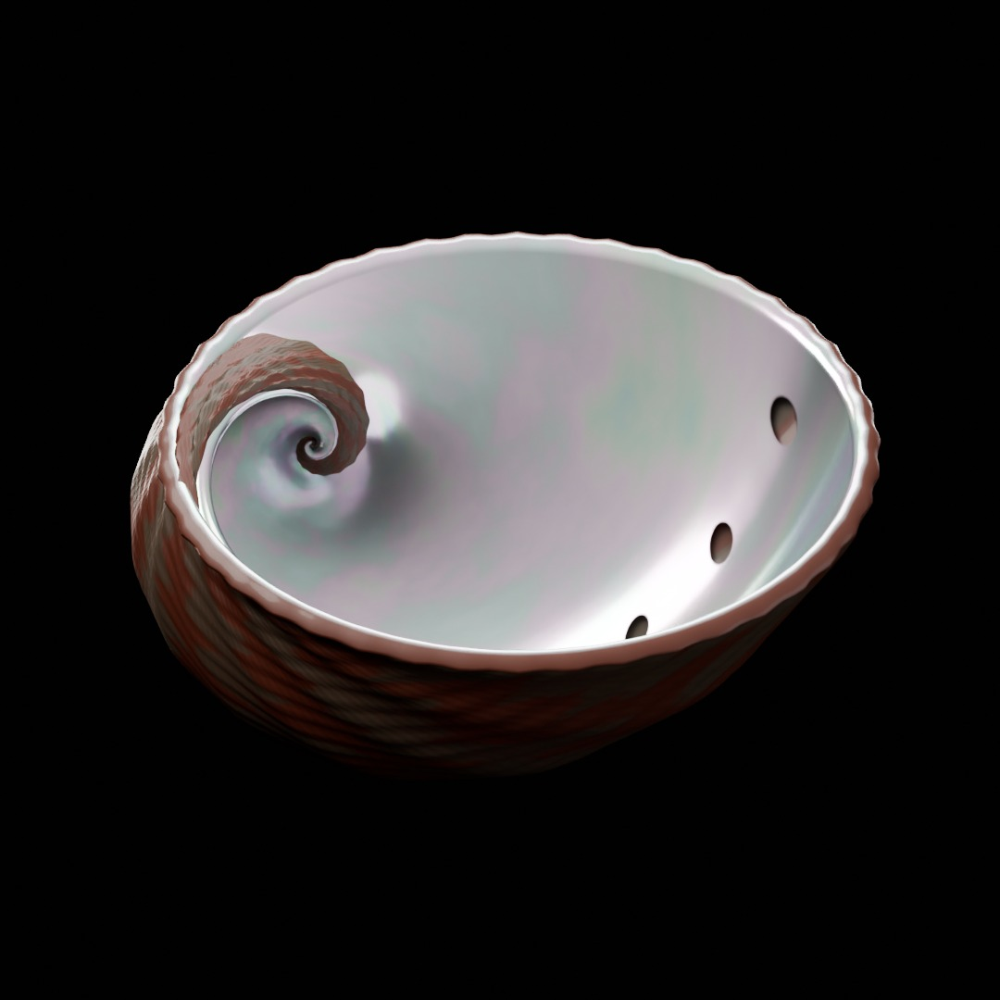

| File | What it is |
|---|---|
| [`../loop.mp4`](../loop.mp4) | the video: 1080², 24 fps, 488 frames (20.3 s), Cycles 64 samples, denoised |
| [`../loop_hud.mp4`](../loop_hud.mp4) | the same with Raup's four numbers (W, D, T, S) read out in the corner |
| [`../render.png`](../render.png) | frame 488, the hero still: the abalone's nacre |
| [`../render-001.png`](../render-001.png) | frame 1, the chambered nautilus |
| [`../nodes/`](../nodes/) | full screenshots of the main tree, `PA_Aperture`, `PA_Spines` and the material `PA_Shell` |

The scene lives in a file (`piece.blend`: **PA_Shell** with the modifier `PA_Nodes` and the tree `PA_Shell_GN`,
five area lights and the camera) that two Python scripts build: `build.py` writes every node group, the material,
the stage and the eight kinds (`PRESETS`), and `sweep.py` keys the sliders from one kind to the next. Neither is
published. Every node is in the screenshots below, and the text names those scripts where a value lives in them.

---

## The one idea

> **Every shell is one curve, grown, turned and slid.** Take a closed curve (the aperture, the shell's mouth),
> sweep it round an axis, and on every turn make it W times larger, keep it a set share D away from the axis, slide it
> T times as far down the axis as it moves out, and keep its own shape S. David Raup showed in 1966 that these four
> numbers place almost every coiled shell in nature, from the nautilus to the tower shell, and that a cockle's valve is
> the same thing with a W so large that it barely makes one turn.

So the generator is one similarity applied to one tube: a point that sits `θ` radians back from the aperture is
scaled by W^(θ/2π) and turned by θ about the axis. Everything else is bookkeeping around that idea:

- **Where on the shell is this vertex?** The tube's rows run from the apex to the aperture, over the lip and back;
  `PA_WhorlClock` turns a row number into θ, how far along (u), and outside or inside (1 · Tube, 2 · Whorl clock).
- **What does the mouth look like?** `PA_Aperture` draws the generating curve: an ellipse that can be squared at the
  shoulder, tapered, pulled into a siphonal canal and tilted (3 · Aperture).
- **Ribs and cords?** `PA_Sculpture` adds relief along and across the growth (4 · Sculpture).
- **How thick?** The wall goes out over the relief, rolls over the lip and comes back thinner (5 · Wall).
- **Where does the curve sit?** (1 + D)/2 out from the axis and T times that down it; the abalone leans it forward
  (6 · Place the curve). Then `PA_RaupCoil` scales and turns it (7 · Coil).
- **Pose, size, paint.** Every kind is turned to its best view and fitted to the same size, then the colour sliders
  are handed to the material, which draws flames, bands, tents, nacre and holes from the shell's own coordinates
  (9 · Pose, 10 · Paint, Appendix B).

### How to read the screenshots

- Each coloured frame is one section of a tree. The main tree's sections are numbered (`2 · Whorl clock`); sections
  inside a node group are lettered (`b · Over the lip`).
- A **cut-out** shows one section on its own. Wires from another section enter through a Group Input socket named
  after what they carry (`aperture curve (lip flared)`, `relief`); wires that leave exit through a Group Output
  socket. `WhorlClock › θ` means the output θ of the `PA_WhorlClock` group node.
- Each section of the main tree has its own Group Input (titled `sliders`), showing only the sliders that section uses.
- Four tiny formulas are node groups so they read as one node: `PA_Clamp` (min(max(x, lo), hi)), `PA_Smoothstep`
  (t²(3 − 2t) of the clamped ramp between from and to), `PA_Mix` (a + (b − a)·t) and `PA_Crest` (((1 + cos x)/2) to
  the power sharpness: one rib per 2π, soft at 1, a thin blade at 10).
- The geometry hands data to the material as **named attributes**: `s_turn` (θ/2π, whorls back from the aperture),
  `s_round` (0 … 1 round the aperture), `s_wall` (0 outside, 1 inside), `s_u` and `s_v` (distances along and round,
  for the tent pattern) and one `p_…` attribute per colour slider.
- **Angles.** θ is the coiling angle: 0 at the aperture, −2π one whorl back. φ is the angle round the aperture:
  π on the axis side (where the ring's seam is), 0 on the far side, π/2 at the top (towards the apex).
- **Units.** The shell is built at "aperture outer edge = 1" and fitted to `Size` (0.2 m) at the end, so every
  number before 9 · Pose is a fraction of the aperture.

Click any screenshot to see it full size.

---

## 0 · The map

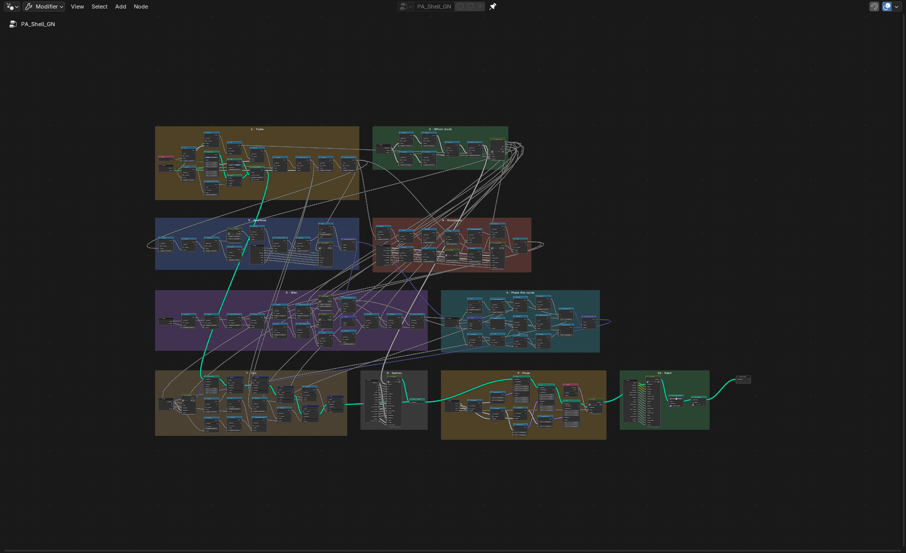

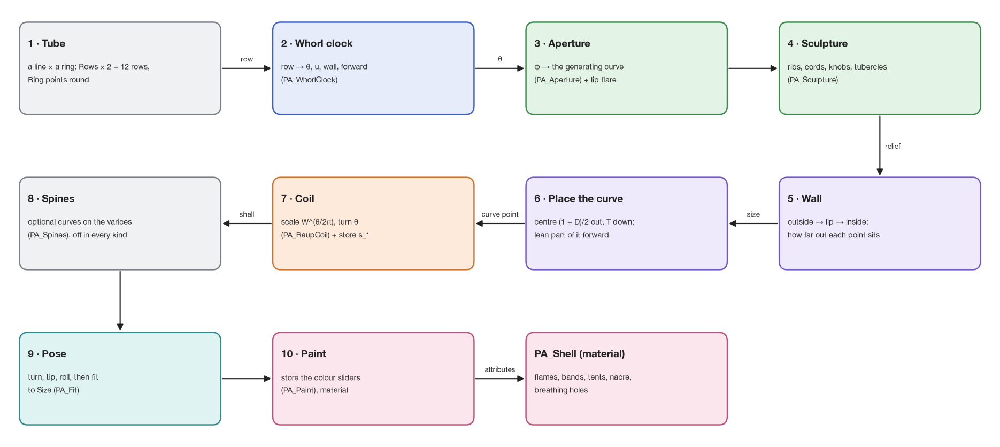

| # | Section | Nodes | Job |
|---|---|---|---|
| 1 | Tube | 15 | a line × a ring: one row per step along the shell, `Ring` points round; row and φ from the index |
| 2 | Whorl clock | 7 | how many whorls; row → θ, u, wall, forward (`PA_WhorlClock`) |
| 3 | Aperture | 11 | φ → the generating curve (`PA_Aperture`); the conch's lip flares in the last quarter whorl |
| 4 | Sculpture | 12 | ribs, cords and knobs (`PA_Sculpture`), and a tubercle under each breathing hole |
| 5 | Wall | 17 | outside with the relief, inside thinner and smoother; how far the lip roll bulges |
| 6 | Place the curve | 15 | the curve's centre (1 + D)/2 out and T down; Lean turns part of its height forward |
| 7 | Coil | 15 | Raup's similarity (`PA_RaupCoil`); store the shell's own coordinates |
| 8 | Spines | 2 | optional spines on the varices (`PA_Spines`); off in all eight kinds |
| 9 | Pose | 11 | turn, tip and roll to the kind's view, then fit to `Size` (`PA_Fit`) |
| 10 | Paint | 3 | store every colour slider (`PA_Paint`), smooth shading, the material |

### The animation

`sweep.py` builds the scene with `build.py`, then keys every slider except `Rows`, `Ring` and `Hand` at the start
and end of each window: the nautilus to frame 30, then for each kind a 30-frame morph and a 26-frame hold. The
abalone arrives with `Tip` 90 (its outside up), holds, turns over to `Tip` −90 in 26 frames and holds for 40. Keys
are Bézier with auto-clamped handles, so each morph eases in and out and holds stay exactly still.

Two things make a plain slider morph work. The vertex count never changes (`Rows` and `Ring` are not keyed), so
there is nothing to pop. And `Expansion` stores log10 W, not W: the cockle's W is 63 and the tower shell's 1.17,
and a straight line in log10 W spreads that change evenly over the 30 frames instead of spending them all at the
large end.

---

## 1 · Tube

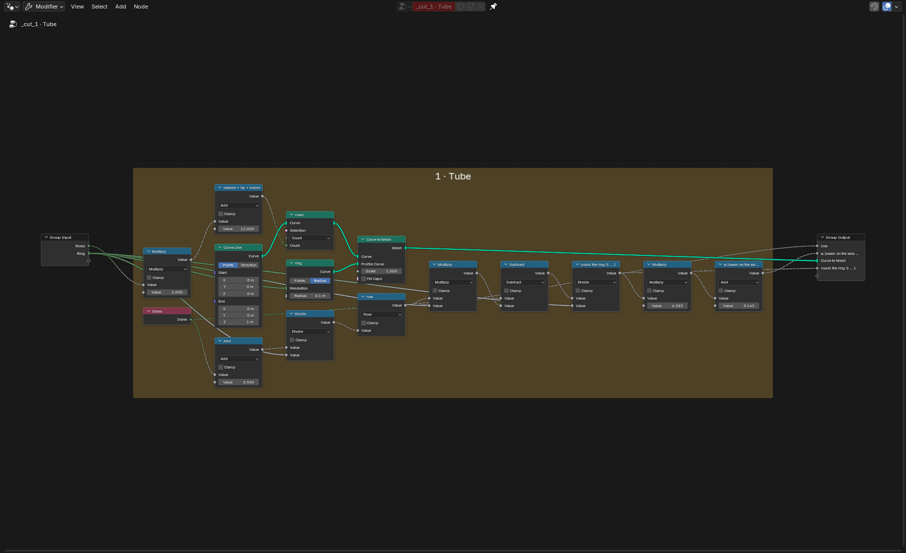

The shell is one tube, and every later section only moves its vertices. A Curve Line is resampled into
`Rows` × 2 + 12 points (`outside + lip + inside`: 1400 rows on the outside, 12 over the lip, 1400 back on the inside),
a Curve Circle with `Ring` points (160) is the profile, and Curve to Mesh sweeps one along the other: 2812 × 160 =
449 920 vertices. The line's and the circle's own shapes don't matter; every position is replaced in 7 · Coil.

| Node | What it does |
|---|---|
| `rows` | the line, resampled into one point per row |
| `ring` | the profile circle, `Ring` points |
| `row` | floor((index + 0.5) / Ring): which row this vertex is on |
| `round the ring 0 … 1` | (index − row × Ring) / Ring |
| `φ (seam on the axis side)` | that × 2π + π, so the ring's seam (where 0 meets 1) lies on the axis side, inside the coil, where it never shows |

### Trick · the index is the address

Curve to Mesh writes vertices row by row: vertex `index` sits at row × Ring + k. So the index alone says where a
vertex is on the shell, and no UV map, attribute or second geometry is needed. The rest of the tree is a function
of (row, φ) and the sliders.

> **Try it:** on the Turritella, set `Ring` to 6. The mouth at the foot becomes a hexagon and every whorl a
> six-sided band; smooth shading hides most of the facets, but the outline gives them away.

---

## 2 · Whorl clock

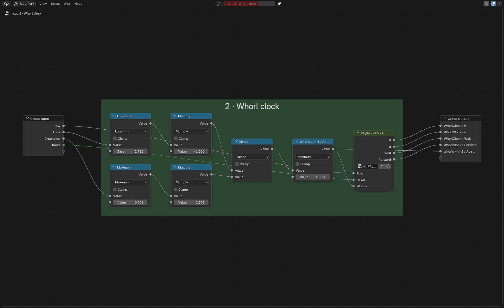

First, how many whorls the shell has. `Apex` is the size of the first whorl (the protoconch) as a share of the last,
and every whorl is W times the one before, so `whorls = ln(1 / Apex) / ln W` (capped at 45). The nautilus
(`Apex` 0.01, W 3.2) has about 4 whorls, the tower shell (0.03, W 1.17) about 22, the abalone (0.01, W 12) under 2,
and the cockle (W 63) only 1.1.

`PA_WhorlClock` turns the row number into four numbers:

| Output | Meaning |
|---|---|
| θ | the coiling angle: 0 at the aperture, −2π × whorls at the apex |
| u | 0 at the apex, 1 at the aperture, on both the outside and the inside rows |
| Wall | 0 on the outside, 1 on the inside, a half cosine over the lip |
| Forward | 0 on both walls, 1 at the crest of the lip |

### Inside `PA_WhorlClock`

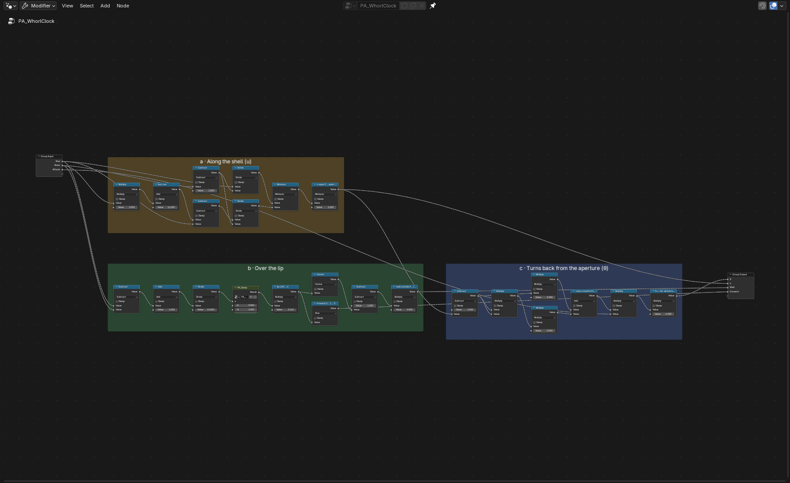

**a · Along the shell (u).** Rows 0 … 1399 are the outside, apex to aperture: u = row / 1399. The inside rows run
back, aperture to apex: u = (`last row` − row) / 1399. Taking the smaller of the two (and at most 1) gives one u
for both walls, so a point on the outside and the point under it on the inside share θ.

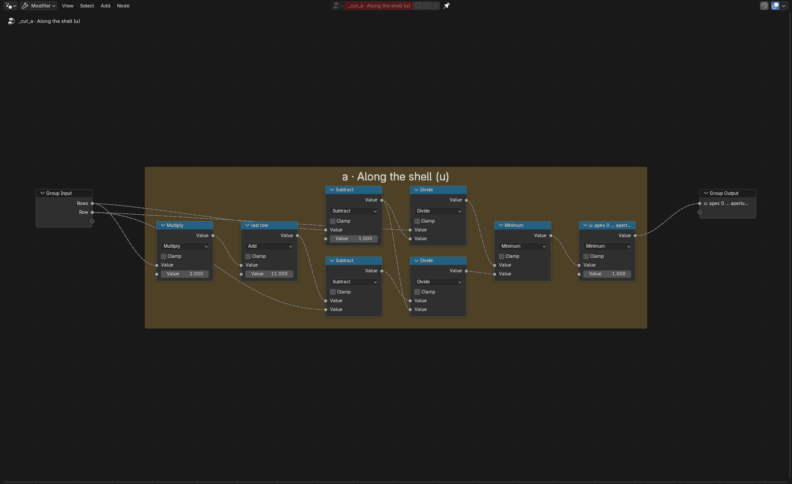

**b · Over the lip.** The 12 lip rows (and one row on each side) get `lip roll 0 … π`; the wall share is
(1 − cos α)/2, which goes 0 → 1 smoothly, and `forward: 0 … 1 … 0` is sin α. In 5 · Wall these turn the 12 rows
into a half circle as thick as the wall: the shell's rim is rounded, not a cut edge.

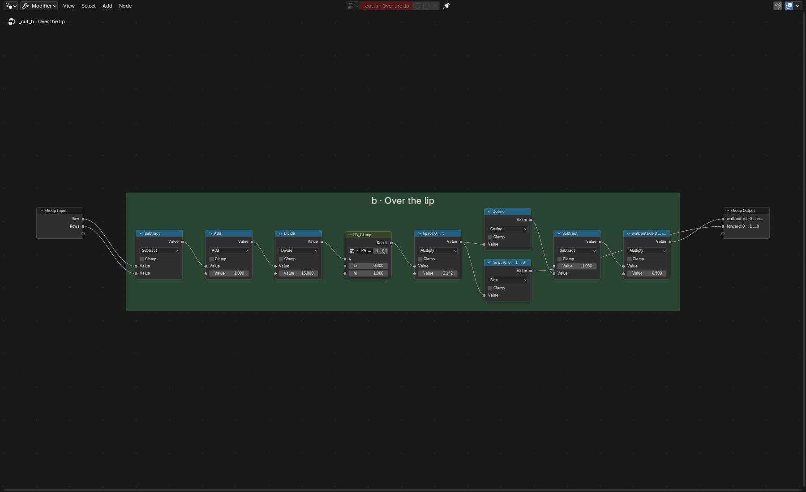

**c · Turns back from the aperture (θ).** θ = −2π × whorls × (1 − u) would spread the rows evenly over the whorls.
But the whorls near the apex are tiny (the first is 1 % of the last) and the last is large, so `rows crowd to the aperture`: q = 1 − u is warped to 0.45·q + 0.55·q² (`BIAS` 0.55), which puts more rows where the shell is big.

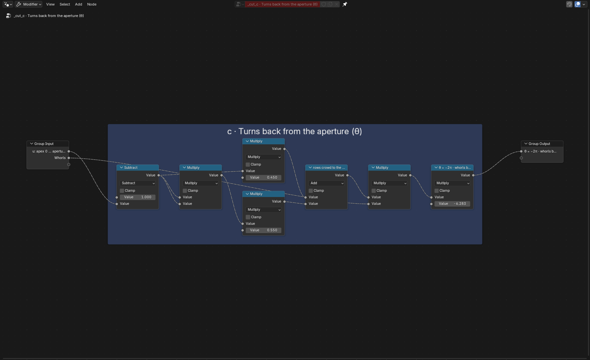

### Trick · one closed wall

Most shell generators sweep a thin surface. This one runs the outside out to the aperture, rolls 12 rows over the
lip and runs the inside back to the apex, so the shell is one welded, closed wall with a real thickness (`Wall`, a
share of the aperture). Because the inside rows share θ with the outside, everything later (sculpture, colour) is
the same function on both walls, with a switch for which wall it is.

> **Try it:** on the Turritella, set `Apex` from 0.03 to 0.3. The first whorl is now 30 % of the last, so the
> shell has ln(1/0.3)/ln(1.17) ≈ 7.7 whorls instead of 22: a short, blunt tower. (On the nautilus the same change
> hides itself: its inner whorls are wrapped inside the last one.)

---

## 3 · Aperture

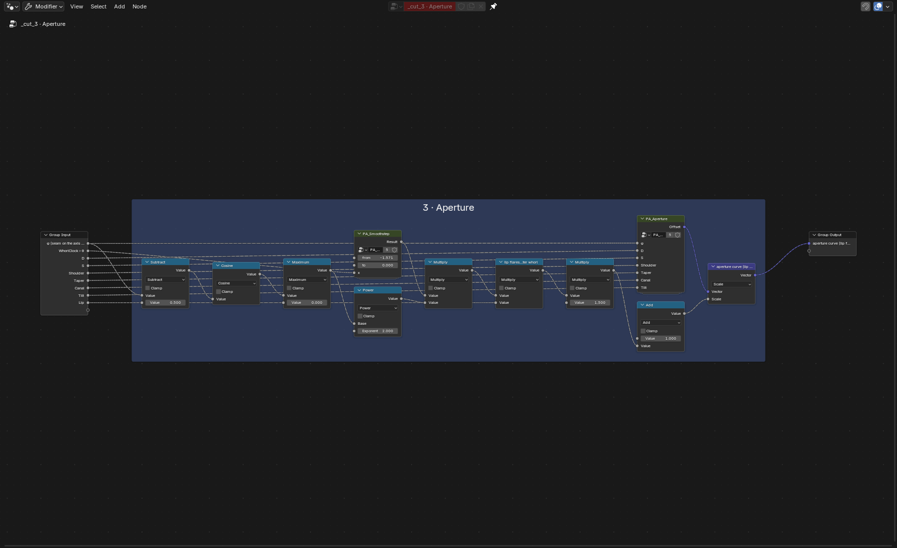

The aperture is drawn in the plane through the coiling axis: x away from the axis, y along it (up = towards the
apex). `PA_Aperture` takes φ and returns that point, centred on 0; 6 · Place the curve moves it out from the axis.

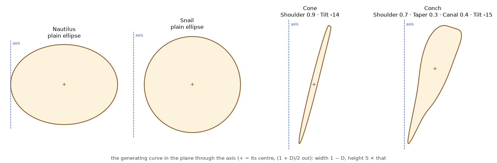

### Inside `PA_Aperture`

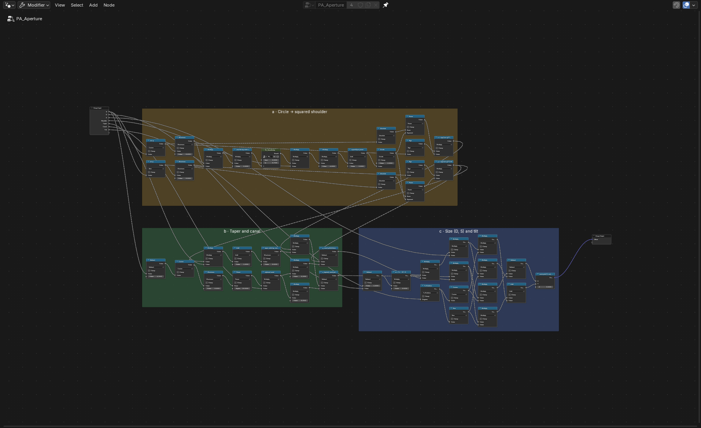

**a · Circle → squared shoulder.** Start from the circle (cos φ, sin φ). A superellipse |x|ⁿ + |y|ⁿ = 1 is the
circle at n = 2 and a square as n grows; drawn from φ it is x = sign(cos φ)·|cos φ|^(2/n), the same for y. The
power is 2 everywhere except `near the top outer corner` (where both cos φ and sin φ are positive), where
`superellipse power` rises to 2 + 6 × `Shoulder`. So only the shoulder squares off, the way a cone or a conch has a
sharp shoulder over a rounded body.

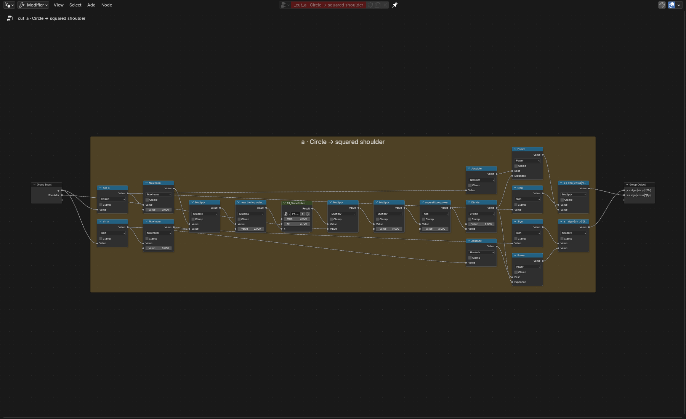

**b · Taper and canal.** `taper: wide top, narrow foot` multiplies x by 1 + y × `Taper` (never below 0.02), so the
curve is a wedge, wide at the shoulder and narrow at the foot. The `siphonal canal` is a spike: max(cos(φ −
`CANAL_PHI`), 0)^10, which is 1 at one φ (pointing down and a little in) and dies within about ±0.7 rad. It pulls
those points down by 2.2 × `Canal` and in by 0.35 × `Canal`: the groove a whelk or conch puts its siphon through.

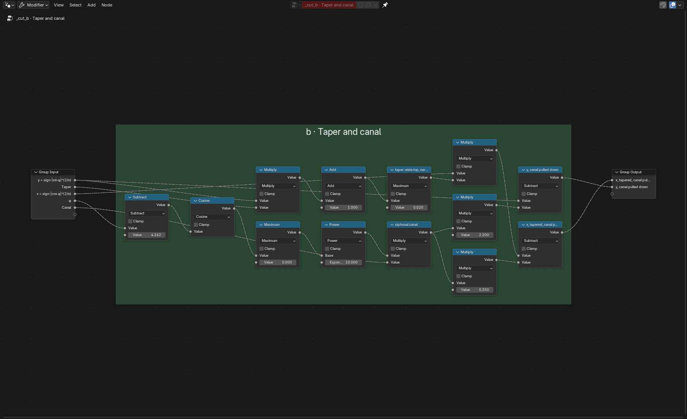

**c · Size (D, S) and tilt.** Raup's D is the inner edge's distance from the axis as a share of the outer edge's. With
the outer edge at 1 and the inner at D, the curve is 1 − D wide, so its half-width is `a = (1 − D) / 2`. S is the
height / width, so y is scaled by a × S. Finally the curve turns by `Tilt` degrees in its plane: the cone's long slit
leans 14° and the conch's 15°.

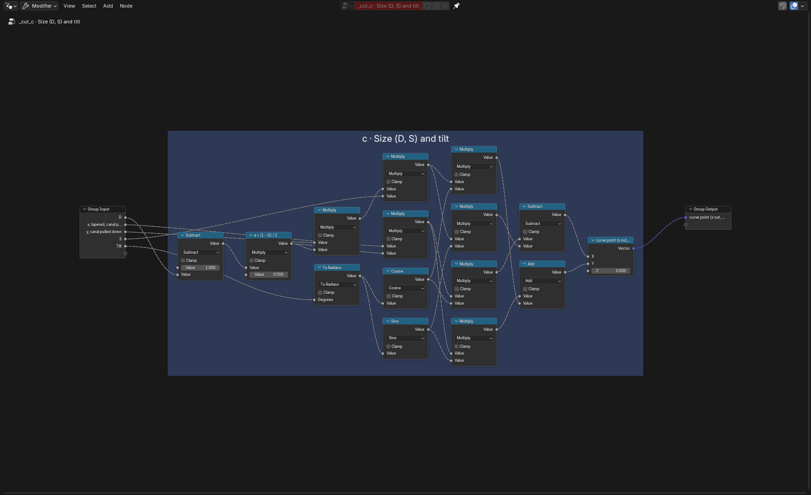

Back in the main tree, `lip flares in the last quarter whorl` is smoothstep(−π/2, 0, θ) × max(cos(φ − 0.5), 0)² ×
`Lip`: zero until the last quarter whorl, strongest on the outer upper side. The curve is scaled by 1 + 1.5 × that:
the conch's grown-up lip.

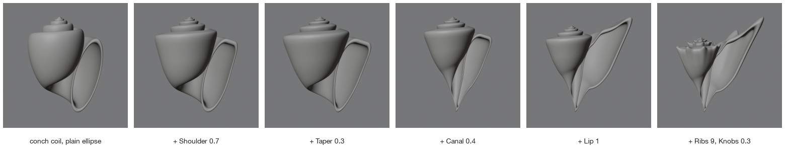

> **Try it:** on the Conch, set `Canal` from 0.4 to 1.5. The foot of the aperture draws out into a long, twisted
> siphonal canal, as on a whelk or a spindle shell.

---

## 4 · Sculpture

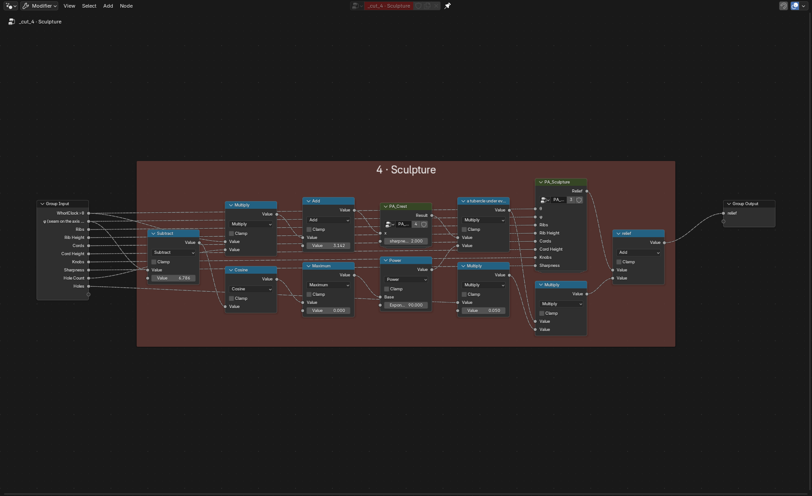

Sculpture is one number, `relief`, that pushes the wall out along the curve (5 · Wall scales the curve by 1 +
relief). `PA_Sculpture` adds three kinds:

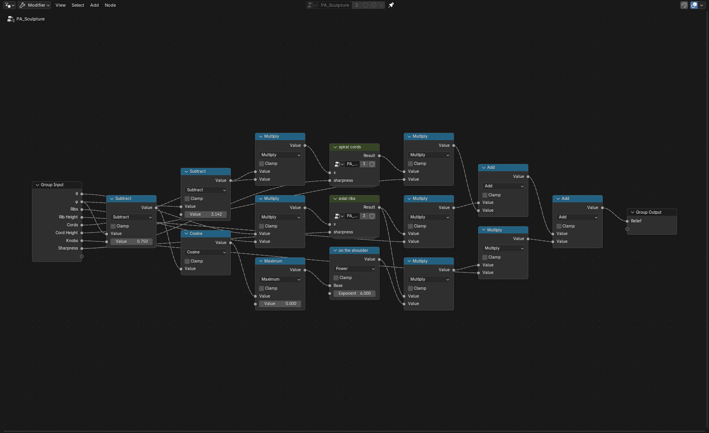

| Label | Formula | What it is |
|---|---|---|
| `axial ribs` | crest(θ × `Ribs`) × `Rib Height` | ribs across the growth, `Ribs` per whorl (the ammonite's 34, the conch's 9) |
| `spiral cords` | crest((φ − π) × `Cords`) × `Cord Height` | ridges along the growth, `Cords` round the aperture (the tower shell's 16, the cockle's 26 radial ribs) |
| `on the shoulder` × ribs | ribs × max(cos(φ − 0.75), 0)^6 × `Knobs` | knobs where each rib crosses the shoulder (the conch) |

`Sharpness` is crest's power: 1 is soft waves, 3 rounded ribs, 10 thin blades, for both ribs and cords. Since θ
runs whorls back and the coil scales everything by W^(θ/2π), a rib per 2π/`Ribs` of θ is automatically small at the
apex and big at the aperture, the way real ribs grow.

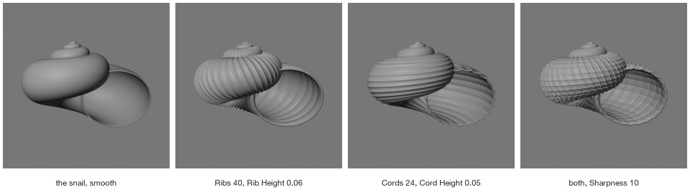

The main tree adds one more: `a tubercle under every breathing hole`. An abalone's holes are made at the lip one at
a time; the old ones are sealed but stay as a row of bumps. The tubercle is a crest of θ × `Hole Count` (one per
hole, shifted by π so it is centred under the hole) times a very narrow band of φ (power 90) at `HOLE_ROUND` 0.58
round the aperture, × 0.05 × `Holes`. The material cuts the holes at the same θ and φ (Appendix B).

> **Try it:** on the Snail, set `Ribs` 3, `Rib Height` 0.3, `Sharpness` 12. Three swollen ridges per whorl:
> varices, the thickened lips many snails leave behind each time they pause growing.

---

## 5 · Wall

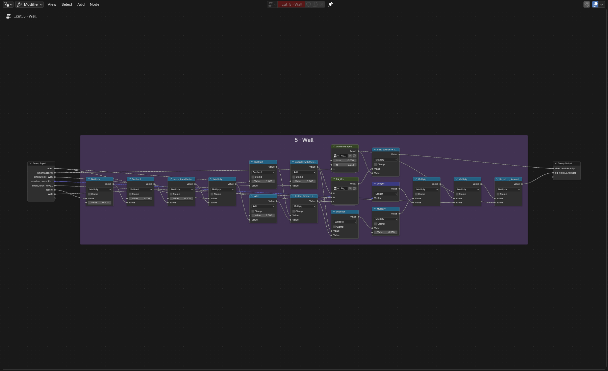

Each point of the curve sits at the aperture curve × a size. This section finds that size for the outside, the lip
and the inside.

| Label | Value | Why |
|---|---|---|
| `outside: with the relief` | 1 + relief | the outside carries the full sculpture |
| `inside: thinner, half the relief (less under nacre)` | (1 − `Wall`) × (1 + relief × `nacre lines the inside smooth`) | the inner surface is `Wall` thinner and follows the ribs only half as much |
| `nacre lines the inside smooth` | 0.5 × (1 − 0.9 × `Nacre`) | mother-of-pearl is laid down in thin flat sheets that fill the sculpture: under full nacre the inside keeps a tenth of the relief |
| `close the apex` | smoothstep(0, 0.015, u) | shrinks the first 1.5 % of the way along to nothing, so the tube is closed at the apex instead of open |
| `size: outside → lip → inside` | mix(outside, inside, wall share) × pinch | along the lip roll the size slides from the outer to the inner wall |
| `lip roll: half the wall, forward` | (outside − inside)/2 × the curve point's distance from its centre × Forward × pinch | pushes the lip rows forward (along the growth) by half the wall thickness, so the rim is a half round |

### Trick · a colour slider that shapes the wall

Without it, the abalone's nacre shows a fine all-over corrugation: half of the outer ribs and cords come through on
the inside. Real mother-of-pearl is laid in flat sheets over the sculpture and hides it. `Nacre` is a paint slider,
but nothing stops the geometry from reading it too: under full nacre the inside keeps a tenth of the relief, and the
material leaves out the growth-line bump there (Appendix B, f). Shells without nacre (`Nacre` 0) keep half the
relief inside.

---

## 6 · Place the curve

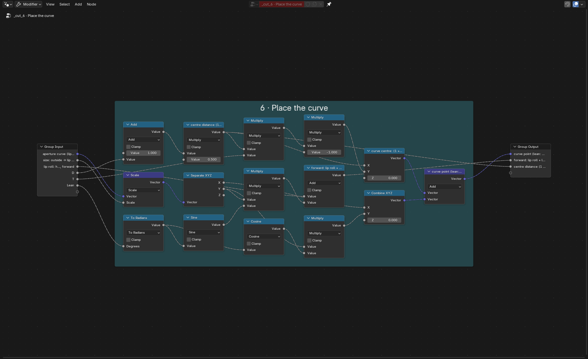

The curve is centred `(1 + D)/2` out from the axis (its inner edge at D, its outer edge at 1) and slid along the
axis: `curve centre: (1 + D)/2 out, T × that down`. That is Raup's T, the slide down the axis per unit of movement
away from it. 0 is a flat coil, a few is a snail, 12 is a tower shell.

Then `curve point (lean: part of its height turns forward)`: the curve's y (its height along the axis) is split by
`Lean`. cos(Lean) of it stays along the axis; sin(Lean) of it is added to `forward: lip roll + lean`, which the
coil applies along the direction of growth. A leaned aperture faces down instead of sideways, which is the one
thing the four Raup numbers can't do and an abalone or a limpet needs.

The four numbers, one at a time, starting from the nautilus (T on a looser coil, W 2.2 and D 0.1, so the spire shows):

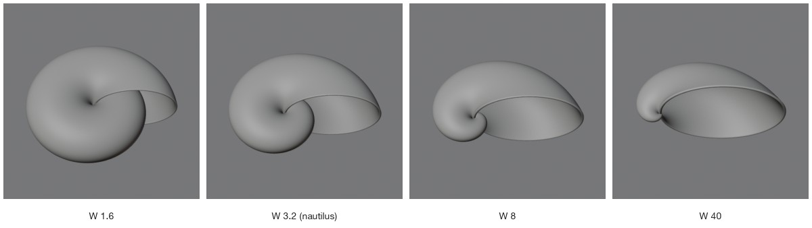

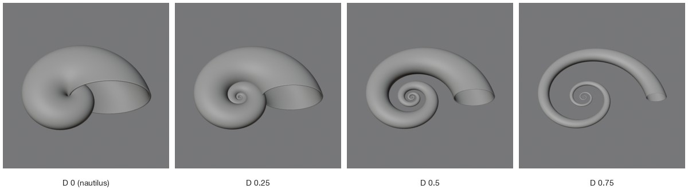

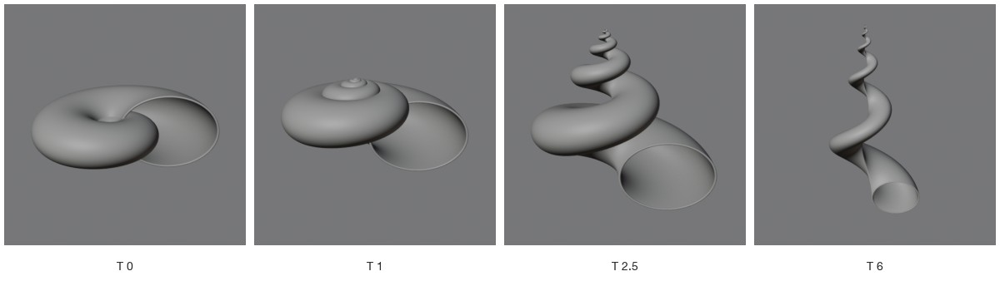

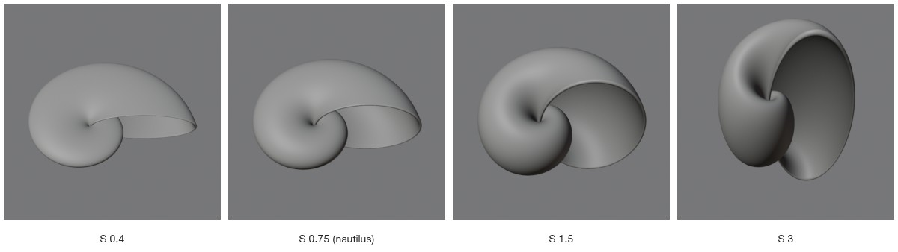

### Trick · an abalone is past the axis

An abalone is an ear-shaped dome with a small spire tucked inside its outline, near one end. Lean alone makes it
face down, but with D ≥ 0 the aperture stops at the axis, so the spire ends up on the rim of the dome, and a very
large W flattens the whole shell into a sheet. The spire sits inside the outline only if the aperture reaches past
the coiling axis, so the `D` slider goes below 0 (the abalone uses −0.24: its inner edge is a quarter of the way past
the axis), with `Lean` 58 and a moderate W of 12, which keeps the dome.

> **Try it:** on the Abalone, set `Lean` to 0. The aperture faces sideways again: a wide open bowl with the spire
> curled at one side.

---

## 7 · Coil

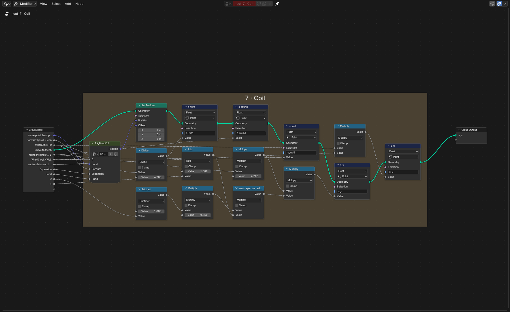

`PA_RaupCoil` is the whole of Raup's model in one small group:

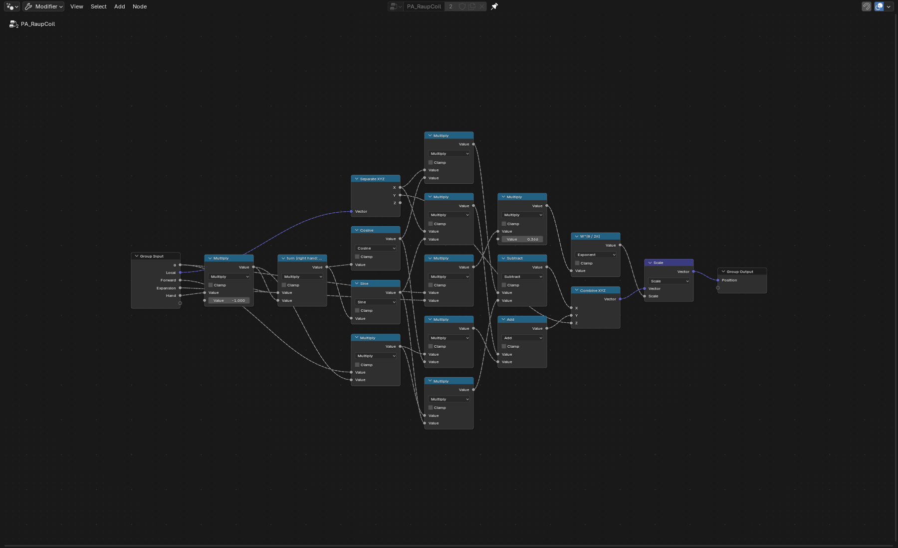

- `W^(θ / 2π)` = exp(θ × `Expansion` × ln 10 / 2π): 1 at the aperture, 1/W one whorl back, 1/W² two whorls back.
- `turn (right hand: clockwise from the apex)`: the curve's x (out from the axis) and its forward offset are turned
  by θ × −`Hand` about the axis; `Hand` −1 mirrors the coil (a left-handed shell).
- The curve's y becomes the height along the axis.
- All three are multiplied by the growth factor.

Then Set Position moves the tube's vertices there, and five attributes are stored for the material: `s_turn`
(θ / 2π), `s_round` (round the ring), `s_wall`, and `s_u` = θ × (1 + D)/2 and `s_v` = round × 2π × `mean aperture radius (1 − D)(1 + S) / 4`, rough distances along and round the shell for the tent pattern.

### Trick · the whole shell is one similarity

Scale and turn are applied to the curve point *with* its relief and wall offset, so every rib, cord, knob and the
wall thickness grow with the shell at W^(θ/2π). That is a logarithmic spiral, and it is why the shell looks the same
at every size: there is no list of whorls, only one formula evaluated at each θ.

> **Try it:** set `Hand` to −1. The snail and the tower shell turn left-handed (sinistral), as the few species
> that coil that way as a rule do, such as the lightning whelk; the flat nautilus only looks mirrored.

---

## 8 · Spines

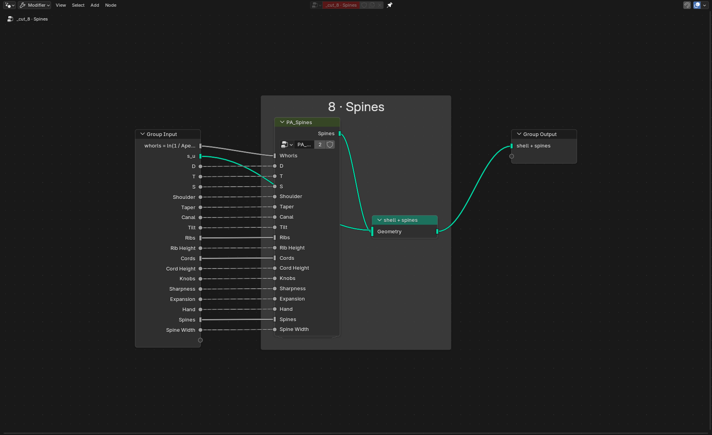

The generator can grow spines where the ribs (varices) cross the cords. They are off in all eight kinds: with
`Spines` at 0 the group makes no points at all and costs nothing. It is a separate group so the main tree stays
readable.

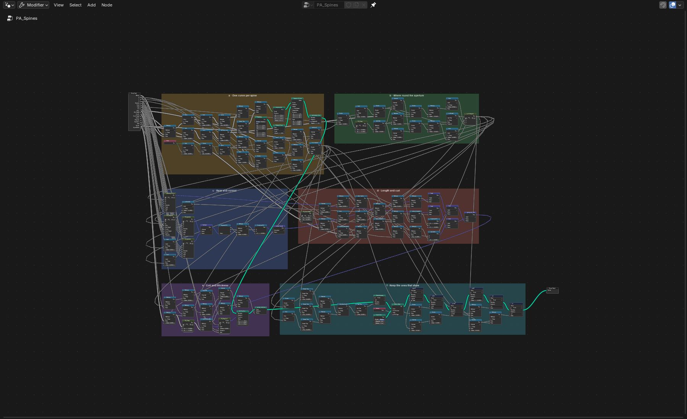

- **a · One curve per spine.** `spines per varix` = round(`Cords`), `varices` = floor(whorls × `Ribs`) + 1 (at most
  60). One point per spine, each instanced with a 10-point line (`spine curves, all at the origin`); from the index:
  `which cord`, `θ of the varix` and `base 0 … tip 1`.
- **b · Where round the aperture.** Each varix's spines are spread round φ, but a `canal share` of them (up to 45 %,
  from `Canal`) goes on the siphonal canal, which is a narrow band of φ but a long stretch of shell.
- **c · Base and normal.** The same `PA_Aperture` and `PA_Sculpture` give the base point on the relief; two more
  copies at φ ± 0.01 give the curve's tangent and so its `outward normal`.
- **d · Length and curl.** Length `Spines` × whorl radius × `older spines shorter` (0.3 at 1.2 whorls back, 1 from 0.2 whorls back);
  each spine goes out along the normal and `curls up towards the apex` (0.45 × length × along²).
- **e · Coil and thickness.** The same `PA_RaupCoil` coils it, so a spine sits where its varix is; its radius is
  `Spine Width` × whorl radius × the growth, tapering to a tenth at the tip.
- **f · Keep the ones that show.** Spines on the hidden side of older whorls are deleted
  (`only where the whorl shows`), then Curve to Mesh with filled caps; the spines carry `s_spine` so `PA_Fit` can leave them out.

> **Try it:** on the Cone, set `Ribs` 3, `Cords` 12, `Spines` 1.2. Rows of spines stand out of the cone along
> three varices a whorl, square to its surface, longest near the lip.

---

## 9 · Pose

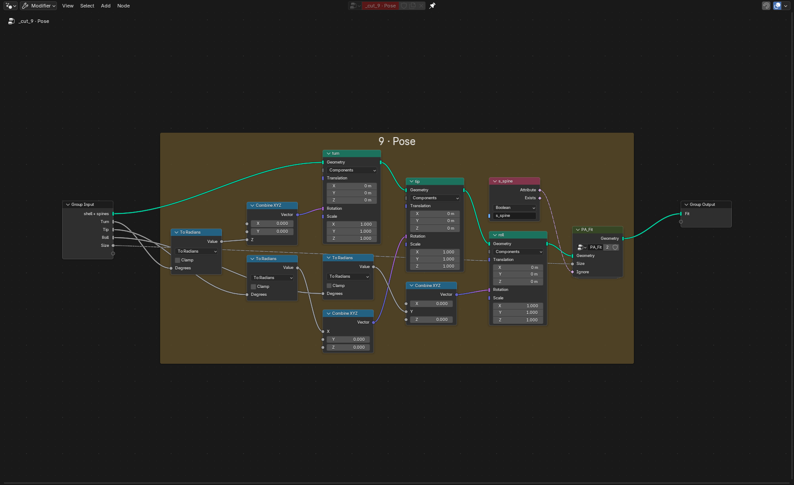

Each kind is shown from the view that reads best: the nautilus and the ammonite from the side of the coil (`Tip`
90: the axis points at the camera), the spired shells nearly upright (`Tip` 8), the cockle as a valve seen from
outside (`Tip` 0, `Turn` 180, `Roll` −90), the abalone from inside (`Tip` −90). Three Transform nodes apply `Turn`
(about the coiling axis), `Tip` (towards the camera) and `Roll` (in the picture), in that order.

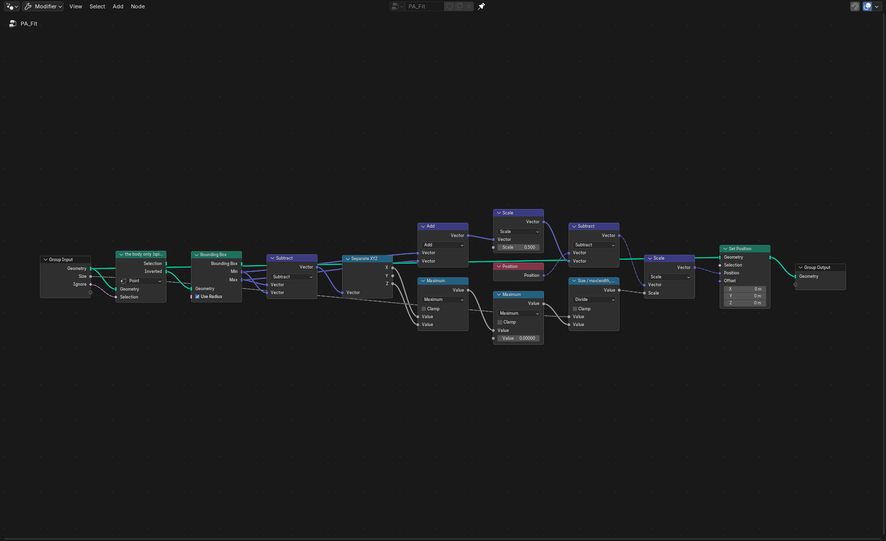

`PA_Fit` then centres the shell and scales it so the larger of its width and height, as the camera sees them, is
`Size` (0.2 m): `Size / max(width, height)`. A tower shell of 22 whorls and a cockle of about one fill
the frame the same way, so a morph between them never zooms. It measures `the body only (spines may reach out of the frame)`, so the shell would hold still while spines grow.

> **Try it:** on the Snail, set `Turn` to 90. The shell turns a quarter about its own axis and the aperture swings
> round to the back; `PA_Fit` re-centres and re-sizes it, so it stays in frame.

---

## 10 · Paint

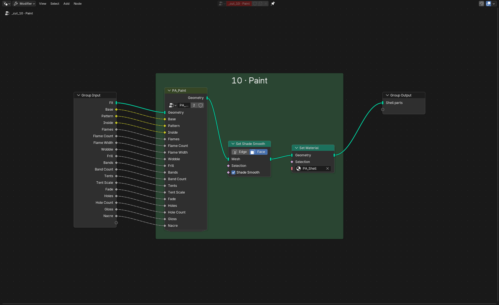

`PA_Paint` stores each colour slider (`Base`, `Pattern`, `Inside`, `Flames`, … `Nacre`) as a point attribute
named `p_` + the slider in lower case. The material reads them back with Attribute nodes. Keying a colour slider
then animates the material too, so the morph changes colour with shape, and the pattern belongs to the geometry
node's preset, not to a separate material per kind.

---

## Appendix A · The kinds

Coiling and aperture numbers after Raup (1966) and real specimens, tuned by eye against photos (`PRESETS` in
`build.py`; anything not listed is the nautilus default).

| Kind | W | D | T | S | Also |
|---|---|---|---|---|---|
| Chambered nautilus | 3.2 | 0 | 0 | 0.75 | flames that `Fade` over 0.45 whorl before the aperture |
| Ammonite | 1.9 | 0.42 | 0 | 0.95 | 34 ribs; thin frilled flames (`Flame Width` 0.035, `Frill` 9): suture lines; chalky (`Gloss` 0.1) |
| Garden snail | 2.2 | 0.1 | 1.4 | 1.0 | `Lean` 25; 5 bands |
| Tower shell | 1.17 | 0.04 | 12 | 1.05 | `Apex` 0.03; 16 cords |
| Textile cone | 1.3 | 0.773 | 2.9 | 19 | `Shoulder` 0.9, `Tilt` −14; tents (`Tent Scale` 5); glossy (0.9) |
| Conch | 1.8 | 0.35 | 2.2 | 3 | `Shoulder` 0.7, `Taper` 0.3, `Canal` 0.4, `Tilt` −15, `Lip` 1, 9 ribs, `Knobs` 0.3; pink inside |
| Cockle | 63 | 0 | 0.3 | 1.0 | 26 radial ribs (cords); about one whorl |
| Abalone | 12 | −0.24 | 0.6 | 0.72 | `Lean` 58; 22 holes; 16 ribs and 44 cords, smoothed inside; `Nacre` 1 |

A cone shell needs a low W and a tall, thin aperture: the gap between one whorl and the next is 1 − 1/W of the
radius, so a slit-like aperture means W close to 1 (here 1.3, 21 whorls). A bivalve sits at the other end: at W 63
its valve grows 63 times in a turn and stops after 1.1 whorls, which is why a cockle has no visible spire, only a
curled beak.

---

## Appendix B · The material (`PA_Shell`)

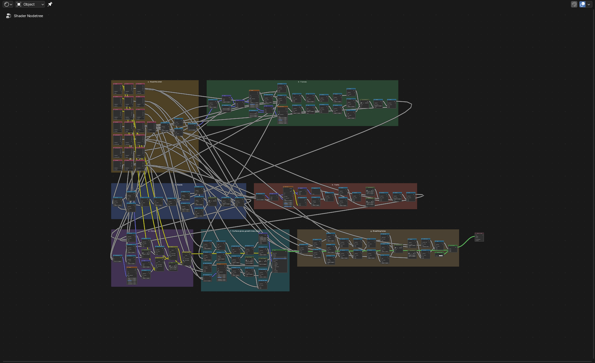

Every pattern is drawn in the shell's own coordinates, so it grows with it: a flame per 1/`Flame Count` of a whorl
is small near the apex and wide at the lip, as on a real shell, without any texture mapping.

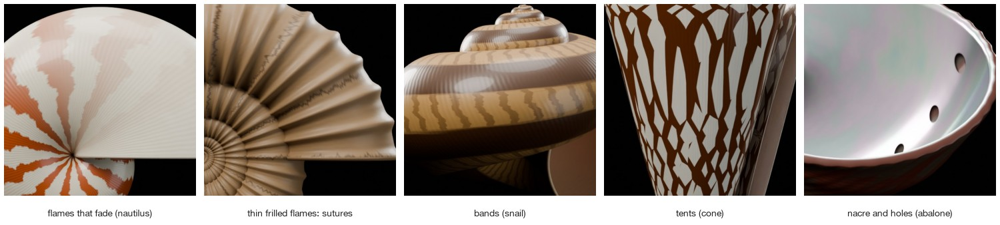

**a · Read the shell.** Attribute nodes for every `s_…` and `p_…` attribute, and `round the aperture as a circle (no seam)`: (cos φ, sin φ), so noise that wanders round the aperture meets itself at the seam.

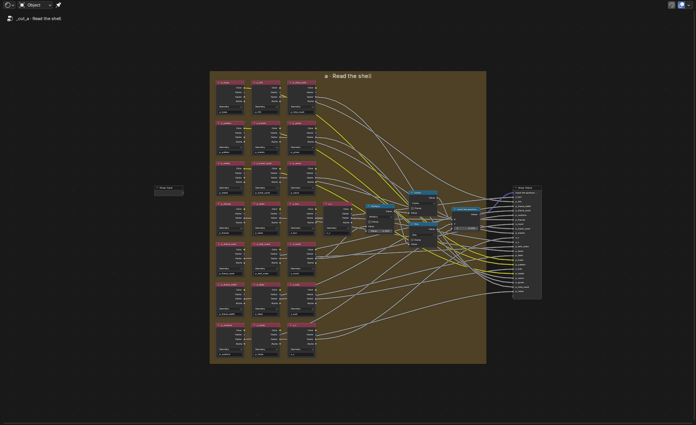

**b · Flames.** A stripe every 1/`Flame Count` of a whorl: stripe(x, w) is 1 within w/2 of a whole number. x is
`s_turn` × `Flame Count` plus `wander −0.5 … 0.5` (noise over the circle and `s_turn`, scale `Frill`) × `Wobble`, so
each flame zigzags round the aperture; `width varies` changes the flame width along it. With a tiny width and a high
`Frill` the same stripes become the ammonite's frilled sutures (where the inner walls met the shell).

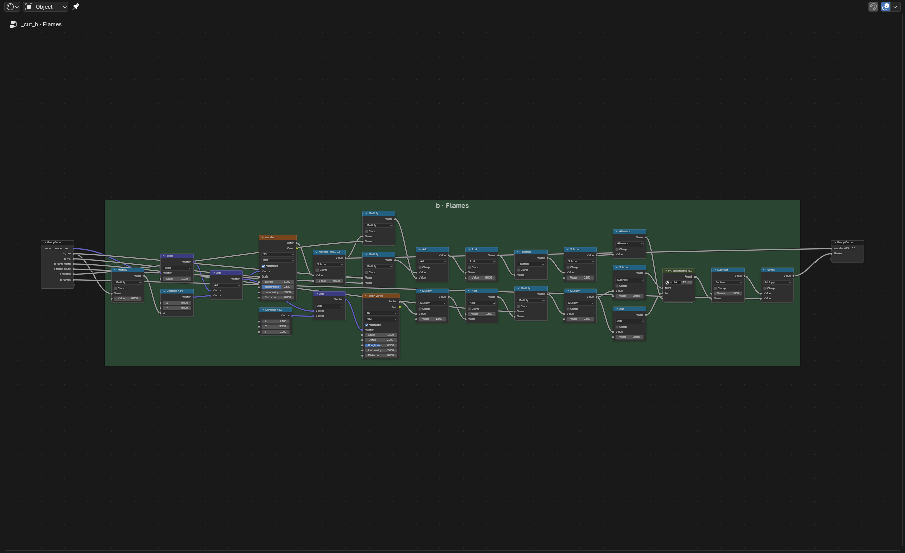

**c · Bands.** The same stripe round the aperture: `s_round` × `Band Count`, with a little of the same wander.

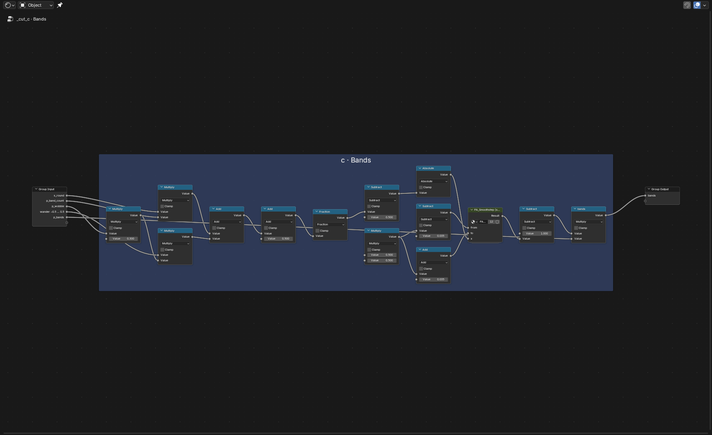

**d · Tents.** The textile cone's tents are triangles that open towards the lip. A 2D Voronoi over (`s_u`, `s_v`) ×
`Tent Scale` gives cells; inside each cell a triangle has its point on the aperture side of the cell's point and
widens back towards the apex (|dy| < 1.15 × (r × 0.5 − dx), with r the cell's random value, so each tent has its own
size). The triangles are the pale part; the rest is the pattern colour.

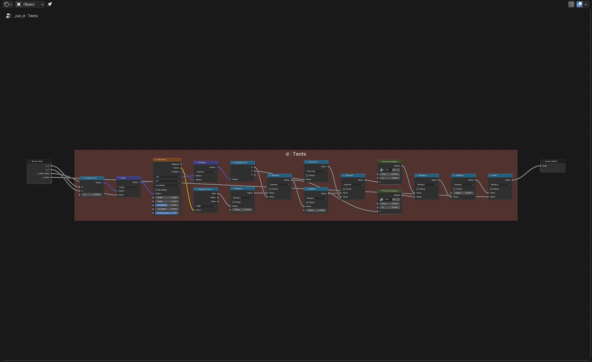

**e · Colour.** The pattern is the strongest of flames, bands and tents, faded over `Fade` whorls before the
aperture (the nautilus's last half whorl is plain cream, as on a real one). A low `mottle` noise darkens the base a
little; the inside (`s_wall` past half) takes `Inside`.

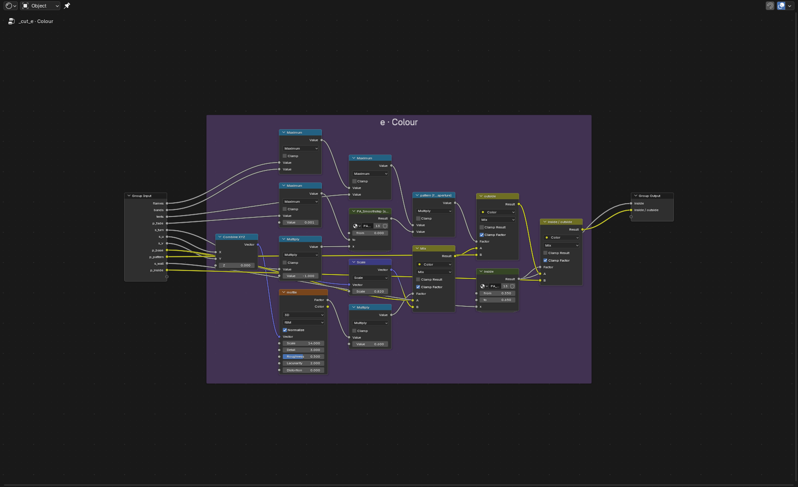

**f · Surface: gloss, growth lines, nacre.** `growth lines: 150 a whorl` are fine ridges as a bump (not on the
nacre). `Gloss` sets roughness 0.62 → 0.14 and a clear coat. `nacre (inside only)` turns the inside into a mostly
metallic surface (`nacre reflects like a metal: the film colours the reflection`) with a thin film 250 … 950 nm thick
that varies with a slow noise: the rainbow sheen of mother-of-pearl is interference in its thin layers, and a thin
film reproduces exactly that.

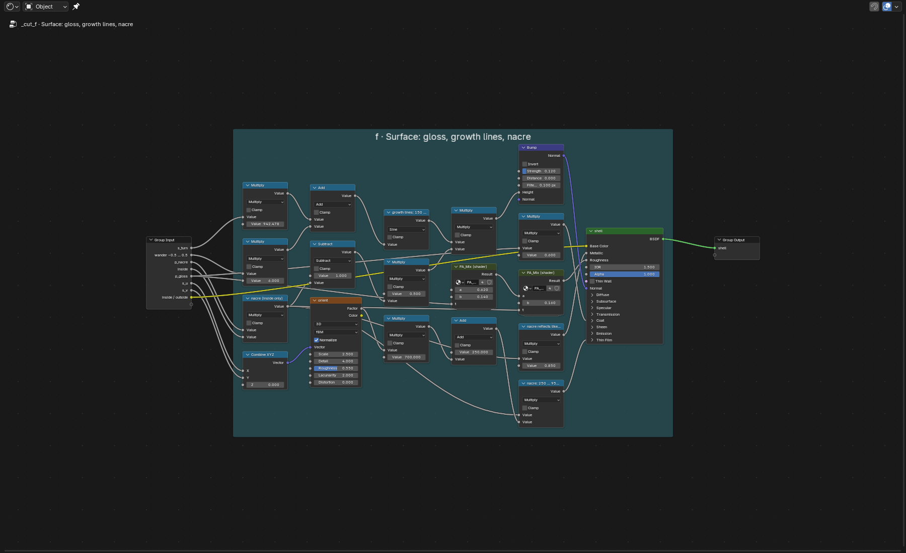

**g · Breathing holes.** `Hole Count` holes per whorl at `s_round` 0.58, each of radius `Holes` × 0.036 (in
whorl-angle units), and only over the last quarter whorl (`s_turn` > about −0.24): an abalone keeps only its newest few holes open and seals the
rest. `cut the holes` mixes in a Transparent BSDF there, so the holes are see-through without cutting the mesh; the
tubercles from 4 · Sculpture sit under every hole, open or sealed.

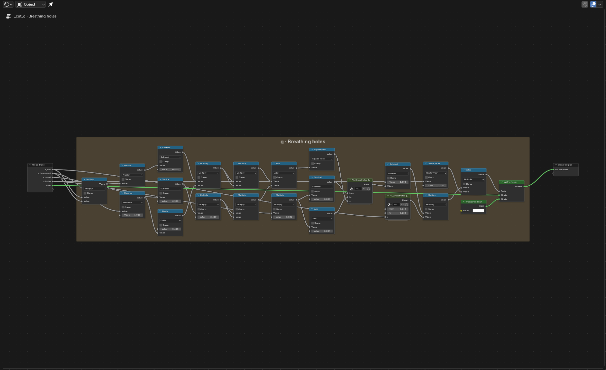

**The studio.** The world is black to the camera (`black backdrop`) but `seen only in reflections` is a soft dome
overhead and a broad card on the camera side, lit for glossy rays only: the glossy cone and the nacre need
something bright to reflect, and the backdrop stays black. Five area lights (key, fill, two rims, top), an 85 mm
camera 0.62 m away, AgX Medium High Contrast at −0.8 exposure.

---

## How it was rendered

Cycles, 1080², 64 samples, denoised, on a second PC with an RTX 4060 (OptiX, every frame on the same GPU): about
7 s a frame, an hour for the 488 frames. Each frame rebuilds the 449 920-vertex shell from its sliders.
The motion was first approved as a white-clay Workbench preview. Frames 360–488 were rendered again
after the inside of the abalone was made smooth (5 · Wall); the nacre is 0 until frame 366, so the earlier frames
were already final.

## Try it yourself

1. **Walk Raup's cube.** In your own build, on the Nautilus, change one of `Expansion`, `D`, `T`, `S` at a time and compare with the
   cut-away figure in 6 · Place the curve: `D` 0.5 opens the centre (an ammonite), `T` 2.5 slides it into an open
   spire, `Expansion` 1.6 (W 40) makes a limpet-like cap.
2. **A shell nobody has.** Raup found most of the W–D–T cube empty in nature. Try `Expansion` 0.3, `D` 0.6, `T` 4
   on the Nautilus: a loose corkscrew of tube, open between its whorls, that almost no living snail builds.
3. **Left-handed.** `Hand` −1 on the Conch: a sinistral conch, the colour pattern mirrored with it.
4. **Your own pattern.** On the Cone, set `Tents` 0, `Flames` 1, `Flame Count` 40, `Flame Width` 0.2, `Wobble` 2:
   a cone with thin wavy stripes from the spire to the foot instead of tents.
5. **A ninth kind.** In your own build, add a line to `PRESETS` in `build.py` (start from the Snail and change a few numbers), add its
   name to `KINDS` and a caption to `NOTES` in `sweep.py`: the animation gets one more 30-frame morph and 26-frame
   hold, and the frame range grows to match.

*Made with Blender 5.2 Geometry Nodes for [Nodevember](https://nodevember.com) 2026, Day 14 · Shell.*
