# How a pearl's lustre is built from 8 µm tablets

*A node-by-node walkthrough of Nodevember 2026 · Day 15 · Pearl*

The video (18 s, 432 frames) is one camera move. It starts on a whole 8 mm Tahitian pearl on a white sweep, dives
into its highlight past the fine wavy growth lines a loupe shows, down to the surface where the lustre comes from:
irregular aragonite tablets about 8 µm across and 0.45 µm thick, laid in layers like terraces, each layer a thin film
that tints the light green or rose. There the key light sweeps across the tablets while the camera circles, and then
the camera pulls back out to the whole pearl. One Geometry Nodes tree, `PA_Pearl_GN`, builds the pearl and the
tablets; one material, `PA_Pearl`, shades both. There is no image texture, no simulation and no modelled or imported
mesh (`pb.audit`: strictly procedural, no issues). Only the camera, the light rig and three values that follow the
zoom are keyed.

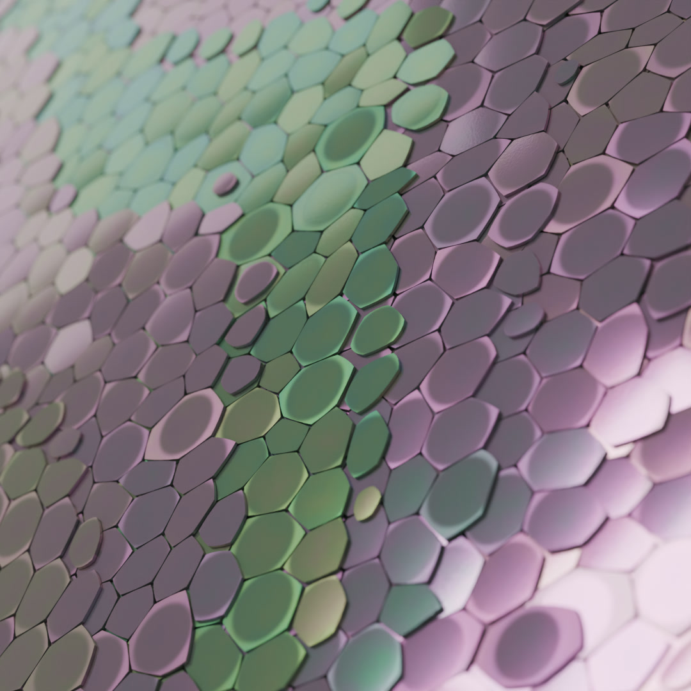

| File | What it is |
|---|---|
| [`../loop.mp4`](../loop.mp4) | the video: 1080², 24 fps, 432 frames (18 s), Cycles 128 samples + denoising |
| [`../render.png`](../render.png) | frame 200 at full size (the still above) |
| [`../render-060.png`](../render-060.png) | frame 60, the whole pearl before the dive |
| [`../nodes/`](../nodes/) | full screenshots of the main tree `PA_Pearl_GN`, the material `PA_Pearl` and the four helper groups |

The scene lives in a file (`piece.blend`: **PA_Pearl** with a Geometry Nodes modifier running `PA_Pearl_GN`,
**PA_Backdrop** with `PA_Backdrop_GN`, the lights in `PA_Studio` and the camera) that one Python script builds:
`build.py` writes every tree, the material, the lights, the camera move and the per-frame keys (`state()`). Neither
is published. Every node is in the screenshots below, and the text names `build.py` where a value lives in it.

Units: **1 Blender unit = 1 mm**. So 0.008 is 8 µm and 0.00045 is 0.45 µm (450 nm).

---

## The one idea

> **One growth height decides everything you see at every scale.** A pearl grows in layers, each one a sheet of
> tablets 0.45 µm thick. The layers are concentric with the pearl, but its surface is a few µm off that shape: a
> growth height h, a smooth field over the pearl. Wherever h crosses a whole number of layer thicknesses, a layer
> ends. That edge is a terrace step for the tablets, and seen from a millimetre away it is a growth line.

Everything else is bookkeeping around that idea:

- **Where are the layers?** `PA_GrowthHeight` gives h (two noise octaves, a few µm). Layer k exists where
  0 ≤ h / t − k < 3, so the top layer is ⌊h / t⌋ and two more lie under it (3 · One copy per layer, 4 · Which
  tablets exist).
- **What is a tablet?** One polygon of a jittered 60° lattice (Dual Mesh), copied once per layer and shifted, so the
  layers stack like bricks (2 · Tablet lattice, 3).
- **Why do the layers differ in colour?** Each layer is a thin film. `PA_LayerFilm` gives its thickness from the
  layer number. The same group runs in the tree (on the tablets) and in the material (on the whole pearl), so both
  agree (8 · A film per layer, 10 d).
- **How does a wide view show it without millions of tablets?** It doesn't build them. Wider than 1.2 mm the
  material draws the same terraces from the same h as a bump and a film (10 a, 10 d). The tablets exist only in a
  1.3 mm patch at the dive point and switch on as the camera passes 1.2 mm.

### How to read the screenshots

- Each coloured frame in the tree is one section of this page, numbered the same.
- The section pictures are **cut-outs**: the frame's nodes copied into a scratch group. Wires that come in from
  another section enter through the Group Input on the left, with the socket named after what they carry (a
  slider's name, or the label of the node that made it, such as `tablet cells`). Wires that leave go out through the
  Group Output on the right.
- In the file itself each frame has its own Group Input labelled `sliders`, showing only the sliders that section
  uses.
- Node labels (the coloured title bars) are quoted `like this`; node types are named in plain text.
- Click any screenshot for full size.

---

## 0 · The map

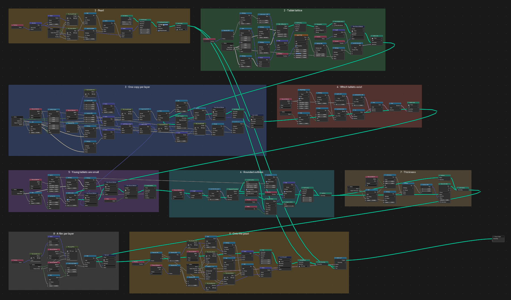

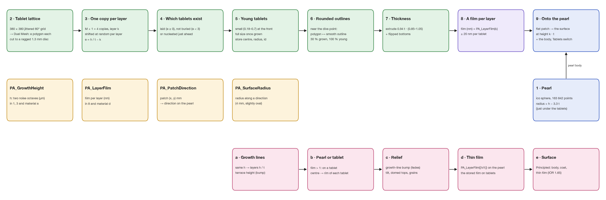

| # | Section | Nodes | Job |
|---|---|---|---|
| 1 | Pearl | 13 | the round body, 163 842 points, sunk just under the tablets |
| 2 | Tablet lattice | 24 | a jittered 60° lattice → one polygon per tablet, cut to a 1.3 mm patch |
| 3 | One copy per layer | 29 | four copies per tablet, each with a layer number k and a random shift |
| 4 | Which tablets exist | 12 | keep the copies whose layer is laid and not buried; a few young ones ahead |
| 5 | Young tablets are small | 12 | tablets near a layer's edge are still growing |
| 6 | Rounded outlines | 14 | near the dive point, blend each polygon with its smooth outline |
| 7 | Thickness | 9 | extrude to 0.45 µm (± a little), close the bottoms |
| 8 | A film per layer | 10 | the thin-film thickness (nm) each tablet's top shows |
| 9 | Onto the pearl | 23 | wrap the flat patch onto the pearl at height k · t; join the body |
| 10 | The material `PA_Pearl` | 68 | five frames a–e: growth lines, pearl or tablet, relief, thin film, surface |

The camera, the light and three keyed values follow the frame width at the dive point:

---

## 1 · Pearl

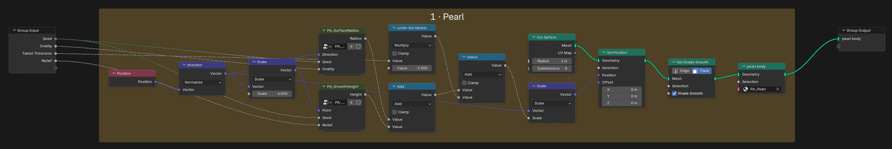

The body is an Ico Sphere of radius 1 with 8 subdivisions (163 842 points), each point pushed out along its own
`direction` to

> `radius` = PA_SurfaceRadius(direction) + h(direction · 4 mm) − (M + 0.3) · t

- **PA_SurfaceRadius** is 4 mm, made slightly oval by one slow noise: (1 + `Ovality` · n) · 4 mm, n in −1…1. With
  `Ovality` 0.006 the radius varies by up to ±24 µm: round to the eye, but not a perfect CG sphere.
- **h** is the growth height from `PA_GrowthHeight` (see [Inside the helper groups](#inside-the-helper-groups)).
- `under the tablets` = −(3 + 0.3) · 0.45 µm. M = 3 layers of tablets will sit on top of h; the body stays just under
  the deepest of them, so the gaps between tablets show nacre-coloured body, never empty space.

Why give the body h at all, if tablets cover it? Because outside the 1.3 mm patch there are no tablets, and the
body *is* the surface the material shades. It carries the same small bumps as the patch, so the silhouette and the
highlight agree with the tablets where the two meet.

> **Try it:** set `Ovality` to 0.05. The pearl turns slightly egg-shaped (up to ±0.2 mm), on its way to a baroque pearl. The tablets
> follow, because section 9 wraps them with the same `PA_SurfaceRadius`.

---

## 2 · Tablet lattice

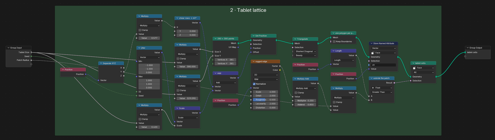

Real nacre tablets are polygons of 5 to 12 µm, five to seven sides each, packed edge to edge: the pattern of cells
growing until they touch. That is a Voronoi pattern, and in Geometry Nodes the cheapest Voronoi is a **Dual Mesh** of
a triangulated point lattice: one polygon per point, each polygon's corners at the centres of the triangles around it.

| Node | What it does |
|---|---|
| `380 × 380 points` | a Grid, `Tablet Size` (8 µm) apart: 380 × 8 µm = 3.04 mm wide and, with rows √3 / 2 as far apart, 2.63 mm tall, about the size of the patch |
| `shear rows → 60°` | moves each row sideways by y / √3: the square grid becomes a 60° (hexagonal) lattice |
| `jitter` | moves every point by up to ±0.42 · 8 µm = ±3.4 µm (`JIT`): irregular sizes and five- to seven-sided cells |
| Triangulate | Shortest Diagonal, so the jittered quads split the short way and the cells stay compact |
| `one polygon per point` | the Dual Mesh: one face per lattice point |
| Store `ctr` | each face's centre, kept for section 3 (Position, evaluated on the Face domain, is the face's centre) |
| `ragged edge`, `outside the patch` | deletes faces farther than `Patch Radius` · (0.85 … 1.1) from the dive point: a 1.3 mm disc with a noisy edge |

The patch lives in flat coordinates: x and y in mm in the tangent plane at the dive point, z = 0. Section 9 wraps it
onto the pearl. Building flat and wrapping late keeps every step here simple 2D maths.

> **Try it:** set `Tablet Size` to 0.004. The tablets halve, but the grid still has 380 points, so it is only
> 1.5 mm wide: the patch gets straight edges where the grid runs out. The 380 is in build.py (`n_side`).

---

## 3 · One copy per layer

Each cell becomes M + 1 = 4 tablets, one per layer that could exist there (`M + 1 copies`, Duplicate Elements on
faces). At the cell's centre:

- `layers here (h / t)` is the growth height in layers: h from `PA_GrowthHeight`, divided by `Tablet Thickness`.
- `layer k` = ⌊h / t⌋ + 1 − Duplicate Index, so the four copies are layers ⌊h / t⌋ + 1, ⌊h / t⌋, ⌊h / t⌋ − 1 and
  ⌊h / t⌋ − 2. The top one is the next layer up, which only exists if a tablet has started there (section 4).

Real nacre stacks like a brick wall: a tablet's edge sits over the middle of the tablet below, not over its edge.
`shift per layer` is a Random Value with ID = k, so every tablet of one layer gets the same random pair (X, Y) in
0…1, and `shift (lattice steps)` moves the whole layer by X steps along one lattice axis and Y along the other. Each
layer is a copy of one lattice, slid by less than a cell.

Then each tablet asks where it stands in its own layer: `e = h / t − k`, computed at the shifted `tablet centre`
and stored as `front`.

- **e ≥ 0:** h has passed this layer: it is laid.
- **e < 0:** the growth surface hasn't reached it yet.
- **e ≥ 3:** three newer layers lie on top: buried and invisible.

> **Try it:** set `Relief` to 0.3. h shrinks to under a third, so it crosses a layer a third as often: the
> terraces spread out and the growth lines on the whole pearl thin out too, since they come from the same h.

---

## 4 · Which tablets exist

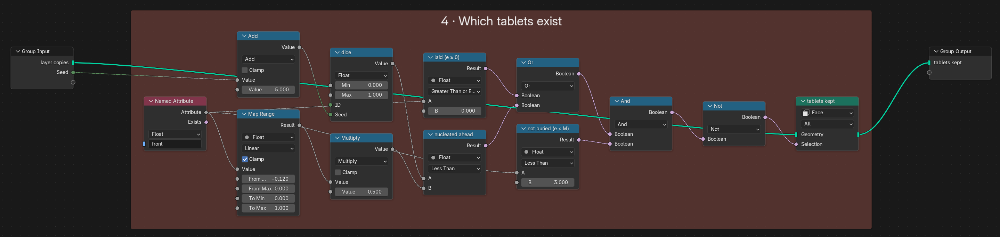

| Node | Rule |
|---|---|
| `laid (e ≥ 0)` | the growth surface has reached this layer here |
| `nucleated ahead` | or: it hasn't yet (−0.12 ≤ e < 0), and `dice` < 0.5 · (e + 0.12) / 0.12, so up to a 50 % chance right at the front, none 0.12 layers ahead |
| `not buried (e < M)` | and fewer than M = 3 layers lie on top |

Everything else is deleted (`tablets kept`). The middle rule is what makes the edge of a layer look grown rather
than cut: real layers advance by tablets that nucleate a little ahead and spread until they meet.

### Trick · keep only three layers

The pearl has thousands of layers. Only the top one shows, and one or two more show through the gaps and at the
steps. Three layers per cell keep the whole pearl at 4.45 million faces, and the body (section 1) plugs everything
below.

> **Try it:** in build.py change the 0.5 in `nucleated ahead` to 1.0. Twice as many islands of new tablets appear
> just ahead of every terrace edge.

---

## 5 · Young tablets are small

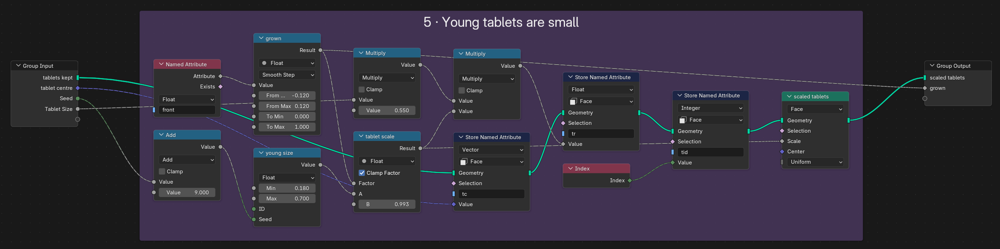

A tablet at the front of its layer is still growing. `grown` is a smooth step of e from −0.12 to +0.12. The
`tablet scale` mixes a random `young size` (0.18 to 0.7) with 0.993 by `grown`, and Scale Elements shrinks each face
about its own centre. A tablet well inside its layer is 99.3 % of its cell (a thin gap is left between neighbours);
one at the front is a small island.

Before the tablets are cut into pieces (section 6), three facts per tablet are stored on its faces for the material:

| Attribute | Value | Used for |
|---|---|---|
| `tc` | the shifted `tablet centre` (patch coordinates; section 9 moves it onto the pearl) | where the tablet's centre is |
| `tr` | 0.55 · 8 µm · scale, the tablet's radius | how far from the centre to its rim |
| `tid` | the face index | one random number per tablet (sections 7 and 8) |

> **Try it:** set both Min and Max of `young size` to 0.9. Every tablet is nearly full size at once and the layer edges become
> hard, straight-sided steps: much more like a CG staircase.

---

## 6 · Rounded outlines

At 80 µm across the frame, a sharp-cornered polygon looks like a CG tile. Real tablets have softened corners. But a
fully smoothed hexagon is a circle, and circles leave wide gaps, so the tablets read as pebbles or sequins.

### Trick · a polygon with slightly rounded corners

Subdivide Mesh and Subdivision Surface at the same level make **the same vertices in the same order**: the first
keeps them on the polygon (`polygon outline`), the second pulls them onto a smooth curve (`smooth outline`, Boundary
Smooth: All). So Sample Index with the plain Index reads, for every vertex of the polygon version, where the same
vertex lies on the smooth one. A Mix of the two positions by `roundness` gives anything between:

- `roundness` = mix(1, 0.3, `grown`): grown tablets are 30 % smooth (`ROUND`): polygons with soft corners.
- Young tablets are 100 % smooth: small round islands, as real ones are before they meet their neighbours.

Only tablets within 0.45 mm of the dive point (`near the dive point`, `R_DETAIL`) get this; farther ones stay plain
polygons: subdivided twice, a hexagon becomes 24 faces, and there is no point paying that where nobody can see corners.

The material adds the rest of the texture (10 c, 10 d): a small tilt per tablet, slightly domed tops, a film that
thins towards the rim, and a satin rim.

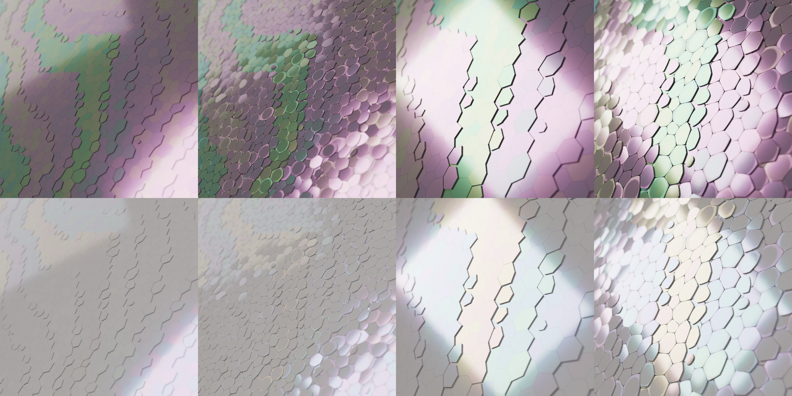

> **Try it:** set `ROUND` in build.py to 1.0. Every grown tablet near the dive point becomes a disc, with
> triangular gaps between them: the pebble look.

---

## 7 · Thickness

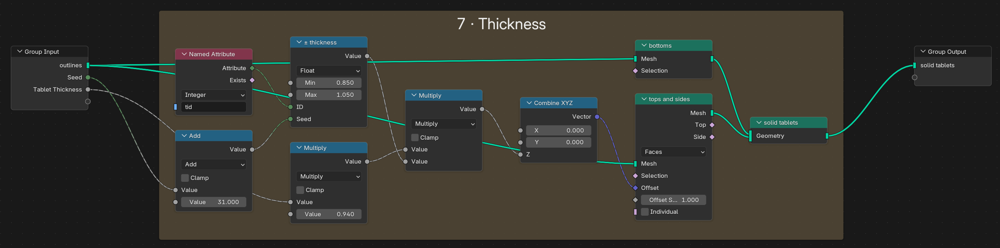

Each tablet is extruded by 0.94 · `Tablet Thickness` · (0.85 … 1.05) (`± thickness`, one random number per `tid`).
The 0.94 leaves a sliver of a gap under the next layer, and ±10 % makes neighbours stand a little proud of each
other, which catches light at grazing angles. Extrude Mesh has Individual off, so a rounded tablet (now about 24 small
faces) rises as one solid instead of a bundle of columns. Flip Faces on the original faces gives the `bottoms`, so every
tablet is closed.

> **Try it:** set `Tablet Thickness` to 0.001. The steps more than double in height. Because h / t also changes,
> there are fewer layers per µm of h, so the terraces grow wider as well.

---

## 8 · A film per layer

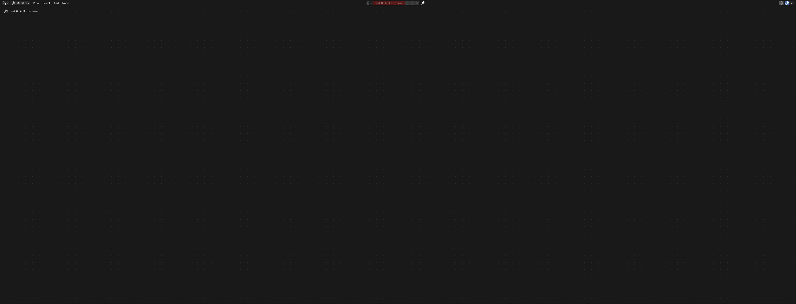

A pearl's orient (the green and rose over its body colour) is thin-film interference: light reflects from the top
and the bottom of the topmost aragonite layer and the two waves interfere, so the colour depends on the layer's
thickness. Principled BSDF has a Thin Film input, a thickness in nanometres. This section stores that thickness on
every tablet as `film`:

> `film (nm)` = PA_LayerFilm(layer, point on the pearl, `Terrace Colour`) + `± 20 nm per tablet`

`PA_LayerFilm` (see [Inside the helper groups](#inside-the-helper-groups)) is a smooth field of 505 to 535 nm over
the pearl, plus a fixed random offset per layer of up to ±60 nm × `Terrace Colour`. So every terrace is a slightly
different colour, every tablet differs again a little, and the colours drift slowly across the pearl.

Why the narrow 505–535 nm? A Tahitian pearl's dark body hides nothing. A wide range, or the full ±60 nm per layer,
reads from afar as oil-slick blotches and at loupe distance as a contour map. So `Terrace Colour` is keyed: 0.35 at
loupe distance (4.7 mm and farther), rising to 1 at 1 mm (frames 106–130, see the zoom figure in the map). It is 0.56
when the tablets switch on at frame 112, and since the tablets and the material read the same keyed value, they agree.

> **Try it:** change `LAYER_DF` in build.py from 60 to 150. Each terrace becomes a separate bright colour: the
> contour-map look this narrow setting avoids.

---

## 9 · Onto the pearl

Every point of the flat patch, (x, y, z), is sent to

> direction = PA_PatchDirection(x, y) · position = direction · (PA_SurfaceRadius(direction) + k · t + z)

So x and y say where on the pearl, the layer number k says how high (`height: k · t + z`), and z is the point's
own height within its tablet (0 at the bottom, about 0.94 t at the top). Note that h is not added here: h only
decided *which* layers exist, and a layer k sits at k · t because that is where layer k is. That is what makes the
steps.

`tc on the pearl` moves each tablet's stored centre onto its top face in object space, where the material reads it.
Then Set Material `PA_Pearl` (the same material as the body), Join with the `pearl body`, and `tablets on?`, a
Switch on the `Tablets` slider: off, the tree outputs the body alone.

### Trick · tablets only where the camera is

`Tablets` is keyed: on while the frame is narrower than 1.2 mm (`W_TABLETS`, frames 112–358), off otherwise. At
1.2 mm the 1.3 mm patch already fills the frame, so its ragged edge is never seen. Wide shots render the 163 842-point
body only; close shots carry 7.4 million points in all.

> **Try it:** set `Patch Radius` to 0.3. The patch shrinks to a small island, and from frame 112 to about 127 its ragged
> edge sits inside the frame, with the shader-only pearl around it.

---

## 10 · The material `PA_Pearl`

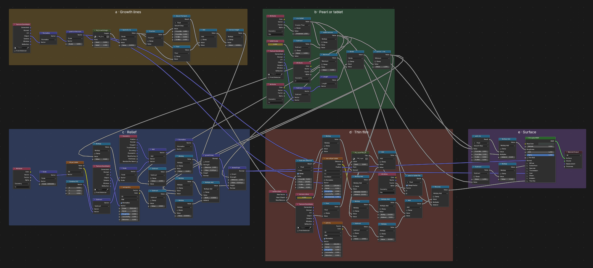

One material shades both the body and the tablets. It tells them apart by the stored `film`: the body has no such
attribute (it reads 0), tablets have several hundred nanometres. On the body the material draws the terraces itself, from the
same h; on the tablets the steps are real geometry and the film is stored.

### a · Growth lines

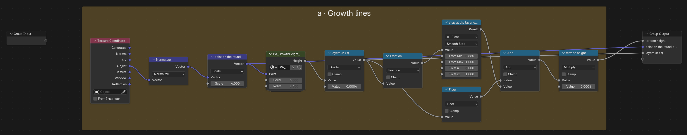

`point on the round pearl` = normalize(Object) · 4 mm, the same point section 1 feeds `PA_GrowthHeight`. With the
same seed and `Relief`, the shader's h is exactly the tree's h. Then `layers (h / t)`, and

> `terrace height` = (⌊h / t⌋ + smoothstep(0.88, 1, fract(h / t))) · t

a staircase: flat for 88 % of each layer, rising to the next over the last 12 %. Fed to a Bump node (frame c), it
draws a step wherever a layer ends: the growth lines a loupe shows.

### b · Pearl or tablet

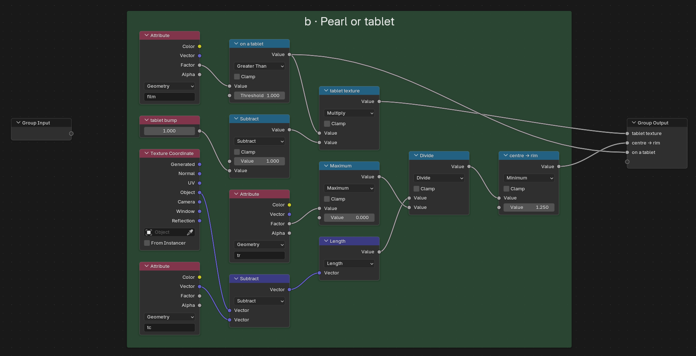

| Value | Meaning |
|---|---|
| `on a tablet` | `film` > 1: 1 on tablets, 0 on the body |
| `tablet bump` | `PA_TabletBump`, keyed: 1 when the tablets switch on, 0 by 0.45 mm frame width |
| `tablet texture` | `on a tablet` · (1 − `tablet bump`): the tablets' own texture, faded in with the zoom |
| `centre → rim` | \|Object − `tc`\| / `tr`: 0 at a tablet's centre, 1 at its rim (capped at 1.25) |

### c · Relief

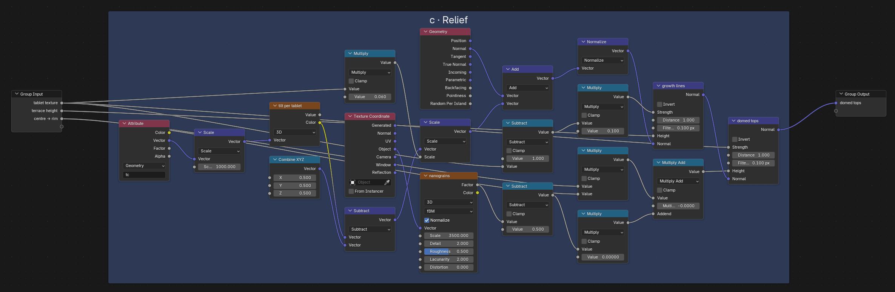

Three things change the normal, in a chain:

1. `tilt per tablet`: a White Noise of `tc` (each tablet its own random vector), × 0.06 × `tablet texture`, added to
   the normal. No two real tablets lie exactly flat, and this tilt makes the mosaic of slightly different
   brightnesses that sells "many separate crystals".
2. `growth lines`: Bump of the `terrace height`, strength 0.1 · (1 − `tablet texture`).
3. `domed tops`: Bump of −20 nm · rel² (`DOME`: the centre 20 nm higher than the rim) plus ±1.5 nm of `nanograins`
   (a noise about 0.3 µm across), strength `tablet texture`.

### Trick · hand the growth lines over, don't switch them

At frame 112 the tablets appear. Before that, the highlight shows the growth lines because the bump puts them there.
At 1.2 mm the real steps (0.45 µm high) are far too small to show in the highlight, so if the bump stopped where the
tablets start, the lines would vanish from the highlight in one frame. Instead the tablets carry the same bump when they switch on
(`tablet bump` = 1) and it fades out by 0.45 mm (frame 127), while the real steps grow big enough to take over.

### d · Thin film

On the body, the film comes from `PA_LayerFilm_Sh`, the shader twin of section 8's group, with the same layer
⌊h / t⌋, the same point and the same seed. So the body's terraces have exactly the colours the tablets will have.
Two additions make the body behave like tablets seen from afar:

- `one cell per tablet`: a Voronoi of 8 µm cells adds ±20 nm per cell, standing in for section 8's ±20 nm per tablet.
- `fade with distance`: terraces narrower than a pixel average out, so the per-layer offset fades from 1 at a 5 mm
  view distance to 0.2 at 25 mm, times `terrace colour` (`PA_TerraceColour`, the same keyed value as the tree's
  `Terrace Colour` slider).

`pearl or tablet film` picks the stored `film` on tablets. Then, inside each tablet, the film thins towards the rim
and is a little `patchy`: + (5 − 14 · rel² ± 15) nm × `tablet texture`.

### e · Surface

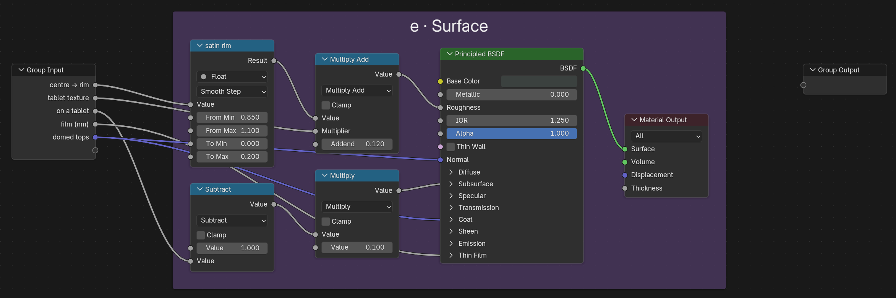

| Input | Value | Why |
|---|---|---|
| Base Color | (0.045, 0.055, 0.05) | a dark Tahitian body; the colour you see is mostly the film |
| Roughness | 0.12 + `satin rim` (up to 0.2 near the rim) × `tablet texture` | the organic matrix between tablets is satin, not glass |
| IOR | 1.25 | a soft, deep reflection under the coat |
| Subsurface | 0.1 × (1 − `on a tablet`), radius (0.4, 0.5, 0.45) × 0.6 mm | a little light under the body; none on tablets 0.45 µm thick |
| Coat | 0.6, roughness 0.03, IOR 1.5 | the crisp mirror-like highlight of a fine pearl |
| Thin Film | `film (nm)`, IOR 1.65 | aragonite's index; the orient |
| Normal, Coat Normal | `domed tops` (the whole chain from frame c) | |

The three pearl types are three rows of `LOOKS` in build.py (body colour, film range, coat and subsurface), picked
with `--look akoya | southsea | tahiti`:

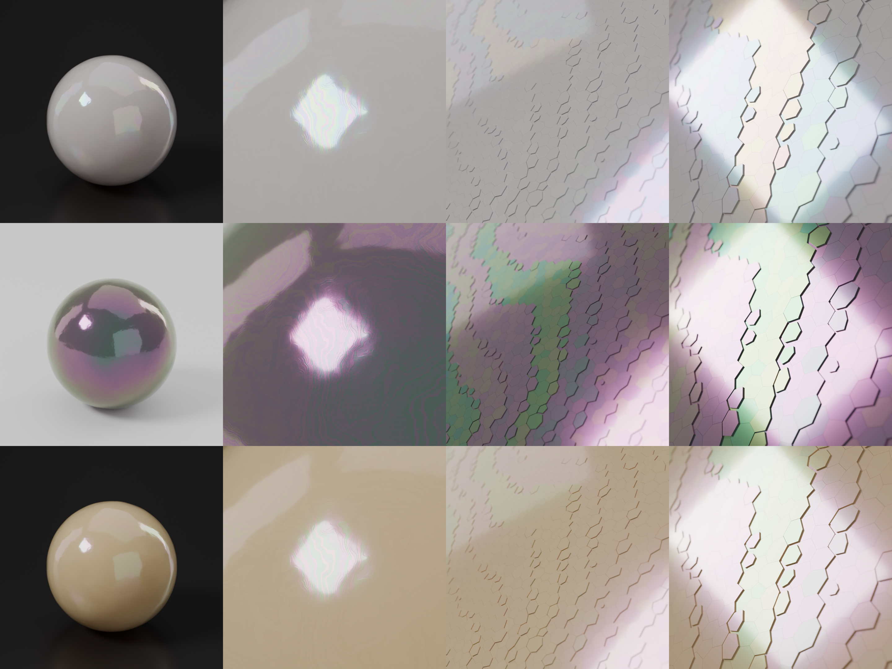

---

## Inside the helper groups

### `PA_GrowthHeight`: the growth height h

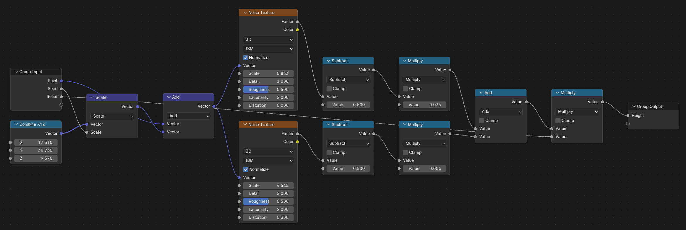

Two noise octaves of the point on the round pearl (mm), each centred and scaled:

| Octave | Noise scale | Feature size | Amplitude | Role |
|---|---|---|---|---|
| big | 1 / 1.2 | about 1.2 mm | ±18 µm | long, nearly parallel growth fronts |
| small | 1 / 0.22, Distortion 0.3 | about 0.22 mm | ±2.2 µm | makes them wander |

both × `Relief` (1.3). The `Seed` shifts the noise (Seed × (17.31, 31.73, 9.37)). The group exists twice,
`PA_GrowthHeight` for Geometry Nodes and `PA_GrowthHeight_Sh` for the material, built by the same Python function, so
the two can never drift apart.

### `PA_LayerFilm`: the film of a layer

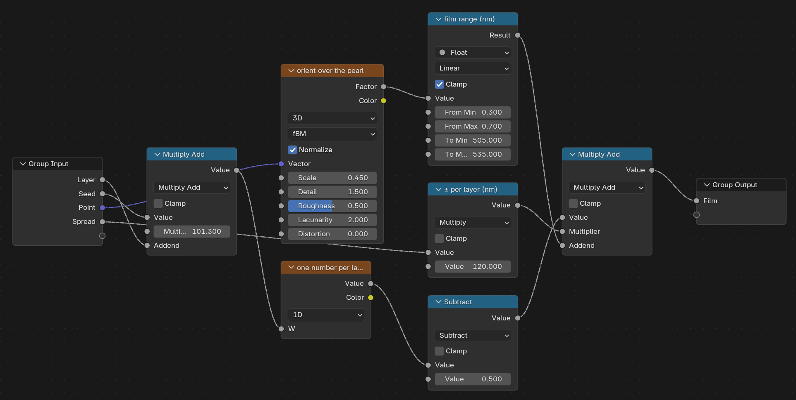

- `orient over the pearl`: a slow noise (scale 0.45 per mm) mapped by `film range (nm)` from 0.3–0.7 to 505–535 nm.
- `one number per layer`: a 1D White Noise of Seed · 101.3 + Layer: the same layer always gets the same number.
- `± per layer (nm)` = Spread · 2 · 60: the per-layer offset, scaled by the `Terrace Colour` keyed value.

Also built twice (`PA_LayerFilm`, `PA_LayerFilm_Sh`) by one function.

### `PA_PatchDirection` and `PA_SurfaceRadius`

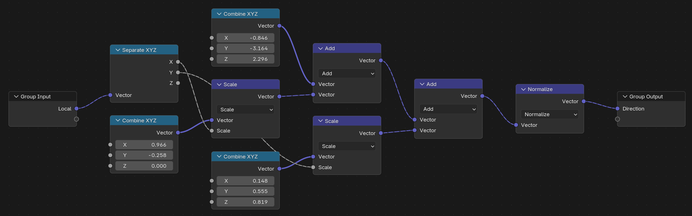

`PA_PatchDirection` maps patch coordinates (x, y in mm) to a direction from the pearl's centre: dive point + x · U
+ y · V, normalized, where U and V span the tangent plane at the dive point. The dive point's normal N0 is half-way
between the key light and the far camera, so it is where the highlight sits in the first frame: the camera dives
straight into the highlight.

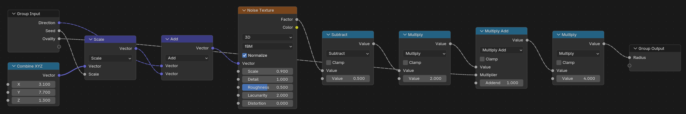

`PA_SurfaceRadius` is the pearl's radius along a direction: 4 mm × (1 + `Ovality` · n).

### The patch from above

Colouring each tablet by its layer number shows the terraces as contour bands of h, exactly the growth lines the
material draws on the rest of the pearl.

---

## Appendix · Camera and light

The move is a function of the frame width w at the dive point (the zoom figure in the map). `state(f)` in build.py
gives everything for frame f, and `animate()` keys it on every frame.

- **Log zoom.** w goes from 12.5 mm to 80 µm between frames 30 and 200 by interpolating log w (with a smootherstep).
  Every second of the dive passes the same *factor* of scale, so it neither crawls at the start nor rushes at the end.
- **A 100 mm lens at every scale.** The camera stands w · 100 / 36 from the dive point (35 mm at the start, 0.17 mm at
  the closest), looking at it.
- **Lens shift keeps the pearl centred** while wide (fully at 10 mm and wider, fading out by 2 mm) and then lets
  the dive point take the centre, without turning the camera.
- **Depth of field ∝ distance.** The aperture radius is 0.008 × the focus distance (`A_OVER_D`), so the blur looks
  the same at every scale, like one photograph.
- **Tilt and orbit.** Below 1.5 mm the camera tilts from 30° to 55° off the surface normal, so the terraces stand in
  relief, and during the hold it orbits 40° about the normal (30° at the end).
- **The light sweep.** The key light is on a rig at the pearl's centre. Wide, the key sits up-left (`LK`). Close in,
  the rig turns it to the mirror direction of the camera, then swings it from −22° to +22° through that direction
  (frames 190–310), so the highlight slides across the tablets. That sweep is the "different lustre" of the brief.
  On the way out the key turns 35° about the vertical, so the final pearl has its highlight in a new place.
- **Studio.** Area lights in mm: key 90 × 63 at 260 mm, a tall rim behind, a big soft fill, and two bounce cards the
  camera doesn't see. A sweep (`PA_Backdrop_GN`: a grid curving up behind, z = (y − 60)² / 280) in light grey.

---

## How it was rendered

Cycles, 1080 × 1080, 128 samples with denoising, AgX Base Contrast. Up to 16 bounces (6 glossy). The tablet frames
hold 7.4 million vertices and 4.45 million faces, rebuilt in about 5 s per frame. Frames 1–280 rendered on an Apple
Silicon Mac (Metal, about 18 s a frame) and frames 281–432 on a second PC with an RTX 4060 (OptiX). A test frame
rendered on both differed by 0.02 / 255 on average, so the hand-off at frame 281 doesn't show.

---

## Try it yourself

1. **Another pearl.** In your own build, change `Seed`. The growth lines, the terraces, the stacking and the tablets
   all change together, because they all come from one h.
2. **A white Akoya on black.** In your own build, switch to the Akoya look on a dark backdrop: a pale body, a wider
   film range (300–520 nm) and full terrace colour.
3. **Crowded growth lines.** Set `Relief` to 3. h more than doubles, so it crosses layers more than twice as often:
   tight fingerprint lines on the pearl and narrow terraces under the camera.
4. **Honeycomb.** In your own build, set the lattice jitter (`JIT` in build.py) to 0: perfect hexagons, which
   instantly look artificial.
5. **Watch the lustre move.** Scrub `loop.mp4` from 8.3 s to 12.5 s (frames 200–300). Only the light moves, and
   each tablet changes colour as the light crosses its tilt and film.

*Made with Blender 5.2 Geometry Nodes for [Nodevember](https://nodevember.com) 2026, Day 15 · Pearl.*
