# How a comb jelly sends rainbows down its rows

*A node-by-node walkthrough of Nodevember 2026 · Day 16 · Wave*

The video (12 s, 288 frames at 24 fps, 1080²) shows a sea gooseberry, a comb jelly about 15 mm long, hanging in
black water. Its eight comb rows are stacks of tiny paddles, still at first. Then the rows start to beat: each paddle beats a
moment after the one before it, so a wave runs along every row from the apical organ (bottom) to the mouth (top), and the
paddles scatter the light into flecks of colour that travel with the wave. The animal swims about 12 mm mouth first.
Then the rows go quiet, one plate after another, and it coasts to a stop. The whole animal (body, 192 comb plates,
pharynx, gut canals, two tentacles with 270 side filaments) and the drifting marine snow come from one Geometry Nodes
tree, `PA_CombJelly_GN`, on an object whose own mesh is empty. There is no simulation, no image texture and no
modelled or imported mesh (`pb.audit`: strictly procedural, no issues). The motion comes from four sliders keyed on every frame.

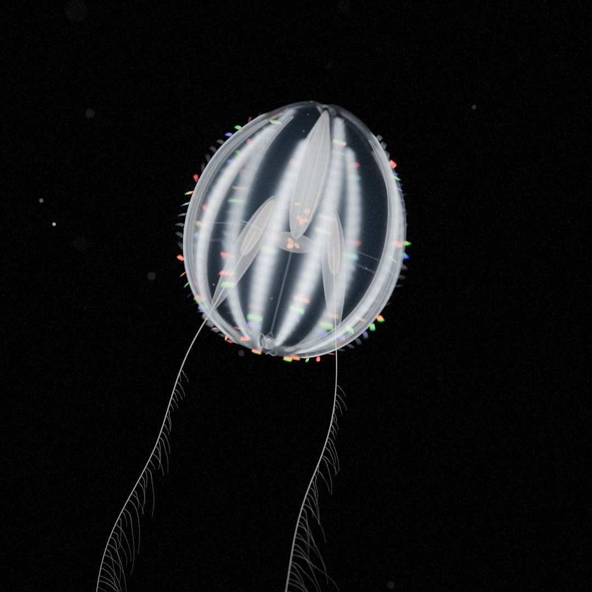

| File | What it is |
|---|---|
| `../loop.mp4` | the video: 1080², 24 fps, 288 frames (12 s), Cycles 128 samples + denoising, motion blur, ISO 3200 grain |
| `../render.png`, `../render-200.png` | stills: frame 120 and frame 200, with the same grain |
| `../nodes/` | node shots of the main tree, the wave and the plate shader |
| `images/` | every figure and node shot on this page |

The scene file and the scripts that build it and add the grain are not published; this page shows every node.

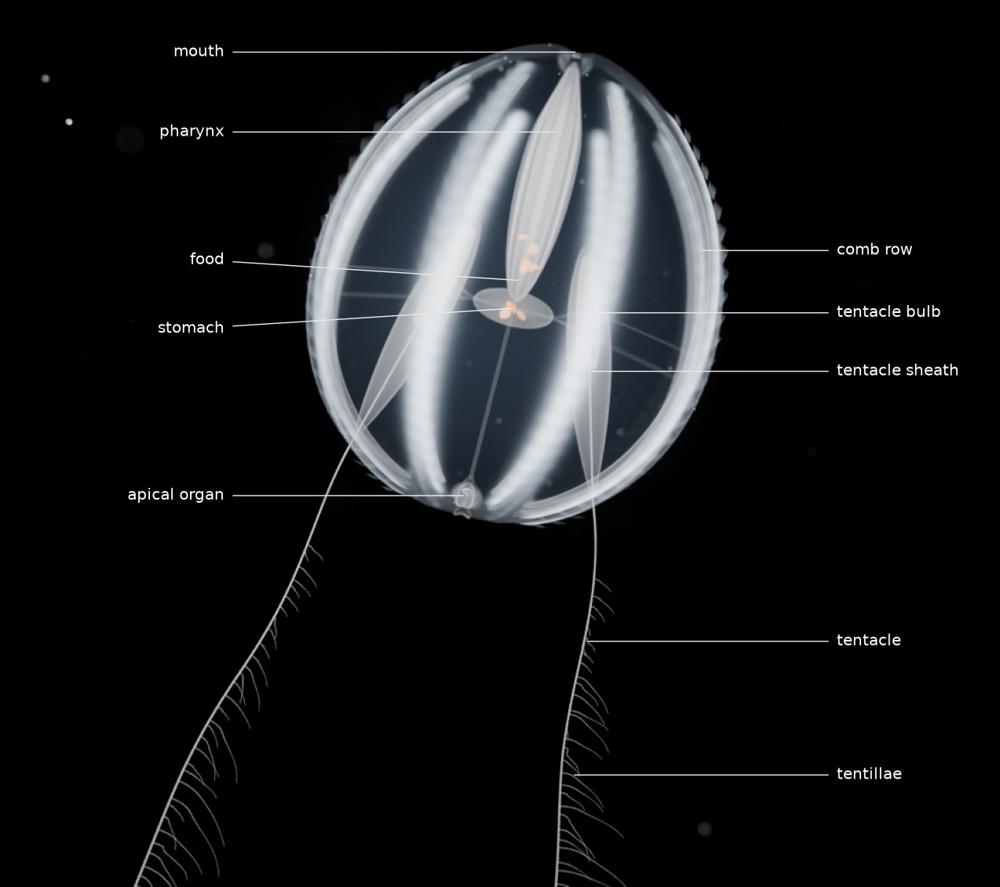

---

## The one idea

> **A wave is a delay.** Every plate runs the same beat: a fast, stiff stroke towards the apical organ, then a slow,
> curled recovery. Each plate starts that beat a little later than its neighbour nearer the apical organ:
> cycles beaten = `Beat` − row delay − plate / `Wavelength`. Copies of one motion, each a little behind the last, read
> as a wave travelling along the row. The colour comes from where a plate is in its stroke, so the rainbow travels
> with the wave.

Everything else is bookkeeping around that idea:

- **What beats?** `PA_Comb Plates`: 8 rows × 24 plates, each a small 6 × 8 grid tagged with its row and its place in
  the row (2 · Comb plates).
- **When?** `PA_Metachronal Wave` turns the `Beat` slider into each plate's own phase (3 · Metachronal wave).
- **How?** `PA_Paddle` asks `PA_Ctene Stroke` for the plate's angle and curl at that phase, and stands the plate on the
  body surface (4 · Paddle).
- **What colour?** The `PA_Ctene` material picks a wavelength from the phase and the plate's angle to the light
  (Appendix A).
- **The rest of the animal:** the body (1), the organs (5), the gut canals (6), the tentacles (7) and their
  filaments (8).
- **Swimming:** a build script keys `Beat`, `Rise`, `Drag` and `Roll` on every frame; section 9 moves the animal and
  section 10 adds marine snow, which stays put and so shows the motion.

### How to read the screenshots

- Each coloured frame is one section of a tree. The main tree's sections are numbered (`3 · Metachronal wave`), and
  each one holds a node group that does the work. Sections inside a group are lettered (`c · Out along the sheath,
  then hang`).
- A **cut-out** shows one section on its own. Wires that come from another section enter through a Group Input socket
  named after what they carry (`arc length outside`, `Body Frame › Normal`). Wires that leave exit through a Group
  Output socket. `noise › X` means the X of the Separate XYZ labelled `noise`. `Organ parts`, `Food parts` and so on are
  the outputs of the Set Material nodes that apply those materials.
- Each section has its own Group Input, showing only the sockets it uses: titled `sliders` in the main tree and
  `inputs` inside a group.
- **Units.** 1 = 1 m, and the animal is 15 mm long, so the fields show small numbers: 0.48 mm is `0.00048 m`. The text
  gives millimetres.
- **Angles on the body.** θ is the polar angle measured from the aboral pole (θ = 0, the apical organ, at the bottom)
  to the mouth (θ = π, at the top); φ goes round the axis. φ = 0 and π is the tentacular plane (x), where the two
  tentacles hang.
- `Smooth Step` in a Map Range node is the smoothstep t²(3 − 2t) of the clamped ramp between From Min and From Max:
  0 below, 1 above, an S between.
- Geometry hands data to later steps and to the shaders as **named attributes**: `b_dir` (body), `pl_k`, `pl_j`,
  `pl_uv` (plates, from 2), `pl_u`, `pl_v`, `pl_ph`, `pl_on` (plates → shader), `tid` and `tf` (tentacles), `tt`
  and `tn` (tentacle tangent and normal), and copy numbers `mk`, `rk`, `pg` and `pf`.

Click any screenshot to see it full size.

---

## 0 · The map

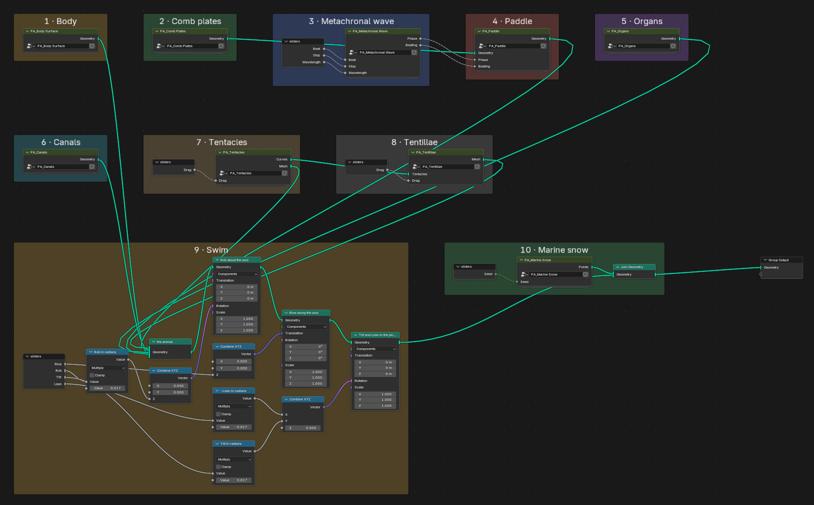

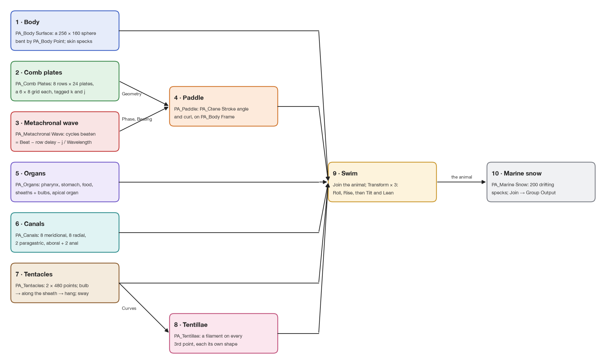

| # | Section | Nodes | Job |
|---|---|---|---|
| 1 | Body | `PA_Body Surface` (23) with `PA_Body Point` (55) and `PA_Crest` (6) | a 256 × 160 sphere bent into the egg-shaped body, ridges under the rows; skin specks |
| 2 | Comb plates | `PA_Comb Plates` (18) | 192 small grids, tagged row `pl_k` and plate `pl_j` |
| 3 | Metachronal wave | `PA_Metachronal Wave` (15) | each plate's phase and whether it is beating |
| 4 | Paddle | `PA_Paddle` (49) with `PA_Ctene Stroke` (19) and `PA_Body Frame` (13) | each plate stood on the body at its stroke angle, curled |
| 5 | Organs | `PA_Organs` (74) with `PA_Spindle` (16) and `PA_Grains` (14) | pharynx, stomach, food, tentacle sheaths and bulbs, apical organ, polar fields |
| 6 | Canals | `PA_Canals` (109) | 8 meridional canals, 8 radial canals, 2 paragastric, the aboral and 2 anal canals |
| 7 | Tentacles | `PA_Tentacles` (104) | 2 × 480 points from the bulb, out along the sheath, then hanging and swaying |
| 8 | Tentillae | `PA_Tentillae` (95) | 270 side filaments on fixed tentacle points |
| 9 | Swim | 11 | Join, then Roll, Rise and Tilt / Lean |
| 10 | Marine snow | 3, plus `PA_Marine Snow` (24) | 200 drifting specks; the final Join |
| – | Materials, light, camera | build script | clear skin and jelly, milky tissues, structural colour on the plates; dark-field light |

The main tree holds 26 nodes: the ten group nodes, Swim's Join, transforms and angle conversions, one `sliders`
Group Input per section that needs one, and the Group Output.

### The keys

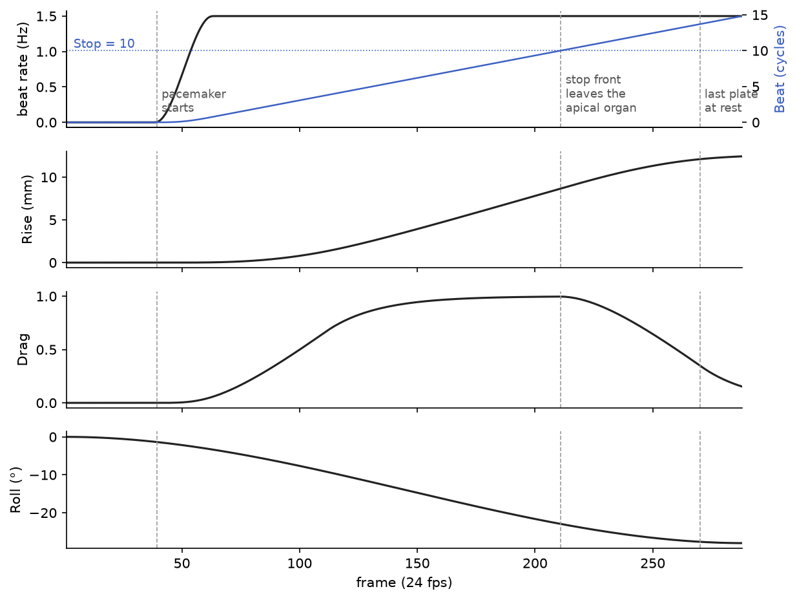

Nothing in the tree knows about frames. The build script's `schedule()` steps through the 288 frames and keys four
sliders:

| Slider | Value | Effect |
|---|---|---|
| `Beat` | cycles elapsed at the pacemaker: 0 until 1.6 s (`T_ON`), then the rate eases up to 1.5 Hz (`F_MAX`) over 1 s | drives every plate (3) |
| `Stop` | 10, set once (not keyed): the first whole cycle after 8.6 s (`T_STOP`) | the cycle on which each plate stops |
| `Rise` | distance swum, mouth first: the speed relaxes towards 1.9 mm/s (`V_MAX`) × activity with a 0.9 s lag (`TAU_V`) | moves the animal along its axis (9) |
| `Drag` | speed / `V_MAX`, 0 → 1 → 0.15 | tentacles and filaments stream back (7, 8) |
| `Roll` | −28° × ease(t / 12 s) | a slow turn about the axis (9) |

"Activity" is 0 before the first wave, rises to 1 while the wave reaches the last plate, and falls back to 0 as the
stop front runs down the rows. The other sliders stay at their defaults: `Wavelength` 7 plates, `Tilt` 14°, `Lean`
10°, `Seed` 3.

The beat on screen is 1.5 Hz; a real Pleurobrachia beats at 4–17.5 Hz. The video is about ten times slower than
life, so the wave can be seen. The animation is a one-shot event with a start and an end, not a loop.

---

## 1 · Body

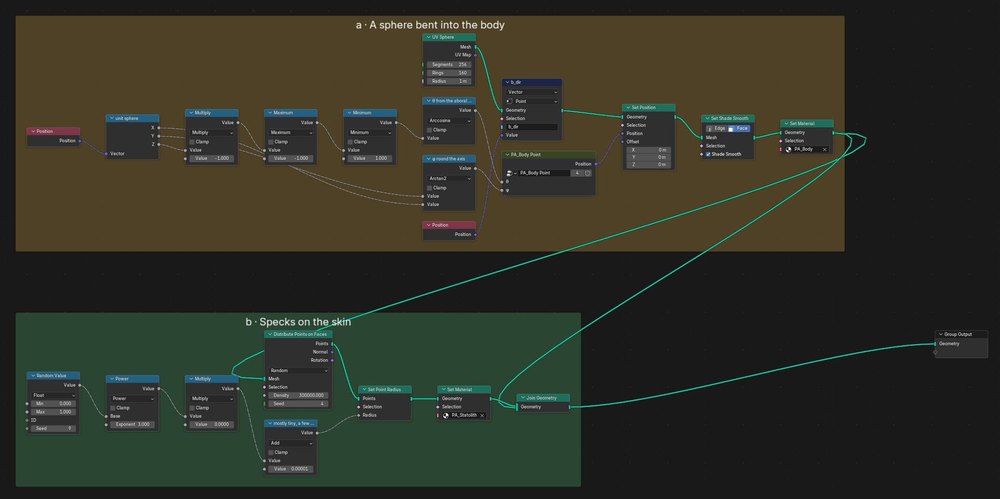

**a · A sphere bent into the body.** A UV Sphere of radius 1, 256 segments × 160 rings. Every vertex of a unit sphere
is its own direction, so its position gives the two body angles directly: `θ from the aboral pole` =
arccos(−z), and `φ round the axis` = atan2(y, x). `PA_Body Point` turns (θ, φ) into a point on the body (see
*Inside the shared groups*), and Set Position moves the vertex there. Before that, Store Named Attribute keeps the
undeformed direction as `b_dir`: the body shader needs (θ, φ) to draw the comb-row bands, and after Set Position it
could no longer get them from the position.

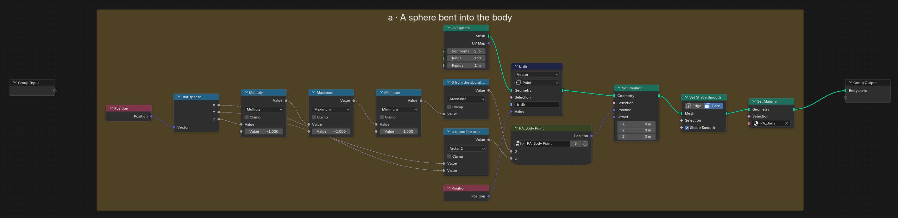

**b · Specks on the skin.** Distribute Points on Faces at 300 000 per m² (0.3 per mm², about 160 on the body) with a
radius of 0.008 mm + 0.03 mm × r³ (`mostly tiny, a few larger`). They catch the light like the epidermal cells and
debris in the photos and give the clear skin something to see.

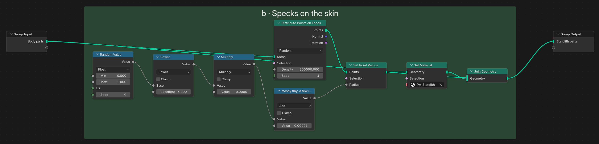

> **Try it:** in `PA_Body Surface`, set Distribute's Density to 3 000 000: ten times as many specks, and the body
> reads as frosted instead of clear.

---

## 2 · Comb plates

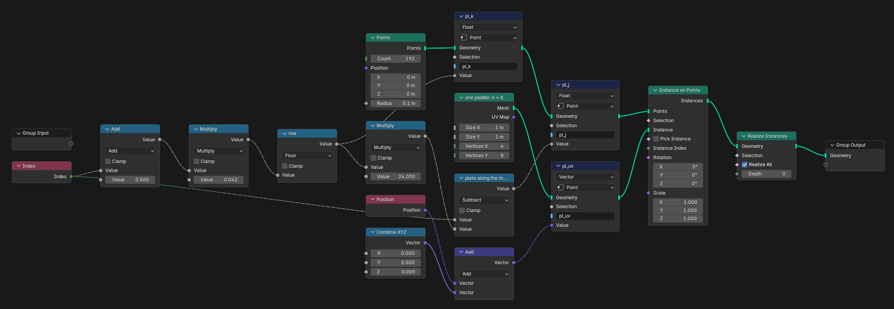

A comb plate (ctene) is a fringe of thousands of fused cilia, about 0.5 mm long. The rows have 24 plates each, so
the group makes 8 × 24 = 192 Points. Index i gives the `row` k = floor((i + 0.5) / 24) and
the `plate along the row (0 = aboral)` j = i − 24k, stored as `pl_k` and `pl_j`. (The + 0.5 keeps floor away from a
whole number that float rounding could tip below.)

Each point gets an instance of `one paddle: 6 × 8`, a Grid of 1 × 1 with 6 × 8 vertices. Its own coordinates, shifted
by (0, 0.5, 0), are stored as `pl_uv`: u runs −0.5 → 0.5 across the plate and v runs 0 at the base → 1 at the tip.
Realize Instances turns the 192 grids into one mesh whose every vertex carries `pl_k`, `pl_j` and `pl_uv`. All
192 grids still sit on top of each other at the origin; section 4 moves every vertex to its place.

**Why realize first?** A plate is not a rigid shape moved as a whole: it curls, so each vertex needs its own position
from (k, j, u, v). After Realize, one Set Position can compute that per vertex.

---

## 3 · Metachronal wave

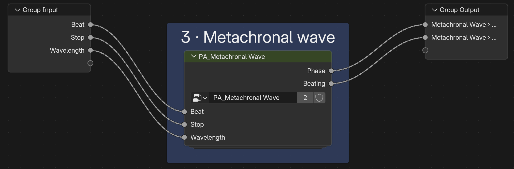

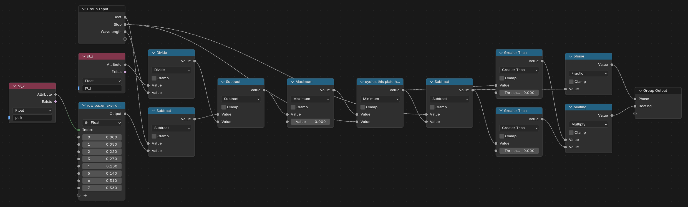

This is the whole idea in 15 nodes. The group outputs fields, not geometry: the node that uses Phase and Beating
evaluates them on its own mesh, and there `pl_k` and `pl_j` are the plate's row and place.

| Node | What it does |
|---|---|
| `row pacemaker delay (cycles)` | an Index Switch on `pl_k`: 0, 0.05, 0.22, 0.27, 0.10, 0.14, 0.31, 0.36 (`ROW_DELAY`) |
| `cycles this plate has beaten` | `Beat` − delay − j / `Wavelength`, clamped to 0 … `Stop` |
| `phase` | its fraction: 0 → 1 through one beat, 0 = at rest, cocked towards the mouth |
| `beating` | 1 while 0 < cycles < `Stop`; the shader only colours plates that beat |

**The delays.** In a real comb jelly the apical organ paces the rows in pairs: each of four balancers drives the two
rows of one quadrant. So the eight delays come in close pairs (0 and 0.05, 0.22 and 0.27, …) and the four pairs are
out of step with each other. Rows of a pair look almost in step; the pairs do not.

**The wave.** j / `Wavelength` is the lag along a row: with `Wavelength` 7, plate 7 runs exactly one beat behind
plate 0, so a row of 24 plates carries about 3½ waves. Plate j reaches a given phase j / 7 cycles after plate 0,
so a crest moves towards the mouth at 7 plates per cycle: 10.5 plates (about 6 mm) a second at 1.5 Hz.

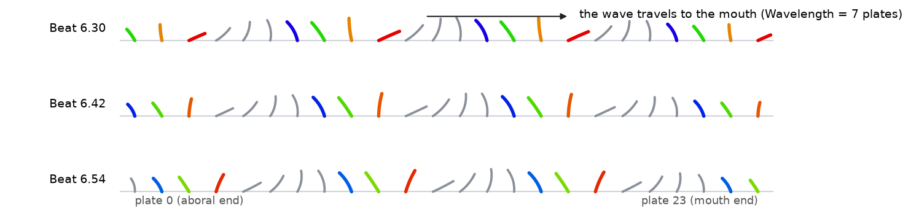

### Trick · stop on a whole cycle

Each plate keeps beating until its cycle count reaches `Stop`, and is then held there. the build script sets `Stop` to the
first whole cycle after 8.6 s (10 here). A whole number has a fraction of 0, the rest pose, and the stroke's end
(p = 1) is the same pose as its start (p = 0). So a plate does not freeze mid-stroke: it finishes its last recovery and
stays in its rest pose. Because a plate's count is delay + j / 7 cycles behind plate 0's, the plates do not stop all
at once: the stop runs along every row like the start did, from frame 211 (plate 0 of the first row) to frame 270
(the last plate).

> **Try it:** set `Wavelength` to 30. The lag along a row is now at most 23 / 30 of a beat: less than one long
> wave per row, so most of a row sweeps together, like oars pulled in time. At 3, the lag is 7.7 beats: the mouth
> end starts 5 s after the apical end and is still beating when the video ends.

---

## 4 · Paddle

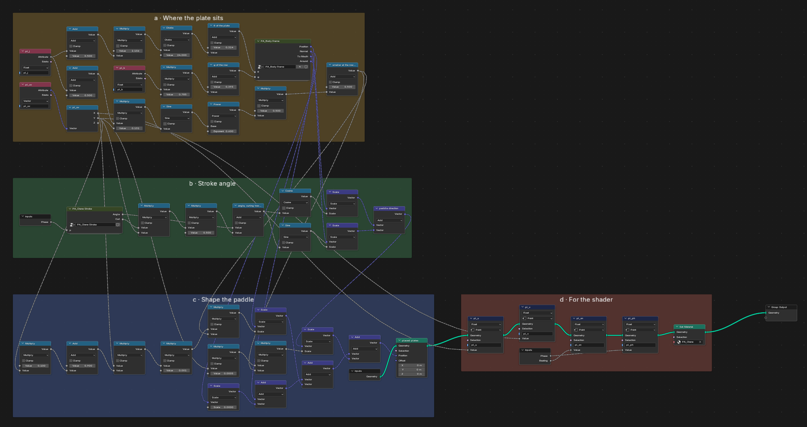

**a · Where the plate sits.** Each row spans θ from 0.10π to 0.78π (`TH0`, `TH1`: 18° to 140° from the aboral pole),
and plate j sits at `θ of the plate` = `TH0` + (`TH1` − `TH0`)(j + 0.5) / 24; the row is at `φ of the row` =
π/8 + k × 2π/8. The first row is at π/8, so the tentacles (φ = 0 and π) leave between two rows. `PA_Body Frame`
returns the surface point there and three directions: the `outward normal`, `to the mouth` (along the row) and
`round the body` (across it). Plates are full size in the middle of a row and about 60 % at the ends
(`smaller at the row ends`: 0.5 + 0.5 sin^0.6).

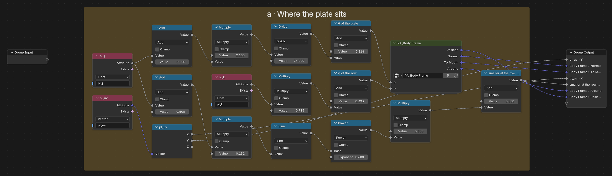

**b · Stroke angle.** `PA_Ctene Stroke` turns the Phase into an Angle (from the normal, + towards the mouth) and a
Curl. The angle grows along the plate, `angle, curling towards the tip` = Angle + Curl × v × 0.5, so the base and the
tip of one plate point different ways. `paddle direction` = Normal cos(angle) + To Mouth sin(angle).

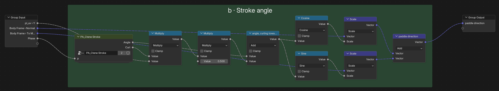

**c · Shape the paddle.** Each vertex goes to

position = surface point + Normal × 0.03 mm + Around × u (0.9 + 0.1 v) × 0.9 mm × size + direction × v × 0.48 mm × size

The plate is 0.9 mm wide (`PW`) and 0.48 mm long (`PL`), a little wider at the tip than at the base. It stands
0.03 mm off the skin, so the two surfaces never touch.

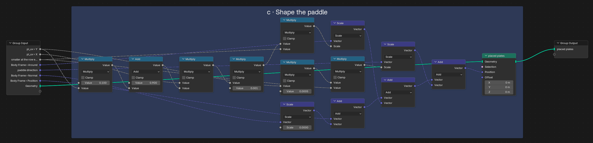

**d · For the shader.** `pl_u`, `pl_v`, `pl_on` (Beating) and `pl_ph` (Phase) are stored on the vertices for
`PA_Ctene`, and the material is set.

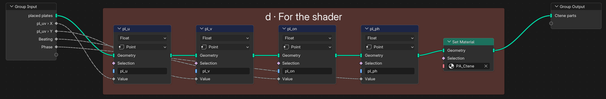

### Trick · a curl is an angle that grows along the plate

A recovering cilium does not swing back stiff: its base leads and the tip trails behind, bent. Adding Curl × v × 0.5
to the angle bends the plate by up to 0.5 × Curl from base to tip without any bones or curves. In the power stroke
the curl is small and positive (the tip lags a little); in the recovery it reaches −0.75 rad (`BEND`).

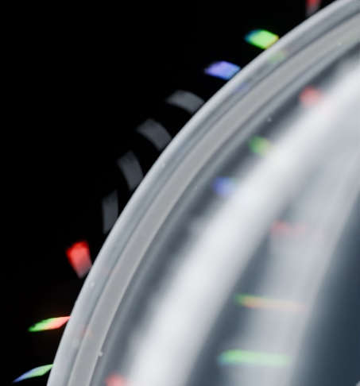

> **Try it:** in your own build set `POWER = 0.5`. The stroke becomes symmetric: the plates swing back as fast as they
> went, and the wave looks like waving rather than rowing.

---

## 5 · Organs

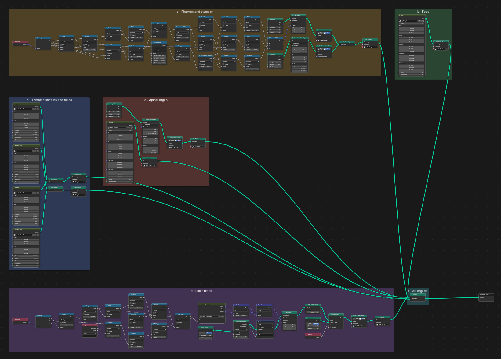

The photos of a sea gooseberry against black show a few milky shapes inside a clear body. They are made here from
spheres and spindles, each roughly where anatomy drawings put it.

**a · Pharynx and stomach.** A UV Sphere (96 × 48) is reshaped vertex by vertex: x × 0.75 mm, y × 1.9 mm, z × 3.9 mm
(`PH_X`, `PH_Y`, `PH_LEN`): a flat spindle, broad in the sagittal plane, ending 0.35 mm short of the mouth. Two
factors shape it: `lengthwise folds` (1 + 0.14 cos 12φ, strongest at the middle) and `narrower at the mouth` (down to 60 %).
The `stomach` is a squashed sphere with half-axes 1.25 × 0.65 × 0.55 mm, at z = −0.9 mm (`Z_INF`), where the canals start.

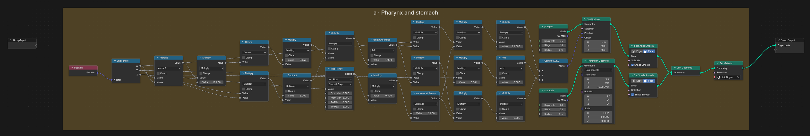

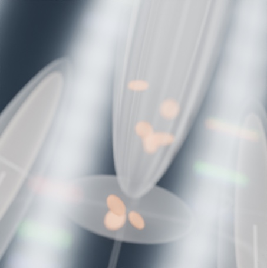

**b · Food.** `PA_Grains` scatters 8 small irregular ico-spheres (0.07–0.3 mm) in and above the stomach: a
half-digested copepod or two, orange in the photos.

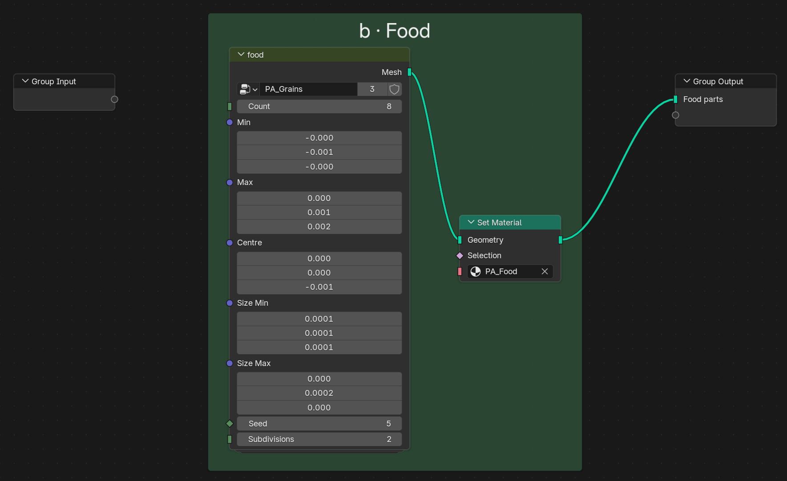

**c · Tentacle sheaths and bulbs.** Each tentacle grows from a bulb at the inner end of a sheath, a pouch that runs
from an opening near the aboral pole up and in towards the pharynx. The opening sits on the body at θ = 0.2π
(`TH_OPEN`), 0.25 mm under the skin: x = ±3.75 mm, z = −6.07 mm. The inner end is at x = ±1.7, z = 1.6 mm
(`SHEATH_IN`). `PA_Spindle` draws each sheath as a tube 7.9 mm long, up to 0.68 mm in radius,
and each tentacle bulb as a slimmer, denser, warmer spindle in its inner half.

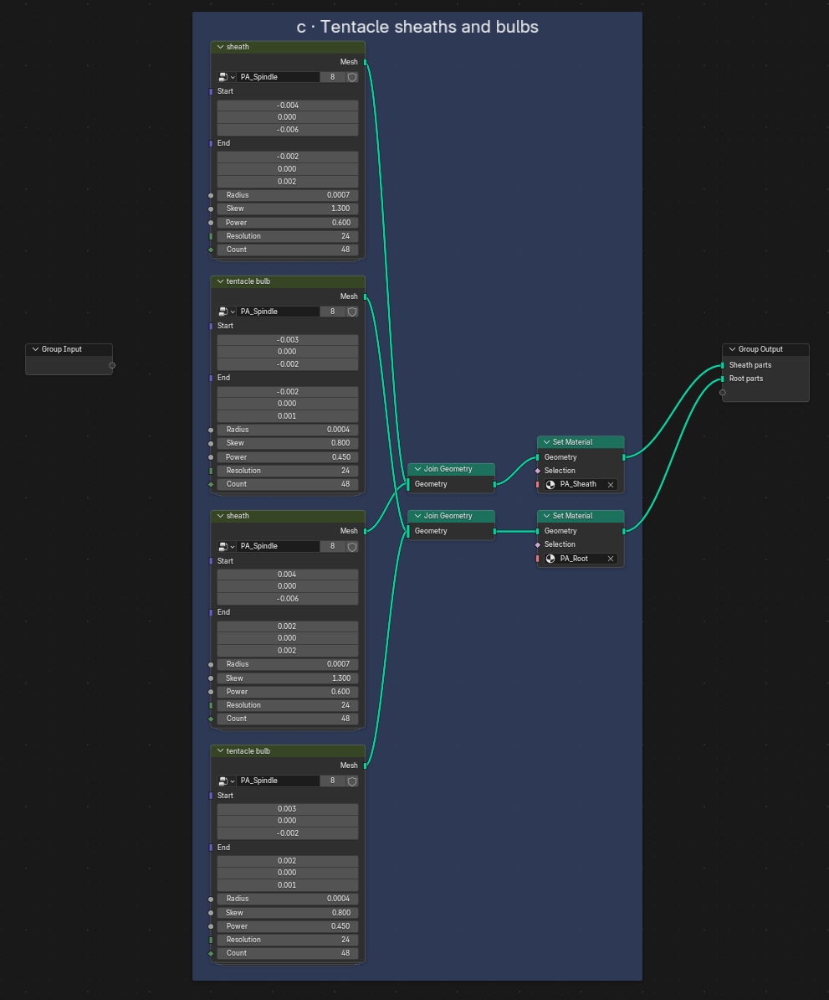

**d · Apical organ.** The `statocyst dome` (half-axes 0.5 × 0.5 × 0.42 mm, a clear material that shows only its
rim) sits in the dimple at the aboral pole, and
`PA_Grains` puts 13 granules inside it for the `statolith`, the balance stone that tells the animal which way is up.

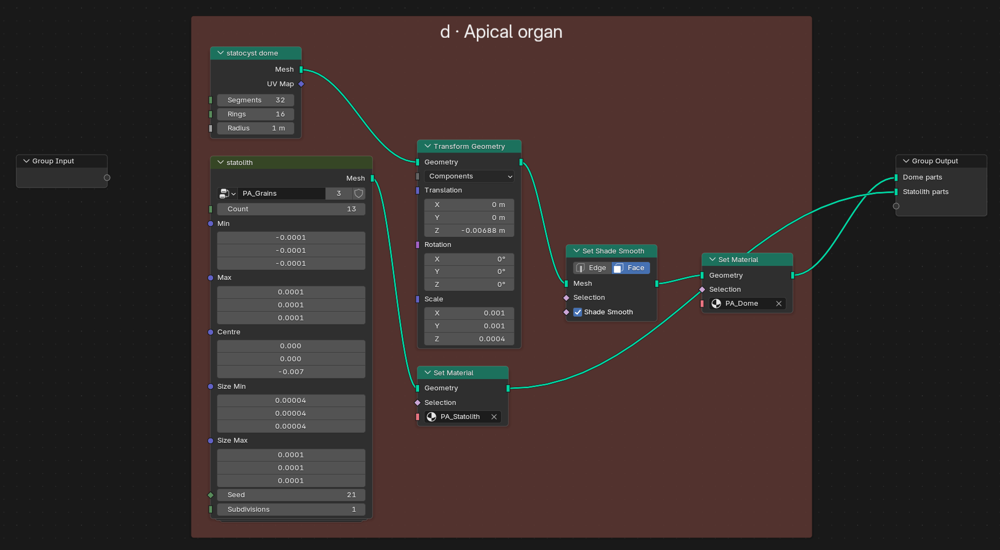

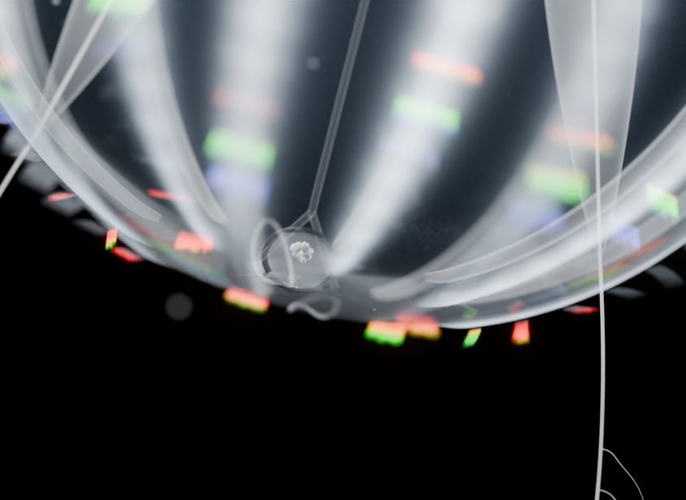

**e · Polar fields.** Two narrow ciliated ovals run from the apical organ along the sagittal plane. A Curve Circle is
copied twice (copy number `pf`, one per side), and its x and y are read as offsets in θ and φ on the body
(`θ along the field`, `φ across it`). `PA_Body Frame` puts it 0.02 mm above the skin, and it becomes a thin tube.

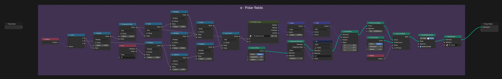

**f · All organs.** One Join, in the same order as the parts are listed.

---

## 6 · Canals

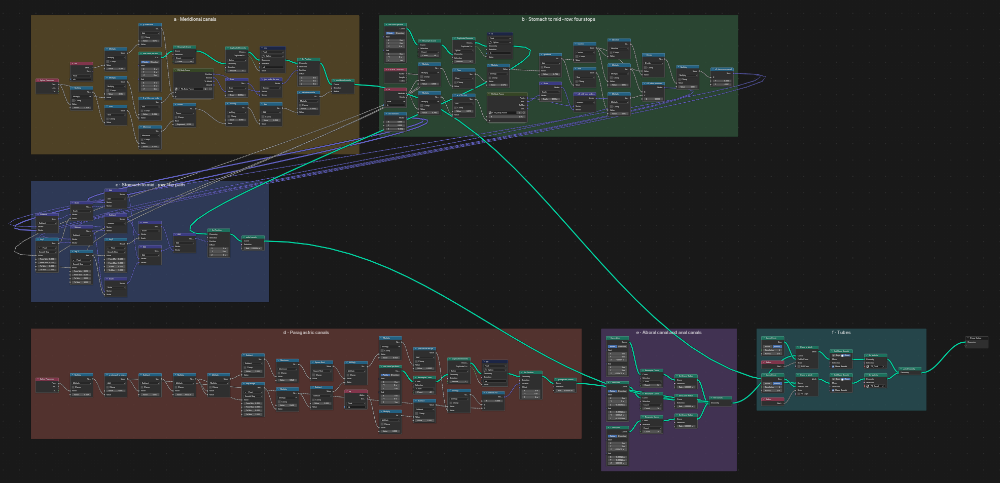

A comb jelly's gut branches into canals that feed the comb rows. They show in the photos as thin milky lines.

**a · Meridional canals.** One canal under each comb row: `one canal per row` is a line of 72 points, duplicated
8 times (copy number `mk`). Its spline parameter t runs θ from a little before the row's start to a little past its
end (`θ: a little past both row ends`), at the row's φ. The point is 0.38 mm under the surface (`just under the row`,
`CANAL_DEPTH`), and the radius is 0.14 mm in the middle, thinning to 35 % at the ends (`fat in the middle`).

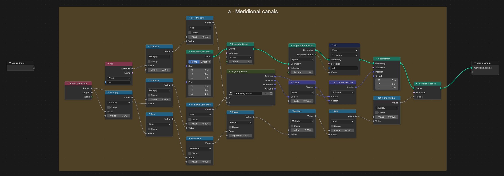

**b, c · Stomach to mid-row.** Each of the 8 radial canals is one curve through four stops: `c0: stomach`,
`c1: transverse canal` (±1.3 mm in the tentacular plane), `c2: interradial, one per quadrant` (at 45° between the
planes, 3.2 × 2.6 mm out) and `c3: mid-row, under the comb row`. The path is

P = c0 + (c1 − c0) S(0, 0.4, t) + (c2 − c1) S(0.25, 0.7, t) + (c3 − c2) S(0.5, 1, t)

with S a smoothstep. The three legs overlap in t, so each corner is a smooth bend, not a kink. `quadrant` =
floor(k / 2) × π/2 + π/4 makes two neighbouring rows share their first three stops and split only on the last leg,
as the real canals do.

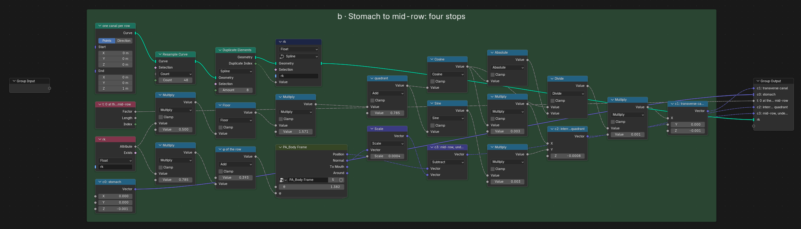

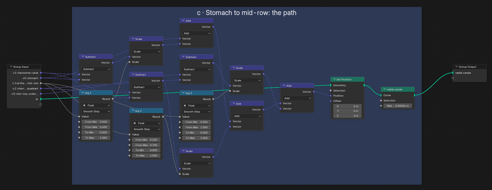

**d · Paragastric canals.** Two canals (copy number `pg`) run along the broad faces of the pharynx towards the mouth,
`just outside the pharynx`: the pharynx's own half-width formula at that height, plus 0.22 mm.

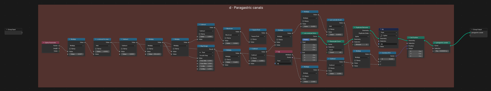

**e · Aboral canal and anal canals.** Three straight lines: from the stomach up to 1.25 mm short of the aboral pole,
then two short branches out to either side of the apical organ.

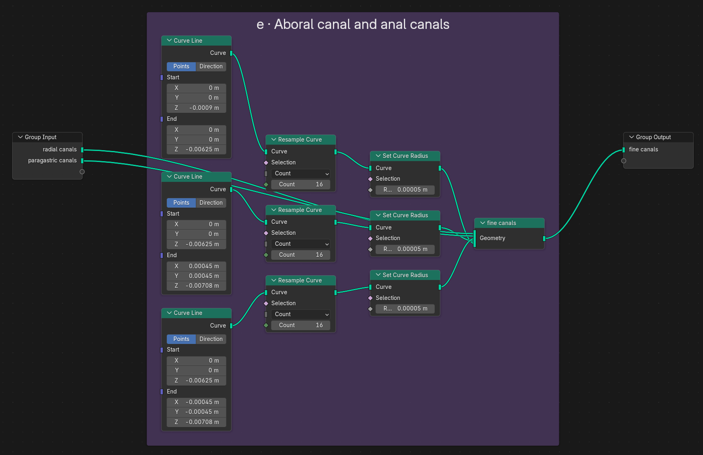

**f · Tubes.** The fine canals (radial, paragastric, aboral and anal) become one tube with the fainter `PA_Duct` material; the
meridional canals get `PA_Canal`. Both are 6-sided.

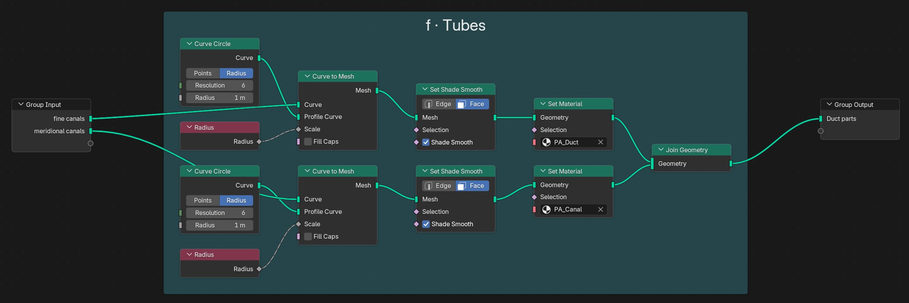

---

## 7 · Tentacles

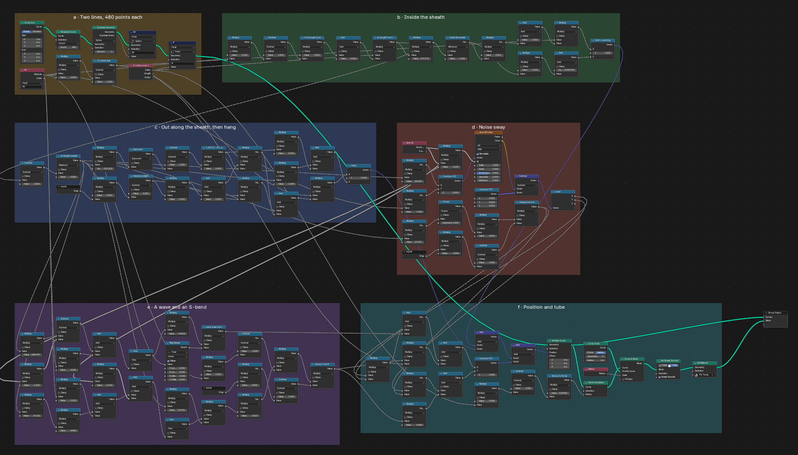

**a · Two lines, 480 points each.** A line resampled to 480 points (`T_PTS`) and duplicated twice: copy number `tid`
(0 or 1), and `±1: which side`. The line's own shape does not matter: its points are only slots, and
`tf: 0 at the bulb, 1 at the tip` (stored as `tf`) says where along the tentacle each one is.

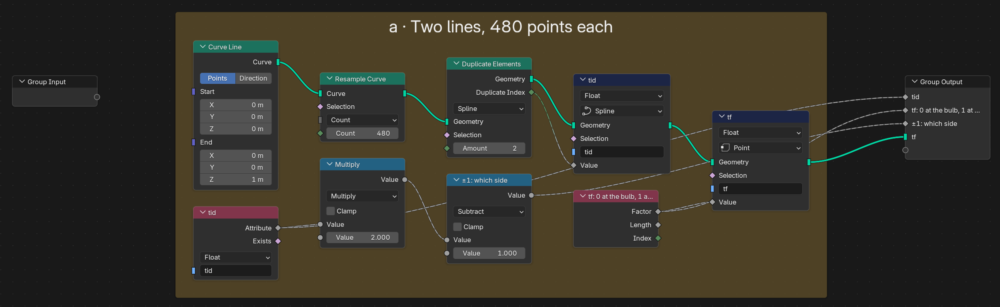

**b · Inside the sheath.** Each tentacle is 52 mm long outside (`T_LEN`; the second one 12 % shorter:
`free length (one a little shorter)`), plus the 5.56 mm (`L_IN`) inside the sheath from the middle of the bulb to the
opening. `arc length from the bulb` = tf × (free length + `L_IN`). While it is under `L_IN`, the point slides along
the sheath's axis from the bulb to the opening (`bulb → opening`).

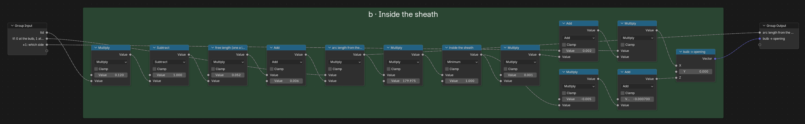

**c · Out along the sheath, then hang.** Past the opening, s = `arc length outside`. A tentacle leaving a tube should
leave along the tube, then turn to hang. With d0 the sheath's direction (0.26 out, 0.97 down: 15° from straight down)
and d1 the hanging direction (`hanging: a slight outward drift`, (0.05, −1), less with `Drag`):

p = d1 s + (d0 − d1) × T_OUT (1 − e^(−s / T_OUT))

Near the opening, T_OUT (1 − e^(−s/T_OUT)) ≈ s, so p ≈ d0 s: the tentacle continues the sheath. Far from it, the
term stops growing at T_OUT, so p ≈ d1 s + a constant: it hangs. The turn takes about `T_OUT` = 3 mm, and the
direction changes smoothly all the way.

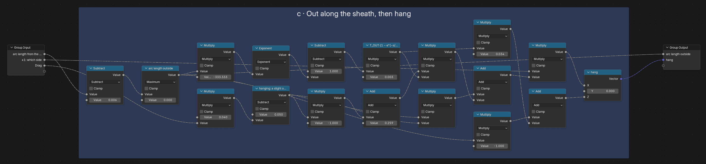

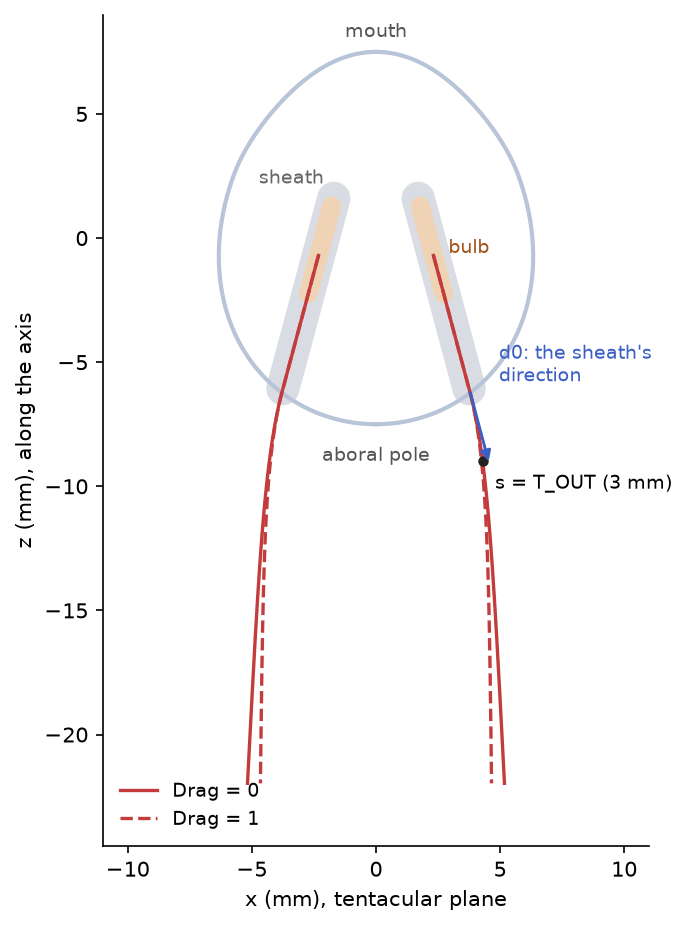

**d · Noise sway.** A `slow 4D noise` of (s × 45, `tid` × 7.3, 0) with W = 0.15 × time: its X and Y, minus 0.5,
push the tentacle sideways, scaled by `sway grows to the tip` = 9 mm × (s / 52 mm)^1.2 × (1 − 0.55 `Drag`):
a few millimetres at the tip, less when it streams back.

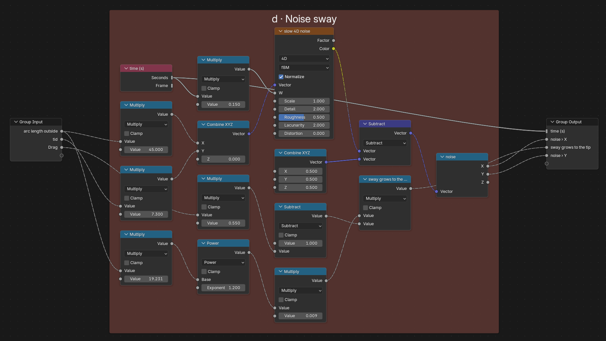

**e · A wave and an S-bend.** `a slow wave down the tentacle`: 0.35 mm, 14 mm long, travelling down at about
3.6 mm/s, faded in over the first 8 mm. `a long S-bend`: two-thirds of a slow sine wave over the length, growing to
7 mm at the tip.

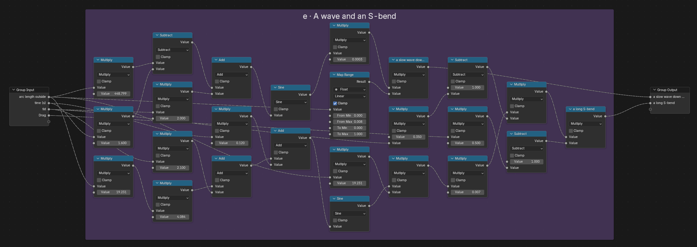

**f · Position and tube.** The sum goes to Set Position (`tentacle curves`, which section 8 reads). The radius is
0.024 mm (`T_R`) at the bulb, 45 % of that at the tip (`thinner to the tip`); an 8-sided Curve to Mesh makes the
tube.

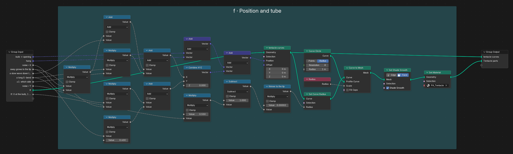

> **Try it:** set `T_OUT` to 0.3 mm in your own build. The tentacles now bend almost at once under the opening, a sharp
> elbow instead of a sweep.

---

## 8 · Tentillae

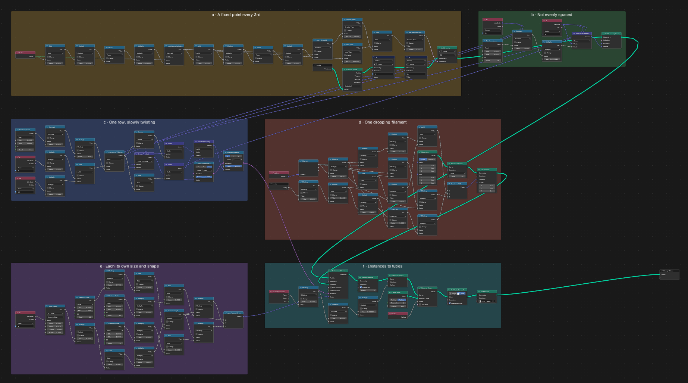

**a · A fixed point every 3rd.** Curve to Points in **Evaluated** mode returns exactly the tentacles' 2 × 480 points,
with their tangent and normal (stored as `tt`, `tn`). Index mod 480 is the `point along its tentacle`; Delete
Geometry removes the points near the sheath (before point 75, about 3 mm past the opening) and two of every three
(`every nth point`). That leaves 135 roots per tentacle, 270 in all.

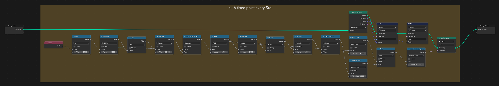

### Trick · fixed roots, by index

Picking the roots by index means the set of filaments never changes while the tentacle sways. The obvious way,
Curve to Points by Count on the moving curve and then deleting the points that fall inside the sheath, lets a
filament near the opening come and go as the curve changes length. When one disappears, every filament after it
takes on its neighbour's random size and droop, and the whole fringe jumps in a single frame (and motion blur, which
needs the same vertices on both sides of a frame, switches off for that frame). With fixed indices the vertex count
is the same on every frame and on every motion-blur step.

**b · Not evenly spaced.** Each root slides along the tangent by up to ±0.3 of the 0.36 mm gap
(`slide along the tentacle`), so the fringe does not look like a comb.

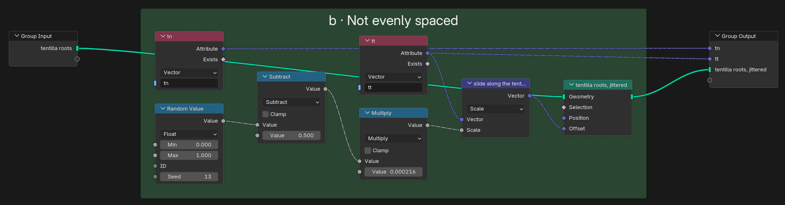

**c · One row, slowly twisting.** Real tentillae grow along one side of the tentacle.
`one row of filaments, slowly twisting` = 3 tf + π `tid` + 1.3 (random − 0.5): one side, turning 3 rad from
bulb to tip, and each filament a little off it. `side the filament points to` = tn cos + (tt × tn) sin of that angle.
Two Align Rotation to Vector nodes make the rotation: Z along the tentacle, then X towards that side (`filament rotation`).

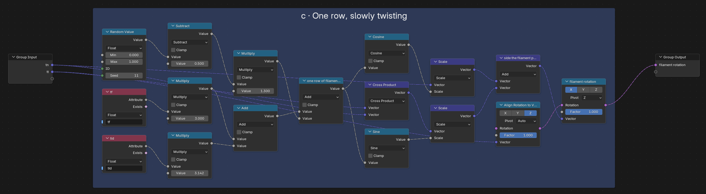

**d · One drooping filament.** One curve of 14 points along x, bent by Set Position: it sags by x² × `droop` along
local Z (the tentacle's direction, so it trails towards the tip), with a small side wobble
(0.12 x² + 0.035 sin 3πx). `droop` = 0.45 + 0.5 `Drag`: filaments trail more while swimming.

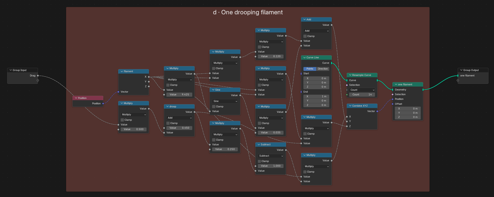

**e · Each its own size and shape.** `filament length` = 3.4 mm (`TILLA_LEN`), ramped up from a quarter over the
first stretch past the sheath, times 0.35–1.25 at random. A non-uniform scale (length, length × 0.3–1.9,
length × 0.5–1.5) gives each one its own droop and waver (`each filament droops and wavers its own way`).

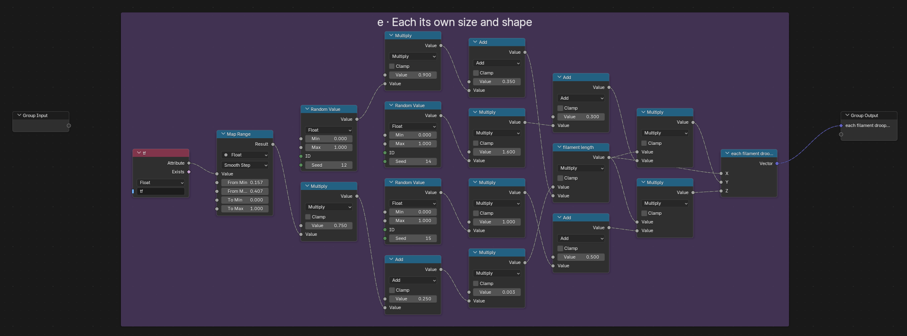

**f · Instances to tubes.** Instance on Points with that rotation and scale, Realize, a radius of 0.007 mm thinning to
40 % at the tip, 4-sided tubes, `PA_Tentilla`.

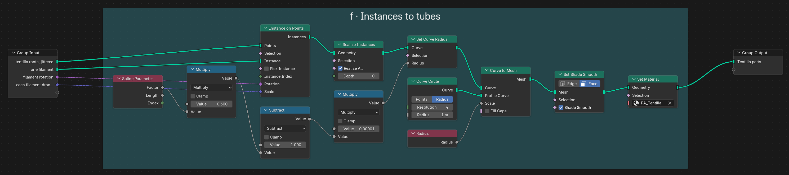

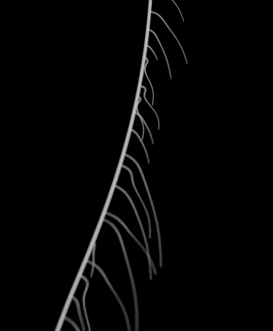

---

## 9 · Swim

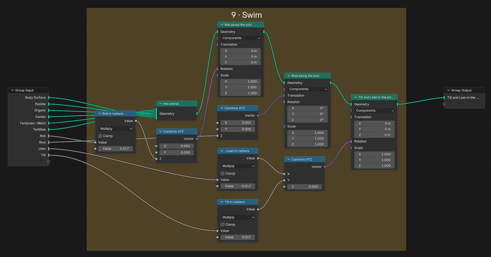

The parts are built in the animal's own frame: axis along z, aboral pole at −7.5 mm, mouth at +7.5 mm. `the animal`
joins them, then three Transforms move it:

1. `Roll about the axis`: `Roll` degrees about z.
2. `Rise along the axis`: `Rise` metres along z, mouth first.
3. `Tilt and Lean in the picture`: `Tilt` (14°) leans the axis sideways, `Lean` (10°) tips the mouth towards the
   camera.

The order matters. Rolling and rising happen along the animal's own axis, and only then is the whole thing tilted, so
it swims along its tilted axis, not straight up the screen. The camera follows 80 % of the rise along the same
tilted axis (keyed in `animate()`), so the animal climbs slowly in the frame while the marine snow streams past.

---

## 10 · Marine snow

200 Points at random in a box 52 × 110 × 74 mm round the animal (`where`), most of them behind it and out of focus.
`drift and sink`: a slow 4D noise moves each by up to ±0.75 mm, and each sinks at 0.35 mm/s × 0.5–1.5. The radius is
0.010 mm × e^(2.2 r²) (`size, sink speed` is one random value used for both), 0.01–0.09 mm. The snow is joined after
the Swim transforms, so it stays in the water while the animal moves past it: the parallax shows the swim.

---

## Inside the shared groups

### `PA_Body Point` (55 nodes)

(θ, φ) → a point on the body.

- **a · Unit sphere, egg profile.** x = sin θ cos φ, y = sin θ sin φ, z = −cos θ.
  `egg: narrower, a little conical at the mouth` = 1 + z × (−0.10) − smoothstep(0.35, 1, z) × 0.06
  (`EGG`, `ORAL`): the photos show the oral end as the more pointed one.
- **b · A ridge under each comb row.** `PA_Crest`, ((1 + cos x) / 2)^12 of 8 (φ − π/8), is 1 on each row and falls to 0
  within a few degrees. It is masked to the rows' θ span and scaled to 0.08 mm (`RIDGE`): `comb-row ridge`.
- **c · Apical dimple and mouth slit.** The `apical dimple` is a 0.45 mm deep Gaussian pit at the aboral pole; the
  `mouth slit` is a 0.7 mm deep pit at the oral pole, long in y and narrow in x.
- **d · Scale to the body.** X = x (egg × 6.3 mm + ridge), Y = y (egg × 6.3 mm × 0.93 + ridge),
  Z = z (7.5 mm + ridge) + dimple − slit (`B`, `FLAT`, `A`): `body point`.

The build script has the same surface in plain Python (`body_point_py`, without ridge, dimple or slit), used to place fixed
points such as the sheath openings.

### `PA_Body Frame` (13 nodes)

Three `PA_Body Point` nodes at (θ, φ), (θ + 0.002, φ) and (θ, φ + 0.002). The differences, normalised, are the
directions `to the mouth` and `round the body`; their cross product is the `outward normal`. Finite differences
work for any surface `PA_Body Point` can describe: change the body shape and the plates, canals and polar fields
follow.

### `PA_Ctene Stroke` (19 nodes)

`power stroke progress` = min(p / 0.22, 1) and `recovery progress` = max((p − 0.22) / 0.78, 0) (`POWER`). The
`angle from the normal` goes from 1.15 rad (66°, cocked towards the mouth: `A_REST`) to −0.55 rad (−31.5°: `A_END`)
along a smoothstep in the first 22 % of the cycle, then back along a slower smoothstep. The `curl` is
0.25 sin(π × power progress) − 0.75 sin(π × recovery progress). Both are equal at p = 0 and p = 1, so cycles join
without a jump.

### `PA_Spindle`, `PA_Grains`, `PA_Crest`

`PA_Spindle` (16 nodes): a line from `Start` to `End`, resampled, radius = `Radius` × sin(π t^`Skew`)^`Power`
(`swell and taper`), as a tube. `Skew` above 1 moves the fattest point towards `End`. `PA_Grains` (14 nodes):
`Count` points in a box round `Centre`, each an ico-sphere with its own size and turn (labelled `where`, `size`,
`turn`). `PA_Crest` (6 nodes): ((1 + cos x) / 2)^sharpness.

---

## Appendix A · Materials

### `PA_Ctene`: structural colour

The colours of a comb jelly are not light it makes. Its moving cilia scatter the light, and the colour depends on
their spacing and their angle to the light and the eye. The shader fakes that with Blender's Wavelength node:

- **a · Plate angle to light and lens.** `H: halfway between key light and lens`, and
  `|N·H|: plate angle to light and lens`: 1 when the plate is turned to mirror the key light into the lens.
- **b · Colour while it sweeps.** `lit while it sweeps`: on from the start of the power stroke (phase 0–0.04) and
  off over phase 0.26–0.55, and only while `beating`. `wavelength (nm)` = 700 − 300 × ramp(0, 0.5, phase) +
  (|N·H| − 0.6) × 90 − (v − 0.5) × 110: red at the start of the stroke, through green to violet, shifted by the
  angle and from the base of the plate to its tip. A Wavelength node and a Hue/Saturation (× 1.5) give the
  `sweeping colour`.
- **c · A glint at rest.** A resting plate still flashes a colour when it happens to sit at the right angle
  (`resting plates: a coloured glint`, |N·H| between 0.86 and 1), its hue from the angle alone.
- **d · Cilia lines, frayed tips.** `cilia lines`: 30 lines across the plate. A White Noise per line sets where each
  cilium ends (`each cilium ends at its own length`), and `frayed tip` fades the plate there.
- **e · Light on clear tissue.** Emission of `colour` × 16 while sweeping, added to a translucent, slightly glossy
  tissue that turns 75 % transparent while the colour shows. All of it is mixed over Transparent by
  cilia × tip × (0.12 + 0.7 band) + 0.02: between the cilia the plate is clear.

### `PA_Body`: clear skin, milky rows, faint jelly

- **a · Where the comb rows are.** From `b_dir`: θ and φ again. `1 on a comb row, 0 between` = (1 + cos 8(φ − π/8)) / 2;
  `a cushion under each plate` repeats 24 times along θ; `comb-row band: core + soft halo` = band^18 × (0.75 + 0.25
  cushion) + 0.22 band^6, inside the row ends.
- **b · Milky where it is a row, or edge-on.** `milky weight` = 0.02 (1 − |N·I|)^4 + 0.4 × band: Transparent where it
  is 0, a translucent and slightly diffuse white where it is 1. The skin shows as a faint rim, brightest edge-on, as in
  dark-field photos.
- **c · Skin reflection and the jelly inside.** A Glossy (roughness 0.12) mixed in by Fresnel (IOR 1.12) × 0.5. The
  volume is `mesoglea: faint blue forward scatter`: Volume Scatter, colour (0.55, 0.72, 1.0), density 2,
  anisotropy 0.55. The jelly fills with a faint glow that is brightest where it is thickest and dims what lies behind
  it.

### Milky tissues

Every soft tissue uses one recipe: weight = base + edge × (1 − |N·I|)^power, Transparent ↔ (Translucent + 25 % Diffuse)
by that weight. Walls read brightest where they are seen edge-on, as in the photos. Thick organs add a Volume Scatter
(anisotropy 0.45), so they read as solid milky masses.

| Material | Colour | base | edge | power | volume density |
|---|---|---|---|---|---|
| `PA_Organ` (pharynx, stomach) | (1.0, 0.96, 0.93) | 0.008 | 0.12 | 2.5 | 70 |
| `PA_Sheath` | (0.98, 0.96, 0.95) | 0.008 | 0.11 | 2.0 | 85 |
| `PA_Root` (tentacle bulbs) | (1.0, 0.84, 0.70) | 0.06 | 0.16 | 1.5 | 210 |
| `PA_Canal` (meridional, polar fields) | (1.0, 0.97, 0.94) | 0.03 | 0.12 | 2.0 | – |
| `PA_Duct` (fine canals) | (1.0, 0.97, 0.94) | 0.01 | 0.04 | 2.0 | – |
| `PA_Food` | (0.92, 0.42, 0.16) | 0.45 | 0.2 | 1.0 | – |

The densities are the build script's values × 0.5 (`LOOK['ovol']`). The tentacles use the same mix at a flat weight of 0.2
(filaments 0.14), pinkish, 40 % diffuse. The statolith granules and the snow are a Principled BSDF mixed with
Translucent.

---

## Appendix B · Light, camera, world

**Dark-field light.** Three disk area lights, 35 mm across, all out of the picture: two rim lights behind the
animal, one to each side, and a third high above. All aim at a point 4 mm above the animal's starting centre, with
powers 0.34, 0.11 and 0.07 W and cool colours. Like a dark-field microscope, light only reaches the lens where
something scatters it. The lights are hidden from the camera and
from glossy rays, so the skin shows no hot highlight, only a soft rim. The world is black except in reflections:
`seen only in reflections: a soft dome, brighter above` (a Light Path › Is Glossy Ray mask), so the clear skin still
shows its edge.

**Camera.** A 100 mm lens 94 mm from the animal (a macro view), at f/24, focused 1.5 mm in front of the centre: the
near rows are sharp, the far side and the tentacle tips go soft. AgX, Medium High Contrast.

**Render settings.** 24 bounces (48 transparent, 20 transmission, 4 glossy, 2 diffuse, 1 volume), indirect light
clamped at 6, denoising on. A light bloom in the compositor (0.35, threshold 1.2).

---

## How it was rendered

Cycles, 1080², 128 samples, denoising, motion blur (half-frame shutter). The 288 frames took about an hour on one GPU
on a second PC (about 13 s a frame). Before the Cycles render, the motion was checked as a white-clay
Workbench preview. After the render, a tile-by-tile frame-difference scan checked every frame for single-frame
jumps like the one described in section 8. A separate script then adds the photographic finish: a cos⁴ lens vignette, then sensor noise in linear light, read noise
plus shot noise (σ² = read² + gain × signal) at an "ISO 3200" level, mostly luminance, new on every frame. It encodes
H.264 at CRF 16.

## Try it yourself

1. **Rows in step.** In `PA_Metachronal Wave`, set every value of `row pacemaker delay (cycles)` to 0: all eight rows
   beat together, and the rainbow flecks line up round the body in rings.
2. **Longer or shorter waves.** `Wavelength` 30: one long, fast wave per row. `Wavelength` 3: short, slow, crowded
   waves; the mouth end starts 5 s late and has not stopped by frame 288 (its last cycle comes 7.7 beats after the
   apical end's).
3. **An earlier stop.** Set `Stop` to 6 (it is not keyed): the stop front leaves the apical organ at frame 147 and the
   last plate rests at frame 206. The `Rise` and `Drag` keys still follow the original schedule, so the animal keeps
   swimming with silent rows. Moving `T_STOP` in your own build moves them all together.
4. **Streaming tentacles.** Delete the `Drag` keys and set it to 1: the tentacles hang almost straight, sway less, and
   the filaments droop to 0.95.
5. **Another water.** `Seed` 4: another scatter of marine snow.

*Made with Blender 5.2 Geometry Nodes for [Nodevember](https://nodevember.com) 2026, Day 16 · Wave.*
