# How a cut-glass decanter writes on the table

*A node-by-node walkthrough of Nodevember 2026 · Day 17 · Caustics*

The video (14 s, 336 frames, 24 fps) looks straight down at a lead-crystal decanter in a dark room, lit by one low
sun. While the decanter turns 30°, the cut on its body morphs through five classic patterns of cut and pressed glass:
flutes, swirl, diamond thumbprint, honeycomb and hobnail. The light that passes through the glass re-weaves itself
on the table with every pattern. The table shows nothing else: no direct sun, no shadow, only light that went
through glass. That light is not Cycles' own caustics. It is ray-traced in Geometry Nodes, about 6.4 million sun rays
a frame, each split into 5 wavelengths that bend by different amounts. The table shader then displays the result as
light. Everything comes from one Geometry Nodes modifier on an empty object, plus Blender 5.3's Principled BSDF
(with its new spectral dispersion) for the glass the camera sees. There is no image texture, no simulation and no
modelled or imported mesh (`pb.audit`: strictly procedural; its one note is the Object Info node that reads the sun
lamp the rays start from). The motion is two keyed sliders, Pattern and Turn.

| File | What it is |
|---|---|
| `../loop.mp4` | the video: 1080², 24 fps, 336 frames (14 s), Cycles 128 samples, denoised, H.264 CRF 16 |
| `../render.png`, `../render-150.png` | stills: frame 300 (hobnail) and frame 150 (diamond thumbprint) |
| `../nodes/` | node shots of the main tree and its helper groups |
| `images/` | every figure and node shot on this page |

The scene file and the scripts that build it and draw this page's figures are not published; this page shows every
node.

---

## The one idea

> **A caustic is the shadow of a lens, and a cut-glass pattern is a field of tiny lenses.** Shoot a dense grid of
> parallel sun rays at the decanter, bend each one at every glass surface it meets with Snell's law, and count where
> they land on the table. Wherever the cut gathers rays, the table is bright; wherever it spreads them, dark. Change
> the cut and the lenses change, so the light on the table changes with it.

So the tree has two halves. One makes the lens: a turned decanter with a pattern cut into it and exact surface
normals. The other is a small ray tracer that follows light through it. Everything else is bookkeeping around that
idea:

- **What does the decanter look like?** One half-section curve, outside up, over the lip and inside down, turned on
  a lathe (1 · Decanter, `PA_Decanter Profile`, `PA_Lathe`).
- **Which cut?** One slider, Pattern 0…4, picks ten numbers between five named states (`PA_Pattern Keys`). One height
  function turns them into a cut depth at every point of the body (`PA_Cut Pattern`).
- **Which way does the glass face?** The surface normals come from the height function itself, not from the mesh,
  so no polygon grid shows in the light (1 · Decanter, sections 3–4).
- **Which light?** A grid of rays facing the sun, from a sun disc 0.53° wide. Each ray is split into K = 5
  wavelengths, each with its own index of refraction (2 · Sun rays).
- **Where does it go?** A repeat zone with Raycast, Snell's law, total internal reflection and Fresnel loss (3 · Trace).
- **How bright is the table?** The landed rays are counted in 0.5 mm cells and turned into irradiance (4 · Caustic map).
  The table's shader shows that number as light (5 · Table).

### How to read the screenshots

Each coloured frame in a tree is one section of the build script (`with g.section("…")`), and the section headings below
use the same numbers. Under every overview there are cut-outs, one per frame. In a cut-out, a wire coming from
another section enters through a Group Input socket named after the node it comes from. For example,
`Pattern Keys › W1` is the W1 output of the Pattern Keys node, and `∂h/∂φ` is the node labelled that way. A wire
leaving the section exits through a Group Output socket. Green-headed nodes with a `PA_` name are node groups; each
has its own section further down. Labels in `code` style are the node labels as they appear in the screenshots.
Lengths are in metres and angles in radians, as Blender stores them, so a Depth of 0.0012 is 1.2 mm. Click any
screenshot to see it at full size.

---

## 0 · The map

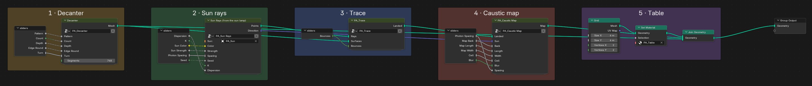

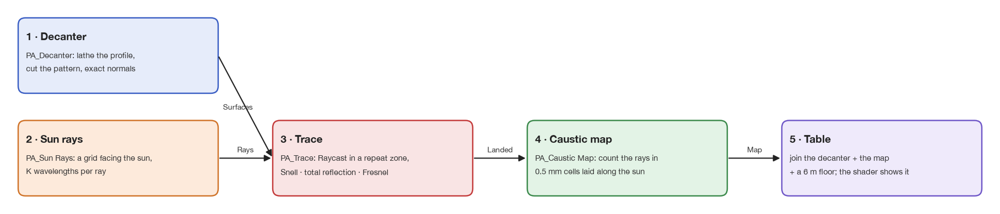

| # | Section | Nodes | Job |
|---|---|---|---|
| 1 | Decanter | 312 in 9 groups | lathe the profile, cut the pattern, exact normals, turn |
| 2 | Sun rays | 124 in 3 groups | a fixed grid of rays facing the sun, K wavelengths each, weights that sum to the sun |
| 3 | Trace | 74 | follow every ray through the glass: Raycast, Snell, total reflection, Fresnel |
| 4 | Caustic map | 84 in 2 groups | count the landed rays in 0.5 mm cells → irradiance on the table |
| 5 | Table | 3 | join the decanter, the map and a 6 m floor |

606 nodes in 16 trees: the main tree (12 nodes) and 15 groups. The main tree only wires the five groups together
and exposes 17 sliders; all the work happens inside the groups.

Only two sliders move. Pattern is keyed 0 → 4 with Bézier keys, so every morph eases in and out of its hold. The
honeycomb → hobnail inversion gets the longest morph, 54 frames (2.25 s), because it is the only one that turns dishes
inside out into domes. Turn runs linearly from 0° to 30° (Appendix B).

---

## 1 · Decanter

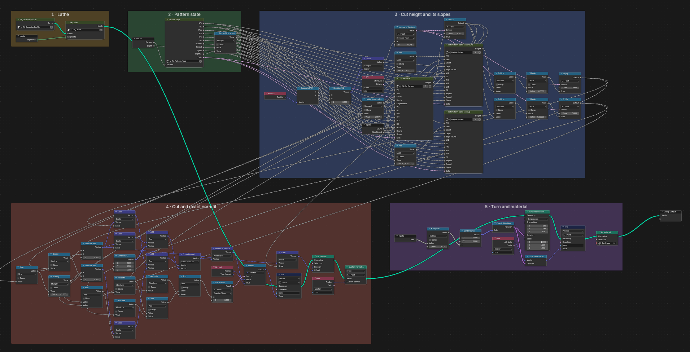

`PA_Decanter` (63 nodes) builds the glass. It calls the profile and the lathe, reads the pattern state, cuts the
pattern into the outside of the body and turns the result. The five cuts look like this from the side, rendered from
the same tree with a side camera:

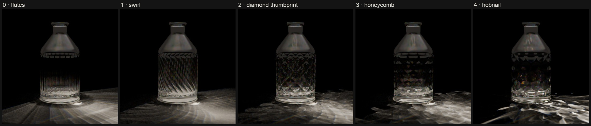

### 1.1 · The profile: one closed curve

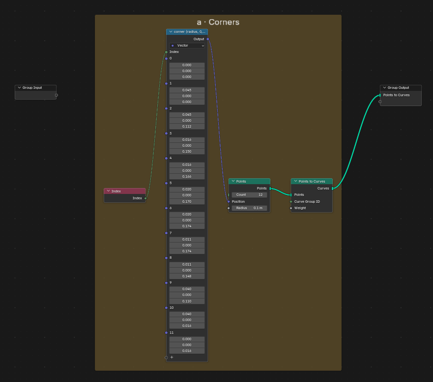

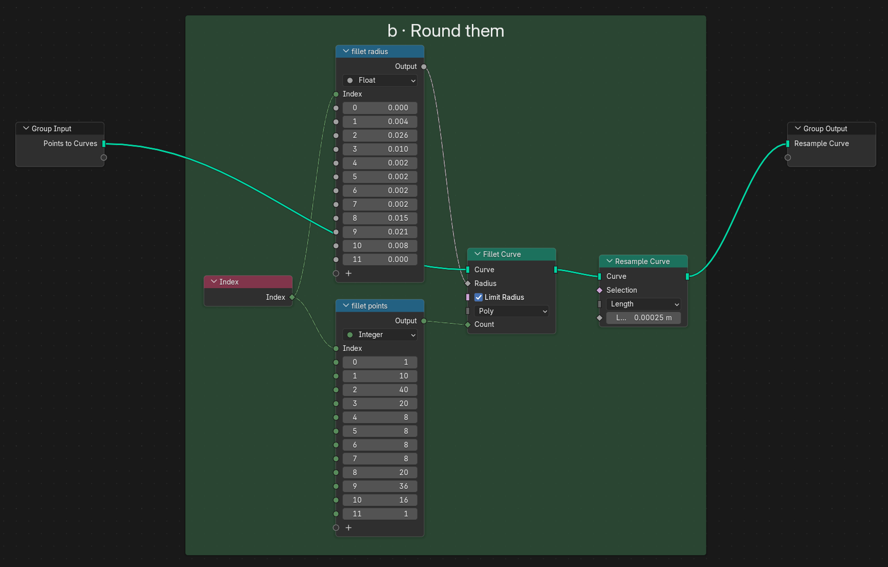

The decanter is a single curve in the XZ plane (x = radius, z = height), drawn as 12 corners:
`corner (radius, 0, height)`. Each corner gets its own `fillet radius` and `fillet points` (Fillet Curve in Poly
mode). The 26 mm fillet rounds the shoulder, 15 mm and 21 mm fillets do the inside of the neck and shoulder, and 1.5 mm ones roll the lip.
Resample Curve then spaces the points every 0.25 mm, which gives 1753 points.

**Why one closed curve?** The curve starts on the axis under the base, runs up the outside, over the lip, down the
inside, and ends on the axis on top of the 16 mm base. Turned, it becomes one closed skin with glass on one side and
air on the other everywhere. The tracer only has to ask which side of a face a ray comes from to know whether it is
entering or leaving glass (3 · Trace, section b). It needs no booleans, no separate inner mesh and no "is this point
inside" test.

### 1.2 · The lathe

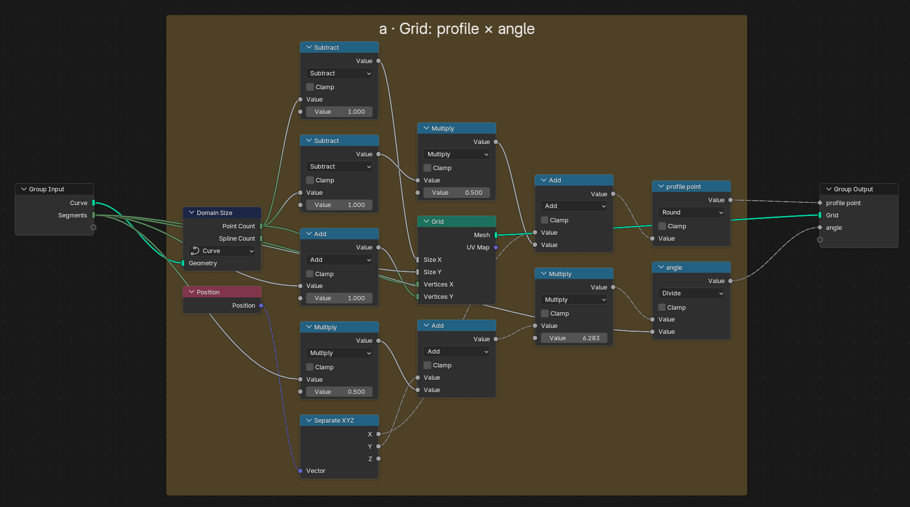

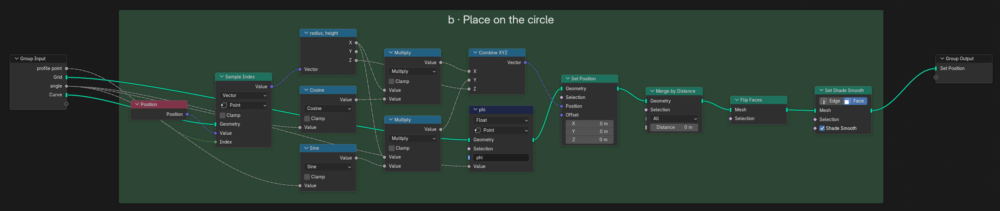

`PA_Lathe` turns any profile curve into a surface of revolution. A Mesh Grid has one column per profile point
(1753) and one row per angle (`Segments`, 768, plus one). Its X position, shifted by half the width, is the
`profile point` index. Its Y position becomes the `angle` φ. Sample Index reads that profile point's radius and height, and
Set Position puts the vertex at (r cos φ, r sin φ, z).

Three cleanups follow:

| Node | Why |
|---|---|
| Store `phi` | the pattern is drawn in (angle, height). Storing φ here keeps it continuous, so later sections never need `atan2` and its jump at ±180° |
| Merge by Distance (1e-7 m) | the first and last rows meet at the seam, and every point on the axis is 768 copies of one point; merging closes the skin |
| Flip Faces | the profile runs the way that makes normals point into the glass; flipped, every normal points into air. Section 3 · Trace relies on this |

The result: 1 344 770 vertices, a vertex every 0.37 mm round the body and every 0.25 mm up it.

### 1.3 · Pattern state: ten numbers from one slider

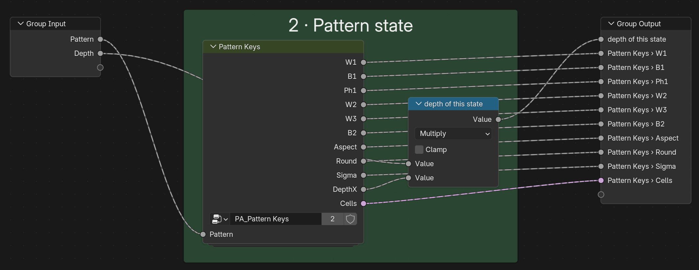

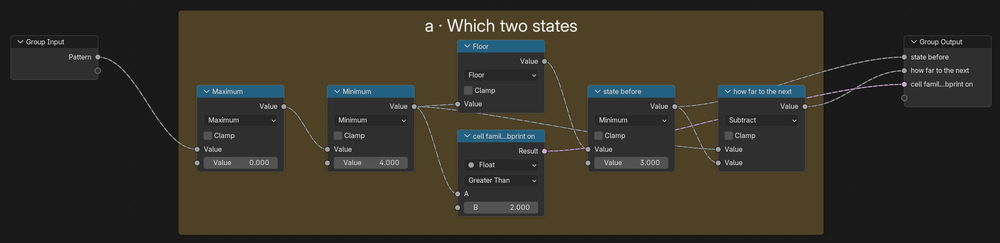

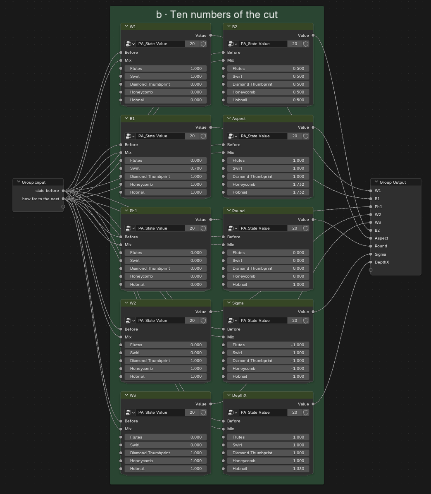

Every cut on the decanter is described by ten numbers. `PA_Pattern Keys` holds a table of them, one row per named
state, and the Pattern slider walks through it. `state before` is ⌊Pattern⌋, and `how far to the next` is the
remainder. Each `PA_State Value` node picks its number in the state before and in the state after, then mixes the
two linearly. At Pattern 1.5, for example, every number is halfway between swirl and diamond thumbprint.

| Number | flutes | swirl | diamond thumbprint | honeycomb | hobnail | What it does |
|---|---|---|---|---|---|---|
| W1 | 1 | 1 | 0 | 0 | 0 | weight of groove set 1 (flutes / swirl) |
| B1 | 0 | 0.7 | 1 | 1 | 1 | lead of set 1: how far a groove moves round per flute pitch of height |
| Ph1 | 0 | 0 | 0 | 0 | 0 | phase of set 1 (kept for experiments) |
| W2, W3 | 0 | 0 | 1 | 1 | 1 | weights of the two crossing sets (diamond) |
| B2 | 0.5 | 0.5 | 0.5 | 0.5 | 0.5 | lead of the crossing sets, ±0.5 |
| Aspect | 1 | 1 | 1 | √3 | √3 | row height / cell width of the cell lattice |
| Round | 0 | 0 | 0 | 0 | 1 | polygon cells → round cells |
| Sigma | −1 | −1 | −1 | −1 | +1 | profile: −1 concave dish, 0 flat facets, +1 round dome |
| DepthX | 1 | 1 | 1 | 1 | 1.33 | depth multiplier (hobnail domes stand 1.6 mm instead of 1.2 mm) |

The eleventh output, `Cells`, is a switch rather than a number: `cell family from the thumbprint on`, which turns on
when Pattern passes 2. Why it can switch there without a jump is the trick in 1.4.

### 1.4 · The cut: one height function, two families

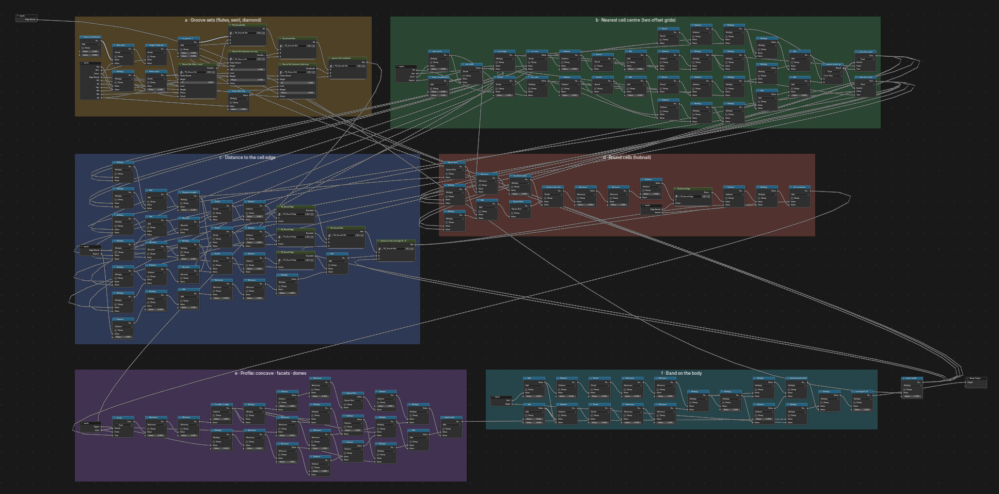

`PA_Cut Pattern` answers one question: at angle φ and height v (measured from the middle of the cut band), how deep
is the cut? The answer is a height h ≤ 0. It is computed in two steps:

1. A **cell coordinate** m: 0 on a groove line or cell edge, 1 in the middle of a cell.
2. A **profile** that turns m into a depth: a dish, a flat facet or a dome.

Two families of patterns make m. Grooves are sets of parallel helical lines, which give the flutes, the swirl and
the diamond. Cells are a lattice of polygons, which give the thumbprint, the honeycomb and the hobnail.

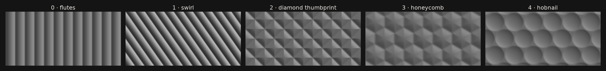

#### a · Groove sets (flutes, swirl, diamond)

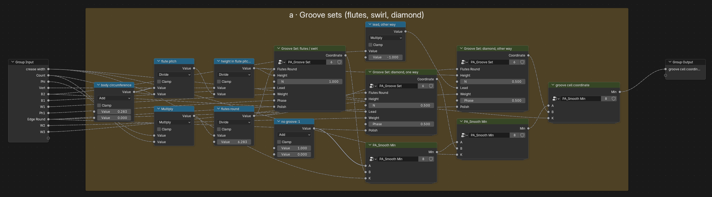

The `flute pitch` is the body circumference divided by Count: 2π × 45 mm / 24 = 11.8 mm. Position on the body is
measured in pitches: `flutes round` = φ · Count / 2π, and `height in flute pitches` = v / pitch. Each
`PA_Groove Set` draws grooves along the lines where

  c = N · (flutes round) + Lead · (height in pitches) + Phase

is a whole number. It returns a rounded triangle wave of c: 0 on a groove, 1 halfway between two (see
[Inside the helpers](#inside-the-small-helpers)).

| Set | N | Lead | Draws |
|---|---|---|---|
| `Groove Set: flutes / swirl` | 1 | B1 | 24 grooves round. Lead 0 makes them vertical (flutes); lead 0.7 shifts each groove 0.7 pitch round per pitch of height, so they lean 35° (swirl) |
| `Groove Set: diamond, one way` | 0.5 | +B2 = 0.5 | 12 helices at 45° |
| `Groove Set: diamond, other way` | 0.5 | `lead, other way` = −0.5 | 12 helices at −45°; with the set above, a lattice of rhombi 23.6 mm across |

A set whose weight W is 0 returns 1 everywhere, which means no groove. `PA_Smooth Min` then takes the smallest of
the three. It starts from `no groove: 1`, so a decanter with all three weights at 0 is uncut. The smooth minimum
rounds the crease where two grooves cross, over a `crease width` of 1.33 × Edge Round.

#### b · Nearest cell centre (two offset grids)

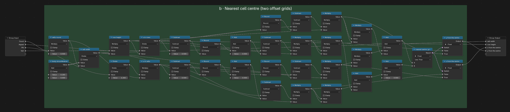

The cell family needs to know which cell a point is in. A hexagonal lattice is awkward to index directly, but it is
the union of two rectangular grids. Grid A has a centre at every whole (u, v); grid B is offset half a cell round and
half a row up. A point belongs to the nearer of its two candidate centres, `nearest centre: grid A` or grid B, and
`x from the centre` and `y from the centre` give its offset in metres.

The `cell width` is the circumference over Count / 2 cells: 2π × 45 mm / 12 = 23.6 mm at Count 24.
The `row height` is Aspect times that. At Aspect 1 the cells are the diamond's rhombi. At Aspect √3, every cell is exactly one cell width from
all six of its neighbours, so the cells are regular hexagons.

### Trick · Two families that agree at one state

> **The groove family and the cell family draw the same surface at the diamond thumbprint, so the morph can change
> family there without a jump.** At Aspect 1, the two crossing groove sets and the cell lattice cut exactly the same
> rhombi (the left two panels above). In a numpy copy of the pattern the two surfaces differ by at most 1e-17 m. In the nodes, going
> from Pattern 1.9999 to 2.0001 moves no vertex more than 0.0006 mm. Grooves can make spirals but not hexagons;
> cells can make hexagons and domes but not spirals. A whole morph from flutes to hobnail needs both, and this one
> shared state stitches them together.

#### c · Distance to the cell edge

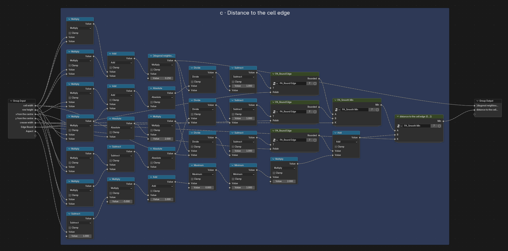

A cell's edges are the perpendicular bisectors to its neighbours. For the diagonal neighbours at (± width/2,
± row/2), the edge is the line x · width + y · row = `|diagonal neighbour|²`. The value 1 − |x · width ± y · row| / L²
runs from 1 at the centre to 0 on that edge. Two such distances cover the four slanted edges. A third,
1 − 2|x| / width, covers the two upright edges toward the side neighbours. It matters only for hexagons, so at
Aspect 1 it gets +2 added, which keeps it out of the minimum; by Aspect 1.2 the extra is gone. `PA_Round Edge`
softens each ramp, and two `PA_Smooth Min` give the `distance to the cell edge (0…1)`.

#### d · Round cells (hobnail)

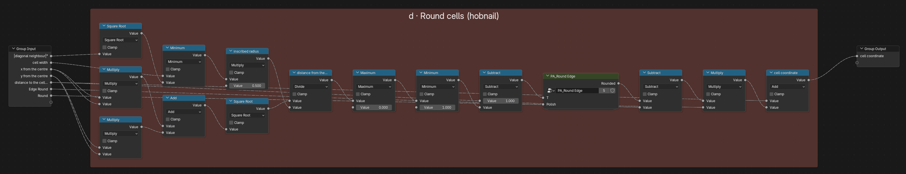

Hobnail domes are round, not hexagonal. `distance from the centre / inscribed radius` is a circular version of the
same coordinate (11.8 mm for the honeycomb), and the Round number mixes polygon → circle. Round only changes during
the inversion (Pattern 3 → 4).

#### e · Profile: concave · facets · domes

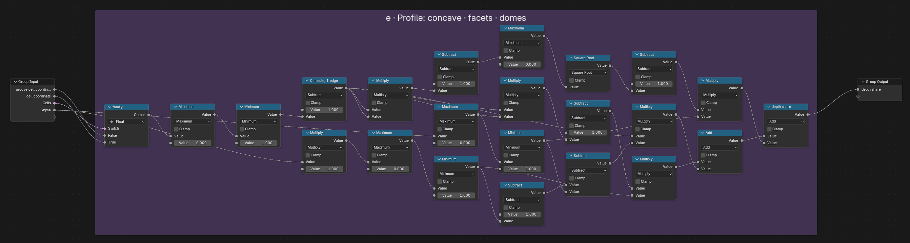

`family` picks one of the two coordinates. With `0 middle, 1 edge` = 1 − m, three shapes are possible, and Sigma
blends them:

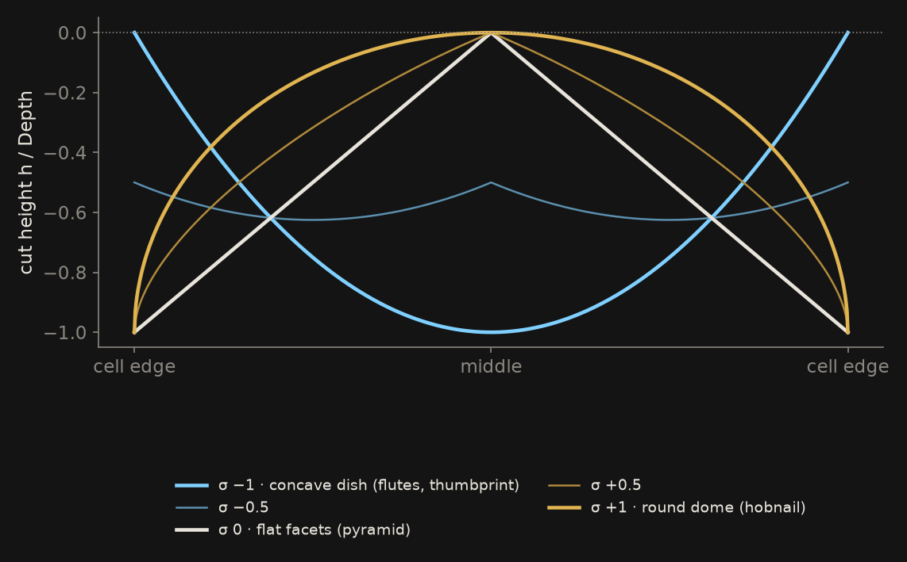

| Sigma | Shape | Pattern |
|---|---|---|
| −1 | concave dish: 1 − v², deepest in the middle, a ridge on every edge | flutes, swirl, thumbprint, honeycomb |
| 0 | flat facets: v, an apex in the middle | (passing) |
| +1 | round dome: 1 − √(1 − v²), a lens on every cell | hobnail |

Only the inversion (Pattern 3 → 4) moves Sigma, and it passes a calm moment on the way. At Pattern 3.25 (σ −0.5) the
dish and the pyramid cancel almost exactly: the whole band sinks by about half the depth, with only ±0.06 Depth of
relief left. Its caustic is closer to the uncut decanter's than any of the five named cuts. Then pyramids grow and
round off into domes:

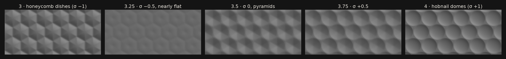

#### f · Band on the body

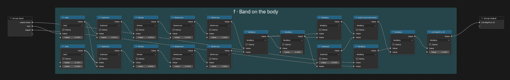

The cut stays on the straight part of the body, from 14 mm to 104 mm. It fades in and out over 6 mm with a
smoothstep, so the cut ends softly instead of in a step. The `cut height (≤ 0)` is −(depth share) × Depth × band.

> **Try it:** at Pattern 2, set Edge Round to 0.3. Every ridge is polished round, so each diamond becomes a small
> lens, and the flat rhombic patches on the table turn into rounded cells with bright caustic rims. Lower it to 0.01
> for knife-sharp ridges. That is the slider's lower end on purpose: `PA_Smooth Min` divides by the crease width, and
> at exactly 0 the cut would vanish from the caustic.

### 1.5 · Cut height and its slopes

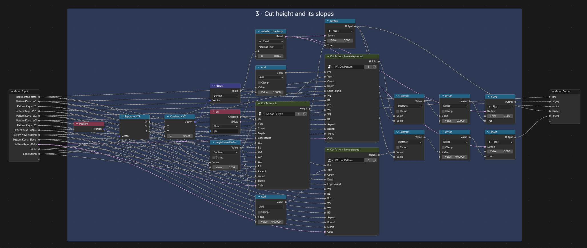

Only vertices on the outside of the body are cut: `outside of the body` is radius > 42.5 mm, so the inside wall,
the neck and the base are left alone. `PA_Cut Pattern` is evaluated three times. `Cut Pattern  h` is evaluated at the
vertex, `Cut Pattern  h one step round` 2e-5 rad further round (0.9 µm on the body), and `Cut Pattern  h one step up`
5 µm higher. The two differences are the slopes `∂h/∂φ` and `∂h/∂z`.

### 1.6 · Cut and exact normal

The cut surface is S(φ, z) = (r + h) ρ̂ + z ẑ, where ρ̂ = (cos φ, sin φ, 0). Its two tangents are

  ∂S/∂φ = ∂h/∂φ · ρ̂ + (r + h) · φ̂  and  ∂S/∂z = ∂h/∂z · ρ̂ + ẑ,

and the `normal of the cut surface` is their cross product, normalised. (The input named `Switch` in the cut-out is
h itself: section 3 ends with the outside-only switch.) Inside the band this normal is stored as `nrm`; elsewhere
the mesh's own normal is kept. Then Set Position moves each vertex inwards by h (`cut inwards`), and Set Mesh Normal
gives Cycles the same vectors as custom normals (`custom normals = the same normals`).

### Trick · Normals from the formula, not from the mesh

> **A caustic magnifies every error in the surface normals, so take them from the height function, not from the
> polygons.** The mesh has a vertex every 0.37 mm, but a 1.2 mm deep cut with 24 flutes makes slopes that change
> across a few polygons. Face normals, or even smoothed vertex normals, carry the polygon grid with them, and a
> caustic turns that into a visible grid of light. The finite-difference normals are the true surface's normals at
> each vertex, and the tracer interpolates them across each face. A test at 768 and 1536 segments gave the same
> caustic map to within photon noise. Cycles uses the same vectors as custom normals, so the glass the camera sees
> and the glass the rays go through bend light the same way.

### 1.7 · Turn and material

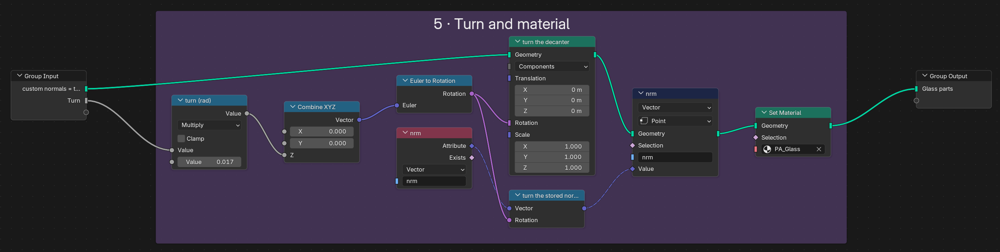

Transform Geometry turns the decanter by Turn degrees about its axis, and Set Material gives it `PA_Glass`.

### Trick · Transform does not turn your attributes

> **Transform Geometry rotates positions and custom normals, but a vector you stored yourself stays where it was.**
> Without `turn the stored normals too` (a Rotate Vector on `nrm`), every normal the tracer reads would lag the
> glass by the whole turn: 30° by the last frame. The light would bend as if the surface faced somewhere else.
> Cycles would still look right, because it reads the custom normals, and those Transform does rotate. Here is a
> check that needs no eye: with 12 cells round, the hobnail repeats every 30°, so its caustic at Turn 30° must equal
> the one at Turn 0°. With the rotation the two maps agree to photon noise (0.6/255); without it they differ by
> 9.1/255 on an average of 16.5.

> **Try it:** change Count from 24 to 32 (keep it even: the cells round are Count / 2). The flute pitch drops to
> 8.8 mm, and the hobnail grows 16 domes round instead of 12, which focus into more, smaller drops.

---

## 2 · Sun rays

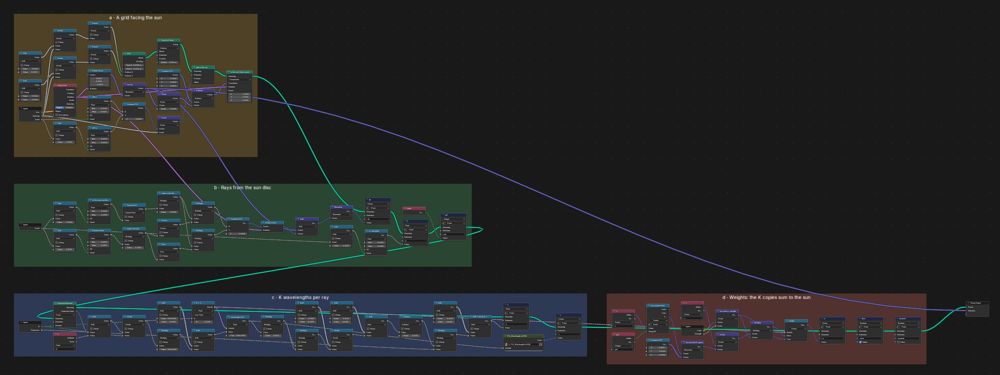

`PA_Sun Rays` (82 nodes) makes the light: points that carry a position, a direction, a wavelength, an index of
refraction and a weight.

### a · A grid facing the sun

`sun ray` is the sun lamp's own direction: (0, 0, −1) turned by its rotation, read with Object Info. The lamp sits
30° above the horizon, shining from azimuth 130°. A Mesh Grid of 98 × 204 mm covers the decanter as seen from any
sun elevation: twice the radius plus 8 mm across, and the diagonal of the decanter plus 8 mm along. It has one vertex
per Photon Spacing. Each point is jittered inside its cell (`jitter x`, `jitter y`), then the grid is turned to face
the sun and moved 0.3 m upstream of the decanter (`in the sun's frame, upstream`).

At the final spacing of 0.056 mm that is 1750 × 3641 = **6 371 750 rays** a frame (the slider's default, 0.08 mm,
gives 3.1 million). The grid's size and spacing never change during the shot, so every ray keeps its index and its
jitter from frame to frame. The photon noise then moves only where the light really moves, instead of boiling
everywhere.

### b · Rays from the sun disc

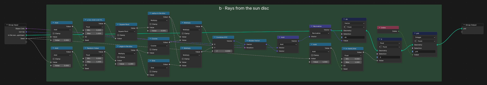

The real sun is a disc 0.53° wide, not a point, and that is what softens the edges of a real caustic. Each ray is
tilted by a random point in a disc of radius 0.265°. Taking √u for the radius spreads the points evenly over the
disc's area. Three attributes are stored: `dir`, the in-band jitter `jl` that section c uses, and `pid`, the ray's
index.

### c · K wavelengths per ray

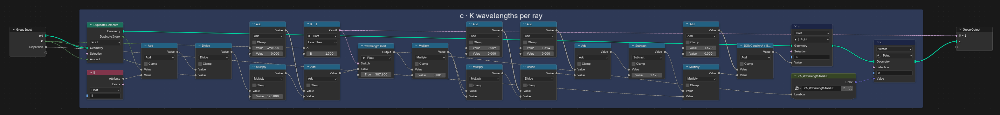

Duplicate Elements makes K = 5 copies of every ray. Copy k gets the `wavelength (nm)` 390 + (k + jl) / K × 320, so
the five copies cover five 64 nm bands of the spectrum, each at the same random point inside its band. The index of
refraction is Cauchy's formula, n = A + B / λ² (λ in µm). A and B are fitted so that n = 1.62004 at 587.6 nm and the
Abbe number is 36.37, the values of Schott F2 lead glass. This is the formula Cycles 5.3 uses for the Principled
BSDF's dispersion (OpenPBR eqs. 55–56), so the rays and the glass the camera sees disperse alike. The Dispersion
slider scales the spread around n_d; at 0 every wavelength sees 1.62004.

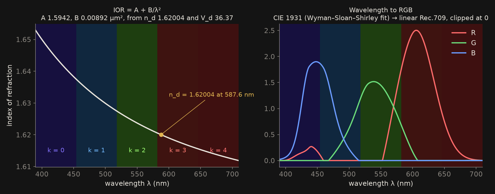

The violet end's index is 0.041 higher than the red end's. That is a small difference in angle, but the table is
0.1–0.4 m from the glass, which is enough to split a sharp caustic line into a rainbow fringe at its edges.

### d · Weights: the K copies sum to the sun

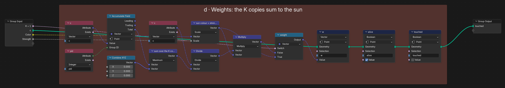

Each copy gets the colour of its wavelength (`PA_Wavelength to RGB`, see Inside the helpers). Its `weight` is that
colour divided by the `sum over the K copies` of the same ray (Accumulate Field grouped by `pid`), times
`sun colour × strength` (6 W/m² of warm light, (1, 0.90, 0.78), the same as the sun lamp).

### Trick · Copies that add up to white

> **Normalise each ray's K colours by their own sum, so the copies add up exactly to the sun.** Wherever the five
> wavelengths of a ray land together, their weights sum to the sun's colour, so undispersed light stays exactly the
> sun's colour, with no tint from the colour-matching curves. Only where the wavelengths part do colours appear. The
> check: Dispersion 0 with K = 5 gives the K = 1 map to within 0.0014 of irradiance, with the same totals.

> **Try it:** set Dispersion to 0. The rainbow fringes on the table vanish and the caustic is the sun's warm white
> throughout. The decanter's rims keep their colour, because that is the Principled BSDF's own dispersion in the glass
> material, which this slider does not touch (Appendix A).

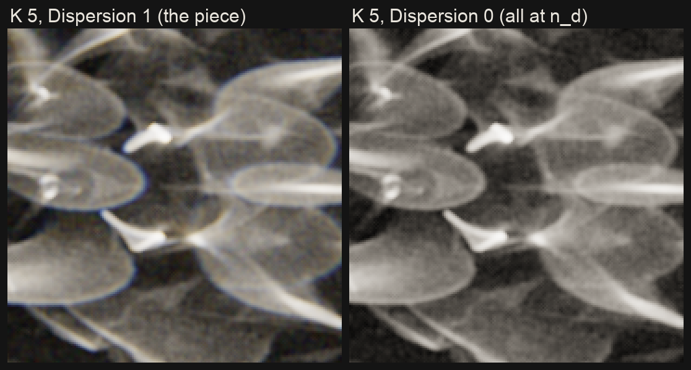

---

## 3 · Trace

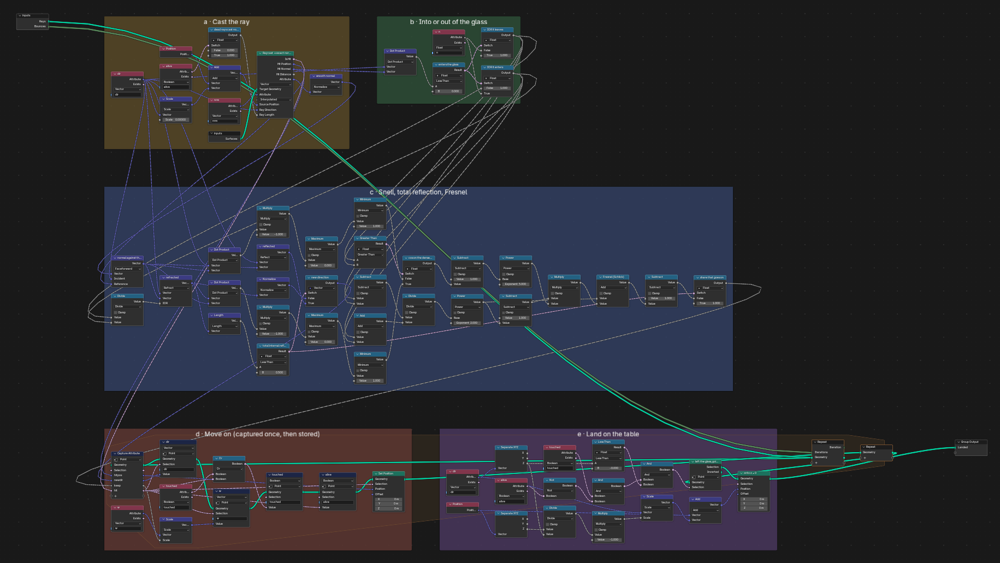

`PA_Trace` (74 nodes) follows every ray through the glass. It is a repeat zone that runs `Bounces` = 12 times. Each
pass moves every live ray to the next surface it hits and bends it there.

### a · Cast the ray

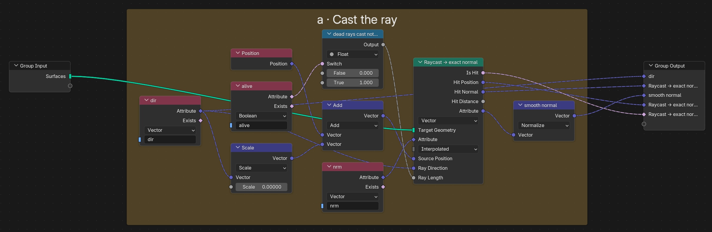

Raycast shoots each point along `dir` at the decanter. It starts 2 µm along the ray, so it does not hit the surface
it is sitting on. It also reads `nrm`, interpolated across the hit face, as the `smooth normal`.
`dead rays cast nothing`: a ray that missed last time gets a length of 0.

### b · Into or out of the glass

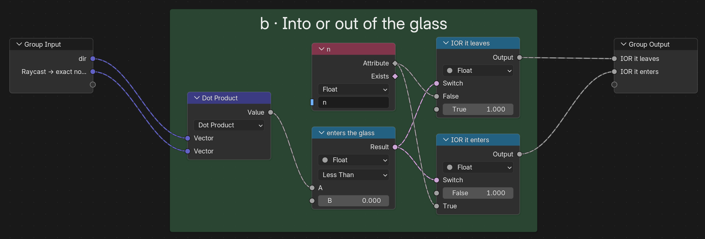

Every face normal points into air (1.2 · The lathe). If the ray meets the face against its normal, it
`enters the glass`; otherwise it leaves. That decides the two indices: air 1 and the ray's own `n`.

### c · Snell, total reflection, Fresnel

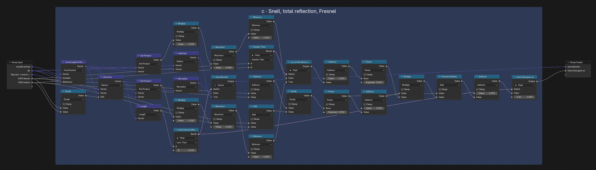

| Node | What it does |
|---|---|
| `normal against the ray` | Faceforward turns the smooth normal to face the incoming ray, using the face normal as reference |
| `refracted` | Vector Math Refract with n1 / n2: Snell's law |
| `total internal reflection` | Refract returns a zero vector when there is no refracted ray: inside F2 glass, beyond 38° from the normal |
| `Fresnel (Schlick)` | the share reflected at the surface: F0 + (1 − F0)(1 − cos θ)⁵ with F0 = ((n1 − n2)/(n1 + n2))², 5.6 % head-on; `cos on the dense side` keeps it right when leaving glass |
| `share that goes on` | 1 − Fresnel for a refracted ray, 1 for a totally reflected one |
| `new direction` | refracted, or reflected under total internal reflection |

Each ray follows one path: it refracts, or it reflects totally. The small Fresnel share reflected at a refraction
is not followed; it is simply taken off the ray's weight.

### d · Move on (captured once, then stored)

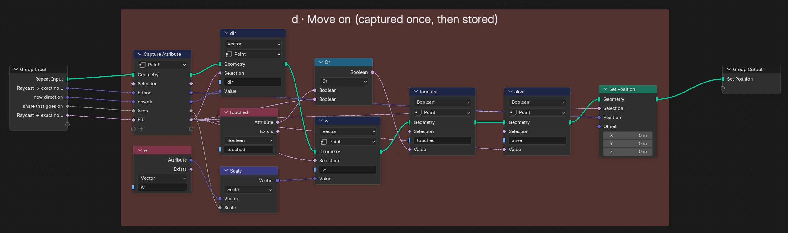

### Trick · Capture once, then move

> **Read every result of the Raycast in one Capture Attribute before moving the points.** A field is evaluated
> again on each node's geometry. If Set Position came first, a Store after it would cast the Raycast again from the
> new position and get a different answer. So one Capture Attribute with four items (`hitpos`, `newdir`, `keep`,
> `hit`) freezes the hit position, the new direction, the share that goes on and whether it hit, for each ray, and
> only then do the Stores and Set Position use them. Selection = hit, so rays that missed keep their place and
> direction and become `alive` = false.

### e · Land on the table

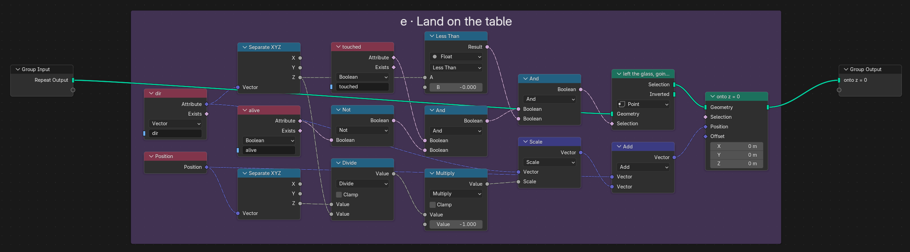

After the zone, a ray lands if it `touched` glass at least once, is no longer alive (its last cast hit nothing) and
is heading down. Separate Geometry keeps those (`left the glass, going down`). Set Position slides each one along
its direction to the table plane (`onto z = 0`): p − d · p_z / d_z.

What is left out, on purpose:

- **Rays that never touch the glass.** That is the direct sun, and dropping it is why the table is black everywhere
  except where light came through the decanter.
- **Rays still inside after 12 surfaces.**
- **Fresnel reflections** (see c).
- **Rays that leave going up.**

> **Try it:** set Bounces to 3. Light that crosses the decanter has to pass four surfaces (outer wall in, inner wall
> out, inner wall in, outer wall out), so almost nothing lands. On the hobnail the map's mean brightness drops from
> 16.5 to 0.8.

---

## 4 · Caustic map

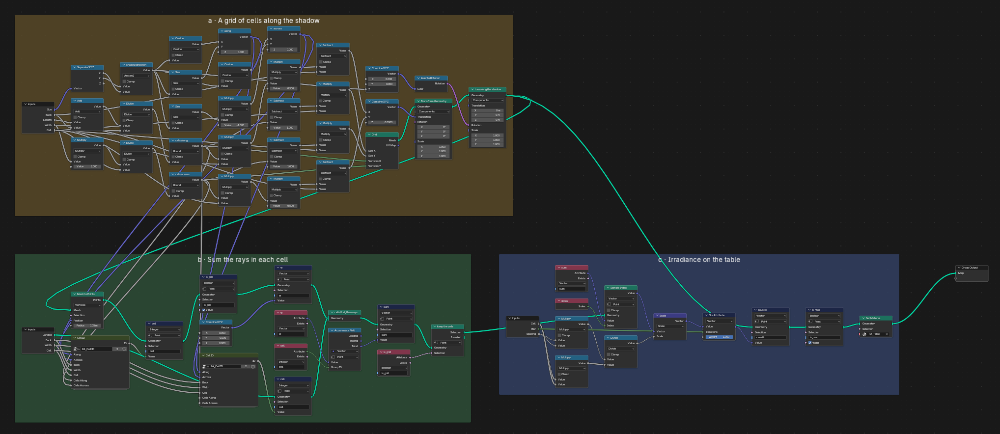

`PA_Caustic Map` (61 nodes, plus `PA_Cell ID`) turns the landed rays into a picture.

### a · A grid of cells along the shadow

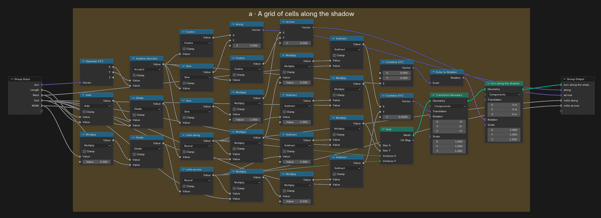

The map is a Mesh Grid laid on the table along the sun's direction (`shadow direction`, `along`, `across`). With
the final sliders it starts 0.12 m behind the decanter (Map Back), runs 0.45 m along the shadow (Map Length) and
0.30 m to each side (Map Width), in 0.5 mm cells: 1140 × 1200 cells, 1.37 million. It floats 0.02 mm above the floor
so the two never fight for the same pixels.

### b · Sum the rays in each cell

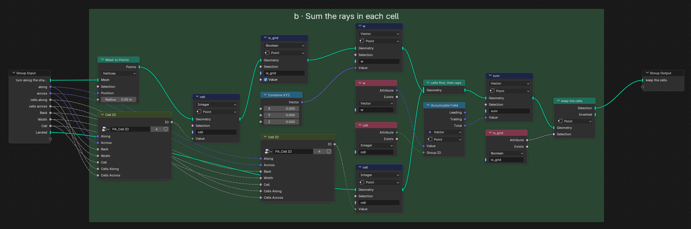

### Trick · A histogram in three nodes

> **Join the cells and the rays into one point cloud and let Accumulate Field, grouped by cell id, do the counting.**
> Every point gets `cell`, the index of the map cell it lies in (`PA_Cell ID`, −1 outside the map). The grid's own
> points carry weight 0, and the rays carry their colour weights. Accumulate Field with Group ID = cell gives every
> point the total of its group. Each grid point sits in its own cell, so it receives the sum of all the rays that
> landed there. Separate Geometry (`keep the cells`) then throws the rays away. There is no loop and no sort; 31.9
> million wavelength-rays are binned in one pass.

### c · Irradiance on the table

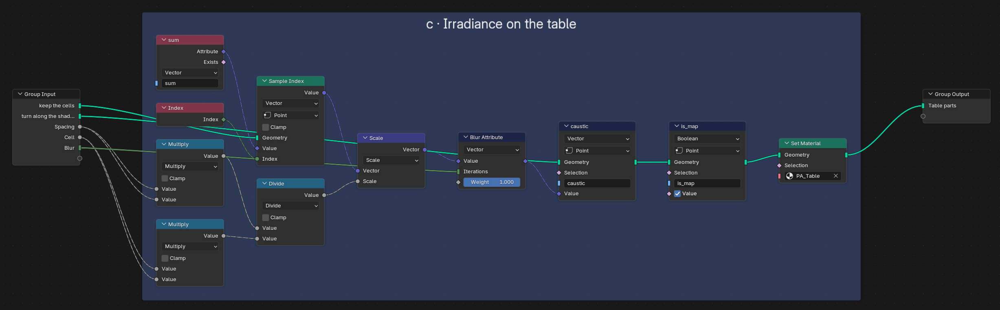

Each ray stands for a beam Photon Spacing wide on each side, measured square to the sun. Its power is its weight
(W/m²) × Spacing². A cell's irradiance is the power that landed in it divided by its area: sum × Spacing² / Cell². This
does not depend on how many rays are shot. Halving the spacing makes four times as many rays, each carrying a quarter
of the power, so only the noise changes. Blur Attribute (Blur = 2 iterations) smooths the photon noise across
neighbouring cells, and the result is stored as `caustic`.

Here is the map for each of the five cuts, read straight from the node tree without rendering:

> **Try it:** set Blur to 0 and the map shows its raw photon grain, the dust of single rays. At 8 it goes smooth but
> loses the sharp edges of the focused drops. The final keeps 2, a spread of about one 0.5 mm cell, which is about a
> pixel at this framing (0.46 m over 1080 px is 0.43 mm a pixel).

---

## 5 · Table

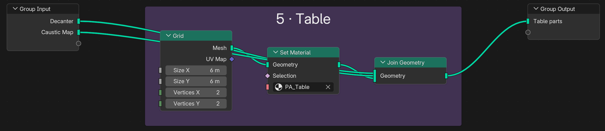

A 6 m square floor, with the same `PA_Table` material as the map, joins the decanter and the map. The floor has no
`caustic` attribute, so it reads 0 and is black. The table you see is the map itself, which is wide enough that its
edge stays outside the square frame.

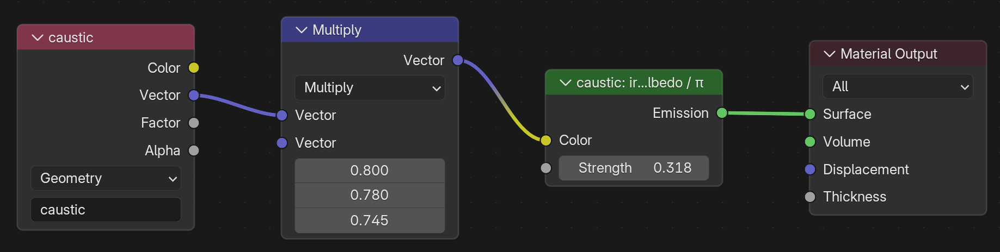

The table is pure emission: `caustic` × albedo × 1/π (`caustic: irradiance × albedo / π`). That is exactly the
brightness a matte white surface of that albedo shows under that irradiance, so the light on the table has the
physical brightness the sun would give it. Because the table has no BSDF, no other light can land on it. The sun
lamp, the room light and Cycles' own caustics never touch it.

Up close, at 100 %, the fringes and the grain look like this:

---

## Inside the small helpers

These groups are small, and each is used many times. Turning them into groups keeps the big trees readable and makes
the point that one formula is reused everywhere.

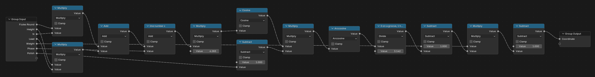

**`PA_Groove Set`** (15 nodes, called 3×) draws one set of parallel grooves. acos(cos 2πc)/π is a triangle wave:
0 on every whole c, 1 halfway. Multiplying the cosine by 1 − polish (Edge Round, 0.06) rounds its sharp tips, the
way a polishing wheel rounds the ridge between two cuts; the tips then sit at 0.11 and 0.89 instead of 0 and 1. Weight 0 returns 1, which switches the set off.

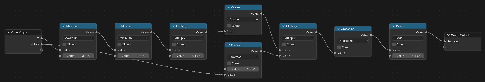

**`PA_Round Edge`** (10 nodes, called 4×) does the same for a 0…1 ramp: acos((1 − polish) · cos πt)/π meets both
ends with zero slope, so the crease where the ramp would hit its flat parts is rounded off. The ends move in a little,
to 0.11 and 0.89 at polish 0.06.

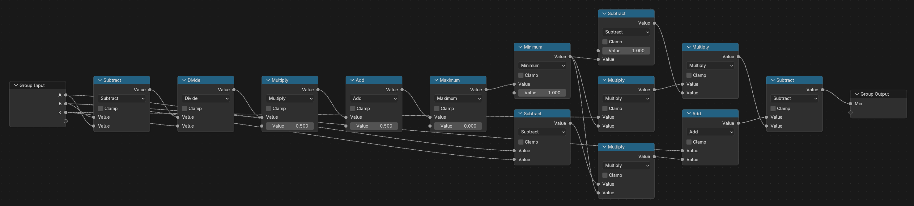

**`PA_Smooth Min`** (15 nodes, called 5×) is the polynomial smooth minimum: min(A, B) with the crease rounded over
a width K. It is what makes the groove crossings and the cell corners look polished rather than machined.

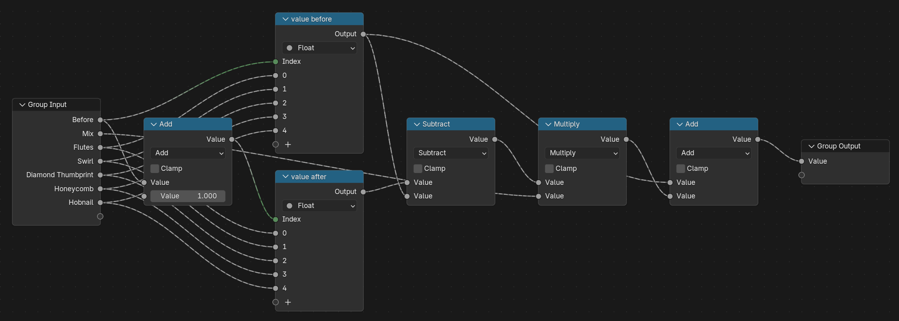

**`PA_State Value`** (8 nodes, called 10×): `value before` and `value after` are Index Switches over the five state
values shown on the group node, mixed linearly.

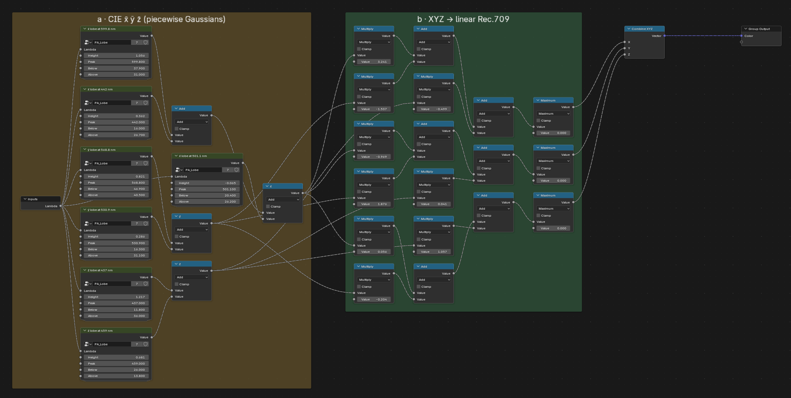

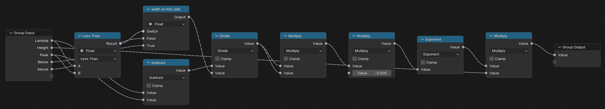

**`PA_Wavelength to RGB`** (32 nodes) and **`PA_Lobe`** (10 nodes, called 7×) give the colour of a wavelength:
the CIE 1931 colour-matching functions as Wyman, Sloan and Shirley's sums of piecewise Gaussians (three lobes for x̄,
two each for ȳ and z̄), then the standard XYZ → linear Rec.709 matrix, clipped at 0. Each lobe has a different
width below and above its peak (`width on this side`). Negative channels are clipped because the five copies are
renormalised to the sun's colour anyway (2 · Sun rays, d).

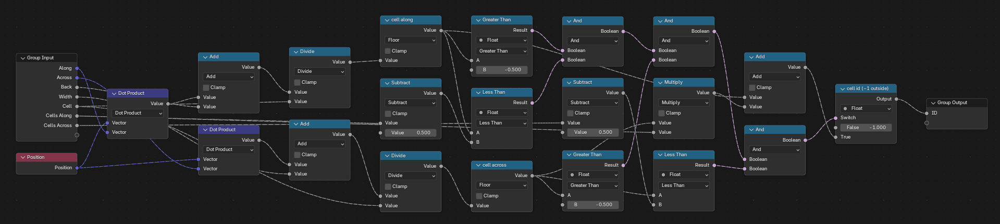

**`PA_Cell ID`** (23 nodes, called 2×) gives a point's map cell: floor((p · along + Back) / Cell), and the same
across, joined into one index. It returns −1 outside the map.

---

## Appendix A · Glass, room light and camera

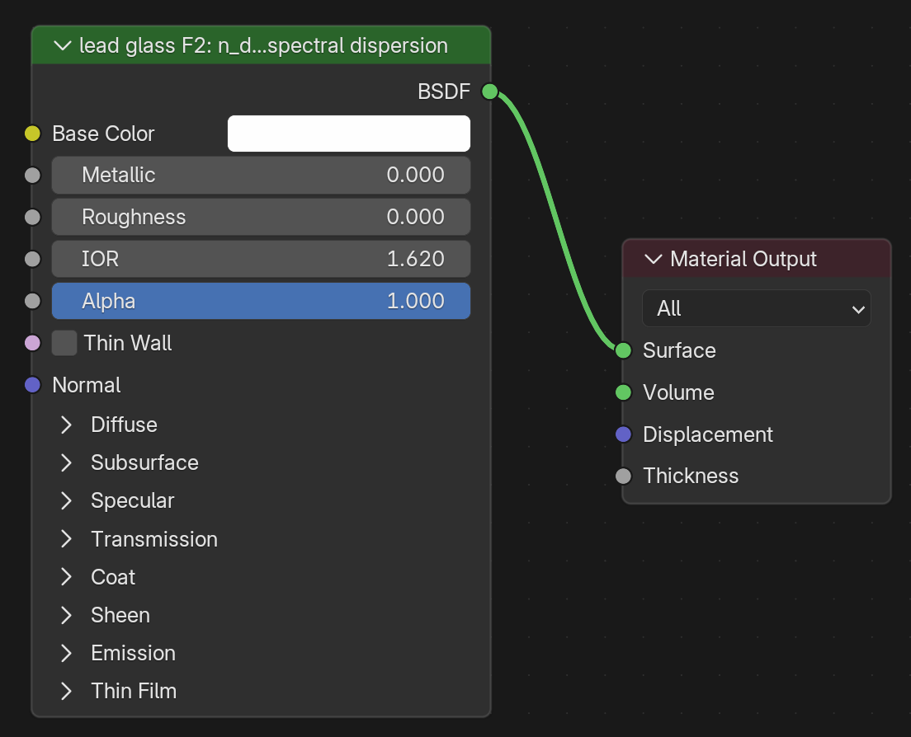

**Glass.** One Principled BSDF: white base, roughness 0, transmission 1, IOR 1.62004, and the two Blender 5.3
sockets **Transmission Dispersion Scale** 1 and **Transmission Dispersion Abbe Number** 36.37. Cycles then traces
the glass spectrally with the same Cauchy formula as section 2c. The table is emission only and cannot receive light,
so this dispersion shows only in the glass: thin rainbow fringes on the lip and the wall rings, where the camera
looks through the glass at a grazing angle. Rendering frame 300 with scale 1 and 0 changes 10 138 pixels by more than
8/255, all inside the decanter.

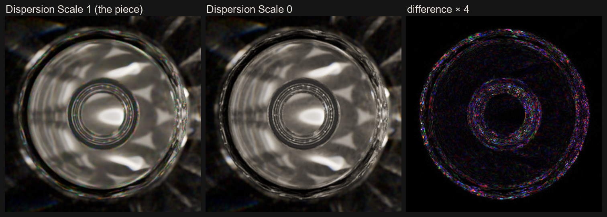

**Room light.** The world is a vertical gradient from near black (0.05, 0.045, 0.04) to warm white (1, 0.96, 0.9).
Its strength is max(Is Glossy, Is Transmission) × (1 − Is Camera) × 0.6, so the room light shows only in the glass's
reflections and refractions, never as a background and never on the table. That is what gives the decanter its
silvery body on black.

**Sun lamp.** Strength 6, angle 0.53°, colour (1, 0.90, 0.78), 30° up, from azimuth 130°. It is hidden from
transmission rays (`visible_transmission` off), so Cycles cannot make a second sun caustic of its own, and the
photon map stays the only one. The lamp still puts glints in the glass's reflections.

**Camera.** Orthographic, 0.46 m across, 1 m above the table. Its centre is 0.17 m along the shadow from the
decanter, and it is turned so the shadow runs to the right of the frame. AgX, Base Contrast look, exposure 0.

**Cycles.** 128 samples, denoised. Max bounces 32, transmission 24, glossy 12, transparent 32, diffuse 3. Indirect
clamp 20. Refractive caustics on, reflective off.

## Appendix B · The keys

| Frames | Pattern | Seconds |
|---|---|---|
| 1–36 | 0, flutes, held | 1.5 |
| 36–72 | 0 → 1, swirl | 1.5 |
| 72–96 | 1 held | 1 |
| 96–138 | 1 → 2, diamond thumbprint | 1.75 |
| 138–162 | 2 held | 1 |
| 162–204 | 2 → 3, honeycomb | 1.75 |
| 204–228 | 3 held | 1 |
| 228–282 | 3 → 4, hobnail (the inversion) | 2.25 |
| 282–336 | 4 held | 2.25 |

The keys sit on the modifier's sliders (`modifiers["PA_Nodes"].properties.inputs.<socket>.value`). Pattern keys
are Bézier with auto-clamped handles, so each hold is flat and each morph eases in and out. Turn has two linear
keys, 0° at frame 1 and 30° at frame 336.

---

## How it was rendered

Cycles (Metal GPU), 1080², 128 samples, Photon Spacing 0.056 mm and K = 5. Each frame first evaluates the
tree (31.9 million wavelength-rays traced, about 8 GB of memory), then renders. All 336 frames took 1 h 16 min, about
13.5 s a frame. The Principled dispersion needs Blender 5.3, so everything was rendered on the one machine
that runs it. Before the final, a 270 px draft (16 samples, K 3, 0.1 mm rays) checked the motion. The
final was then scanned frame by frame for jumps and checked in 100 % crops.

The finer ray spacing is about grain, not about brightness, which the map normalises (section 4c). At the default
0.08 mm the photon grain visibly moved from frame to frame. At 0.056 mm (twice the rays) it is finer and reads as
film grain.

## Try it yourself

1. **Stop on the in-between states.** In your own build, set Pattern to 0.5, 1.5, 2.5 or 3.25. At 2.5 the diamonds stretch toward
   hexagons (Aspect 1.37) while still dishes. At 3.25 the cut is nearly flat, and its caustic is closer to an
   uncut decanter's than any named cut's.
2. **Turn off the cut.** Set Depth to 0: a plain decanter, and its caustic is one smooth, bright fan, the baseline
   every pattern breaks up.
3. **One wavelength.** Set K to 1 (one ray per position, at 587.6 nm). The trace has a fifth of the rays to follow
   and the fringes go, but the sun's warm tint stays.
4. **Steeper cuts.** Set Depth to 0.0025 (2.5 mm). The facets slope about 34° and throw much of the light sideways,
   out of the shadow, as a dim haze instead of drops.
5. **Move the sun.** Raise it to 45° at the same azimuth (130°). The shadow and the whole caustic shorten and
   pull in toward the decanter.

*Made with Blender 5.3 Geometry Nodes and Cycles for [Nodevember](https://nodevember.com) 2026, Day 17 · Caustics.*
