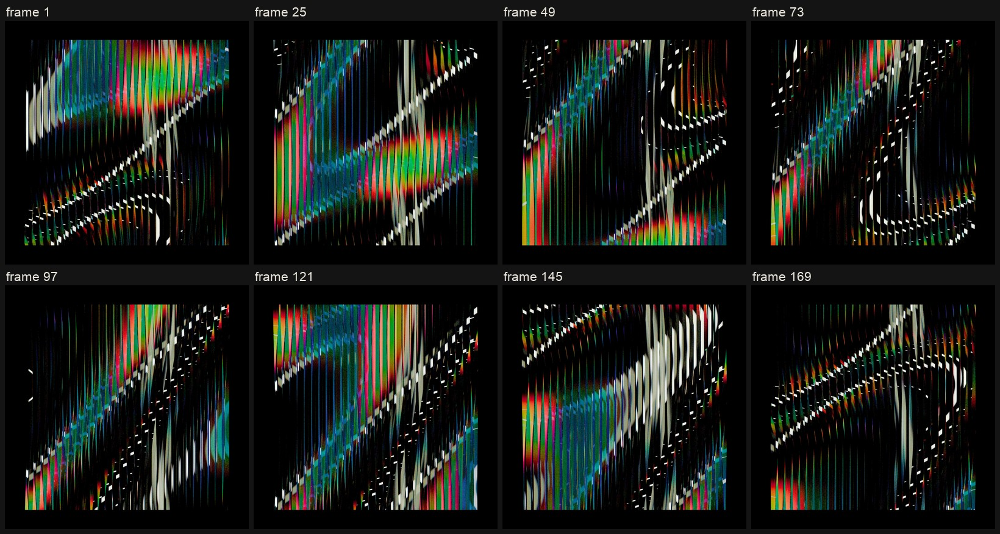
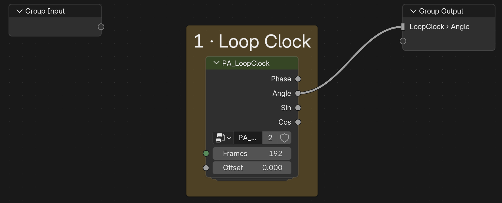
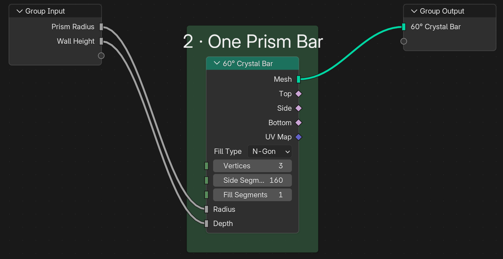
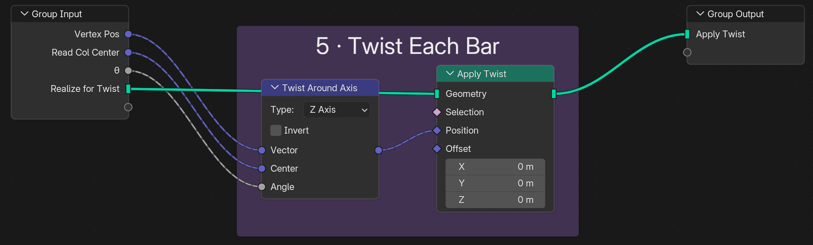
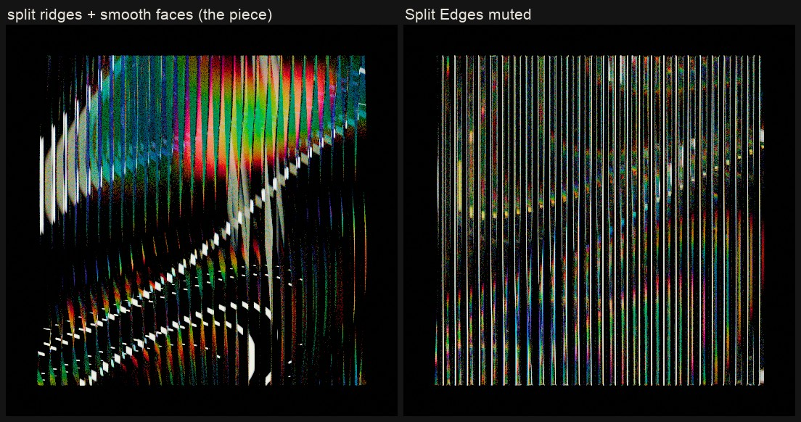
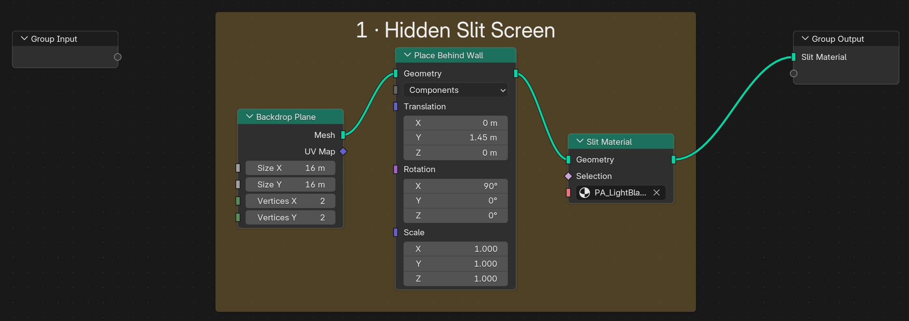
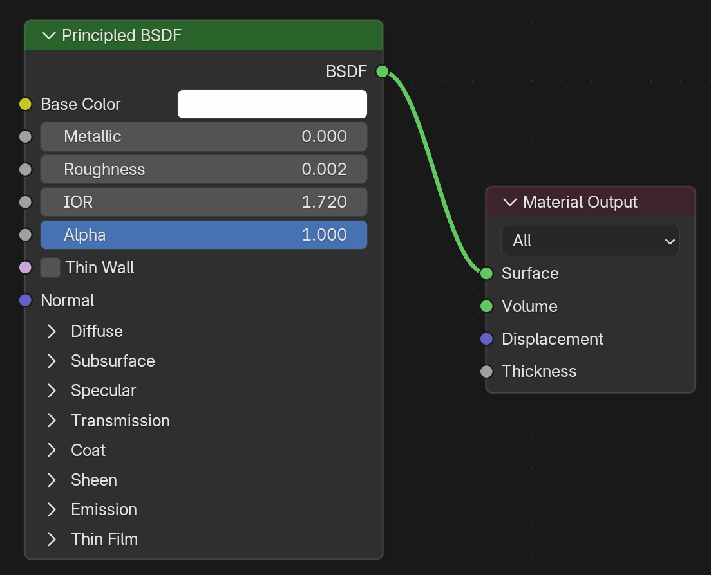
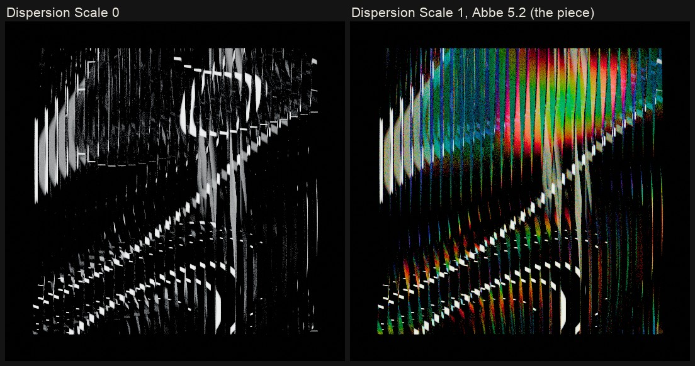
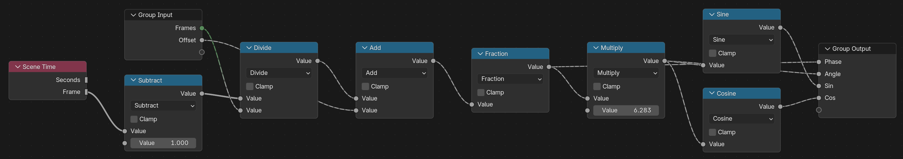
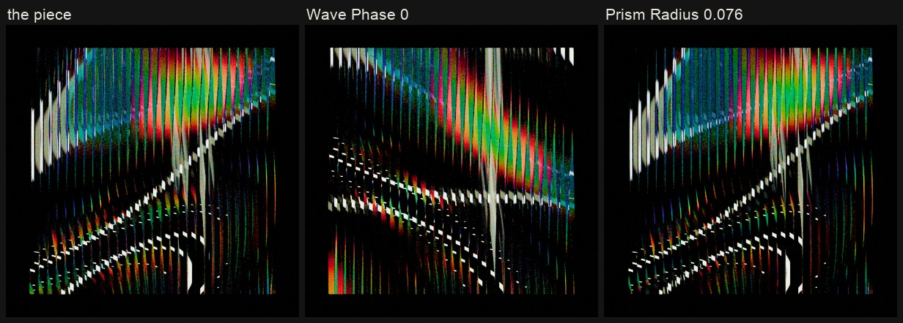

# How a wall of twisted prisms turns one white slit into a rainbow wave

*A node-by-node walkthrough of Nodevember 2026 · Day 18 · Prism*

The video (8 s, 192 frames, 24 fps) looks straight at a wall of 28 tall glass bars, each with a triangular
cross-section, on black. Ribbons of spectral colour and dotted white arcs sweep diagonally across the bars and slide
down the wall. The scene has no lamps, no coloured light and no image textures. The only light source is a black screen
with a vertical white slit, standing 1.45 m behind the wall, that the camera is not allowed to see. Everything in the
picture is that slit seen through glass. The colours come from Blender 5.3's Principled BSDF, which can now split
white light by wavelength (dispersion). The bars are built and twisted by one Geometry Nodes modifier of 28 working
nodes. Nothing is keyed: a clock drives the twist, and the loop has no seam because in one loop the twist wave moves
through one full period and every bar turns 120°, which maps a triangle onto itself. A procedural-purity audit reports
the file as strictly procedural, with no issues.

| File | What it is |
|---|---|
| `../loop.mp4` | the video: 1080², 24 fps, 192 frames (8 s), Cycles 384 samples, no denoiser, H.264 |
| `../render.png`, `../render-097.png` | stills: frame 1 (512 samples) and frame 97 (384 samples, as in the video) |
| `../nodes/` | node shots of the wall tree, the backdrop tree, both materials and the loop clock |
| `images/` | every figure and node shot on this page |

The scene file and the scripts that build it and draw this page's figures are not published; this page shows every
node and every value. The glass needs Blender 5.3 or later: 5.2 has no dispersion.

---

## The one idea

> **The light is a vertical white slit that the camera cannot see, and everything in the picture is that slit seen
> through a turning prism.** Each bar bends the line of sight sideways by an amount that depends on how far the bar
> is turned at that height. A bar therefore lights up only where its turn aims it at the slit. Twist the bars with a
> travelling wave and those places line up into diagonal arcs that slide down the wall. Let the glass split the
> colours and every arc becomes a spectrum.

The rest of the file supports that idea:

- **What are the bars?** One three-sided cylinder, copied 28 times along x (2 · One Prism Bar, 3 · Array and Tag
  Centres).
- **How far is each bar turned?** One formula gives the angle θ for every point of the wall:
  a slow roll, a travelling sine wave and a fixed fan across the wall (4 · Twist Angle). Each bar turns about its own
  axis, ring by ring (5 · Twist Each Bar).
- **Why do the bars still act as prisms?** Their three corners stay knife-sharp while the twisted faces are shaded
  smooth (6 · Sharp Ridges, Smooth Faces).
- **Where is the light?** On a hidden backdrop: black, with soft-edged white slits 2.85 m apart (The light).
- **Where does the colour come from?** From dispersion in the glass material (The glass).
- **Why is there no seam?** The clock wraps after 192 frames, and the roll it drives is exactly a third of a turn
  (1 · Loop Clock, and the trick in section 4).

### How to read the screenshots

Each coloured frame in a tree is one section of the build script (`with g.section("…")`), and the section headings
below use the same numbers. Under the overview there is one cut-out per frame. In a cut-out, a wire coming from another
section enters through a Group Input socket named after the node it comes from. For example, `LoopClock › Angle` is
the Angle output of the clock group, and `Read Col Center` is the node with that label. A wire leaving the section
exits through a Group Output socket. Every frame that uses a slider has its own small Group Input labelled `sliders`
that shows only the sliders that frame uses, so no single fan of wires crosses the whole tree. The Math nodes in
section 4 are labelled with the term they compute (`z · 0.70`, `roll = Angle / 3`). Labels in `code` style are the
node labels as they appear in the screenshots. Lengths are in metres and angles in radians, as Blender stores them, so a
Twist Strength of 0.78 is 44.7°. Click any screenshot to see it at full size.

---

## 0 · The map

| # | Section | Nodes | Job |
|---|---|---|---|
| 1 | Loop Clock | 1 (a group of 8) | Angle runs 0 → 2π over the 192 frames |
| 2 | One Prism Bar | 1 | a three-sided cylinder: one 60° bar, 3.94 m tall, cut into 160 segments |
| 3 | Array and Tag Centres | 5 | 28 copies along x; every vertex remembers the centre of its own bar |
| 4 | Twist Angle | 14 | θ for every vertex: roll + wave + fan |
| 5 | Twist Each Bar | 2 | turn every vertex by θ about its own bar's vertical axis |
| 6 | Sharp Ridges, Smooth Faces | 5 | split the three corners, smooth everything else, assign the glass |

The tree has 28 working nodes (plus the Group Inputs and the Group Output), and the modifier shows five sliders:
Columns 28, Prism Radius 0.088, Wall Height 3.94, Twist Strength 0.78 and Wave Phase 0.68. The light is a second,
three-node tree on its own object (The light). The wall comes out as 27,216 vertices and 13,496 faces, the same at
every frame.

Nothing in the file is keyed, so there is no timeline. Every moving part reads one number, the clock's Angle.

---

## 1 · Loop Clock

`PA_LoopClock` turns the scene frame into an angle:

> Phase = fract((frame − 1) / Frames + Offset), Angle = 2π · Phase

With Frames = 192, frame 1 gives Angle 0, frame 192 gives 2π · 191/192, and frame 193 would wrap back to exactly 0.
Anything that reads Angle only through sin(…) or cos(…) repeats every 192 frames by construction. Section 4 also
uses Angle directly, divided by 3; the trick in that section explains why that is safe too. The inside of the group is
in Appendix A.

> **Try it:** set the group's Frames to 96. The wave runs twice as fast and the loop lasts 4 s. Keep the scene's
> frame range at 192 and the video shows two identical loops.

---

## 2 · One Prism Bar

`60° Crystal Bar` is a Cylinder with only 3 vertices around, so its cross-section is an equilateral triangle with
60° corners: a prism. The Radius (Prism Radius, 0.088 m) is the distance from the axis to a corner, so each face is
0.088 · √3 = 0.152 m wide and lies 0.044 m from the axis. The Depth is Wall Height, 3.94 m.

**Why 160 side segments?** The twist only moves vertices, it adds none. A bar made of one tall segment could not
bend: its top and bottom would turn, but the faces between them would stay flat. With 160 segments there are 161
rings of 3 vertices, 24.6 mm apart, and each ring turns by its own angle. The steepest twist in the piece changes the
angle by 0.77° from one ring to the next, small enough that the faces read as smooth curves (section 6).

**Why 3.94 m?** The orthographic camera frames a 4.68 m square. The 28 bars span 3.76 m between the outer centres,
plus up to 0.088 m of bar on each side: 3.94 m. A wall 3.94 m tall is therefore square, with about 0.37 m (85 px) of black
on every side.

> **Try it:** set Vertices to 4 for square bars. They still twist, but now the loop jumps at the seam: the roll in
> section 4 turns every bar 120° per loop, and a square only looks the same after 90°. Change `roll = Angle / 3` to
> divide by 4 and the loop closes again.

---

## 3 · Array and Tag Centres

| Node | What it does |
|---|---|
| `Column Array` | Mesh Line in End Points mode: 28 points from x = −1.88 m to +1.88 m. The ends are fixed, so the spacing is 3.76 / (Columns − 1) = 0.139 m. More columns pack the bars tighter; the wall does not grow |
| `Store Col Center` | writes each point's own position into a vector attribute `col_ctr` (`Column Center` is a Position node) |
| `Array Columns` | Instance on Points: one bar on every point. The point attribute `col_ctr` becomes an instance attribute |
| `Realize for Twist` | turns the 28 instances into one real mesh. Instance attributes are copied onto every vertex, so each vertex of a bar carries that bar's centre |

**Why realize, and why tag first?** The twist is different at every height of a bar, so it has to move single
vertices; a Rotate Instances node can only turn a whole bar by one angle. After Realize Instances, though, a vertex no
longer knows which bar it belongs to, and Vector Rotate needs the centre of that bar (section 5). Storing the centre
*before* instancing carries it through: the attribute rides along from point to instance to vertex.

### Trick · the bars are packed closer than they are wide

The spacing (0.139 m) is smaller than a face (0.152 m), so two neighbours that turn close to side-on cut into each
other. Measured on the evaluated mesh across the loop (48 frames, every ring of every neighbouring pair), 27–45 % of
the neighbouring rings overlap at any moment, by up to 15 mm. Real glass bars would collide. Cycles does not mind:
it has no notion of nested glass and treats each surface on its own, and the picture barely depends on it. At Prism
Radius 0.076 no ring touches its neighbour in any of the 48 frames, and the render keeps the same pattern, only with
thinner bars and more black between them (third picture in [Try it yourself](#try-it-yourself)).

> **Try it:** set Columns to 14. The spacing doubles to 3.76 / 13 = 0.289 m, the bars stand apart with wide black
> gaps, and the dotted arcs break up into scattered dashes, because there are too few bars to carry a line.

---

## 4 · Twist Angle

Every vertex of the wall gets one angle, built from its height z and its bar's centre x:

> θ(x, z, t) = Angle / 3 + Twist Strength · sin(0.70 z − Wave Phase · x + Angle) + 0.35 x

| Node | Computes |
|---|---|
| `Vertex Pos` → `Split Z` | the height z of this vertex |
| `Read Col Center` → `Split Col X` | the x of this vertex's bar (from `col_ctr`) |
| `z · 0.70`, `x · Wave Phase`, `wave front` | 0.70 z − Wave Phase · x: the phase of the wave at this point |
| `+ Angle (travel)` | adds the clock, so the wave moves |
| `sin`, `· Twist Strength` | the wave term |
| `roll = Angle / 3` | the roll term |
| `fan = x · 0.35` | the fan term |
| `roll + wave`, `θ` | the sum |

**The three terms, with this piece's numbers:**

- **Roll, Angle / 3.** Every bar turns the same amount, 120° per loop. On its own this would just spin the bars;
  together with the wave it keeps the bars from simply rocking back and forth around one position.
- **Wave, 0.78 · sin(0.70 z − 0.68 x + Angle).** At its peak the wave turns a bar 0.78 rad = 44.7° either way. Up the
  bar the phase grows by 0.70 rad per metre, so a 3.94 m bar holds 2.76 rad (158°) of the sine. That is less than half
  a wave, and the top and bottom of one bar are never more than 87.7° apart. Across the wall the phase falls by
  0.68 rad per metre, so the first and last bars are 147° apart. Lines of equal phase run at atan(0.68 / 0.70) = 44°,
  rising to the right. As Angle grows they slide down and to the right, one wavelength
  (2π / √(0.70² + 0.68²) = 6.4 m) per loop, about 0.8 m/s.
- **Fan, 0.35 x.** A fixed turn that grows across the wall, from −37.7° on the left end to +37.7° on the right. Even
  where the wave is flat, every bar faces the light at a slightly different angle.

### Trick · roll by exactly a third

The clock wraps after 192 frames. The sine does not care: sin(… + 2π) = sin(…). The roll term does: at frame 192 it
is 119.375°, and one frame later the wrapped clock resets it to 0°. That jump is invisible only because an
equilateral triangle turned by 120° is the same triangle. Its three corners trade places, but the shape and position
do not change. This can be checked without looking. Match the vertices of frame 1 (every 7th one) to their nearest
vertex in frame 192: the largest move is 3.21 mm. Between frames 100 and 101 it is 3.05 mm. So the seam is an ordinary step.

> **Try it:** set Wave Phase to 0. Every bar now runs the same wave in step, so the wave fronts are horizontal and
> only the fan term tilts the arcs. In the render they tip down to the right instead of rising (middle picture in
> [Try it yourself](#try-it-yourself)).

---

## 5 · Twist Each Bar

`Twist Around Axis` is a Vector Rotate in Z Axis mode. It turns each vertex position by θ about a vertical line
through `Center`, and the centre is that vertex's own bar (`col_ctr`). `Apply Twist` (Set Position) writes the
result. A rotation about a vertical axis never changes z, so every ring stays at its height; only its triangle turns.
Each bar therefore stays a triangle at every height, but the triangle is turned a little differently from ring to
ring, and the three faces become gently twisted ribbons.

> **Try it:** unplug `Center`, so it falls back to (0, 0, 0). Every vertex now turns about the middle of the wall
> instead of about its own bar, so the bars near the ends swing forward and back in depth on a circle of up to
> 1.88 m. The wall bends into one curved, twisted sheet: from the front its outline bows, and the bars crowd
> together where the sheet turns away from the camera.

---

## 6 · Sharp Ridges, Smooth Faces

Edge Angle's Unsigned Angle is the angle between the normals of the two faces that share an edge. On these bars there
are only three kinds of edge. Measured on the twisted mesh with the split muted:

| Edge | Unsigned angle | Count (all 28 bars) |
|---|---|---|
| along a corner (the 60° ridges) | 120° | 13,440 |
| around the end caps | 90° | 168 |
| between two rings of one face | at most 0.77° | 13,356 |

None falls between 1° and 89° (checked at frames 1 and 97), so `Ridge > 45°` (0.785 rad) picks exactly the
corners and the cap rims. Any threshold in that range would do the same. `Crisp 60° Ridges` (Split Edges) cuts the mesh along them, so each face
strip gets its own vertices, and `Silky Ribbon Faces` (Set Shade Smooth) then smooths only across the rings.
`Crystal Material` assigns the glass.

**Why both?** A prism works because each face is flat at a fixed angle to the next, so it bends light by a fixed
amount. Without the split, smooth shading blends the normals around the corners and each bar refracts like a round
rod: the slit becomes a thin vertical line in every bar, and the arcs are gone. Without smooth shading, the bar keeps
its corners but the normal jumps at every ring, and at 100 % every white dash breaks into a comb of horizontal steps,
one per ring (24.6 mm, about 6 px).

> **Try it:** set the threshold to 100° (1.745 rad). The cap rims (90°) are no longer split, so smooth shading bends
> the normals over the ends of every bar. Only the top and bottom ring of each bar changes: in a render, the 6 rows
> of pixels at each end of the wall; everything between is identical.

---

## The light: a slit the camera cannot see

`PA_OpticalBackdrop_GN` makes one 16 × 16 m square (`Backdrop Plane`), stands it upright in the XZ plane and moves it
to y = 1.45 m, behind the wall (`Place Behind Wall`). The build script then turns off the object's Camera ray visibility
(Object Properties › Visibility › Ray Visibility › Camera). Rays from the
camera pass straight through it, but rays that have been bent by the glass still hit it. That is why the gaps between
the bars, and the margin around the wall, are black: those rays fly past the hidden backdrop into an almost black
world.

The material `PA_LightBlade` paints the slits:

| Node | What it does |
|---|---|
| `Object Coords` → `Slit Spacing & Shift` → `Split X` | an X' coordinate across the screen (see the trick below) |
| `Slit Period` | Wrap: repeats X' every 2.6 units. The bounds are entered as Max −1.3, Min 1.3; Wrap only uses the interval between them, so this is the same as Min −1.3, Max 1.3 |
| `Dist to Slit` | the distance to the nearest slit centre |
| `Slit Profile` | Map Range, Smooth Step: 1 within 0.045 of the centre, 0 beyond 0.110 |
| `Optical Slit Mask` | mixes `Deep Obsidian Back` (emission 0.003, 0.004, 0.008, strength 1) and `Pure White Optical Blade` (emission 0.93, 0.97, 1.0, strength 11.5) |

### Trick · the 24° turn is a stretch, not a tilt

The Mapping node turns the object coordinates 24° about Z. On a screen that stands in the XZ plane, that does not
tilt anything: the screen has the same y = 1.45 everywhere, so the turn only mixes x with that constant,
X' = x · cos 24° − 1.45 · sin 24° = 0.9135 x − 0.590. The slits stay vertical. They are 2.6 / 0.9135 = 2.85 m
apart, and their centres sit at x = −2.200 m (just past the left end of the wall, still inside the frame) and
x = +0.646 m (right of centre); the next one, at +3.49 m, is outside. In x, each slit is fully white within ±0.049 m
of its centre and fades to black at ±0.120 m. The left picture under [The one idea](#the-one-idea) shows exactly this:
two plain vertical stripes. Every diagonal in the render is made by the bars.

---

## How a vertical slit becomes diagonal arcs

The camera is orthographic, so all its rays are parallel and point straight at the wall. A ray that hits a bar enters
through one face, bends, leaves through one of the other two faces, bends again, and flies on to the backdrop
1.45 m behind the wall's centre line. How far it bends depends on how that bar is turned at that height, θ. The lever
is long: at that distance, every degree of bend moves the hit point about 25 mm (1.45 m · tan 1°). A slit with a 10 cm
white core is therefore crossed by a few degrees of turn.

The twisted faces tilt the rays slightly up or down as well, but the slit is uniform from top to bottom, so that does
not matter. Whether a point of the picture lights up depends only on how its bar is turned at that height (θ), on
where across the bar the ray enters, and on where the bar stands relative to the slit. The lit points are where θ
takes a value that aims the bar at a slit. Several values do: there
are two slits, and a ray can leave through either far face. As θ varies smoothly over the wall, those points join
into lines:

- **Where θ changes fast with height** (the steep parts of the wave), a bar sweeps across the slit within a few
  centimetres of height, and its piece of the line is a short dash. The dashes of neighbouring bars line up into the
  dotted arcs.
- **Where θ changes slowly** (near the crests of the wave), a bar stays aimed at the slit over a tall stretch, and
  the line turns into a wide ribbon. That is where the broad bands of colour are.
- **As the wave travels and the bars roll** (section 4), the lit lines move: on the video the whole pattern slides
  down the wall by about 16 px a frame (measured by matching consecutive frames). That is faster than the wave
  itself (about 11 px a frame), because the roll shifts every bar's aim at the same time.

Twist Strength shows it directly. At 0 each bar has one angle from top to bottom (only roll and fan), so it is lit
along its whole height or not at all: vertical stripes. At 0.39 the angle changes half as fast, so the dashes are
longer. At 1.56 it changes twice as fast and passes the aiming values more often, so the dashes are shorter and there
are more arcs.

---

## The glass: where the colours come from

`PA_OpPrismGlass` is a single Principled BSDF. The screenshot shows its panels folded; the table lists every value
the build script sets:

| Input | Value | Why |
|---|---|---|
| Base Color | 0.996, 0.998, 1.0 | clear glass, with no tint |
| Roughness | 0.002 | polished: the slit stays a sharp image |
| IOR | 1.72 | dense flint glass; a higher IOR bends light more strongly |
| Transmission Weight | 1.0 | the bar is glass, not plastic |
| Transmission Dispersion Scale | 1.0 | turns Blender 5.3's dispersion on (0 is off) |
| Transmission Dispersion Abbe Number | 5.2 | how far the colours fan out |
| Specular IOR Level | 0.5 | the default |
| Coat Weight / Coat Roughness | 0.08 / 0.005 | a faint second reflection on the faces |

With dispersion, each wavelength sees its own IOR: blue bends more than red. A bar that aims red light at the slit
therefore aims blue light a little beside it, and each crossing of the slit spreads into a spectrum. Where θ changes
slowly, the spectrum is stretched over a tall stretch of the bar, which gives the broad ribbons of colour.

The Abbe number is the usual glass-catalogue measure of dispersion: the lower it is, the more the colours fan out.
Dense flint glass is around 20–30. At 5.2 the colours fan out four to six times wider than in dense flint, so a
few degrees of turn already separate red from blue. With Dispersion Scale 0 the same arcs and ribbons are all white:

**Why no denoiser?** None of this is a caustic. A camera ray goes through two glass surfaces and lands on a glowing
backdrop. Path tracing follows that path directly, so it converges quickly. With no diffuse surface anywhere in the
scene, the caustics settings (both off) change nothing. At 384 samples the remaining grain is fine and even, and a
denoiser could blur the hairline edges.

---

## Appendix A · `PA_LoopClock`

Frame − 1, divided by Frames (192), plus Offset (0), then Fraction gives Phase from 0 up to just under 1; times 2π
gives Angle. The group also outputs sin and cos of the angle, which this piece does not use. It is the same clock
group used in earlier days, made by a small helper in the build script.

## Appendix B · Camera, world and colour

| Setting | Value |
|---|---|
| Camera `PA_Camera` | orthographic, Ortho Scale 4.68, at (0, −7, 0), looking along +y |
| World `PA_World` | Background 0.0005, 0.0006, 0.0010, strength 1: almost black |
| Lamps | none; the only light is the backdrop's emission |
| Colour | AgX, look AgX - Punchy, exposure −0.15 |
| Compositor | off: no glare, no bloom |

---

## How it was rendered

Cycles in Blender 5.3 on the GPU (Metal), 1080 × 1080, 384 samples with adaptive sampling (threshold 0.005), no
denoiser, pixel filter width 1.0 px (sharper than the default 1.5). Light paths: up to 14 bounces in total, 14
transmission, 8 glossy, 2 diffuse; indirect light clamped at 20. One frame takes about 15 s on the GPU (frame 97,
measured for this page), so the 192 frames take about 47 minutes. The hero still `render.png` is frame 1 at 512
samples.

---

## Try it yourself

1. **Make the light visible.** In your own build, turn the backdrop object's Ray Visibility › Camera back on. The gaps between the bars and the margin now show the backdrop: black, with the white slit right of centre and
   the second slit at the left edge (compare the left picture under [The one idea](#the-one-idea), which hides the wall).
2. **Twist harder or softer.** Twist Strength 1.56 gives shorter dashes and more arcs; 0.39 gives longer dashes and
   fewer; 0 gives vertical stripes (the four-picture figure above).
3. **Put all the bars in step.** Wave Phase 0: the wave fronts become horizontal and the arcs tip the other way
   (middle picture).
4. **Stop the collisions.** Prism Radius 0.076: no two bars touch in any of 48 checked frames, and the pattern
   survives (right picture).
5. **Turn off the colour.** Transmission Dispersion Scale 0 in `PA_OpPrismGlass` gives the white version. Abbe
   Number 20, a real dense flint, keeps the colours but fans them out less: by the Abbe definition, 20 / 5.2 ≈ 4
   times less.
6. **Rebuild from scratch.** Make a Cylinder with 3 vertices and 160 side segments, put it on a 28-point Mesh Line
   after storing each point's position, realize, and turn every vertex about its own bar's centre by the formula in
   section 4. Split the edges sharper than 45°, shade smooth, and give it a dispersive Principled glass. Light it
   only with an emissive slit screen that the camera cannot see.

*Made with Blender 5.3 Geometry Nodes for [Nodevember](https://nodevember.com) 2026, Day 18 · Prism.*
