# How a sky full of ice crystals turns one sun into three, and makes the air shimmer

*A node-by-node walkthrough of Nodevember 2026 · Day 19 · Shimmer*

The video (12 s, 288 frames, 24 fps, 1080²) is a locked-off view across a frozen, snow-covered lake at sunrise. The
sun climbs from 0.3° below the horizon to 5.5° above it, and the still air fills with diamond dust: tiny hexagonal
ice crystals drifting near the ground. The sky then builds the display that real diamond-dust mornings show. A sun
pillar appears first, then two sun dogs 22° either side of the sun (red on the inside, a white tail on the outside),
the upper tangent arc and the faint 22° halo. Close to the lens single crystals glitter, and the glitter crowds onto
the arcs. None of it is painted. Every halo is ray-traced in Geometry Nodes: 9 million rays a frame, each with its own
wavelength, are followed through hexagonal ice with Snell's law and Fresnel reflection, binned on the sky and drawn
as light. The glitter reads the same traced map. The file has no image textures, no simulation and no imported
assets, and a procedural-purity audit finds nothing else.

The piece was made for Day 18 · Prism (every hexagonal plate is a 60° prism) and is filed as Day 19 · Shimmer: the
shimmer of diamond dust and its halos are the same thing, seen up close and from far away (The one idea).

| File | What it is |
|---|---|
| `loop.mp4` | the video: 1080², 24 fps, 288 frames (12 s), Cycles 128 samples + OpenImageDenoise, H.264 CRF 16 |
| `render.png` | frame 240, the hero still |
| `render-090.png` | frame 90: the pillar and the first sun dogs, before the arcs |
| `nodes/` | the node trees: `main.png` (`PA_SunDogs_GN`: the halos and the glitter), `sun-rays.png`, `trace.png`, `halo-map.png`, `sky-dome.png`, `glints.png`, `lake.png` |
| `post.md` | idea, physics checks, build log, captions and alt text |

The `.blend` file and the Python script that builds it are not published. The scene holds **PA_SunDogs** (modifier
`PA_Nodes`, tree `PA_SunDogs_GN`: the halos and the glitter), **PA_Lake** (tree `PA_Lake_GN`: snow, ice, forest,
hills), the lamp **PA_Sun**, the camera **PA_Cam** and the world **PA_World**; every tree is in the screenshots below.
It was built in Blender 5.2 and runs unchanged in 5.3.

---

## The one idea

> **A halo is millions of tiny prisms, each sending the sun to your eye at the angle it turns light least.** Any two
> side faces of a hexagonal ice crystal with one face between them form a 60° prism. A ray through such a prism is
> never turned less than about 22°, and rays pile up at that minimum. Crystals that float the same way up put that
> pile-up at the same place on the sky: plates lying flat make the sun dogs, columns lying flat make the tangent arc.
> Crystals that tumble put it on a ring 22° round the sun.

The same thing happens one crystal at a time near the lens. A crystal drifting a metre away flashes only at the
moment its faces send the sun into the camera, and that happens most often in the directions where the halo is
bright. Over a few seconds the flashes trace out the arcs: **the halo is shimmer, added up** (section 6).

The rest of the file supports that idea:

- **Which crystals, which way up?** Three hexagonal prisms, each used by millions of rays in their own orientation
  (1 · Ice crystals, 2 · Sun rays).
- **How is a ray turned?** It is followed face to face: refraction, reflection, total internal reflection
  (3 · Trace through the ice).
- **How do 9 million exit directions become a picture?** They are counted in 0.2° cells on the sky (4 · Halo map) and
  drawn on a dome of glowing vertices round the camera (5 · Sky dome).
- **Where does the glitter come from?** From 3 million near crystals whose chance to flash follows the same map
  (6 · Glitter near the lens).
- **What moves?** Only keys: the sun climbs, the dust drifts in, and each crystal population switches on in turn
  (Appendix A).

### How to read the screenshots

Each coloured frame in a tree is one section of the build. The main tree's sections are
numbered 1–6 like the headings below; inside a node group they are lettered a, b, c. Under each overview there is one
cut-out per frame. In a cut-out, a wire coming from another section enters through a Group Input socket named after
the node it comes from: `tilt: Rayleigh(σ)` is the node with that label, `seed base: Seed · 1000 + Pop · 50` the sum
that seeds every random number. A wire leaving the section exits through a Group Output socket. Every frame that uses
a slider or a group input has its own small Group Input showing only those sockets (labelled `sliders` in the main
tree, `inputs` inside groups). Labels in `code` style are the node labels in the screenshots; many Math nodes carry the
formula they compute (`z = 2·u1 − 1`, `bump (1 − x²)²`). Lengths are in metres. Labels give angles in degrees where
that is easier to read; the nodes themselves work in radians. Click any screenshot to see it at full size.

---

## 0 · The map

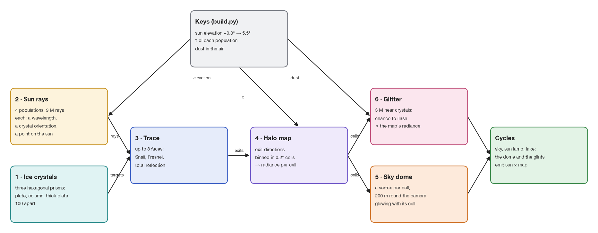

| # | Section | Nodes | Job |
|---|---|---|---|
| 1 | Ice crystals | 1 (a group of 9) | three hexagonal prisms: a plate, a column, a thick plate, 100 apart |
| 2 | Sun rays, one crystal each | 14 (four calls of a group of 120) | 9.0 M rays in four populations; each ray gets a wavelength, a crystal orientation and a point on the sun |
| 3 | Trace through the ice | 2 (a group of 71) | follow every ray through up to 8 faces; keep the ones that leave, with their direction on the sky |
| 4 | Halo map | 2 (a group of 30) | count the exits in 0.2° cells: light per cell, per unit of sunlight |
| 5 | Sky dome | 2 (a group of 27) | a vertex per cell, 200 m round the camera, glowing with its cell's light |
| 6 | Glitter near the lens | 3 (a group of 93) | 3 M crystals 0.5–15 m away; each flashes now and then, more often where the map is bright |

The node counts include a frame's own Group Input where it has one. Four small helper groups are used inside the others
(Inside the small helpers): `PA_Sky Cell`, `PA_Unit Vector`, `PA_Fresnel` and `PA_View Direction`. With them the sky
tree has 447 nodes in 10 groups. The lake is a second tree of 155 nodes on its own object (Appendix C).

The modifier shows 15 sliders. Six of them are keyed, so the timeline drives them; the rest stay as set:

| Slider | Value | What it does |
|---|---|---|
| Sun Elevation | keyed −0.3° → 5.5° | degrees above the horizon |
| Plates | keyed 0 → 0.085 | strength (τ, see section 4) of the plates lying flat: sun dogs, parhelic circle |
| Wobbly Plates | keyed 0 → 0.5 → 0.12 | plates that rock more: the sun pillar |
| Columns | keyed 0 → 0.18 | columns lying flat: the upper tangent arc |
| Random | keyed 0 → 0.45 | crystals in any orientation: the 22° halo |
| Plate Tilt · Wobble Tilt · Column Tilt | 0.6° · 3° · 0.5° | how far each population rocks out of its rest position (σ) |
| Rays | 2.5 | ray count multiplier: 1 = 3.6 M rays a frame |
| Bounces | 8 | faces a ray may meet |
| Blur | 2 | smoothing passes on the dome |
| Dust | keyed 0 → 1 | share of the near crystals in the air |
| Glint Gain · Glint Density | 0.002 · 0.22 | brightness of one flash; chance to flash per unit of traced light |
| Seed | 3 | every random number in the tree |

The display switches on in the order real diamond dust shows it: the pillar while the sun is lowest, then the sun
dogs, the tangent arc and the 22° halo. The pillar then fades, because a higher sun needs plates tilted more steeply
to send light down to the eye (Appendix A).

---

## 1 · Ice crystals

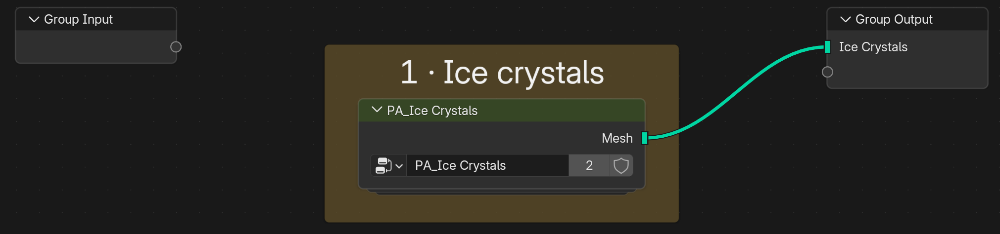

A hexagonal ice crystal is a six-sided prism. Each one here is a Cylinder node with 6 vertices and an n-gon cap,
radius 1 (the distance from the axis to a corner):

| Label | Depth | Shape | Used by |
|---|---|---|---|
| `plate: thickness 0.15 × diameter` | 0.3 | a thin plate | Plates, Wobbly Plates |
| `column: length 1.5 × diameter` | 3.0 | a long pencil | Columns |
| `thick plate (random crystals)` | 1.0 | as thick as it is wide, roughly | Random |

The three stand 100 units apart along x (`one prism per shape, 100 apart`), so a ray aimed at one of them can never
reach another. Their size does not matter: only the angles between the faces decide where light goes, so the
crystals are 2 units wide instead of the 0.1 mm of real diamond dust.

### Trick · Turn the ray, not the crystal

Nine million crystals in nine million orientations would be nine million meshes. Instead each population has a single
crystal that never moves, and each ray is turned into that crystal's frame: a ray hitting a tilted crystal is the same
as the inverse-tilted ray hitting an upright one. Section 2 picks an orientation per ray and turns the ray by its
inverse; section 3 turns the exit direction back. The tracer then needs one Raycast against 3 small prisms.

---

## 2 · Sun rays, one crystal each

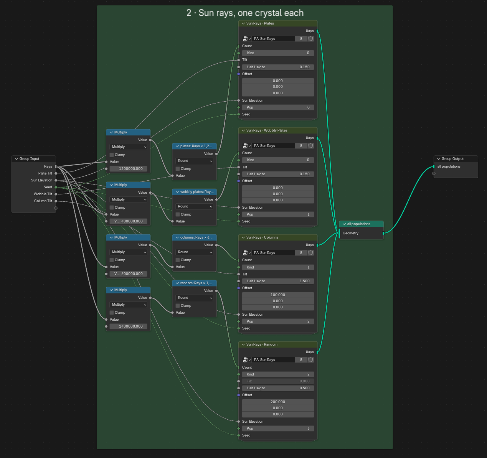

Four calls of the same group `PA_Sun Rays` make the four populations:

| Population | Kind | Crystal | Tilt σ | Rays (× Rays 2.5) | Draws |
|---|---|---|---|---|---|
| Plates | 0 plate | plate, offset 0 | Plate Tilt 0.6° | 1,200,000 → 3.0 M | sun dogs, parhelic circle, subsun |
| Wobbly Plates | 0 plate | plate, offset 0 | Wobble Tilt 3° | 400,000 → 1.0 M | sun pillar, wide sun dogs |
| Columns | 1 column | column, offset 100 | Column Tilt 0.5° | 600,000 → 1.5 M | upper tangent arc |
| Random | 2 random | thick plate, offset 200 | (unused) | 1,400,000 → 3.5 M | 22° halo, a faint 46° halo |

Pop (0–3) tells the rays apart later, and gives each population its own random numbers.

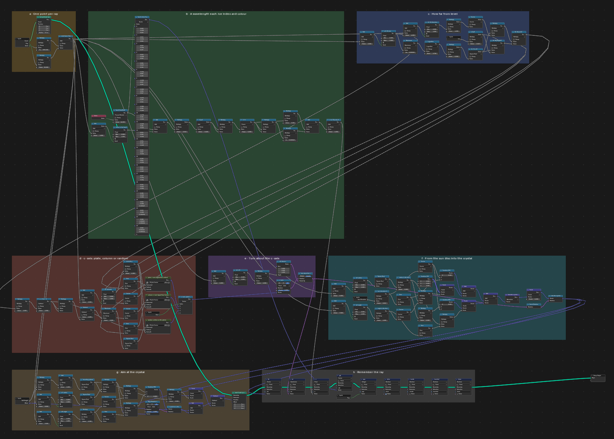

### a · One point per ray

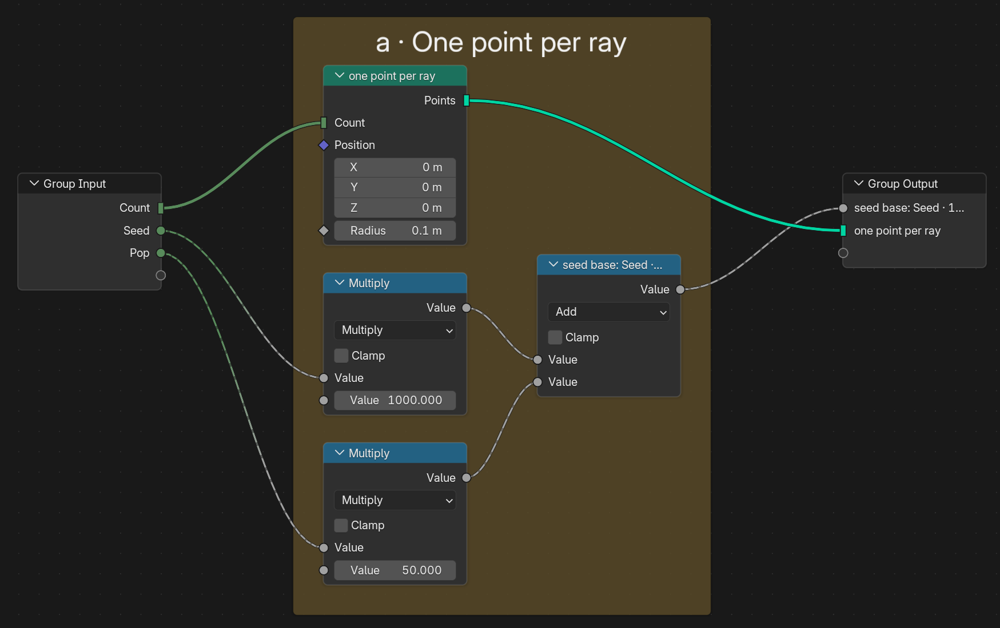

A ray is a point that stores a direction. `seed base: Seed · 1000 + Pop · 50` is added to a different small number
(1, 2, … 9) in every Random Value node below, so no two random numbers in the group are correlated and the four
populations differ.

### b · A wavelength each: ice index and colour

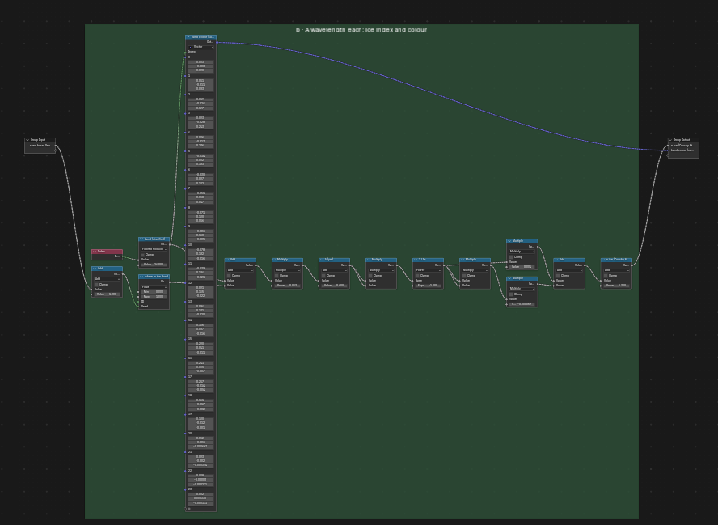

Each ray carries one wavelength between 400 and 700 nm. The range is cut into 24 bands of 12.5 nm, and
`band (stratified)` is simply the point's index modulo 24, so every band gets exactly the same number of rays.
`where in the band` places the ray randomly inside its band.

The refractive index comes from the wavelength: `n ice (Cauchy fit to Warren 2008)` is n = A + B/λ² + C/λ⁴, fitted to
the ordinary-ray index of ice measured by Warren & Brandt (2008). It gives 1.3194 at 400 nm, 1.3109 at 550 nm and
1.3070 at 700 nm, within 0.0004 of the measurements. That 1 % spread is what puts red on the inside of every halo
and blue on the outside (the three curves in The one idea).

`band colour (sums to white)` is the colour of each band: the CIE 1931 colour-matching functions averaged over the
band and turned into linear sRGB, scaled so that the 24 colours add up to exactly (1, 1, 1). Light that the ice does
not split stays white.

### Trick · Stratified wavelengths

A random wavelength per ray would leave some cells with a few more red rays than blue ones by chance, which shows up
as coloured speckle. With the index modulo 24, any 24 neighbouring rays cover the whole spectrum once. Where nothing
sorts the colours apart (the sun pillar, which is reflection only) the bands still add up to white.

### c · How far from level

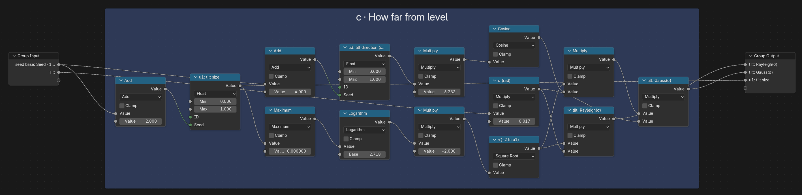

Real plates fall face down, like leaves, and rock a little; columns fall lying flat and rock a little. The tilt
slider σ says how much. Two random numbers make the rocking:

- `√(−2 ln u1)` is the Box–Muller radius: the length of a random 2D Gaussian step. Times σ it is
  `tilt: Rayleigh(σ)`, how far a plate's axis leans from vertical when it wobbles freely in both directions.
- Times also cos(2π·u3) it becomes a 1D Gaussian, `tilt: Gauss(σ)`: how far a column's long axis dips out of the
  horizontal.

### d · c-axis: plate, column or random

The c-axis is the crystal's six-fold axis (perpendicular to the hexagon). `PA_Unit Vector` builds a direction from
its horizontal length h, its height z and its azimuth φ: (h cos φ, h sin φ, z). The three kinds differ only in what
they feed it:

| Label | Horizontal | Vertical | Result |
|---|---|---|---|
| `plate: c-axis tipped from vertical` | sin(tilt) | cos(tilt) | nearly vertical: the plate lies nearly flat |
| `column: c-axis tipped from horizontal` | cos(tilt) | sin(tilt) | nearly horizontal, pointing any way |
| `random: uniform on the sphere` | √(1 − z²) | `z = 2·u1 − 1` | any direction, evenly spread |

The random kind uses Archimedes' rule: a height chosen evenly between −1 and 1, with an even azimuth, spreads points
evenly over a sphere. `c-axis: plate / column / random` picks one by Kind.

### e · Turn about the c-axis

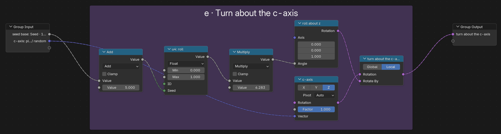

The c-axis fixes two of the crystal's three degrees of freedom. The third is how far the hexagon is turned about its
own axis, chosen evenly (`roll about z`). Align Rotation to Vector (`c-axis`) points the crystal's z along the
c-axis and `turn about the c-axis` adds the roll. The result is a full orientation, a rotation per ray.

### f · From the sun disc into the crystal

The sun is at azimuth 0 (straight ahead, +y) and elevation h. It is not a point: its disc is 0.53° wide, which
blurs every halo edge by about that much. `radius in the disc` is √u × 0.265°, so the points are spread evenly over
the disc's area, and `towards a point on the sun` is the direction to one of them. The ray travels the other way;
`into the crystal frame` turns that travel direction by the inverse of the crystal's rotation (the trick in
section 1).

### g · Aim at the crystal

`bounding sphere` is the radius of a sphere round the prism: √(half height² + 1). Each ray starts on a disc of that
radius, facing the ray, 3 radii back along it (`start 3 radii up the ray`). Points on the disc are spread evenly by
area (√u for the radius), so the rays rain on the crystal like sunlight: each face is hit in proportion to the area
it shows the sun. Rays that pass beside the crystal never touch it and are simply not counted (section 3 f).

### h · Remember the ray

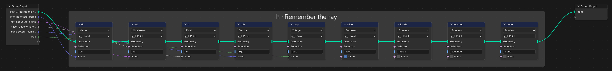

Everything the tracer needs is stored on the point: `dir` (in the crystal frame), `rot` (the orientation, to turn
back later), `n`, `rgb`, `pop`, and four flags that start as alive, outside, not touched, not done.

> **Try it:** set Plate Tilt from 0.6 to 3 (the same as Wobble Tilt). The sun dogs grow from 0.6° to 2.8° tall
> (half-maximum height, measured on the traced map) and a pillar appears: rocking plates spread the sun dogs up and
> down and start to reflect the sun downwards.

---

## 3 · Trace through the ice

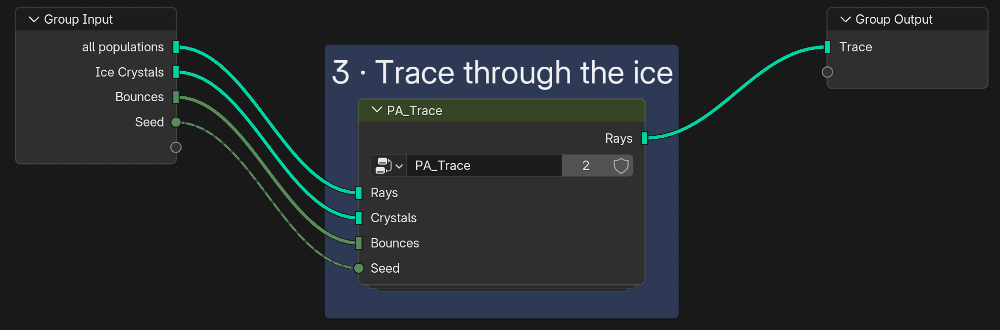

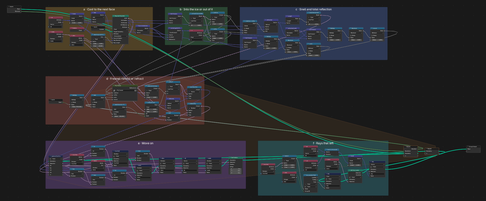

A repeat zone runs Bounces = 8 times. Each pass moves every ray to the next face it meets and decides there whether it
reflects or refracts.

### a · Cast to the next face

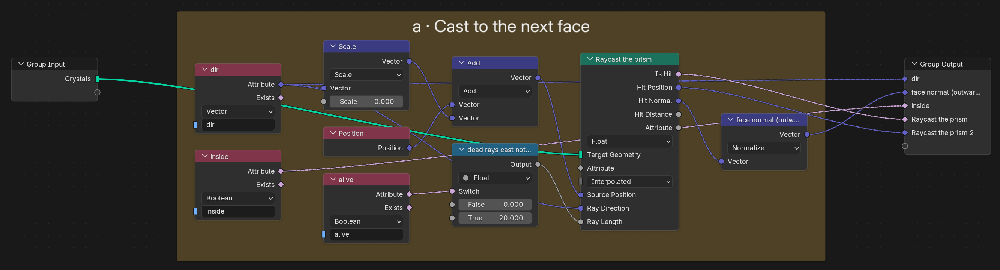

`Raycast the prism` casts from the ray's position, nudged 0.0001 forward so it does not hit the face it is standing
on, along `dir`, up to 20 units. A ray that is no longer alive casts a length of 0 (`dead rays cast nothing`), so
it can't hit anything and nothing about it changes.

### b · Into the ice or out of it

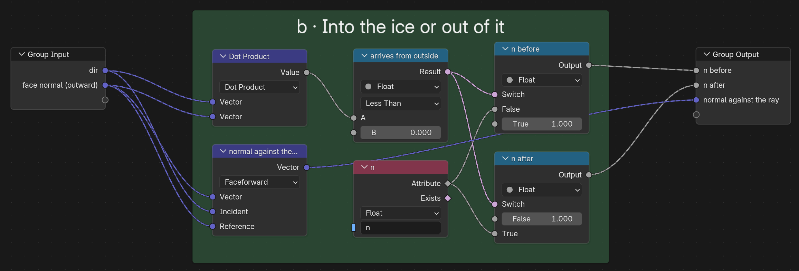

The hit normal points out of the crystal. If the ray travels against it (`arrives from outside`), the ray goes from
air (n = 1) into ice (`n before` = 1, `n after` = n); otherwise the other way. `normal against the ray` is the normal
flipped to face the incoming ray, which is the form the Refract and Reflect operations expect.

### c · Snell and total reflection

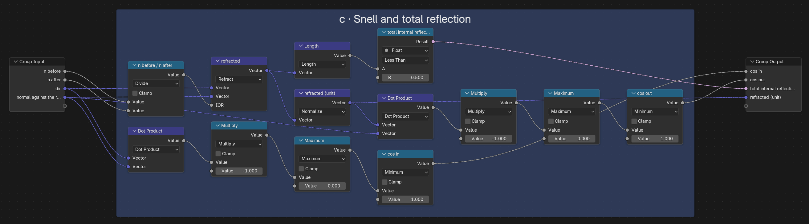

Vector Math Refract applies Snell's law with the ratio `n before / n after`. When no refracted ray exists (inside
the ice, beyond the critical angle of asin(1/1.31) ≈ 50°), it returns a zero vector; `total internal reflection`
tests for that. `cos in` and `cos out` feed Fresnel's formulas.

### d · Fresnel: reflect or refract

`PA_Fresnel` gives the share of light a face reflects, averaged over the two polarisations: about 2 % straight on,
rising to all of it at grazing angles. Total internal reflection makes it 1 (`reflectance (unpolarised)`).

### Trick · One ray, one path

A real ray splits at every face into a reflected and a refracted part. Following both would double the rays at every
bounce. Instead each ray rolls a die: `a die per face` is a fresh random number for every ray at every bounce (its
seed adds the bounce number, `seed: bounce + Seed · 7919`), and the ray reflects if the die is below the reflectance
(`reflect?`), otherwise it refracts. Over millions of rays the share that reflects equals the reflectance, so every
ray keeps the same weight and the halo map only has to count rays. `inside after` flips when the ray crosses the
face and stays the same when it reflects.

### e · Move on

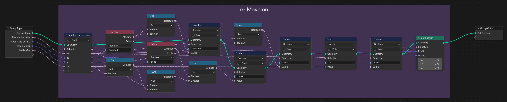

The ray now moves to the hit point with its new direction. The flags: `touched` once it has hit the crystal at all;
`done` once it hits a face and ends up outside (it has left, possibly by bouncing straight off the first face);
`alive` only while it is inside. A ray that hits nothing (it missed the crystal, or it left on an earlier pass)
stops being alive, and its next passes cast nothing.

### Trick · Capture once, then move

Geometry Nodes evaluates a field on the geometry of the node that uses it. If the Raycast's outputs were read
directly by the Store nodes after Set Position, the Raycast would be cast again from the *new* position and give a
different answer. `capture the hit once` evaluates the hit, the hit position, the new direction and the inside flag
together, on the geometry before anything moves, and everything after reads the captured values. Without it the rays
skip faces.

### f · Rays that left

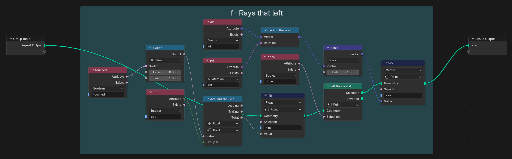

Accumulate Field adds up `touched` per population (Group ID = `pop`) and stores the total as `hits` on every ray: how
many rays of that population met the crystal. Then `left the crystal` keeps only the rays that left. Their
direction is still in the crystal's frame; `back to the world` turns it by the stored rotation. Light leaving in
direction D is seen by looking back along −D, so `sky` is the negated direction: where on the sky this light appears.

> **Try it:** set Bounces to 1. Every ray now meets a single face, so only light reflected off the outside of a crystal
> remains: the map keeps a tenth of its light and the 22° halo and the sun dogs vanish. At Bounces 2 they are back
> (in through one face, out through another) with 83 % of the light; at 3, 98 %. The default of 8 catches the rest,
> the paths with internal reflections.

---

## 4 · Halo map

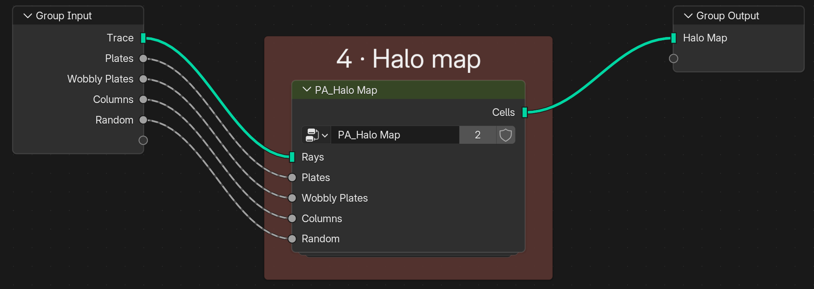

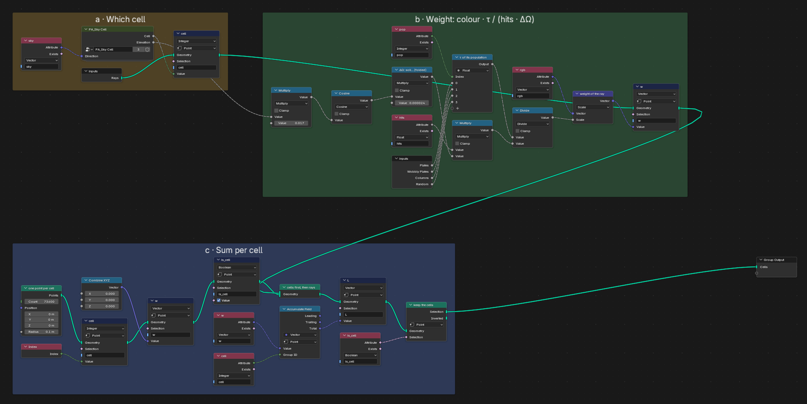

The map is a grid of 0.2° cells on the sky: azimuth from the sun 0–46°, elevation −10° to 54°. That is 230 × 320 =
73,600 cells. Each cell ends up holding the light that reaches the eye from that direction, per unit of sunlight.

### a · Which cell

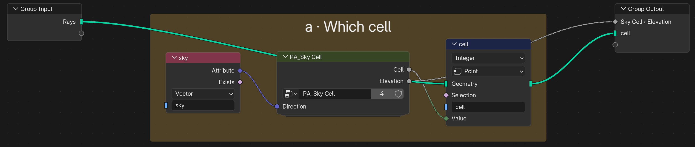

`PA_Sky Cell` turns a direction into a cell number (its inside is in Inside the small helpers). It uses the
azimuth's absolute value, which folds the left half of the sky onto the right.

### Trick · Fold the sky

The crystals' orientations have no preferred side, so the display is a mirror image about the vertical through the
sun. Counting |azimuth| puts the rays of both halves into one set of cells: twice the rays per cell, so less noise for
the same work. The dome (section 5) unfolds it again.

### b · Weight: colour · τ / (hits · ΔΩ)

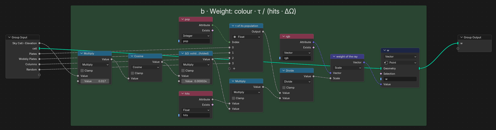

Each ray gets a weight: its band colour, times its population's τ, divided by `hits` and by the solid angle of a cell,
`ΔΩ: solid angle of a cell, ×2 (folded)`. A 0.2° × 0.2° cell covers less sky towards the zenith, hence cos(elevation);
the ×2 is for the fold. Dividing by `hits` makes each population's map the *share* of its light that goes to each
direction, whatever the ray count; dividing by ΔΩ turns a share per cell into light per unit of solid angle, which is
what a radiance is. The τ sliders then say how much of the sunlight the layer of crystals scatters at all.

### c · Sum per cell

### Trick · A histogram in four nodes

Geometry Nodes has no "bin these values" node, but Accumulate Field with a Group ID is one. `one point per cell`
makes 73,600 empty cells; `cells first, then rays` joins them in front of the rays, so every cell exists even if no
ray lands in it, and the cell points keep their index order. Accumulate Field's Total, grouped by `cell`, gives every
point the sum of `w` over its cell, stored as `L`. `keep the cells` throws the 9 million rays away and keeps the
73,600 cell points, each holding its cell's light. Rays outside the map have cell −1, a group with no cell point, so
they drop out.

![The traced sky map at frame 240 (sun 4.2°). Top row, each population alone: Plates give two short bright sun dogs at ±22° on the sun's level and a subsun below the horizon; Wobbly Plates a vertical pillar through the sun and wider sun dogs; Columns a V-shaped arc 22° above the sun and a horizontal line through the sun; Random a ring 22° round the sun with a red inner edge and a fainter ring near 46°. Bottom: all four together with the features labelled: upper tangent arc, 22° halo, sun dog, sun pillar, parhelic circle, subsun](images/maps.png)

Each population draws its own part of the display. Section 6 reads the same 73,600 cells.

### Check · Are the halos where physics puts them?

The map can be measured. At frame 240's sun (4.17°):

| Feature | In the map | Expected |
|---|---|---|
| 22° halo, inner edge (half maximum) | red channel 21.75°, blue 22.25° | minimum deviation 21.6–22.6° from red to violet (The one idea) |
| inside the 22° halo, 15–19° from the sun | 6 % of the halo's peak | dark: no ray is turned less than the minimum |
| sun dog (plates), peak | red 21.9°, blue 22.5° from the sun | Bravais's rule for a sun at height h, index n′ = √(n² − sin²h) / cos h: 21.80° (650 nm), 22.39° (450 nm) |
| upper tangent arc | 22.1° above the sun | touches the 22° halo while the sun is low |

The map is binned in 0.2° cells, so agreement within 0.1–0.2° is as close as it can show. A numpy tracer was
written first from the same physics, and the node version was built to match it. The two maps
below were made during development, with the sun at about 4°. The numpy map has no wobbly plates, a plate tilt of
1° and its own crop and tone curve, so compare where things are, not how bright they are:

### Check · Does the light add up?

Summing L × ΔΩ over the whole sky should give τ times the share of the scattered light that lands inside the map.
At frame 240 the file gives 0.035 τ for the plates, which is 0.84 / 24 (0.74 / 24 for the wobbly plates, about
0.5 / 24 for the columns and the random crystals, whose light spreads further). The 24 band colours add up to white,
so one ray carries 1/24 of white on average, and the weight in b lacks that factor of 24. The picture is not affected,
because the four τ values were set by eye against the sky. Read the sliders as 24 × the optical depth: the plates'
0.085 is a real optical depth of 0.0035, the random crystals' 0.45 is 0.019. Both are far below 1, a thin haze in
which a ray rarely meets two crystals, which is what a map built from one crystal per ray assumes.

---

## 5 · Sky dome

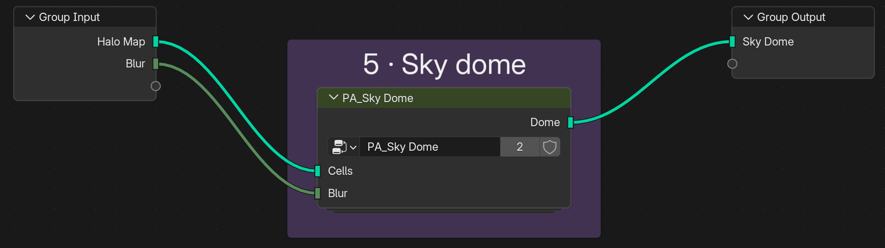

The map has to become light in the picture. The dome is a grid of vertices, one per cell, both halves, round the
camera.

### a · Azimuth × elevation grid

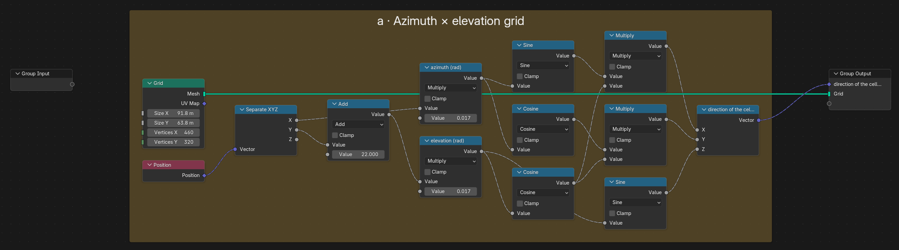

A Grid of 460 × 320 vertices spaced 0.2 apart: x is the azimuth in degrees from −45.9 to 45.9, y the elevation from
−9.9 to 53.9. `direction of the cell centre` turns each vertex into the unit vector of that direction.

### b · Take the cell light

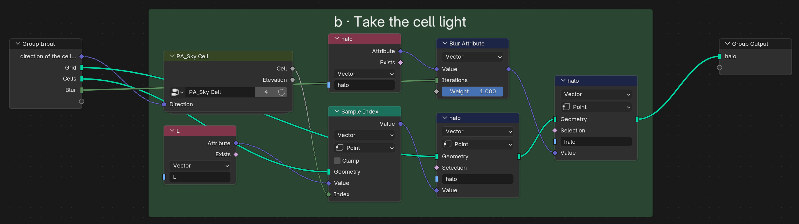

The same `PA_Sky Cell` as in section 4 finds each vertex's cell (both halves map to the same folded cell), and
Sample Index copies that cell's `L` into the attribute `halo`. Blur Attribute averages each vertex with its grid
neighbours, 2 passes, to soften the cell-to-cell noise.

### c · Round the camera

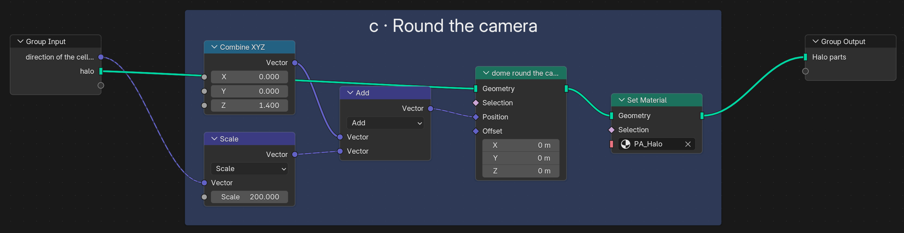

`dome round the camera, in front of the trees` moves every vertex 200 m out from the camera in its own direction. Each
0.2° cell is then 0.7 m across, and Cycles interpolates `halo` smoothly across the faces between the vertices. 200 m
is closer than the nearest trees (the headlands start about 260 m away), because diamond dust hangs in the air right
here: real halos are drawn in front of the forest, not behind it.

The material `PA_Halo` multiplies `halo` by the sun's irradiance (`sun irradiance (colour × W/m²)`, a colour keyed
every frame from the sky model, Appendix B) and emits it, added to a Transparent BSDF so the sky shows through. The
map is light per unit of sunlight, so multiplying by the sunlight gives the halo's radiance in the sky's own units.
The object is hidden from shadow, diffuse, transmission and volume rays: the camera sees the halos, and the glossy
black ice reflects them, but they do not light the scene.

Below about −0.4° the snow is closer than 200 m (from 1.4 m up, the ground at −0.4° is 200 m away), so the lower part
of the dome is hidden. Below the horizon the halos show in the glitter of the near crystals instead (the subsun in
the glints figure of section 6).

> **Try it:** set Sun Elevation to 20° (the slider is keyed: clear its keys first; the sky and the sun lamp keep their
> own keys, so only the halos move). The plates' sun dogs move out to 24.7° from the sun, outside the 22° halo; at
> 30° they are at 28.7°. Bravais's rule predicts 24.65° and 28.80°: steeper rays cross a flat plate's side faces at a slant and
> see a higher index.

---

## 6 · Glitter near the lens

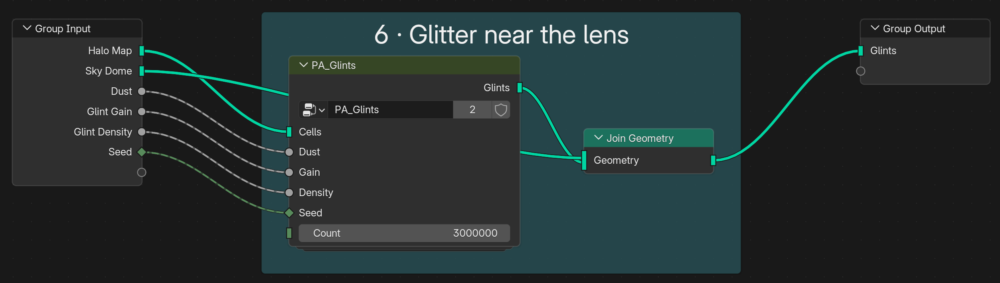

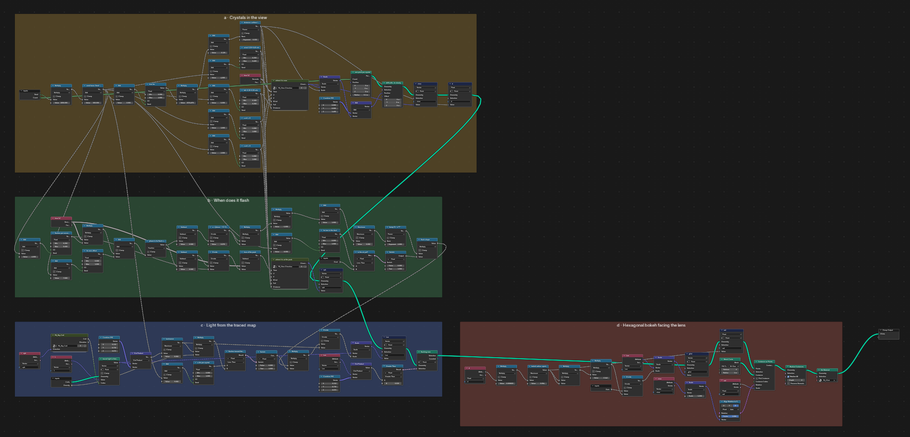

The dome shows the halo as a smooth glow, the sum of countless crystals too far away to see one by one. The crystals
within a few metres of the lens are seen one by one, and each one sparkles.

### a · Crystals in the view

3,000,000 crystals are placed in the camera's view, not in the world: each gets a position on the image (u, v, from
−1.08 to 1.08, the frame being −1 to 1) and a distance between 0.5 and 15 m. `distance: uniform in volume` is
(w·(15³ − 0.5³) + 0.5³)^⅓, so there are as many crystals per cubic metre far away as near, and most of them are far.

They drift: a sideways wind of 0.25–0.45 m/s and a slow fall of 0.10–0.25 m/s. `PA_View Direction` (`where it is
now`) moves each crystal across the image by speed × time / distance, so near crystals cross the frame faster than far
ones, as parallax does. It wraps them round at the edges and returns the direction from the camera. The 8 % margin
past the frame edge hides the wrap.

### b · When does it flash

A drifting crystal rocks and spins, and it flashes when a face lines up. Each crystal gets its own rhythm, 0.25–0.6
flashes a second, and `phase in its flash cycle` runs from 0 to 1 in each cycle. The flash is a smooth bump,
`bump (1 − x²)²` with x = (phase − ½)/0.07: 0.14 of a cycle wide, so it lasts 13 frames at the slowest rate and
6 frames at the fastest.

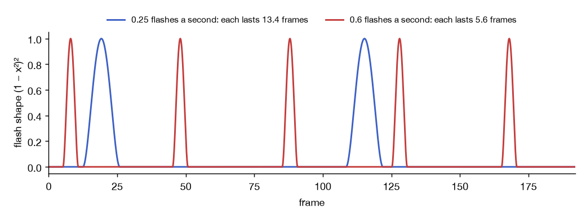

`in the air yet?` compares a random number with Dust, which the keys raise from 0 to 1: as Dust rises, more crystals
join, each at its own moment.

### Trick · Decide at the peak

A crystal 1 m away drifts across several 0.2° cells of the map while it flashes. If its colour and whether it flashes
were looked up where it is *now*, a near crystal could change colour or vanish halfway through its flash, which
reads as a flicker. `time of the peak` works out when this flash peaks, `where it is at the peak` (the same
`PA_View Direction` group, at that time) gives the direction then, and it is stored as `vpk`. Everything in c reads
`vpk`, so each flash keeps one colour and fades in and out whole.

### c · Light from the traced map

This is where the glitter meets the halo. `traced light in that direction` reads the map at the crystal's direction.

### Trick · A halo is shimmer, added up

The obvious move, making each flash as bright as the map, gives the wrong picture: every crystal flashes, faintly
where the sky is dark, and the air fills with even speckle. A halo is bright because *more* crystals send light your
way in that direction, not because each one sends more. So the map sets the **chance** to flash
(`flashes toward the lens?`: a die below luminance × Glint Density, 0.22), and every flash has the same strength
(L divided by its own luminance, times `flash shape`) and the map's colour in that direction. `flashing now` keeps
only crystals that are visibly lit, about 430 of the 3 million at any frame.

One frame of glints looks random. Ninety frames of them draw the halo. The colours come from the map, cell by cell:
on the arcs they are the halo's colours (red on the inner edge of the sun dogs, white on the tails). In the dim sky a
cell holds only a few rays of a few wavelengths, so a flash there has a pure spectral colour, much as a single ice
crystal sparkles red or green in real diamond dust.

### d · Hexagonal bokeh facing the lens

The camera is focused far away, so a crystal at 1 m is a blurred disc. With a lens focused at infinity, the blur
disc of a point has the size of the aperture in the world, whatever its distance: 24 mm at f/2.8 is 8.6 mm across.
Each glint is therefore a hexagon (a 6-blade aperture) of radius 4.3 mm facing the lens. Beyond about 5 m that would
shrink below 0.6 pixel, so `bokeh radius: aperture, ≥ 0.6 px` keeps it at least that big. The flash's light is
spread over the disc: `glint` is Lon × Glint Gain / (π r²), so a large near disc is dim and a far small one is a
bright point, with the same total light. The camera's own depth of field is off: the near crystals carry their own
blur, and everything else is far.

> **Try it:** raise Glint Density from 0.22 to 1, then 5. Frame 240 goes from 427 flashes to 1,874 and 8,056. The
> chance to flash cannot pass 1, and on the plates' sun dogs (where the map reaches about 5.7) it is already above 1 at 0.22.
> So the sun dogs gain nothing while the dim sky gains 19 times as many flashes, and the glitter traces the halo
> less and less. Set Dust to 0 and the glitter is gone; the halos on the dome stay.

---

## Inside the small helpers

### `PA_Sky Cell`

Used three times: by the halo map (where each ray goes), the dome (where each vertex looks) and the glitter (where
each crystal is at its peak). One group guarantees that all three agree on what "cell 41,317" means. Azimuth is
measured from +y (the sun's side) with Arctan2(x, y) and folded with Absolute; elevation is Arcsine of z, clamped to
±1 first. The cell number is column + row × 230. The group also outputs the elevation, which the halo map needs for
the cell's solid angle.

### `PA_Unit Vector`

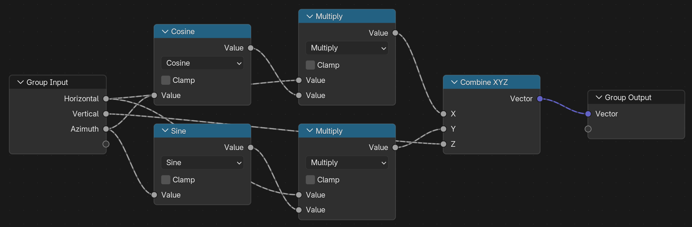

(Horizontal · cos φ, Horizontal · sin φ, Vertical). Section 2 d calls it three times with different horizontal and
vertical parts.

### `PA_Fresnel`

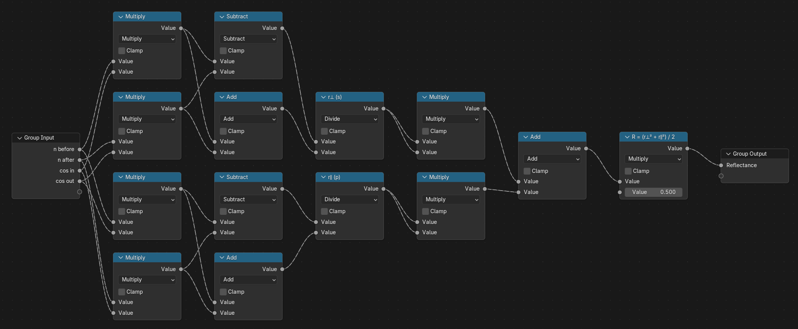

Fresnel's equations for the two polarisations, `r⊥ (s)` = (n₁ cos i − n₂ cos t) / (n₁ cos i + n₂ cos t) and
`r∥ (p)` = (n₁ cos t − n₂ cos i) / (n₁ cos t + n₂ cos i), and their mean power `R = (r⊥² + r∥²) / 2`. Sunlight is
unpolarised, so the average is right. At normal incidence on ice, R = ((1.31 − 1)/(1.31 + 1))² ≈ 1.8 %.

### `PA_View Direction`

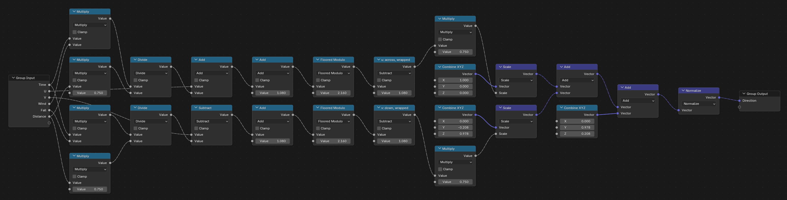

`u: across, wrapped` and `v: down, wrapped` move a crystal over the image plane: a speed v at distance d sweeps an
angle of v·t/d, which on the image plane is v·t/(d · tan 36.9°), half the view being tan 36.9° = 0.75 wide. Floored
Modulo wraps it into −1.08…1.08. The result is turned into a direction with the camera's own axes (right; up and
forward tipped by the camera's 12° pitch). Section 6 calls it twice: for now and for the moment of the flash's peak.

---

## Appendix A · The keys

Everything in the tree is a pure function of its sliders and the scene time; the motion comes from keys that the
build sets on every frame. With t = (frame − 1)/287 running from 0 to 1:

- Sun elevation = −0.3° + 5.8° · (0.55 t + 0.45 t²): about 100 minutes of a real winter sunrise, squeezed into 12 s,
  a little faster towards the end.
- Dust = smoothstep(0.02, 0.35, t).
- Wobbly Plates = 0.5 · smoothstep(0.02, 0.25, t) · (1 − 0.76 · smoothstep(0.35, 0.80, t)): up early, then down
  to a quarter. A pillar needs plates tilted by more than the sun's height, so as the sun climbs fewer plates can
  make it and the pillar fades. The key does that fading; the tracer alone would only make it shorter.
- Plates = 0.085 · smoothstep(0.15, 0.50, t), Columns = 0.18 · smoothstep(0.30, 0.70, t),
  Random = 0.45 · smoothstep(0.35, 0.85, t).

The sun lamp, the sky's sun position and the irradiance colour in `PA_Halo` and `PA_Glint` are keyed on the same
frames (Appendix B). Every ray keeps its random numbers from frame to frame (they depend on the index and the seed
only), so between two frames only the sun's height and the τ values change: the halos grow smoothly instead of
re-rolling their noise 24 times a second.

## Appendix B · Sky, sun and exposure

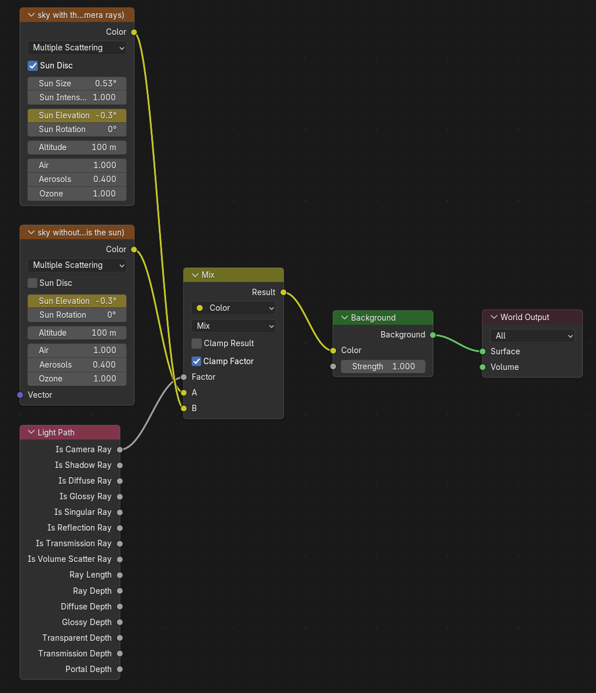

- **Sky.** Two Sky Texture nodes, both of the Multiple Scattering type, aerosol density 0.4 (clean Arctic air, a
  golden rather than blood-red low sun), sun size 0.53°. Camera rays see the one with the sun's disc; every other
  ray sees the one without, because the sun lamp `PA_Sun` (angle 0.53°) is the sun for lighting. Cycles samples a
  lamp far better than a tiny bright patch in a sky texture.
- **Sun.** The lamp's colour and strength follow the sky model's own disc. A small calibration script renders the disc at a
  range of elevations and writes its irradiance per colour to a table; the build keys the lamp and the
  `sun irradiance (colour × W/m²)` node of both emission materials from that table every frame. The snow, the halos
  and the sky therefore all get the same low, golden sun.
- **Exposure.** The Multiple Scattering sky is in physical units: the sun at 3.5° gives an irradiance of about 30,
  the sky a radiance of 1–3. Exposure −3 brings that into range; the view transform is AgX, look Medium High Contrast.
- **Glow.** The compositor adds Fog Glow, strength 0.6 above a threshold of 20: only the sun and the brightest glints
  bloom.
- **Camera.** `PA_Cam` stands on a tripod 1.4 m above the ice, 12° pitched up, 24 mm on a 36 mm sensor (a 74° view).

## Appendix C · The lake

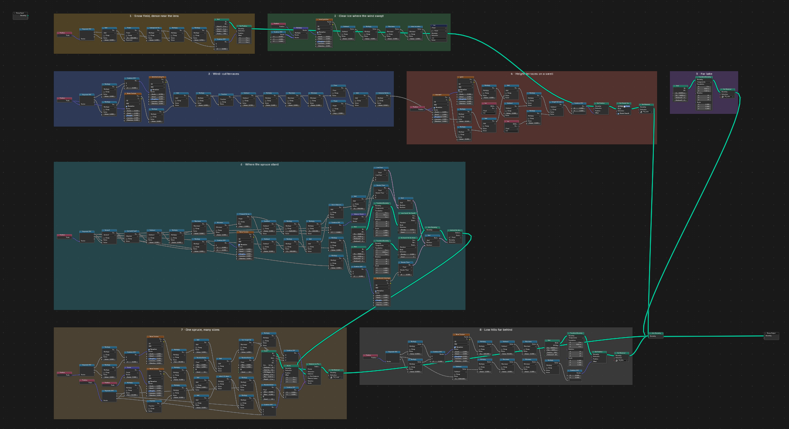

The lake is a second Geometry Nodes tree on `PA_Lake`. It is scenery, so this appendix is short.

| # | Section | What it does |
|---|---|---|
| 1 | Snow field, dense near the lens | a 900 × 700 Grid bent into a wedge in front of the camera; its rows run from 1.2 m to 700 m, spaced geometrically (`rows spaced like the view: y = y0·k^v`), so each row covers about the same height in the image |
| 2 | Clear ice where the wind swept | a broad, stretched noise, sharpened (× 9) into patches of bare ice, stored as `ice` |
| 3 | Wind-cut terraces | a noise stretched along the wind, cut into steps: each unit is flat for its first 72 % and climbs steeply in the rest (`terraces: flat tops, steep steps`), the layered look of wind-cut snow (sastrugi) |
| 4 | Height: terraces on a swell | terraces × 0.16 m + a slow swell × 0.20 m + grain × 8 mm on the snow; the ice sits 2 cm lower (`height (m): snow, or 2 cm down to the ice`) |
| 5 | Far lake | a flat 16 × 6 km quad beyond the snow field |
| 6 | Where the spruce stand | points scattered on two bands; kept only beyond a shore line that is 3.4 km away towards the sun and 260 m away at the sides (`shore distance: far toward the sun, near at the sides`), in a 700 m deep belt, in stands with clearings |
| 7 | One spruce, many sizes | a thin 8-sided cone whose radius steps out at 11 whorls of branches (`whorl: 11 steps up the tree`), instanced on every point: 12,251 trees, `tree height (m)` from a broad noise (× 20 m, + 5 m) plus a random −3 to +4 m, at least 4 m |
| 8 | Low hills far behind | a 30 × 4 km grid centred 9 km away, lifted by a large noise and faded in over its first kilometre |

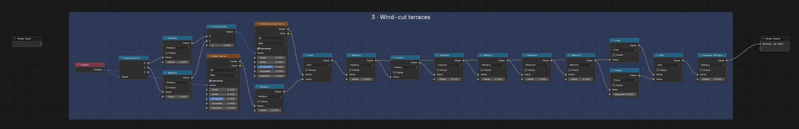

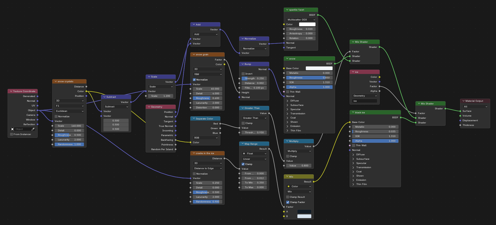

The snow material `PA_Lake` is a bright Principled BSDF with a little subsurface scattering and a fine bump
(`snow grain`). On 7 % of the cells of a fine Voronoi pattern (`snow crystals`) it mixes in a mirror-like
`sparkle facet` with its normal tipped at random: individual snow grains that catch the low sun, which is the glitter
path on the snow under the sun. Where the `ice` attribute is 1 it is `black ice` instead, nearly clear and smooth,
with `cracks in the ice` from a Voronoi edge distance. The forest and the hills (`PA_Forest`, `PA_Hills`) are dark,
rough materials mixed towards `horizon glow (aerial perspective)` with distance (half-way at about 10 km for the
forest, 4 km for the hills), so the far shore fades into the sunrise.

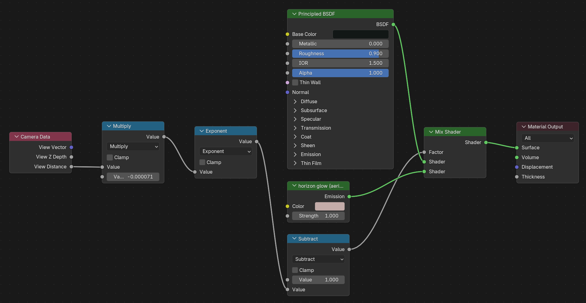

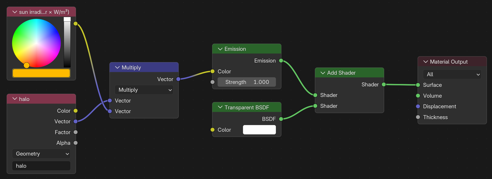

---

## How it was rendered

Cycles, 128 samples with OpenImageDenoise, 1080², persistent data on (the lake and the forest keep their BVH from
frame to frame; only the sky object is rebuilt). Each frame re-runs the whole tracer: 9 M rays through up to 8
faces, about 1 s of the 15 s a frame took with Apple Metal. Frames 1–199 were rendered there and 200–288 on a second
PC with an RTX 4060 (OptiX), 50 minutes in all. Ten overlapping frames rendered on both devices agreed to a
PSNR of 67–68 dB with no difference in brightness, so the two halves are simply joined. Encoded as H.264, CRF 16.

The video was rendered in Blender 5.2.3. For this tutorial the trees were rebuilt in 5.3 with the larger sections
split and repeated formulas gathered into the four small helper groups, and compared with the rendered file: every vertex, every attribute and every tree instance at frames 1, 150 and 240 is
identical, bit for bit.

## Try it yourself

In your own build, clear the keys on the modifier first (right-click a keyed slider → Clear Keyframes) for any
experiment that touches a keyed slider. Each result below was measured on the scene at frame 240's settings.

1. **Bounces 1.** Only light reflected off the outside of the crystals is left, a tenth of the total: the 22° halo
   and the sun dogs disappear. Bounces 2 brings them back (in through one face, out through another).
2. **Plate Tilt 3.** The sun dogs grow from 0.6° to 2.8° tall. The plates now rock as much as the Wobbly Plates,
   so they draw what that population draws in the maps figure: tall sun dogs and a pillar.
3. **Sun Elevation 20 (and 30).** The plates' sun dogs move out to 24.7° from the sun (28.7° at 30°), leaving the
   22° halo behind, as Bravais's rule predicts (24.65° and 28.80°).
4. **Random 0.** The 22° halo goes and the rest stays. Plates 0 instead leaves only the faint, tall sun dogs of the
   Wobbly Plates. The maps figure in section 4 shows each population alone.
5. **Glint Density 1 or 5.** 1,874 or 8,056 flashes in frame 240 instead of 427. The sun dogs are already
   saturated, so only the dim sky gains, and the glitter draws the halo less clearly.

*Made with Blender Geometry Nodes for [Nodevember](https://nodevember.com) 2026, Day 19 · Shimmer.*
