# How 13 pulsed jets turn Blender 5.3 voxel grids into creamy underwater smoke

*A node-by-node walkthrough of Nodevember 2026 · Day 20 · Smoke*

The video (3.1 s, 75 frames, 24 fps, 720²) and hero still (frame 64, 1080²) look like macro high-speed photography of thick cream poured into warm rose-tinted water. Dense ivory plumes surge in from the left, roll into tightly curled mushroom caps, and feather out into a soft peach-rose haze on the right. None of it uses Mantaflow, external OpenVDB caches, image textures, or modelled meshes. The entire fluid is a 3D incompressible Navier-Stokes solver built directly from Blender 5.3 Geometry Nodes grid nodes inside a single Simulation Zone, shaded with an energy-conserving Principled Volume at 20 volume bounces. A procedural-purity audit reports the file as strictly procedural with zero issues and zero node warnings.

| File | What it is |
|---|---|
| `loop.mp4` | slow-motion animation: 720², 24 fps, frames 4–78 (75 frames, 3.13 s), Cycles 48 samples + OpenImageDenoise, 16 volume bounces, H.264 CRF 16 |
| `render.png` | frame 64, the hero still: 1080², Cycles 144 samples, 20 volume bounces |
| `render-048.png` | frame 48: mid-bloom, as the hero dome curls forward over the pink-lit valley |
| `nodes/` | the node trees: `main.png` (`PA_CreamPlume_GN`), `domain.png`, `advect.png`, `emitter.png`, `nozzle.png`, `forces.png`, `project.png`, `mat-cream.png`, `world.png` |
| `post.md` | idea, captions and alt text |

The `.blend` file and the Python script that builds it are not published. The scene holds **PA_CreamPlume** (modifier `PA_Nodes`, tree `PA_CreamPlume_GN` + 6 helper groups), material `PA_CreamPlume`, world `World`, camera `PA_Cam`, and four studio area lights; every tree is in the screenshots below. It was built and rendered in Blender 5.3.

---

## The one idea

> **Creamy underwater smoke is two things working together: incompressible fluid shear that curls smooth mushroom caps, and 20-bounce volume scattering that turns deep shadows warm peach instead of muddy grey.** A jet pushed into still water cannot compress the water ahead of it; pressure forces the water aside and curls the jet's rim backward into rounded billows. In Cycles, raising optical density makes those billows look as thick as milk, while high-albedo multiple scattering lets light bounce 15–20 times through every crease so crevices glow warm peach-rose rather than collapsing into dark ash.

Everything else in the tree is bookkeeping around those two ideas:

- **Where does the fluid live?** Two aligned cubic voxel grids — a coarser velocity grid (1.8 cm voxels) for fast pressure solves and a finer cream grid (8.5 mm voxels) for crisp curls — plus a smooth boundary sponge (`1 · Voxel domains & sponge`).
- **How does one frame step forward?** Classic four-step operator splitting inside one Simulation Zone: advect, inject nozzles, add forces, and project out divergence (`2 · Navier-Stokes fluid solver`).
- **How does the grid become renderable?** Attach the evolved `density` float grid to a tiny empty Volume Cube and assign `PA_CreamPlume` (`3 · Volume output`).
- **Why does it look like cream in rose water instead of grey smoke?** Dual-regime density transfer (`66·core + 2.4·mist`), an energy-conserving `Principled Volume`, 20 volume bounces, and a shallow 90 mm macro lens (Appendices A & B).

### How to read the screenshots

Each coloured frame in a tree is one logical section. The main tree has three numbered sections matching the headings below; inside helper groups, sections are lettered `a`, `b`, `c`, `d`. Under the map there is one cut-out per section. In a cut-out, wires coming from another section enter through a Group Input socket named after what they carry (`velocity topology`, `sponge mask`), and wires leaving exit through a Group Output socket. Every frame that reads modifier parameters has its own compact local Group Input (`sliders` in the main tree, `inputs` in groups) showing only the sockets it uses. Names in `code` style match exact node labels in the screenshots. Lengths are in metres and times in seconds (simulation clock runs at 30 fps). Click any screenshot to inspect it full size.

---

## 0 · The map

| # | Section | Nodes | Job |
|---|---|---|---|
| 1 | Voxel domains & sponge | 17 (calls `PA_GridDomain` twice) | defines the 1.92 × 1.30 × 2.00 m box, builds coarse velocity and fine cream grids, and computes a smooth edge fade |
| 2 | Navier-Stokes fluid solver | 11 (wraps 4 step groups inside one Simulation Zone) | runs advect → emit → forces → pressure projection every frame to evolve velocity `V` and cream density `D` |
| 3 | Volume output | 3 | binds the evolved `density` grid onto a 2³ dummy Volume Cube and assigns `PA_CreamPlume` |

The main tree has 32 nodes including its Group Output. Across `PA_CreamPlume_GN` and its six helper groups (`PA_GridDomain`, `PA_AdvectStep`, `PA_MultiNozzleEmitter`, `PA_MilkNozzle`, `PA_FluidForces`, `PA_PressureProject`), the full procedural solver totals 189 nodes.

The modifier exposes nine sliders:

| Slider | Default | What it controls |
|---|---|---|
| `Velocity Voxel` | `0.018` m | voxel spacing for velocity, curl, and Poisson pressure (~107 × 73 × 112 voxels) |
| `Smoke Voxel` | `0.0085` m | voxel spacing for cream density advection (~226 × 153 × 236 voxels) |
| `Time Scale` | `0.88` | scales Simulation Zone `Delta Time` for slightly slower, silkier billowing |
| `Plume Gravity` | `0.52` | oblique density-driven gravity pulling thick cream down and right |
| `Vorticity` | `11.2` | Fedkiw vorticity confinement strength that rolls crisp mushroom caps |
| `Macro Curl` | `1.20` | large-scale divergence-free 4D curl disturbance (scale `3.8`) |
| `Micro Curl` | `1.38` | fine-scale divergence-free 4D curl disturbance (scale `11.5`) |
| `Cream Emit` | `6.2` | peak dye injection rate across the 13 staggered nozzles |
| `Dissipation` | `0.012` | gentle per-second fade (`1 - fade·dt`) so outer mist slowly thins |

All 13 nozzles finish firing by frame 57 (`1.90` s). From frame 57 to frame 78 the plume coasts purely on its own momentum, vorticity confinement, and pressure waves — which is why frame 64 (shaded grey above) has rich rolled petals without hard nozzle spheres poking through.

---

## 1 · Voxel domains & sponge

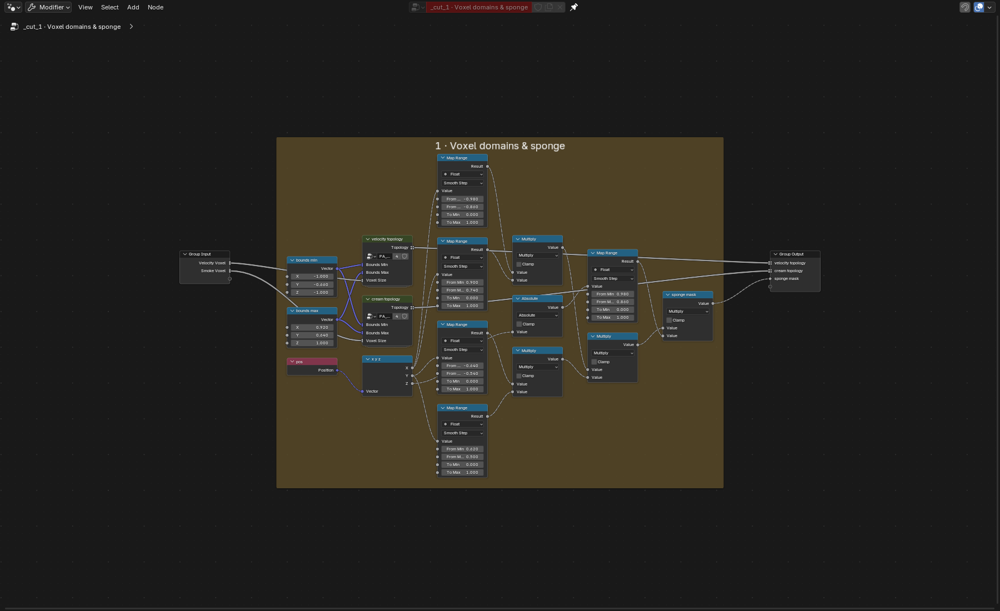

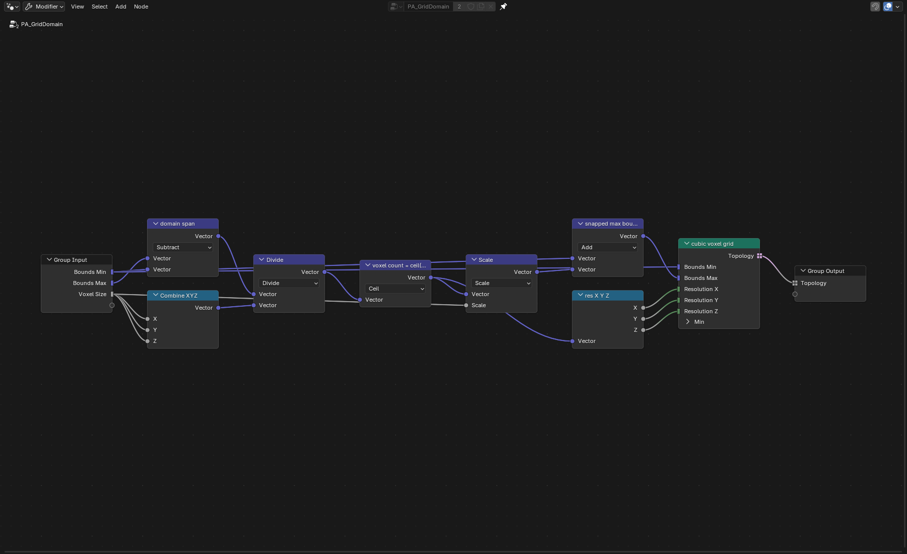

Why two grids instead of one? Pressure projection (`Grid Solve Poisson`) scales steeply with voxel count, yet smooth pressure waves do not need 8.5 mm resolution. Putting velocity on `0.018` m voxels (~875k cells) and cream dye on `0.0085` m voxels (~8.2M cells) keeps the Poisson solve fast while preserving razor-sharp milk curls.

Inside `PA_GridDomain`, `domain span` (`hi − lo`, here `1.92 × 1.30 × 2.00` m) is divided by `Voxel Size` and rounded up (`voxel count = ceil(span / h)`). That integer resolution is then multiplied back by `h` and added to `Bounds Min` (`snapped max bound`) before feeding `cubic voxel grid` (Cube Grid Topology).

Beside the topologies, `pos` splits into `x y z` and feeds five Smooth Step Map Range nodes that fade from `1` inside the core box to `0` across a 10–16 cm margin near each wall (`X`: `-0.98..-0.86` and `0.90..0.74`, `Y`: `-0.64..-0.54` and `0.62..0.50`, `|Z|`: `0.98..0.86`), multiplied into `sponge mask`. Any cream drifting near the domain walls dissolves smoothly instead of clipping against a hard box face.

### Trick · Snapping `Bounds Max` keeps every voxel strictly cubic

If you divide a box span by `h` and pass `ceil(span / h)` straight into Cube Grid Topology without snapping `Bounds Max`, the last fractional voxel gets stretched unevenly along X, Y, and Z. Stretching distorts `Grid Curl` and `Grid Gradient`, which assume isotropic spacing. Snapping `Bounds Max = Bounds Min + ceil(span / h) · h` guarantees exact cubic voxels at every slider setting.

> **Try it:** Raise `Smoke Voxel` from `0.0085` to `0.014` for 4× faster lookdev previews — the macro silhouette stays identical because `Velocity Voxel` (`0.018`) still drives the exact same flow field, only fine cream filaments soften.

---

## 2 · Navier-Stokes fluid solver

The Simulation Zone holds two voxel-grid state items: vector velocity `V` (initialized to zero by `zero V0` on `velocity topology`) and scalar cream density `D` (initialized to zero by `zero D0` on `cream topology`). Each frame computes `dt = Δt · Time Scale` (`0.88 / 30 ≈ 0.0293` s) and passes `V`, `D`, and `scene time` through four operator-splitting groups in order:

| Step | Group node | Inputs → Outputs | Role |
|---|---|---|---|
| 1 | `step 1 · advect` (`PA_AdvectStep`) | `V`, `D`, `dt` → `Advected Velocity`, `Advected Density` | moves velocity and cream along the current flow field |
| 2 | `step 2 · emit nozzles` (`PA_MultiNozzleEmitter`) | `Advected Density`, `Sponge Mask`, `Time`, `dt` → `Cream Density`, `Jet Force` | injects 13 staggered milk jets, dissipates, and clamps `0..1.50` |
| 3 | `step 3 · forces` (`PA_FluidForces`) | `Advected Velocity`, `Cream Density`, `Jet Force`, `Time`, `dt` → `Forced Velocity` | adds jets, gravity, vorticity confinement, dual-scale curl, and drag |
| 4 | `step 4 · pressure project` (`PA_PressureProject`) | `Forced Velocity` → `Velocity` | removes divergence (`∇·V = 0`) via Poisson solve |

### Inside `PA_AdvectStep`

- **Section `a · Midpoint velocity self-advection`**: samples `V(x)` (`sample V(x)`), steps backward half a step (`x - 0.5·dt·V(x)`), samples the midpoint velocity (`sample V(mid)`), steps backward a full step (`x - dt·V(mid)`), and writes `sample V(back)` back onto `Velocity Topo` (`advect velocity`).
- **Section `b · BFECC cream density advection`**: upsamples velocity onto the finer `Cream Topo` (`upsample V` → `velocity on cream`) and runs `BFECC advect cream` (Grid Advect, scheme `BFECC`, limiter `Clamp`). BFECC (Back and Forth Error Compensation and Correction) cancels most of the numerical blurring of first-order semi-Lagrangian advection, while `Clamp` prevents negative undershoots or ringing around sharp milk rims.

### Trick · Why velocity is advected by hand in Blender 5.3.0

In Blender 5.3.0, `GeometryNodeGridAdvect` works cleanly on float grids (`density`) but outputs zeros on vector grids (`velocity`). Tracing backward with three `Sample Grid` nodes (`x` → `mid` → `back`) implements true second-order RK2 midpoint advection with zero extra memory, preserving crisp vortex cores across 80 frames.

### Inside `PA_MultiNozzleEmitter` & `PA_MilkNozzle`

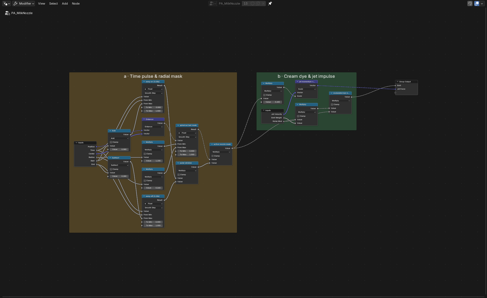

Each nozzle is one call to `PA_MilkNozzle`: a smooth temporal gate (`ramp on (0.08s)` × `ramp off (0.28s)` → `pulse window`) multiplied by a soft sphere (`spherical ball mask`, inner radius `0.26·r`, outer radius `1.15·r`). Inside `PA_MultiNozzleEmitter`, a 4D Noise Texture (`4D front breakup noise`, scale `9.5`, detail `2.5`, roughness `0.58`, `W = Time × 0.95`) remapped to `0.48..1.33` (`noise mod 0.48..1.33`) modulates every nozzle *except* `hero dome`:

| Nozzle label | Center `(X, Y, Z)` | Radius | Jet Velocity | Active (s) | Weight | 4D Breakup | Role in composition |
|---|---|---|---|---|---|---|---|
| `hero dome` | `(-0.40, -0.14, 0.22)` | `0.165` | `(1.40, -0.46, -0.12)` | `0.00–1.65` | `1.00` | off | plump, pillowy center-right billow |
| `crown 1`–`5` | `(-0.78..-0.34, -0.24..-0.12, 0.38..0.76)` | `0.074–0.100` | varied rightward & radial | `0.00–1.85` | `0.95–1.05` | on | intricate upper-left curled mushroom crown |
| `left spine`, `pink valley` | `(-0.74..-0.52, 0.04..0.14, -0.28..-0.02)` | `0.105–0.115` | `(1.08..1.15, …)` | `0.00–1.80` | `0.90–0.95` | on | receding mid-left bridge & warm backlit pocket |
| `bottom 1`–`4` | `(-0.72..0.02, -0.18..-0.08, -0.78..-0.56)` | `0.072–0.100` | upward-right curling | `0.00–1.90` | `0.95–1.05` | on | crisp lower foreground blossoms |
| `right mist veil` | `(0.04, 0.34, -0.08)` | `0.180` | `(1.15, 0.08, -0.14)` | `0.00–1.80` | `0.16` | on | subtle low-density milk haze dissolving on the right |

All 13 `Emit` masks combine via `MAXIMUM` (`combined nozzle emit`) so overlapping nozzles never over-saturate density, while their `Jet Force` vectors (`jet momentum × 3.6`) sum via `ADD` (`combined jet force`). Section `b` applies gentle decay (`(1 - fade·dt) · sponge`), adds `emit · Cream Emit · dt` (`d_prev + emit·rate·dt`), and clamps the result to `0..1.50` (`clamp 0..1.50`).

### Trick · One smooth hero nozzle beside twelve noisy micro-nozzles

Leaving `Noise Mod = 1.0` on `hero dome` while perturbing the surrounding crown and bottom jets with `4D front breakup noise` creates strong scale contrast: a smooth, creamy pillow pushing toward the viewer framed by dozens of tightly shredded curls. Meanwhile `right mist veil` emits at just `0.16×` weight behind the focal plane (`Y = +0.34`), feeding the translucent rose-water haze on the right third of the frame.

### Inside `PA_FluidForces`

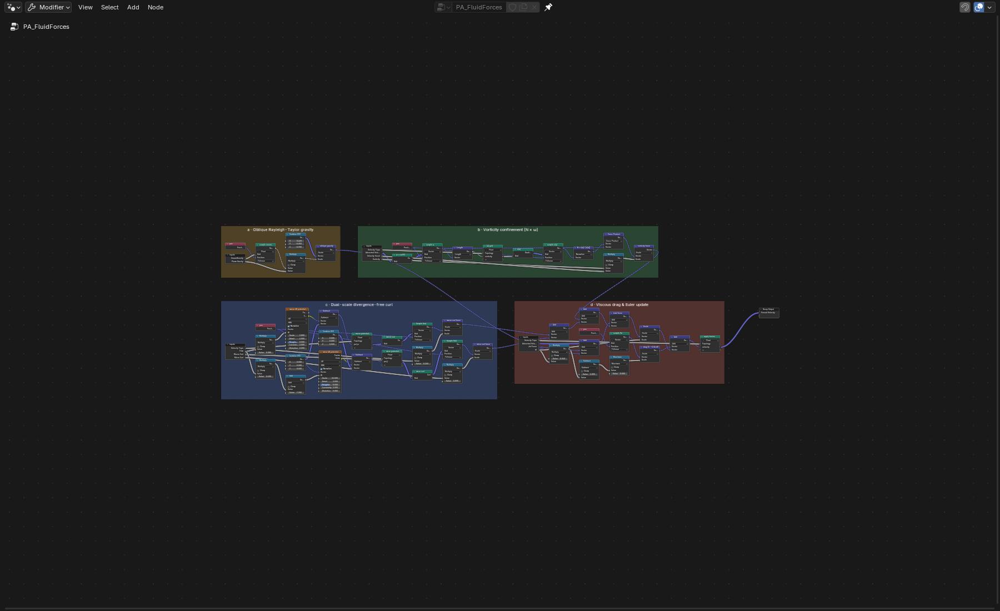

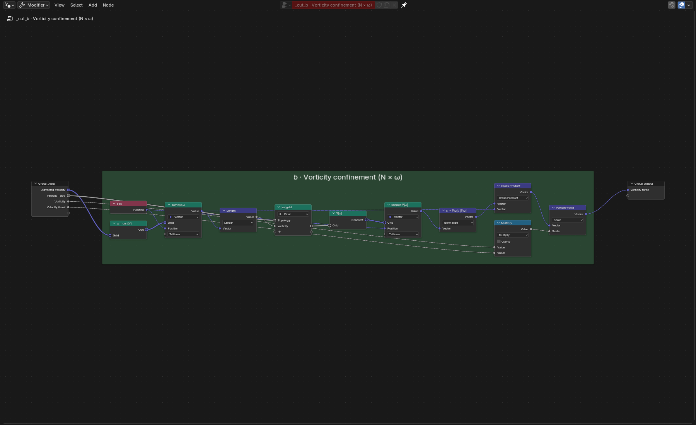

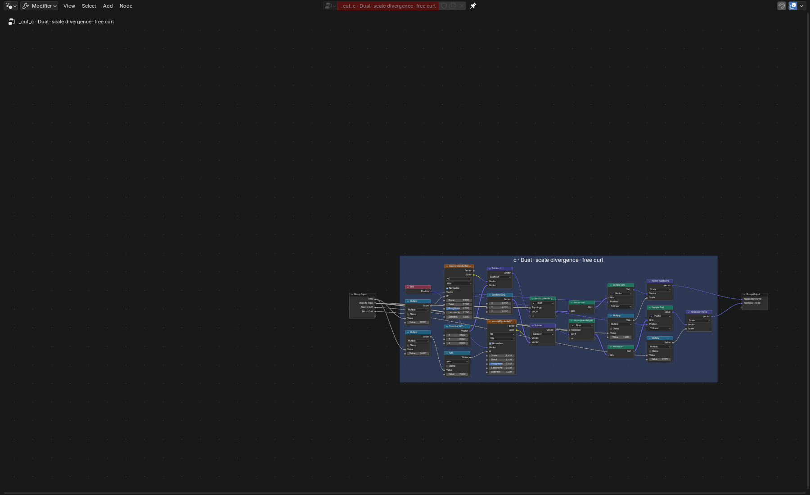

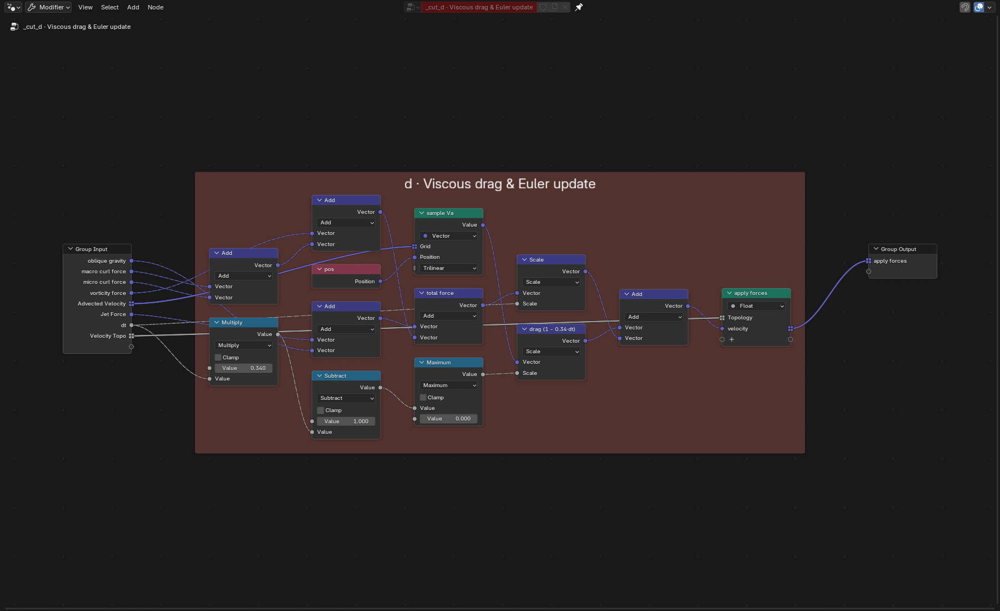

Four physical forces sculpt the cream every frame:

1. **Oblique Rayleigh-Taylor gravity (`a`)**: dense cream (`sample cream density`) sinks along `(0.42, -0.05, -0.90)` scaled by `Plume Gravity` (`0.52`), pulling heavy lobe undersides downward into classic overhanging caps.
2. **Vorticity confinement (`b`)**: computes vorticity `ω = curl(V)`, stores its magnitude `|ω| grid`, takes its gradient `∇|ω|`, normalizes it into `N = ∇|ω| / |∇|ω||`, and adds `vorticity force = (N × ω) · Vorticity · hc`. Multiplying by the voxel size `hc` (`0.018`) makes the confinement strength consistent when you change grid resolution.
3. **Dual-scale divergence-free curl (`c`)**: builds two 4D vector potentials — `macro 4D potential (3.8)` (scale `3.8`, time rate `0.38`, gain `0.16`) and `micro 4D potential (11.5)` (scale `11.5`, time rate `0.60`, gain `0.095`) — and takes `Grid Curl` of each. Because `∇·(∇×A) ≡ 0`, curl forces inject organic rolling eddies without fighting the pressure solver.
4. **Viscous drag & Euler update (`d`)**: sums `Jet Force`, `oblique gravity`, `vorticity force`, `macro curl force`, and `micro curl force` into `total force`, damps `sample Va` by `drag (1 - 0.34·dt)` so cream feels slightly syrupy rather than chaotic, and updates `apply forces`.

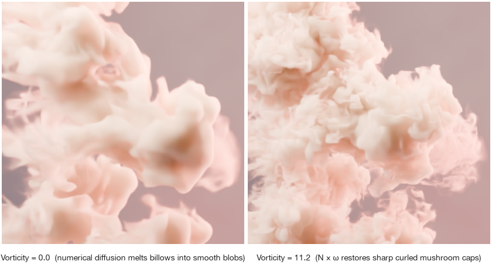

### Inside `PA_PressureProject`

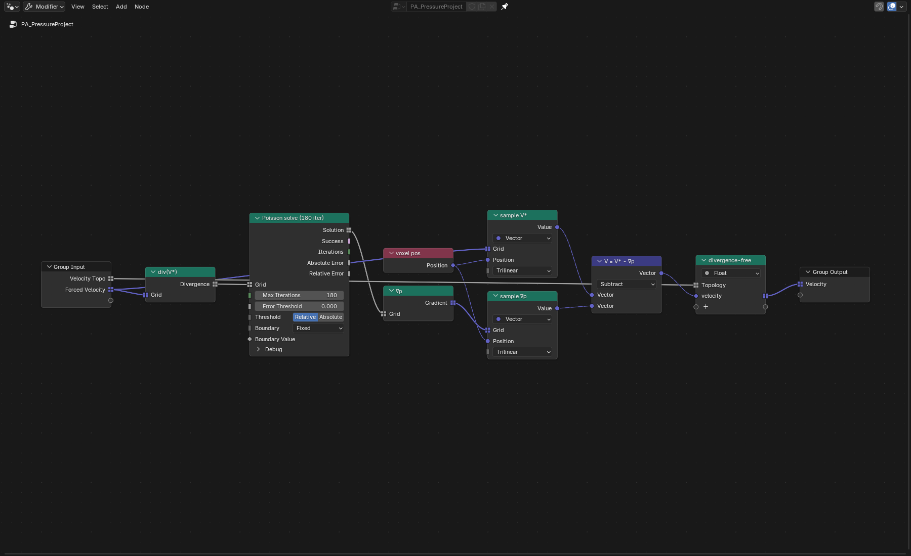

`PA_PressureProject` enforces incompressibility (`∇·V = 0`): `div(V*)` measures where fluid is piling up or pulling apart, `Poisson solve (180 iter)` (Grid Solve Poisson, `Max Iterations = 180`, `Error Threshold = 1e-4`, `Boundary = Fixed`) solves `∇²p = ∇·V*` with zero pressure on the open outer box walls, and `V = V* - ∇p` subtracts the pressure gradient to output `divergence-free` velocity for the next frame.

> **Try it:** Set `Vorticity` to `0.0` (as shown in the comparison strip above) to see how much detail comes from `N × ω` alone; or push `Vorticity` to `15.0` for sharper, more frothy coral-like petals.

---

## 3 · Volume output

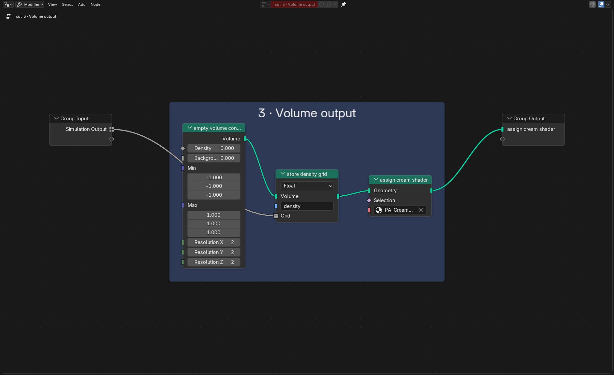

Cycles renders Volume geometries, not standalone float grids. `empty volume container` creates a minimal `2 × 2 × 2` Volume Cube with `Density = 0.0`, `store density grid` (Store Named Grid) attaches the high-resolution simulated `D` grid under the name `"density"`, and `assign cream shader` binds `PA_CreamPlume`.

### Trick · A 2³ Volume Cube is just a zero-cost wrapper

You do not need the Volume Cube's bounds or resolution to match the solver grid: `Store Named Grid` replaces the `"density"` grid with the exact bounds, transform, and voxel size of `D` from the Simulation Zone. Keeping the placeholder at `2 × 2 × 2` adds virtually zero overhead.

---

## Appendix A · Cream volume shader (`PA_CreamPlume`)

A raw linear fluid grid looks like wispy grey smoke. Three shader decisions turn it into thick underwater cream:

1. **Dual-regime density transfer (`1 · Dual-regime cream density`)**: `read density grid` splits into two Smooth Step ramps:
   - `cream core (0.14..0.48)` × `66.0` gives dense lobes a steep, milk-like interface with high optical thickness.
   - `diluted veil (0.01..0.20)` × `2.4` preserves delicate low-density wisps around the rim so the cream dissolves naturally into the water.
   Summing both (`66·core + 2.4·mist`) avoids the hard plastic shell of an isosurface mesh while keeping inner billows plump.
2. **Energy-conserving `Principled Volume` (`2 · Energy-conserving Principled Volume`)**: `mist peach → cream ivory` blends albedo from `(0.99, 0.56, 0.54)` in the wispy veil to warm vanilla-ivory `(0.992, 0.896, 0.816)` in the core, feeding `cream Principled Volume` with `Anisotropy = 0.28` and warm peach-coral `Absorption Color = (0.98, 0.36, 0.28)`. Its built-in `Density Attribute` string is cleared so only our remapped `Density` socket controls extinction.
3. **20 volume bounces (`Volume Bounces = 20`)**: with high warm albedo (`R = 0.992 > G = 0.896 > B = 0.816`), each additional internal scatter bounce multiplies the spectrum again — 1–2 bounces at lit crests stay warm ivory, 6–10 bounces in mid-crevices turn soft peach-rose, and 15–20 bounces in deep pockets glow warm apricot-coral.

### Trick · Why `Principled Volume` prevents cyan shadow inversion

If you build a warm cream volume by adding a bare `Volume Scatter` node (with blue lower than red) and a weak `Volume Absorption` node, red scatters heavily near the surface while blue has much lower extinction and punches straight through deep crevices — turning shadows an eerie cyan-teal. `Principled Volume` balances total extinction across RGB channels automatically, so warm albedos shift purely from ivory to peach-rose at every depth.

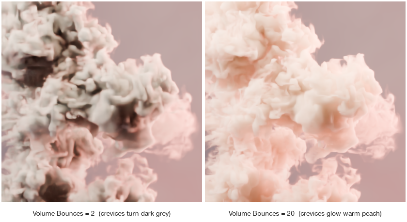

---

## Appendix B · Rose-water world, macro lighting & lens

- **World (`World`)**: uses `window UV` so the dusty-rose water backdrop stays locked to the framing — muted cool mauve-grey `(0.36, 0.27, 0.30)` in the bottom-left corner, soft blush-rose `(0.82, 0.48, 0.47)` upper-right, warm rose-peach `(0.96, 0.40, 0.40)` mid/lower-right, and a subtle two-octave 2D noise bokeh veil (`broad mist (2.2)` + `fine mist (4.8)`). `split camera / lighting` separates what the camera sees (`camera backdrop (0.92)`) from the softer ambient fill (`peach ambient fill (0.30)`) so directional studio lights still carve clear 3D relief.
- **Four area lights** (all `visible_camera = False`):

| Light | Size (m) | Location | Power (W) | Colour | Spread | Job |
|---|---|---|---|---|---|---|
| `PA_KeyCream` | `1.4 × 1.3` | `(-2.9, -1.5, 2.7)` | `86` | `(1.00, 0.91, 0.80)` | `52°` | raking warm vanilla key across upper-left & bottom curls |
| `PA_PeachBack` | `2.8 × 2.5` | `(2.5, 2.2, 0.2)` | `340` | `(1.00, 0.42, 0.34)` | `80°` | strong warm peach backlight driving multi-bounce glow through crevices |
| `PA_WarmTop` | `1.8 × 1.2` | `(0.8, -0.9, 3.2)` | `72` | `(1.00, 0.80, 0.60)` | `64°` | soft golden-peach wrap over the central hero dome |
| `PA_CoolFill` | `1.8 × 1.8` | `(-3.6, -0.4, -2.8)` | `16` | `(0.58, 0.66, 0.94)` | `82°` | whisper-soft cool slate-blue contrast on the lowest left underside |

- **Macro telephoto camera (`PA_Cam`)**: `90 mm` lens (36 mm sensor) at `(0.10, -3.55, 0.00)` aiming at `(0.06, 0.00, 0.00)` — shifting slightly right leaves the right third open for rose water. Depth of field is locked at `3.29 m` (`Y ≈ -0.26 m`, right on the crisp upper-left and lower curled ridges) at `f/3.6` with 7 aperture blades, letting the nearer hero dome and deeper background clouds soften gently.
- **Colour & post**: `AgX` with `AgX - Medium High Contrast`, exposure `-0.22`, plus a light compositor bloom (`bloom = 0.035`, `threshold = 1.25`).

---

## How it was rendered

Rendered in Cycles on Apple Silicon Metal GPU with OpenImageDenoise and `adaptive_threshold = 0.015`:

- **Hero still (`render.png`, frame 64)**: `1080 × 1080`, `144` samples, `20` volume bounces, `volume_step_rate = 0.35`, `Smoke Voxel = 0.0085` (~6 min 45 s including 64-frame simulation warmup).
- **Animation (`loop.mp4`, frames 4–78)**: `720 × 720`, `48` samples, `16` volume bounces, `volume_step_rate = 0.45`, `Smoke Voxel = 0.0095`, stepped sequentially in one Blender process so the Simulation Zone stays cached in RAM (~46 min total, ~37 s/frame average), then encoded with `ffmpeg` at `24 fps` (`libx264`, `yuv420p`, `CRF 16`, `742 KB`).

---

## Try it yourself

1. **See multiple scattering vanish**: drop `Scene → Cycles → Max Bounces → Volume` from `20` to `2`. The sunlit tips stay cream, but every fold turns dark grey-brown (matching the left panel of the bounce strip above).
2. **Melt the curls**: set the modifier slider `Vorticity` from `11.2` to `0.0` and step to frame 64. Numerical diffusion smooths the mushroom caps into soft, marshmallow-like lobes (matching the vorticity strip above).
3. **Swap the colour story**: in `PA_CreamPlume`, change `Absorption Color` to cool slate-lavender `(0.52, 0.56, 0.96)` and `PA_PeachBack` to ice blue — the exact same 20-bounce math turns rose cream into milk poured into indigo ink.
4. **Shift the focal plane**: in `PA_Cam`, shorten `Focus Distance` from `3.29` m to `3.05` m to pull razor-sharp focus onto the protruding front hero dome while the upper-left crown melts into pastel bokeh.

*Made with Blender 5.3 Geometry Nodes for [Nodevember](https://nodevember.com) 2026, Day 20 · Smoke.*
