# How a procedural forest canopy casts its own sunbeams: one Geometry Nodes tree, a loop of wind, and a mist box

*A node-by-node walkthrough of Nodevember 2026 · Day 21 · Sunbeam (v2 · Komorebi)*

The loop (10 s, 240 frames, 24 fps) shows a low morning sun shining through a woodland glade. Slim golden shafts
cut through mist, round light spots lie on the moss and the ferns, and a dark forest pool mirrors the trunks. The
trees, boughs, twigs, leaves, ferns, stones, ground and pollen all come from one Geometry Nodes modifier. The mist is
a second, tiny modifier. Everything that moves (branches, leaves, fern tips, pollen, water ripples, mist wisps and
the camera) is a function of the frame number that returns to its start at frame 241, so the loop has no seam. There
are no image textures, no simulation, no imported or hand-modelled foliage and no keyframes except the camera's
(`pb.audit`: strictly procedural, no issues).

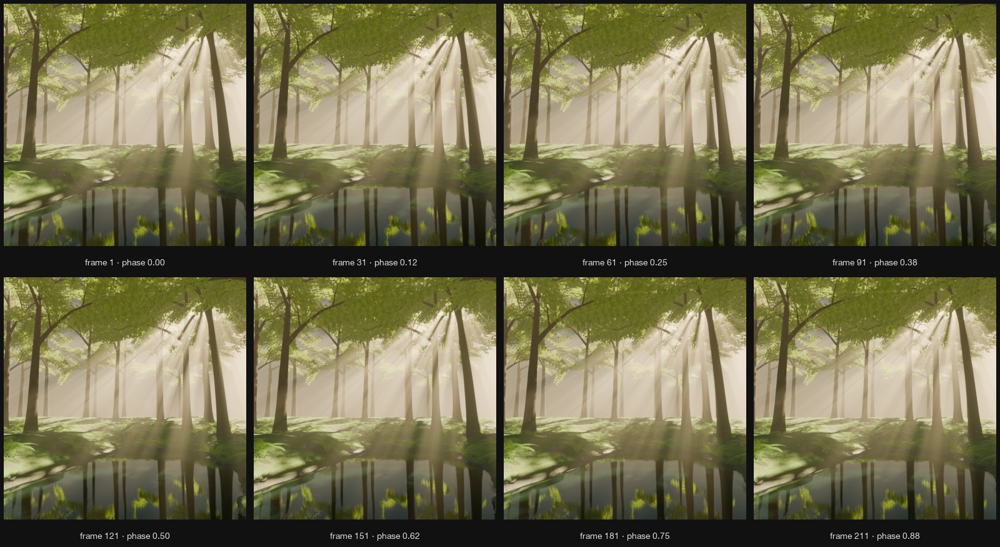

| File | What it is |
|---|---|
| [10-second loop](../loop.mp4) | 1080 × 1080 at 24 fps, rendered in EEVEE with AgX Punchy |
| [Finished still](../render.png) | 1080 × 1080, frame 120 |
| [Main node tree](images/nodes-main.png) | The 18 frames of `PA_Komorebi_GN` |

---

## The one idea

> **The canopy is a real shadow caster, so the sunbeams are not painted: they are the gaps we leave in it.** Every
> sprig of leaves is geometry. Each one decides whether to exist by asking *where would my shadow land on the ground?*
> Sprigs whose shadows land in the same spot get the same answer, so the holes line up along the direction of the sun
> and a long straight shaft appears.

Everything else is bookkeeping around that idea:

- **Where does a sprig sit?** On a twig of a branch of a bough of a trunk. Every one of those is built from the
  previous one, so nothing floats (3 · Trees and `PA_ForestTree`).
- **How does it decide?** Noise sampled at its *shadow footprint*, not at its own position (4 · Canopy, "Trick · gaps
  that follow the sun").
- **Why does the light breathe?** Wood, twig points, leaves and fern tips read the same looping 4D noise, so the whole
  canopy sways as one and the dappled spots move on the moss (`PA_LoopNoise`, Appendix A).
- **Why can we see the beams?** A box of mist scatters the sun forward, so the shafts show up in the air
  (Mist, below).

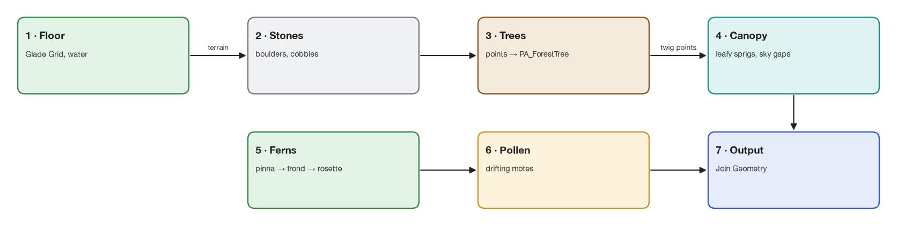

### How to read the screenshots

- Each coloured frame is one block of the tree. The main tree has one row per numbered section (`1a · Ground`,
  `1b · Water`, …) and every wire ends at the `Join Geometry` at the right. Blocks inside `PA_ForestTree` are
  lettered (`a · Trunk`).
- A **cut-out** shows one section on its own. Wires that come from another section enter through a Group Input socket
  named after what they carry (`Set Position`, `Seed`). Wires that leave exit through a Group Output socket.
- Header colours follow Blender's node categories: blue headers are Math and Vector nodes, green ones are geometry
  operations. Most of the plumbing in the big sections is Math nodes building a mask.
- Distances are in metres (1 Blender unit = 1 m). Angles in the `Set Position` offsets are radians, as in the file.
- Click any screenshot to open it full size. Node labels are written `like this`; node types are plain text.

---

## 0 · The map

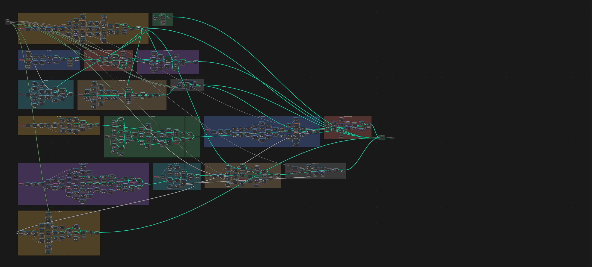

| # | Section | Frames | Nodes | Job |
|---|---|---|---|---|
| 1 | Mossy Forest Floor | 1a Ground, 1b Water | 40 | the ground and the water sheet |
| 2 | Mossy Stones & Cobbles | 2a Rock, 2b Bank Boulders, 2c Shoreline Cobbles | 43 | boulders on the banks, small stones at the shore |
| 3 | Connected Forest Trees | 3a Grove, 3b Hero Trunks, 3c One Tree per Point | 48 | where the trees stand, one `PA_ForestTree` per point |
| 4 | Breathing Leaf Canopy | 4a Leaf, 4b Twig Sprig, 4c Sky Gaps, 4d Place and Flutter | 109 | the leafy sprig, the sky gaps, the foliage |
| 5 | Forest Ferns | 5a Pinna and Frond, 5b Rosette, 5c Scatter, 5d Tip Breeze | 109 | pinna → frond → rosette → scattered clumps |
| 6 | Drifting Pollen | one frame | 28 | gold motes on small loops |
| 7 | Output | one frame | 1 | one `Join Geometry` for all seven parts |

The main tree has five sliders and two helper groups. Everything is deterministic: same sliders, same forest.

| Slider | Default | Range | Used by |
|---|---|---|---|
| `Wind Strength` | 1.25 | 0 – 2.8 | wood sway, leaf flutter, fern tips (3, 4, 5) |
| `Canopy Density` | 1.35 | 0.35 – 2 | how many sprig anchors each branch gets |
| `Fern Scale` | 1.22 | 0.5 – 1.8 | size of every fern clump |
| `Pollen Count` | 380 | 0 – 1500 | number of motes |
| `Seed` | 21 | 1 – 999 | every scatter and every tree's own random numbers |

Time comes from `PA_LoopClock`: `Phase = fract((frame − 1) / 240)` and `Angle = Phase × 2π`. `PA_LoopNoise` is a 4D
noise whose extra dimension and a small x offset both move on a circle as `Phase` goes 0 → 1, so the field at `Phase`
1 equals the field at `Phase` 0.

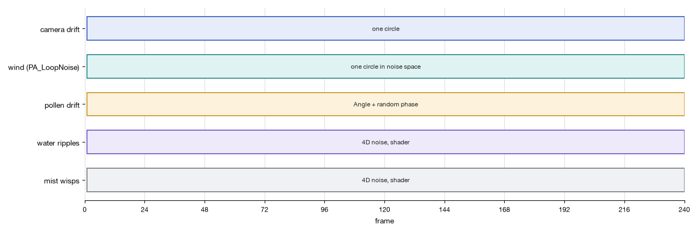

---

## 1 · Mossy Forest Floor

**1a · Ground**

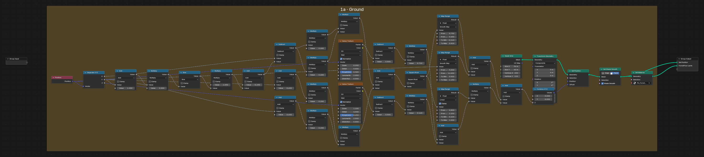

**1b · Water**

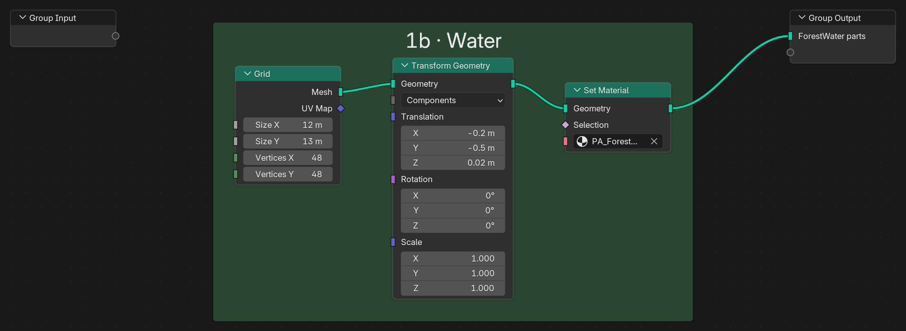


The ground is a plane that gets bent. **Why a grid and not a modelled terrain?** Every later scatter (stones, trees,
ferns) distributes points *on this mesh* and ray-casts against it, so one change here moves the whole forest.

| Node | What it does |
|---|---|
| `Glade Grid` (Grid) | 34 m × 40 m, 200 × 220 vertices, moved 4 m in +Y so it runs from y = −16 to +24 |
| Map Range (smoothstep) | distance to an S-shaped stream centre line → height from −0.26 m (bed) to +0.82 m (bank) |
| second Map Range | y from 5 to 16 m lifts the ground up to 1.15 m, so there is no flat horizon |
| two Noise Textures | scale 0.20 and 1.10, weighted 0.72 and 0.16; a ramp scales the noise from 0.22 to 1.0 between 0.8 m and 2.2 m from the stream, so the pool bed stays smooth |
| `Set Position` | adds the sum as Z offset |
| Set Shade Smooth + `Set Material` | `PA_ForestFloor` |
| second Grid (12 m × 13 m, 48 × 48) | the water sheet at z = 0.02, `PA_ForestWater` |

The stream centre is `−0.25 + 1.35 · sin((y + 1.2) · 0.30)`: a slow S bend. Distance to it is an ellipse
(x stretched by 0.68, y by 0.28), which makes the pool long and wide rather than a ditch.

> **Try it:** in the Map Range that turns the stream distance into height, set `To Min` from −0.26 to −0.6. The pool gets 34 cm deeper, but the water
> sheet stays at z = 0.02, so you will only see a darker, deeper-looking bed. Raise `To Min` to 0.1 and the bed pokes
> through the water sheet: that is why the value is negative.

---

## 2 · Mossy Stones & Cobbles

**2a · Rock**

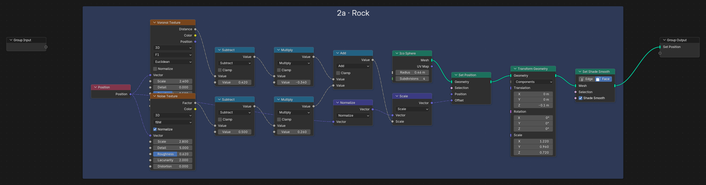

**2b · Bank Boulders**

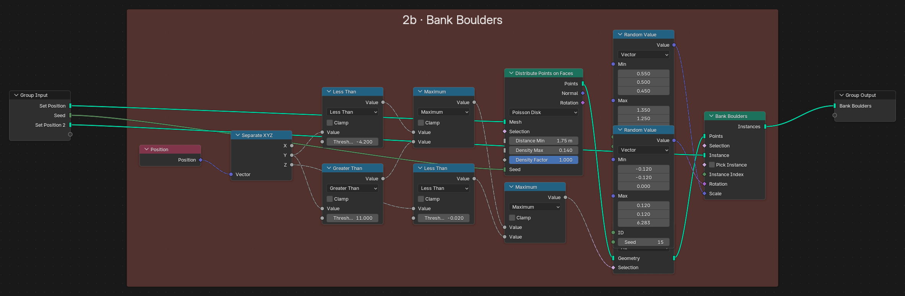

**2c · Shoreline Cobbles**

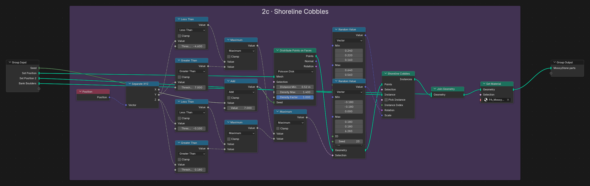


One rock is made once and instanced two ways. **Why two scatters?** Boulders want wide spacing on dry banks; cobbles
want tight spacing in a thin wet band at the water's edge.

| Step | Numbers |
|---|---|
| Rock: Ico Sphere, radius 0.46, 4 subdivisions | pushed along its normal by `−0.34 · (Voronoi distance − 0.42) + 0.26 · (noise − 0.5)`: flat facets (Voronoi scale 2.4) plus a lump (noise scale 2.8) |
| Squash and sink | scale (1.22, 0.96, 0.72), moved 0.10 m down, so the base is buried in the slope |
| `Bank Boulders` | Poisson Disk, `Distance Min` 1.75 m, `Density Max` 0.14; points deleted where y < −4.2 or y > 11 or z < −0.02; scale 0.55–1.35 |
| `Shoreline Cobbles` | Poisson Disk, 0.52 m, density 1.4; kept only where −4.6 ≤ y ≤ 7 and −0.10 ≤ z ≤ 0.18; scale 0.24–0.64 |

Both scatters use `Seed` (cobbles `Seed + 7`), so changing `Seed` rearranges the stones.

### Trick · select by height, not by painting

The cobble band is not a painted mask. It is a `Delete Geometry` fed by `z < −0.10` OR `z > 0.18`, read from the point
positions that Distribute Points on Faces already placed on the bent ground. Wherever the terrain is at the right
height, cobbles appear, whatever shape the banks have.

> **Try it:** change `0.18` to `0.6` in the cobble mask. The band of small stones climbs the banks. Raise
> `Density Max` of the cobbles to 3 and the shore becomes a gravel bar.

---

## 3 · Connected Forest Trees

**3a · Grove**

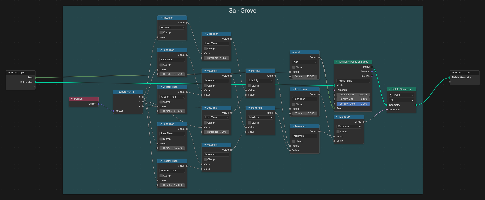

**3b · Hero Trunks**

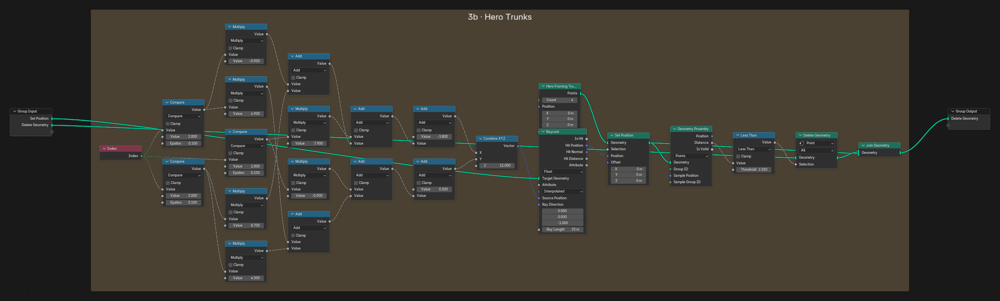

**3c · One Tree per Point**

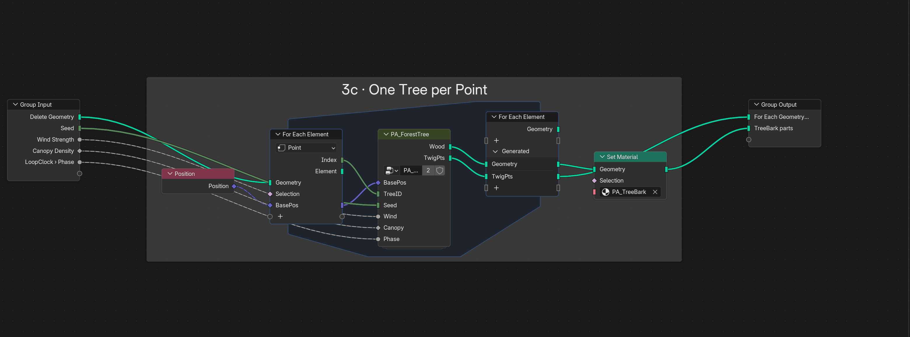


This section only decides *where* trees stand and calls `PA_ForestTree` once per point.

1. **Random grove.** `Distribute Points on Faces`, Poisson Disk, `Distance Min` 3.55 m, `Density Max` 0.12, on the
   ground mesh. The Math chain then deletes points:
   - inside the open lane (|x| < 3.05 and y < 9.2), which keeps a clear glade in front of the camera;
   - outside the forest box (y < −1.6, y > 21, x < −13.5 or x > 14);
   - in the water (z < 0.16).
2. **Four hero trunks.** `Hero Framing Trunks` is a Points node with 4 points. An `Index` and four `Compare` nodes pick
   the position per point: (−3.8, 0.3), (4.1, −0.2), (−4.7, 5.2), (4.9, 4.8). A `Raycast` fired from z = 12 downwards
   (ray length 25 m) at the ground finds the surface, and `Set Position` moves each hero point to the `Hit Position`.
   The trunks frame the shot and are never buried or floating.
3. **No crowding.** A `Geometry Proximity` (target: Points) measures each random point's distance to the heroes and
   deletes those closer than 2.35 m.
4. **One tree per point.** `Join Geometry` merges the random and hero points. A `For Each Geometry Element` zone runs
   over them and feeds `PA_ForestTree` the point's position (`BasePos`), its `Index` as `TreeID`, `Seed`, `Wind`,
   `Canopy` and the loop `Phase`. The zone returns the wood geometry, and a second item, `TwigPts`, carries the
   twig anchor points on to section 4.

### Trick · why a For Each zone, not Instance on Points

Instance on Points would paste identical trees. Inside a For Each Element each tree is evaluated on its own, and
`PA_ForestTree` seeds every random value with `TreeID + 37 · Seed`. Tree 7 of Seed 21 has its own height (9.6–13.4 m),
base radius (0.19–0.33 m), lean and branch angles. Change `Seed` and every tree changes with it, but the same seed
always gives the same forest.

> **Try it:** set `Seed` to 22 in the modifier. The stones, ferns and trees all move, and the four hero trunks keep
> their positions (they are typed in) but grow new shapes.

---

## Inside `PA_ForestTree`

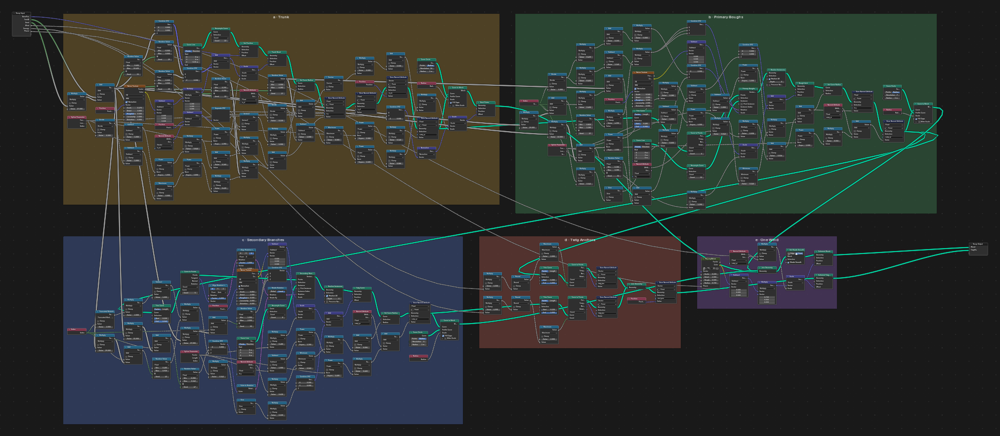

Input sockets: `BasePos`, `TreeID`, `Seed`, `Wind`, `Canopy`, `Phase`. Outputs: `Wood` (a mesh) and `TwigPts` (points).
The group builds from the trunk outwards, and each new part reads a curve of the one before it. That is why it all
stays attached.

### a · Trunk

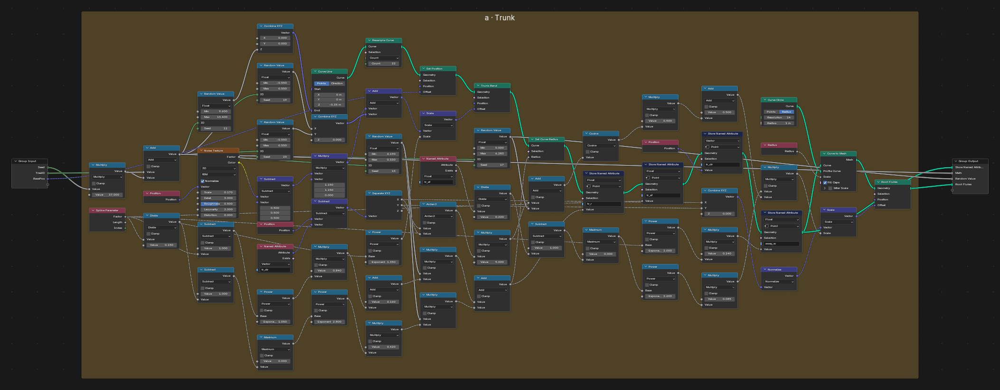

A line from z = −0.35 m (below the ground) up to the tree height, resampled to 22 points, then moved to `BasePos`.

- `Trunk Bend`: noise (scale 0.17) plus a random lean of ±0.55 m, scaled by `factor^1.35`, so the base stays put and
  the top leans most.
- Radius: `r0 · (0.16 + 0.84 · (1 − f)^1.05)` is the taper; a flare of `r0 · 0.42 · (1 − f/0.15)^2.8` swells the
  lowest 15 %.
- Store Named Attribute writes `tr_r` (radius), `tr_sf` (position along the trunk), `tr_ctr` (the centre line) and
  `sway_w` (how much this point sways, `0.14 · f²`). Later nodes read these.
- `Root Flutes`: below 22 % height each vertex moves outward by `0.085 m · envelope · wave`, where the wave is
  `0.5 + 0.5 cos(5 · angle + offset)`, five buttress lobes around the trunk.

### b · Primary boughs

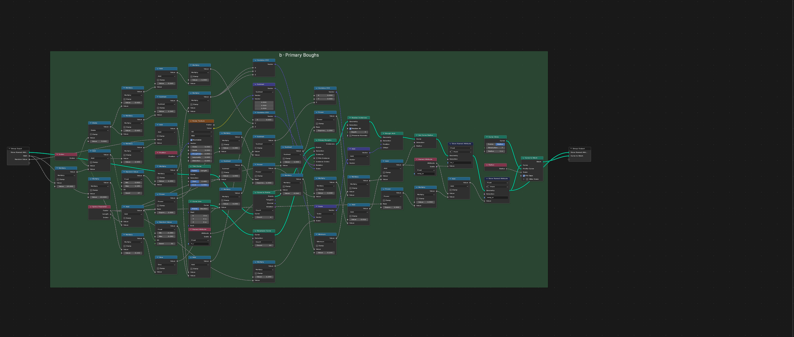

A Trim Curve keeps the trunk between 48 % and 98 %, and Curve to Points puts 6 points on it. They are samples *of
the bent trunk's own curve*, which is why a bough starts exactly on the bark. Each point instances a 12-point line:

- azimuth steps by the golden angle (2.39996 rad) from point to point, plus ±0.38 jitter;
- pitch rises from 0.26 to 0.68 rad, length is `4.25 m · (0.82 – 1.18) · (1.14 − 0.46 · k)` with k from 0 to 1 along
  the trunk, so upper boughs are shorter;
- `Bough Arch` bends each line up and over: `0.65 · sin(π t) − 0.28 t²`, plus noise (scale 0.34) growing with t. At
  t = 0 every term is 0, which keeps the join to the trunk fixed.
- Radius: `min(0.54 · trunk radius, 0.145)` tapering with `(1 − t)^1.25`, plus a **collar** `0.038 · (1 − t)^6` that is
  large only at the trunk, so the bough flares into it like a fillet.

### c · Secondary branches

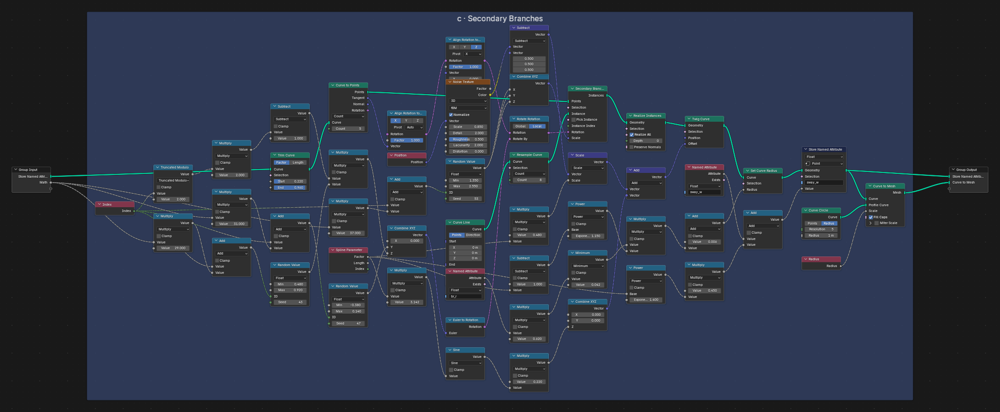

The boughs between 22 % and 96 % get 5 points each (30 per tree). Branches alternate sides (±1 from `Modulo` of the
index), with yaw 0.48–0.92 rad, pitch −0.38 to +0.14 rad, length 1.35–2.55 m, 8 points. Two Align Rotation to Vector
nodes turn each branch along the bough's tangent and keep it Z-up. `Twig Curve` adds wiggle (noise scale 0.85, ×0.48
along the branch) and a small lift (`0.22 · sin(π t)`). Radius is `min(0.62 · bough radius, 0.042)`.

### d · Twig anchor points

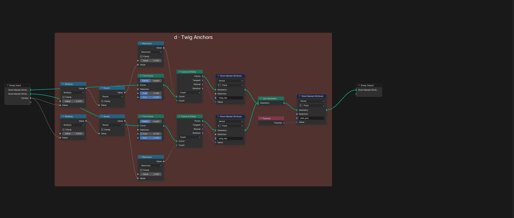

Each bough (from 38 %) gets `round(6.5 · Canopy)` points and each secondary branch (from 12 %) gets `round(4.5 ·
Canopy)`. At the default 1.35 that is 9 and 6, so a tree has 6 × 9 + 30 × 6 = **234 anchors**. The count is a fixed
number per branch, never random, so no anchor appears or vanishes during the loop. Each anchor stores `twig_tan` (the
branch direction) and `rest_pos` (its position **before** any wind).

### e · One wind for wood and anchors

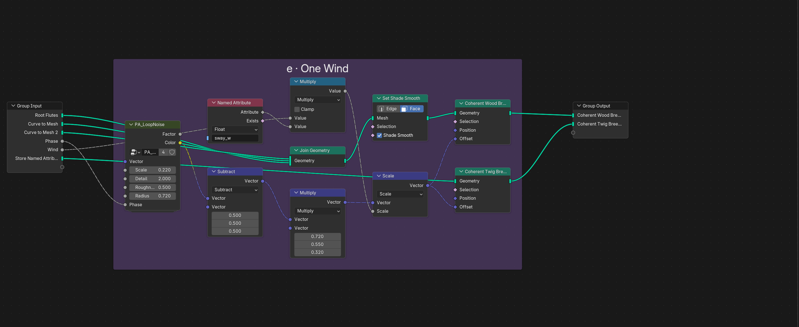

`PA_LoopNoise` (scale 0.22, radius 0.72) gives a vector; `(noise − 0.5) · (0.72, 0.55, 0.32) · Wind · sway_w` is the
offset. `Coherent Wood Breeze` applies it to the mesh and `Coherent Twig Breeze` to the anchors, **the same offset
from the same positions**, so a leaf follows its branch exactly. `sway_w` is 0 at the ground, `+0.55 · t^1.5` along a
bough and `+0.45 · t^1.4` along a twig, so tips move most and joints never tear.

> **Try it:** set `Wind Strength` to 0. Trunks, boughs, twig anchors and fern tips all stop. The camera drift, pollen,
> water ripples and mist wisps still move, because they do not read the wind slider. The loop still closes, only
> quieter.

---

## 4 · Breathing Leaf Canopy

**4a · Leaf**

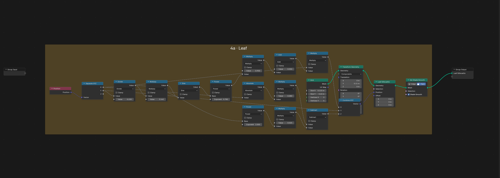

**4b · Twig Sprig**

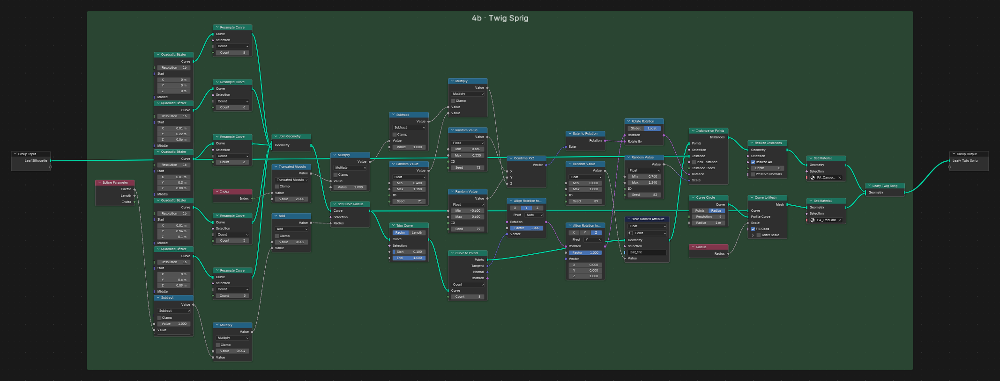

**4c · Sky Gaps**

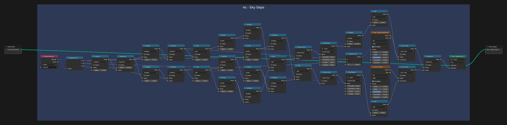

**4d · Place and Flutter**

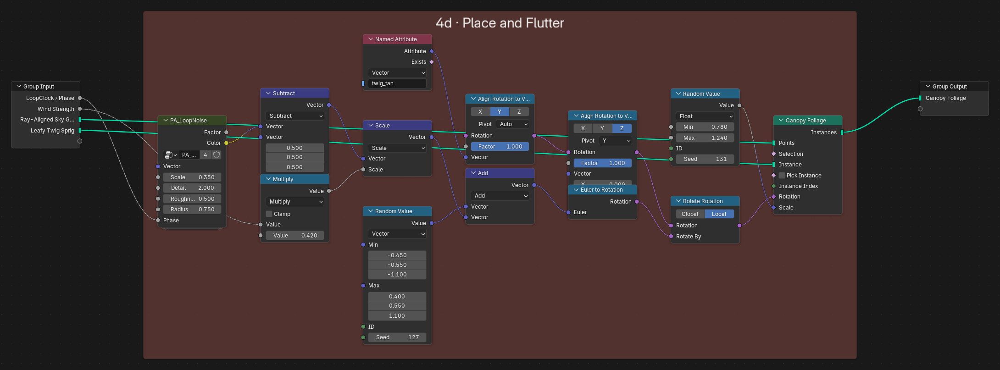


### The sprig

- `Leaf Silhouette`: a 3 × 5 grid (0.115 × 0.22 m) with its base at the origin. X is narrowed by
  `0.05 + 0.95 · sin(π y/0.22)^0.78` to a pointed oval, and Z is `0.08 · |x| − 0.025 · (y / 0.22)²` for a V-fold along the
  midrib and a droop at the tip.
- A twig skeleton from five quadratic Bezier curves: a main shoot (8 points) and four side shoots (6, 6, 5, 5). Radius
  tapers from 5.4 mm to 1.8 mm.
- 8 leaves per curve are placed with Curve to Points, 5 curves, so **40 leaves per sprig**. They are aligned to the
  curve tangent, then rotated by a random yaw (0.40–1.15 rad, alternating sides), pitch and roll, and scaled
  0.76–1.24. Each leaf stores `leaf_tint`.
- `Leafy Twig Sprig` is the Join Geometry of twig wood and leaves.

### Trick · gaps that follow the sun

The sun is a parallel light at azimuth 26°, elevation 33°. A point at height `dz` above the ground has its shadow at

```
gx = x − dz · 0.6750
gy = y − dz · 1.3841
```

These two constants are the horizontal run of the sun's rays per metre of drop: `cos(el)·sin(az) / sin(el)` and
`cos(el)·cos(az) / sin(el)`. `dz` is the anchor's height above 0.20 m. The `Ray-Aligned Komorebi Shafts` noise
(scale 0.28, on `(gx, gy, 0)`) is sampled at the *footprint*, not at the anchor. Two sprigs one above the other on a
sunbeam line get the same footprint and the same answer, so the openings line up into a corridor that the sun can
travel through to the ground. The cut is `noise < 0.24 + 0.33 · w`, where `w` fades from 1 to 0 as the footprint
moves from 0.55 to 1.35 (in units of an ellipse 4 m × 3.8 m) away from the foreground target near (−0.2, −1.2). So
the shafts are boldest where we want them: the left bank, the ferns and the pool.

A second mask, 3D noise at scale 0.55 below `0.30 + arch_air` (up to 0.16 extra around a spot near x = 0, y = 1.6), breaks the canopy up into lace so it reads as backlit leaves and sky flecks. The larger of the two masks wins. `Ray-Aligned Sky Gaps` deletes the anchors it selects.

**Why `rest_pos`?** Both masks read the stored rest position, not the swaying one. If they read the live position,
the wind would move anchors across the mask edge and leaves would pop in and out. With `rest_pos` the set of leaves
is fixed for the whole loop and only their positions move.

### Place and flutter

`Canopy Foliage` instances the sprig on the surviving anchors. Align Rotation turns it along `twig_tan`, then a
rotation is added: random (±0.45, ±0.55, ±1.10 rad) plus a flutter vector from `PA_LoopNoise` (scale 0.35, radius
0.75) times `Wind · 0.42`. Scale is 0.78–1.24.

> **Try it:** set `Canopy Density` to 0.35. Each bough gets 2 anchors and each branch 2, so a tree has 6 × 2 + 30 × 2 =
> 72 anchors instead of 234: a thin, airy canopy with more sky. At 2 it is 13 and 9: 6 × 13 + 30 × 9 = 348.
>
> **Gotcha:** if you move the sun (`PA_MorningSun`), the two constants 0.6750 and 1.3841 do not follow it. Recompute
> them from the formula above, or the shafts will no longer match the shadows.

---

## 5 · Forest Ferns

**5a · Pinna and Frond**

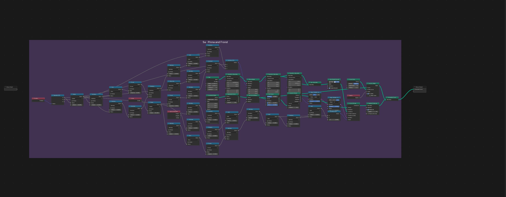

**5b · Rosette**

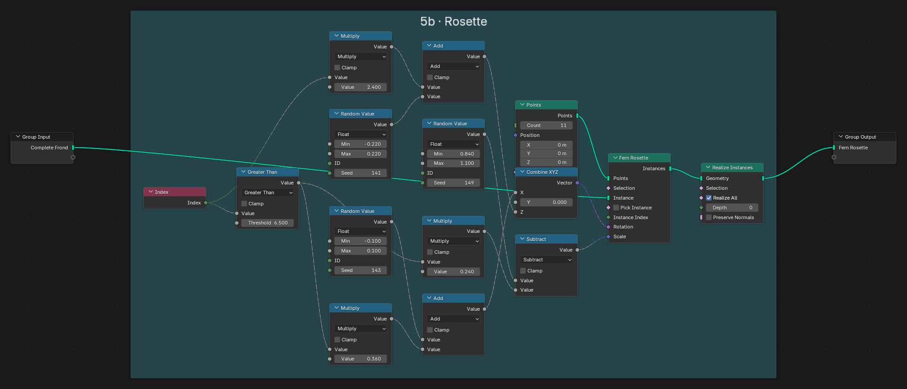

**5c · Scatter**

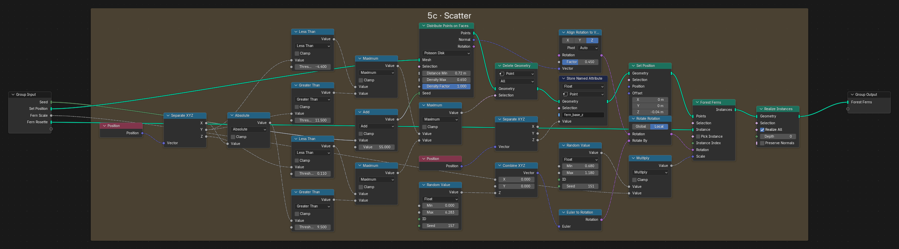

**5d · Tip Breeze**

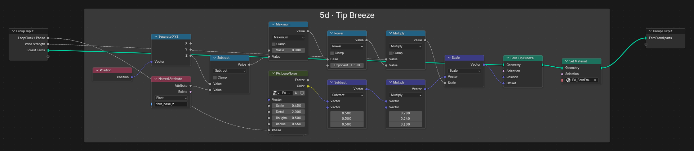


A fern is built in four scales, each one made of the one before.

| Scale | Node | Numbers |
|---|---|---|
| leaflet | `Pinna Blade` | a 5 × 3 grid, 0.145 × 0.024 m, narrowed to a pointed blade; mirrored once for the other side of the stem |
| frond | `Frond Pinnae` → `Complete Frond` | a 0.80 m Bezier rachis, 20 points; 22 pinna pairs on its upper 84 % (14 % → 98 %); pinna scale 0.18 + 0.92 · envelope, so fronds are shortest at base and tip |
| clump | `Fern Rosette` | 11 fronds at the golden angle; 7 outer ones arch (pitch ±0.10) and 4 inner ones stand up (pitch +0.36, scale −0.24) |
| forest | `Forest Ferns` | Poisson Disk, 0.72 m, density 0.65, on the banks only; sunk 0.04 m; scale (0.68 – 1.18) × `Fern Scale` |

**The orientation bug worth knowing.** Curve to Points gives a tangent along the curve, but a flat pinna lies in the
XY plane. Aligning only the Y axis lets the leaflets spin around the stem like open blinds. Two Align Rotation to
Vector nodes fix it: the first sets Y to the tangent, the second sets Z to world up with Y as the pivot. Now every
leaflet's face is up.

`Fern Tip Breeze` offsets each vertex by `(noise − 0.5) · (0.28, 0.24, 0.10) · Wind · h^1.5`, where `h` is the height
above the clump's own base (stored as `fern_base_z`). The `h^1.5` keeps the root still and bends the tips.

> **Try it:** set `Fern Scale` to 0.5 and then 1.8. Only size changes: the Poisson spacing stays 0.72 m, so at 1.8
> the clumps overlap and form a carpet.

---

## 6 · Drifting Pollen

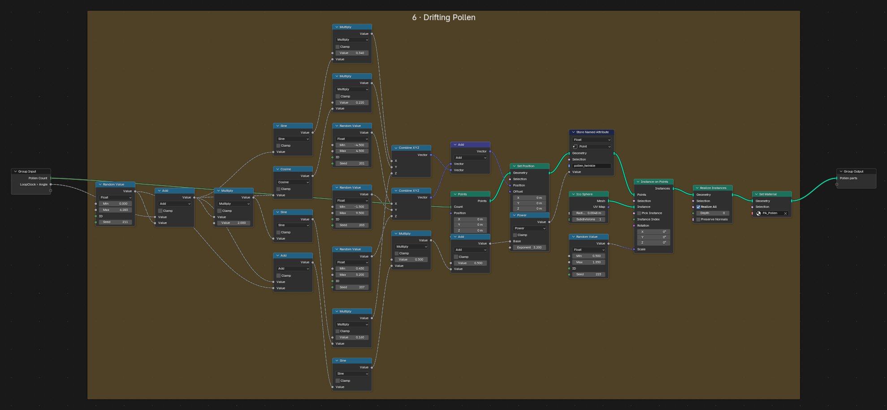


`Pollen Count` points are placed at random in a box (x ±4.5, y −1.5 to 9.5, z 0.45 to 5.2). Each gets a phase
`φ` (0 to 2π). Its offset from the base is a small loop:

```
x: 0.34 · sin(Angle + φ)
y: 0.22 · cos(Angle + φ)
z: 0.16 · sin(2 · (Angle + φ))
```

`Angle` is the loop clock's 0 → 2π, so after 240 frames every mote is back where it started.

Each mote stores `pollen_twinkle = (0.5 + 0.5 · sin(Angle + 2φ))^3.2`, which is low most of the time and peaks briefly
once per loop. The material mixes Transparent with a lit shader by this attribute, so a mote is faint most of the time and
glints at its peak, and only where light reaches it. The mote is an Ico Sphere of radius 4.8 mm (subdivision 1), scaled 0.50–1.35.

> **Try it:** set `Pollen Count` to 0. The `Points` node makes no points and nothing else changes. At 1500 the
> sunbeams fill with glitter; the cost is only more tiny instances.

---

## 7 · Output

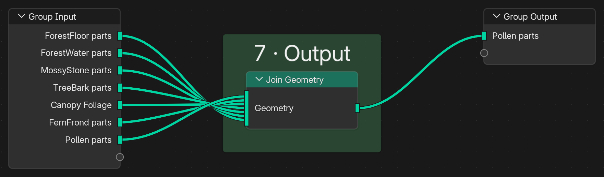


A single `Join Geometry`: floor, water, stones, trees, canopy, ferns, pollen. Every part already carries its own
material from its own `Set Material`, so no more is needed here.

---

## Mist · `PA_MistVolume_GN`

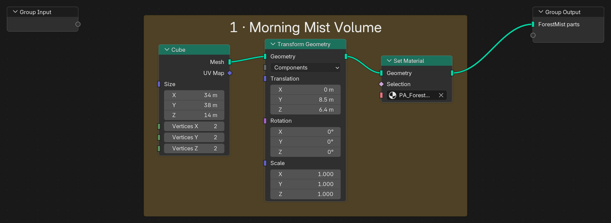

Another object, **MistVolume**, holds a cube of 34 × 38 × 14 m moved to (0, 8.5, 6.4), and one material
(`PA_ForestMist`, a volume). Its shadow visibility is off, so the box doesn't throw a shadow itself. All the beauty is in the
volume shader:

| Factor | Value |
|---|---|
| base density | 0.0185 |
| wisps | 4D noise, scale 0.14, remapped 0.28–0.78 → 0.62–1.38; moves on a circle of radius 0.60 with the loop angle |
| height | 1.18 near the ground to 0.68 at 11.5 m: denser low |
| camera fade | `View Z Depth` 0.55 → 2.1 m maps 0 → 1: no fog on the lens |
| `Anisotropy` | 0.66, strongly forward-scattering |

The forward scatter is what makes beams: light going toward the camera along the shaft is scattered *toward* the
camera. The canopy supplies the shape of the beams; the mist only makes them visible.

> **Try it:** double the 0.0185 density. The shafts get brighter but the whole glade turns milky and the dark pool
> loses its contrast. Halve it and the beams almost vanish even though the canopy gaps are unchanged.

---

## Appendix A · Materials, light, camera

| Item | Notes |
|---|---|
| `PA_ForestFloor`, `PA_MossyStone`, `PA_TreeBark` | procedural moss, humus, wet shoreline darkening; granite with moss on top; furrowed bark with a mossy collar |
| `PA_CanopyLeaf`, `PA_FernFrond` | Principled BSDF (Subsurface 0.28 and 0.25) mixed with a Translucent BSDF so leaves glow when the sun is behind them |
| `PA_ForestWater` | opaque, Roughness 0.022, IOR 1.333, Coat 1; ripples are a 4D noise (scale 2.6) on a circle of radius 0.28 driving a Bump of strength 0.032 |
| `PA_Pollen` | described in section 6 |
| `PA_ForestMist` | described above |
| `PA_MorningSun` | Sun, colour (1.0, 0.78, 0.40), energy 92, angle 0.70°, azimuth 26°, elevation 33° |
| `PA_CanopyFill` | Disk area light, 20 m across, 380 W, `volume_factor` 0 (so it lights the leaves without adding haze) |
| world | gradient from warm gold at the horizon to cool teal, strength 0.72 |
| `PA_Camera` | 30 mm, f/4.5, focus 6.8 m; moves on a 0.18 × 0.12 m ellipse around (−0.30, −5.05, 1.32) and looks at (0, 4.6, 2.55); one key per frame so the path closes exactly |

## How it was rendered

EEVEE, 1080², 240 frames, 64 samples per frame, ray-traced reflections (screen space), volumetrics at tile size 2 with
128 samples, volumetric shadows on (32 samples), start 0.4 m and end 28 m. Colour is AgX with the Punchy look and
−0.05 exposure, plus a little bloom and halation from `pb.post`. The frames were rendered on the LAN farm (Flamenco)
and encoded as H.264, CRF 16.

## Try it yourself

1. **No wind.** `Wind Strength` 0, then 2.8. At 0 the canopy freezes but the beams still shimmer a little, because the
   pollen, the mist and the water still move. At 2.8 the twig flutter is more than twice as large.
2. **Open the canopy.** Raise `0.24` (the base threshold in section 4) to `0.40`. More anchors are deleted, so the
   shafts get wider.
3. **Move the sun.** Rotate `PA_MorningSun` to an azimuth of 40° while keeping its elevation at 33°. Recompute
   `0.6750` and `1.3841` with the formula in section 4 and update the two Math nodes that multiply `dz`.
   The beams and the shadows swing round together.
4. **A thicker forest.** Lower `Distance Min` in section 3 from 3.55 to 2.4. The grove gets denser, up to the
   `Density Max` cap of 0.12 points per m²; the open glade is still kept clear by the lane mask.
5. **Seasons.** In `PA_CanopyLeaf` change the leaf colour from chartreuse to orange-red. Nothing in the geometry
   needs to change.
6. **Rebuild from scratch.** Start with the Glade Grid and a Set Position, scatter one boulder with Distribute Points
   on Faces, then write a one-bough tree: a line, a Resample Curve, Curve to Points and Instance on Points. Add one
   thing at a time, the same order as the sections above.

---

*Made with Blender 5.3 Geometry Nodes for [Nodevember](https://nodevember.com) 2026, Day 21 · Sunbeam.*
