# How a camera inside a compound eye turns one sun into many: 415 glass lenses that switch on, rim first

*A node-by-node walkthrough of Nodevember 2026 · Day 22 · Lens | Through an Insect's Eye (v3 · Sunlit Facets)*

The clip (7 s, 168 frames, 24 fps) opens on what a person would see from a spot in a meadow at sunset: one red poppy,
backlit, and one low sun. The view widens. Then a hexagonal pattern closes in from the edges of the frame to the
centre. Behind it the poppy breaks up into dozens of small copies and the sun turns into a cluster of four-pointed
stars. At the end the petals fade to blue-violet in an illustrative "bee view". There is one poppy and one sun in the
scene. Every copy is Cycles refracting the scene through 415 closed glass lenses that sit around the camera. Nothing
is painted, tiled or composited in. The eye, the poppy, the meadow and the haze are four Geometry Nodes modifiers. There
are no image textures and no imported or modelled meshes (a procedural audit flags nothing). The only
keyframes are on the `Vision` slider, the fisheye focal length, the false-colour amount and a hover of the camera
that stays under a degree.

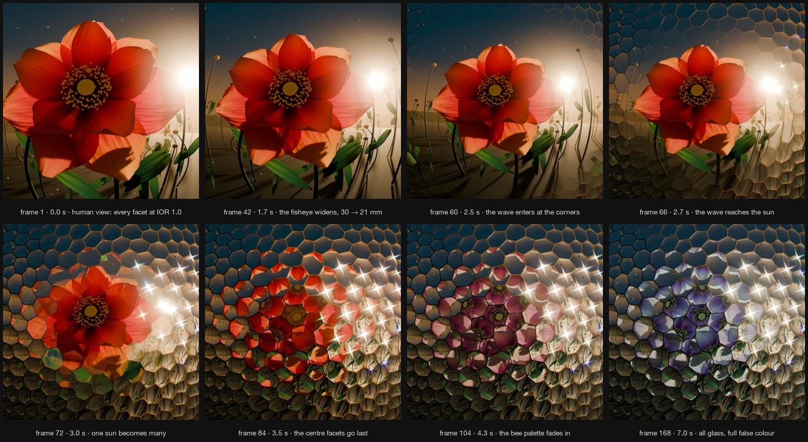

| File | What it is |
|---|---|
| `vision-transition.mp4` | the clip: 1080 × 1080, 24 fps, 168 frames (7 s), Cycles, H.264 |
| `vision-start.png`, `vision-ending.png` | its first frame (the human view) and its last frame |
| `loop.mp4`, `render.png` | the other Day 22 clip (a gust swings the poppy off the sun) and the hero still. They use the same eye with `Vision` at 1 |
| `nodes/` | the node trees full size: `main.png` (`PA_Compound eye_GN`), `vision-wave.png`, `fovea-stretch.png`, `cornea-cap.png`, `glass.png`, `petal.png`, `petal-material.png`, `poppy.png`, `sky.png` |
| `post.md` | idea, build notes, captions and alt text |

The `.blend` files and the Python script that builds them are not published. The scene holds **PA_Compound eye**
(modifier with the tree `PA_Compound eye_GN`, parented to the camera **PA_Compound Eye Camera**), **PA_Poppy**,
**PA_Meadow** and **PA_Air behind flower**. Every node, label and number you need is in the screenshots and the text.
It needs Blender 5.3, which added dispersion to the Principled BSDF.

---

## The one idea

> **Every facet is a real lens from the first frame. The clip only decides, facet by facet, whether its glass bends
> light.** Each facet stores one number, `cornea`, from 0 to 1. The glass material reads it. At 0 the facet is glass
> with an index of refraction of 1.0, which bends nothing and reflects nothing, so the camera sees straight through
> it. At 1 it is a lens of IOR 1.48. A single slider, `Vision`, sends that switch across the eye as a wave from the
> rim to the centre.

Everything else is bookkeeping around that idea:

- **Where are the facets?** On a sunflower spiral spaced so the central facets are about three times bigger than the
  rim ones, like an insect's acute zone (1 · Fovea, 2 · Spiral).
- **What shape is each one?** A cell of a spherical Voronoi diagram (3), thickened into a closed solid (4, 5) and
  ground into a biconvex lens whose curvature scales with the facet (6).
- **How does a facet switch?** `PA_Vision wave` turns `Vision` into one 0 → 1 value per facet, rim first (7). The glass
  dissolves from a clear lobe into a lens lobe whose IOR starts at 1.30, not 1.0 (7, "Trick · dissolve, don't ramp").
- **Why is there no honeycomb in the human view?** The amber ridges between the facets grow with the same wave (8).
- **And the bee view?** A material and compositor tint, keyed after the optics are done (Appendix A).

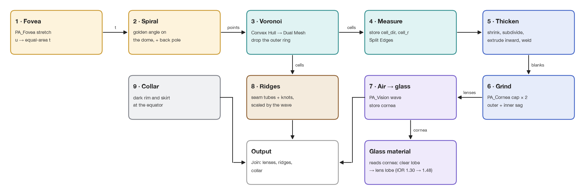

### How to read the screenshots

- Each coloured frame is one section of the tree, numbered like the headings below (`01 · Fovea: …`). The helper
  groups and the petal group use letters (`a · Grid and petal outline`).
- A **cut-out** shows one section on its own. Wires that come from another section enter through a Group Input socket
  named after what they carry (`Weld the two shells`, `Facets tagged with cell_dir, cell_r`). Wires that leave exit
  through a Group Output socket. Sliders keep their own names (`Vision`, `Dome Radius`).
- Node labels are written `like this` and match the screenshots. Node types are plain text (Set Position, Dual Mesh).
- Distances are in metres in the file and in millimetres in the text where that is easier to picture
  (`Dome Radius` 0.43 = 430 mm). Angles in the nodes are radians.
- Click any screenshot to open it full size.

---

## 0 · The map

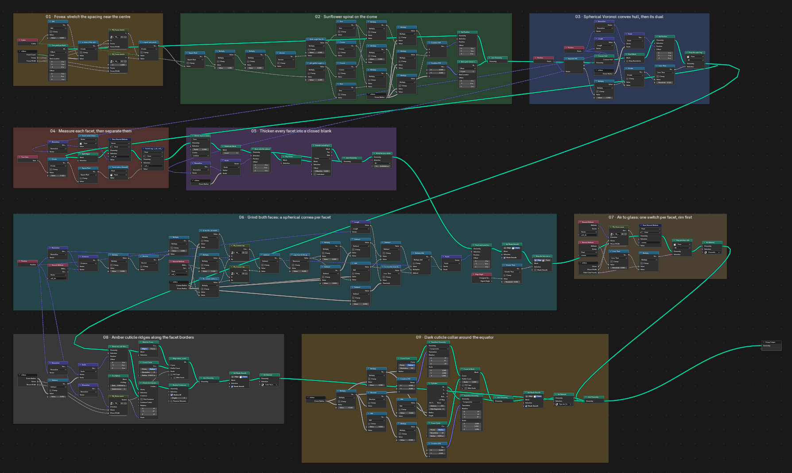

| # | Section | Nodes | Job |
|---|---|---|---|
| 1 | Fovea: stretch the spacing near the centre | 7 | one point per facet, and an equal-area coordinate that gives the centre bigger facets |
| 2 | Sunflower spiral on the dome | 21 | golden-angle points on the hemisphere, plus one pole behind |
| 3 | Spherical Voronoi: convex hull, then its dual | 13 | the facet outlines |
| 4 | Measure each facet, then separate them | 9 | store each facet's centre direction and radius on its points |
| 5 | Thicken every facet into a closed blank | 9 | a closed, 3.2 mm thick glass tile per facet |
| 6 | Grind both faces: a spherical cornea per facet | 30 | bulge both faces into a lens |
| 7 | Air to glass: one switch per facet, rim first | 8 | store `cornea`, the value the glass reads |
| 8 | Amber cuticle ridges along the facet borders | 15 | tubes and knots along the seams, grown by the same wave |
| 9 | Dark cuticle collar around the equator | 18 | a dark rim that hides the trimmed edge |

The node counts are from the cut-outs. The tree has eight sliders:

| Slider | Default | Range | What it does |
|---|---|---|---|
| `Facet Count` | 460 | 120 – 1600 | points on the spiral (415 facets survive the trim) |
| `Fovea` | 3.2 | 1 – 8 | area of a central facet relative to a rim facet |
| `Fovea Width` | 0.18 | 0.03 – 0.6 | share of the facets in the enlarged zone |
| `Cornea Radius` | 2.3 | 1.25 – 8 | lens curvature radius, in facet radii |
| `Dome Radius` | 0.43 | 0.31 – 0.50 | radius of the hemisphere around the camera (m) |
| `Vision` | 1 | 0 – 1 | 0: every facet clear. 1: every facet glass. In between: the wave |
| `Wave Width` | 0.35 | 0.05 – 1 | how much of the wave each facet takes. The clip sets 0.5 |
| `Hide Clear Facets` | off | | deletes facets that are still clear, for a clay preview |

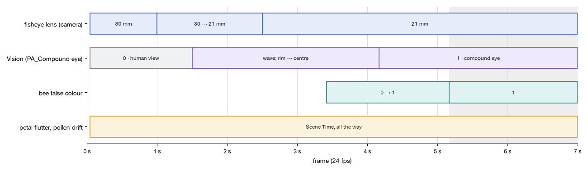

The keys use Blender's default eased (Bézier) interpolation. The fisheye focal length goes 30 → 21 mm between
frames 24 and 60. `Vision` goes 0 → 1 between frames 36 and 100. The false colour goes 0 → 1 between frames 82 and
124. The plant holds the hero pose (`Lean` 0, `Flutter` 0.04, meadow `Wind` 0.025). Its small motions come from the
Scene Time node, so the meadow keeps breathing while the eye changes, and the camera hovers by less than a degree.
The shaded band, frames 124–168 (the last 1.8 s), is the hold: the optics and the colour are finished.

---

## 1 · Fovea: stretch the spacing near the centre

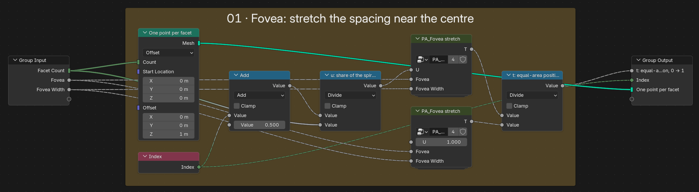

Many insects have an acute zone: a patch of bigger facets that looks forward. This section decides how big each
facet will be, before any facet exists.

| Node | What it does |
|---|---|
| `One point per facet` | Mesh Line with `Facet Count` points (460) |
| `u: share of the spiral, 0 → 1` | (Index + 0.5) / count: each point's place along the spiral |
| `PA_Fovea stretch` | `t(u) = u + (Fovea − 1) · w · (1 − e^(−u/w))`, with w = `Fovea Width` |
| `t: equal-area position, 0 → 1` | t(u) divided by t(1) |

Section 2 places point number *i* so that the area of the dome inside it is proportional to t. So each facet gets an
area proportional to the slope dt/du = 1 + (Fovea − 1) e^(−u/w). That is 3.2 at the centre and
1 + 2.2 · e^(−1/0.18) ≈ 1.009 at the rim, a ratio of about 3.2. On the finished dome, the facets within 15 % of the
axis have a mean radius of 41.3 mm and those in the outer 15 % have 23.7 mm, an area ratio of 3.02. The extra size
falls off on a scale of w = 0.18: at u = 0.18 a facet still has 1.8 times the rim area, at u = 0.5 only 1.14 times.

### Trick · divide by the same group at u = 1

The second `PA_Fovea stretch` gets u = 1 and gives t(1). Dividing by it makes the last point land on t = 1 whatever
`Fovea` is. Without it, raising `Fovea` would push the spiral past the edge of the dome.

> **Try it:** set `Fovea` to 1. Then t = u and every facet has the same area: 432 facets survive the trim, with radii
> from 23.2 to 31.9 mm, and the centre/rim area ratio drops to 1.07. The poppy repeats at the same size everywhere.

---

## 2 · Sunflower spiral on the dome

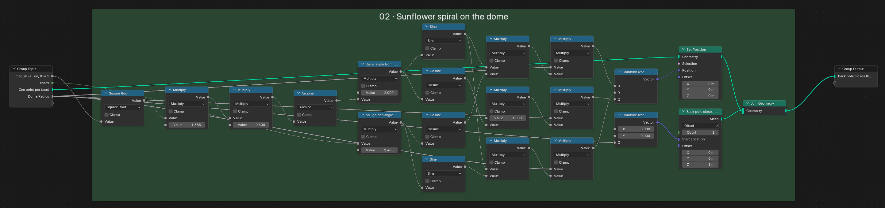

The points go on a sunflower spiral. Each new point turns by the golden angle, π(3 − √5) ≈ 137.5°, from the last one,
so it falls into the largest gap the others have left. The points never line up into rings or rows, and their
neighbourhoods are mostly hexagonal, like real facets.

| Node | What it does |
|---|---|
| ρ = √t · 2 sin(1.53 / 2) | radius in Lambert's equal-area projection. A cap of half-angle θ on a unit sphere has area π(2 sin(θ/2))², so ρ² ∝ t means area ∝ t |
| `theta: angle from the eye axis` | θ = 2 asin(ρ / 2). The spiral reaches 1.53 rad (87.7°) |
| `phi: golden angle × index` | φ = index × 137.5° |
| Set Position | `Dome Radius` × (sin θ cos φ, sin θ sin φ, −cos θ) |
| `Back pole closes the hull` | one more point at (0, 0, +`Dome Radius`), behind the camera |

The dome opens along −Z because the eye is parented to the camera, and a Blender camera looks down its own −Z. The
camera sits at the centre of the dome, so every facet is the same distance from it, 430 mm.

> **Try it:** set `Facet Count` to 900. 797 facets survive the trim, with radii from 16.0 to 34.2 mm. The centre/rim
> area ratio stays at 2.96, because the fovea is defined as a share of the facets, not as a size.

---

## 3 · Spherical Voronoi: convex hull, then its dual

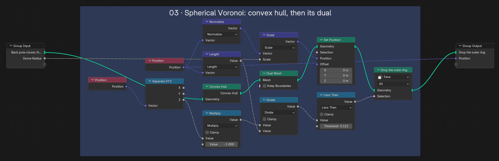

The convex hull of points on a sphere is their spherical Delaunay triangulation: two nodes give every facet centre
its natural neighbours. Dual Mesh then puts a vertex in each triangle and a face around each original point. These
faces are the Voronoi-style cells, one per facet. (Dual Mesh uses triangle centres, not circumcentres, which is close
enough for near-equilateral triangles.) The dual vertices lie slightly inside the sphere, so Set Position normalises
them back onto it.

`Drop the outer ring` deletes every cell whose centre is more than 1.45 rad (83.1°) off the axis. Those are the cells
next to the back pole, stretched across the open side of the dome. The default eye keeps 415 cells: 325 hexagons,
53 pentagons and 37 heptagons (a check script counts them). The 5- and 7-sided cells appear where the number
of visible spiral arms changes.

> **Try it:** mute `Drop the outer ring` (select it, M). 461 cells come back: the 460 spiral cells plus one around
> the back pole. That last cell has a 389 mm radius and wraps behind the camera, and vertices now reach 115° off the
> axis. None of it shows in the clip, because the corner of the frame is 75° off the axis (Appendix C), but it is
> wasted glass.

---

## 4 · Measure each facet, then separate them

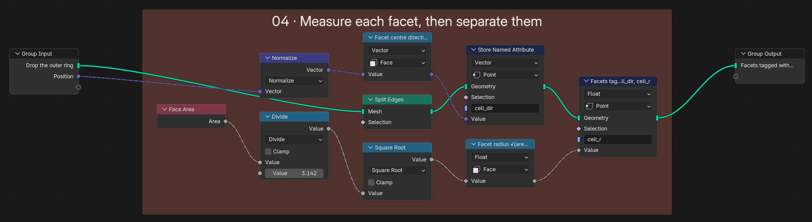

Split Edges gives each cell its own vertices, so a facet can move without dragging its neighbours along. Then each
facet measures itself while it is still one flat polygon:

| Node | What it does |
|---|---|
| `Facet centre direction` | Field on Domain (Face) of normalize(Position): the direction of the face centre |
| `Facet radius √(area/π)` | Field on Domain (Face) of Face Area: the radius of a disc with the same area |
| `Facets tagged with cell_dir, cell_r` | two Store Named Attribute nodes that write both values onto the face's points |

### Trick · tag the points before the topology changes

Section 6 needs to know, for every one of thousands of points, the centre and size of the facet it belongs to. After
subdivision and extrusion there is no face left to ask. So the values go onto the corner points now. Subdivide and
Extrude copy point attributes onto the new points, and since every corner of a facet holds the same value, the
interpolation returns it exactly.

---

## 5 · Thicken every facet into a closed blank

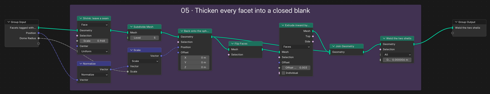

Cycles only refracts correctly through closed solids: a ray has to enter the glass and leave it again. An open shell
bends a ray once and never bends it back.

| Node | What it does |
|---|---|
| `Shrink: leave a seam` | Scale Elements 0.968 per face. Each edge pulls back by 3.2 % of its distance from the facet centre (about 1.5 mm on the largest facet), so a 2–3 mm seam opens between neighbours. The ridges fill it later |
| Subdivide Mesh | level 5: enough points to bend the flat polygon into a smooth lens |
| `Back onto the sphere` | normalise again, since subdivision put the new points on the flat polygon |
| Flip Faces | the normals now point inward |
| `Extrude inward by the thickness` | Extrude Mesh (faces, not individual) by 3.2 mm: the inner face and the side walls |
| `Weld the two shells` | join the unflipped copy back on as the outer face, then Merge by Distance (6.4 µm) |

The result is one watertight tile per facet with outward normals. A check script confirms 415 islands, no
non-manifold edges and no negative volumes.

---

## 6 · Grind both faces: a spherical cornea per facet

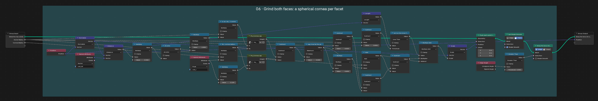

Now each tile becomes a lens. Every point moves along its own direction from the camera to a new distance:

| Node | What it does |
|---|---|
| `d: arc distance from the facet centre` | `Dome Radius` × 2 asin(chord / 2), where chord = distance(normalize(Position), `cell_dir`) |
| `Rc: cornea radius of curvature` | `Cornea Radius` × `cell_r`: 2.3 facet radii |
| `PA_Cornea cap` × 2 | cap(x) = √(Rc² − x²), the height of a sphere of radius Rc above a point x from its axis |
| `sag: how far the glass bulges` | max(cap(d) − cap(1.12 r), 0): a spherical cap that is zero at 1.12 r |
| `Is it on the inner face?` | length(Position) < `Dome Radius` − 1.6 mm |
| `Push each point to its lens radius` | outer face: `Dome Radius` + sag. Inner face: `Dome Radius` − 3.2 mm − 0.8 × sag |
| `Keep the lens rim sharp` | smooth shading, except edges sharper than 0.55 rad |

So each facet becomes a biconvex lens. The outer face is a sphere of radius Rc, and the inner face bulges 0.8 times
as far toward the camera. The cut at 1.12 r is just past the corner of a regular pentagon with the facet's area
(1.11 r after the shrink), so the sag stays positive all the way to the edge and the rim keeps a little thickness.

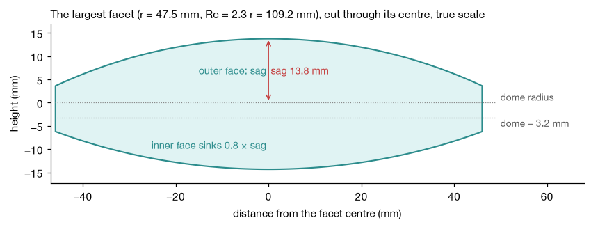

### Trick · the chord form of the arc distance

The obvious arc distance is acos(a · b). Near the facet centre the dot product is almost exactly 1, and acos of a
float32 number near 1 jumps in steps. That left star-shaped ripples in every lens. 2 asin(|a − b| / 2) is the same
angle and stays exact at small distances.

### Trick · the curvature scales with the facet

Because Rc = 2.3 r, every facet is the same lens shape at a different size. A thin-lens estimate gives the focal
length f = Rc / (1.8 (n − 1)), where the 1.8 is the outer face plus 0.8 for the inner one. At n = 1.48, f = 1.16 Rc.
That is 126 mm for the largest facet. The camera is 430 mm away, beyond the focal point, so each facet forms a small
**upside-down** image of the meadow, at about f / (430 − f) ≈ 0.4 times its size. A big central facet has a longer
focal length and so a bigger image: the poppy is largest in the middle of the eye.

> **Try it:** set `Cornea Radius` to 1.6. The largest facet's sag grows from 13.8 to 21.7 mm and its focal length
> drops from 126 to 88 mm. The image scale drops to about 0.26, so each facet shows a smaller poppy and more of the
> meadow around it. At the slider minimum, 1.25, the sag is 33 mm and the scale is 0.19.

---

## 7 · Air to glass: one switch per facet, rim first

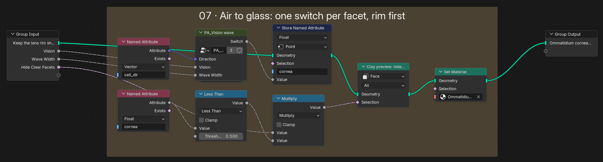

This is the switch the whole clip is about, and it is only eight nodes:

| Node | What it does |
|---|---|
| `PA_Vision wave` | `cell_dir`, `Vision` and `Wave Width` in, one 0 → 1 `Switch` out (see "Inside `PA_Vision wave`") |
| Store Named Attribute `cornea` | writes the switch on every point |
| `Clay preview: hide clear facets` | when `Hide Clear Facets` is on, deletes faces whose `cornea` is below 0.5 |
| Set Material | `Ommatidium cornea | dispersive glass` |

The wave reads `cell_dir`, not the point's own position. Every point of a facet holds the same `cell_dir`, so the
whole facet gets one value and switches as a unit. There is never a gradient across a single lens.

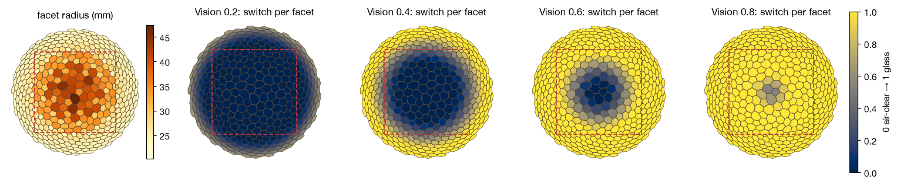

### The glass reads `cornea`

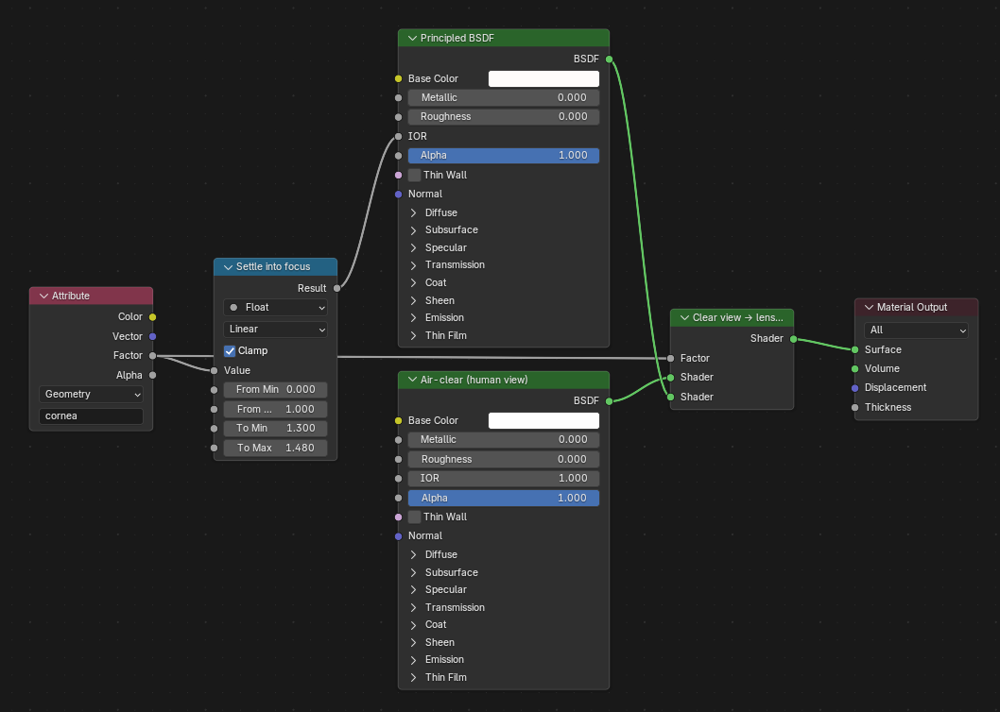

| Node | What it does |
|---|---|
| Attribute `cornea` | 0 while the facet is clear, 1 once it is glass |
| `Air-clear (human view)` | Principled BSDF, white, roughness 0, IOR 1.0, full transmission |
| `Settle into focus` | Map Range: `cornea` 0 → 1 becomes IOR 1.30 → 1.48 |
| Principled BSDF | roughness 0, full transmission, dispersion scale 1, Abbe number 26 (in the collapsed Transmission panel) |
| `Clear view → lens view` | Mix Shader, factor `cornea` |

At IOR 1.0 an interface has no Fresnel reflection and no refraction, so rays go straight through and the facet is
invisible. A Transparent BSDF should look the same, but in this scene the sun disc seen through it came out much
dimmer. The IOR-1 Principled matches the plain view exactly. The dispersion gives every sun image a thin rainbow rim.

### Trick · dissolve, don't ramp the IOR

The obvious switch is to ramp the IOR from 1.0 to 1.48. With the focal length from section 6, f = Rc / (1.8 (n − 1)),
there is an IOR at which f equals the 430 mm to the camera: n = 1 + Rc / (1.8 × 430). That is about 1.07 for a rim
facet (r = 23.7 mm) and 1.14 for the largest one. At that moment the camera sits exactly at the facet's focal point.
The facet magnifies without limit and fills with a single colour, then its image flips. A facet next to the sun fills
white for a frame and then the sun comes back in a neighbour: a blink (top row below).

The dissolve avoids the crossing altogether. The lens lobe starts at IOR 1.30, where even the largest facet's focal
length is 202 mm, well short of 430 mm. Its image is already upside down when it starts to fade in, and it only
shrinks into place as the IOR settles to 1.48 (bottom row).

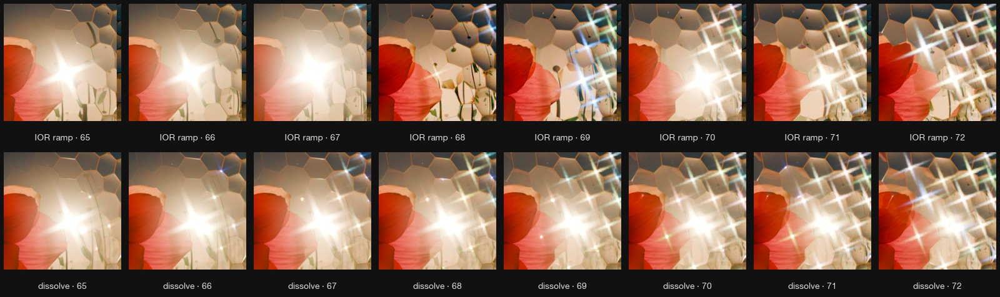

> **Try it:** set `Vision` to 0.6 and drag `Wave Width`. At 0.05 each facet switches over about a twentieth of the slider,
> so the wave is a sharp ring with clear facets inside and finished lenses outside. At 1 every facet's switch spans
> half the slider, so the whole eye is a soft gradient from the clear centre to the glassy rim.

---

## 8 · Amber cuticle ridges along the facet borders

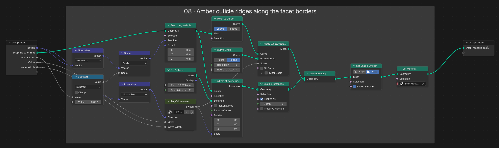

Real compound eyes have dark cuticle between the facets. Here it also covers the seams from section 5: the tubes are
3.4 mm across.

| Node | What it does |
|---|---|
| `Seam net, mid-thickness` | the cells from section 3 (before Split Edges, so neighbours share edges) at `Dome Radius` − 1.6 mm |
| `Ridge tubes, scaled by the wave` | Mesh to Curve, then Curve to Mesh with a circle profile (8 sides, 1.7 mm radius) |
| `A knot at every junction` | an Ico Sphere (2.5 mm radius, 2 subdivisions) on every vertex of the net |

Both the tubes and the knots are scaled by `PA_Vision wave`, this time with each point's own direction. A clear facet
therefore has no frame, and the human view at `Vision` 0 shows no honeycomb. The seams grow continuously along the
wave front. Their material, `Inter-facet ridges | amber chitin`, is a dark coated Principled mixed 0.22 with an orange
Translucent, so the ridges glow amber where the sun shines through them.

> **Try it:** set `Vision` to 0.5 and look at the dome in the viewport. The ridges are full thickness at the rim and
> taper to nothing toward the centre, where the facets are still clear.

---

## 9 · Dark cuticle collar around the equator

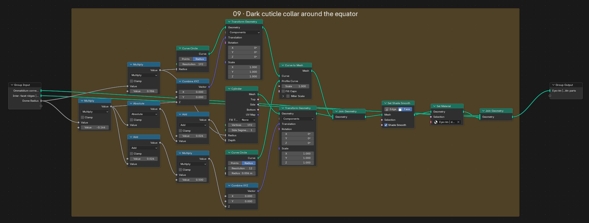

The trimmed cells end in a ragged edge: their centres reach 83° off the axis and their corners 85°. The collar
covers it. A circle of radius
`Dome Radius` × sin(1.404) sits 1.404 rad (80.4°) off the axis and is swept into a tube with a 6 mm profile. An open
cylinder runs from there back to 26 mm behind the camera. The material, `Eye rim | dark iridescent chitin`, is a dark,
slightly metallic Principled with a fine noise bump.

In this clip the corner of the frame is 75° off the axis, so the collar stays just out of view. It matters in any
view that looks further out: a wider fisheye, or the dome seen from outside.

---

## Inside the helper groups

The three small groups keep the formulas readable in the main tree. Each one is a field: it runs once per point
wherever it is used.

### `PA_Fovea stretch`

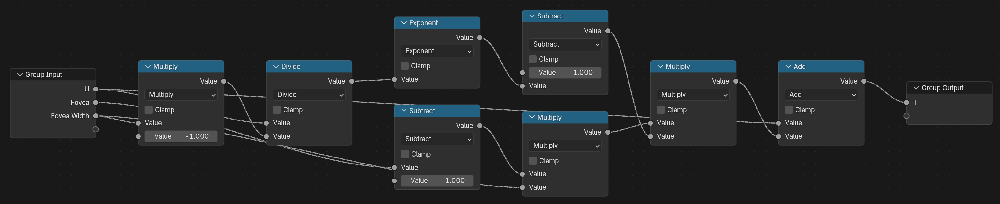

`T = U + (Fovea − 1) · Fovea Width · (1 − e^(−U / Fovea Width))`. The Exponent node gets −U / w, so the bracket
grows from 0 at the centre toward 1 and the stretch only adds area near the start of the spiral.

### `PA_Cornea cap`

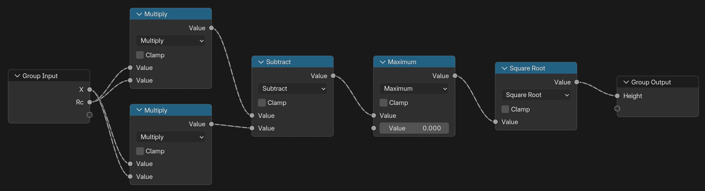

`Height = √(max(Rc² − X², 0))`. The Maximum keeps the square root defined if X ever passes Rc. With the 1.12 r cut and
`Cornea Radius` at least 1.25, it never does.

### `PA_Vision wave`

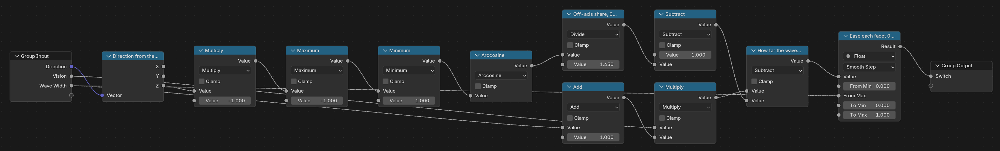

| Node | What it does |
|---|---|
| `Direction from the eye centre` | Separate XYZ of the direction. Only Z is used |
| `Off-axis share, 0 centre → 1 rim` | acos(−Z) / 1.45: 0 on the axis, 1 at the trimmed rim |
| `How far the wave has passed this facet` | `Vision` × (`Wave Width` + 1) − (1 − share) |
| `Ease each facet 0 → 1` | Map Range, smoothstep, from 0 → `Wave Width` to 0 → 1 |

Why `Wave Width` + 1? A rim facet (share 1) starts at `Vision` 0 and is done at w / (w + 1). The centre facet
(share 0) starts at 1 / (w + 1) and is done at exactly 1. So at `Vision` 0 every facet is clear and at 1 every facet
is glass, for any width. With w = 0.5 each facet takes a third of the slider. In the clip `Vision` runs
from frame 36 to frame 100, so the rim starts turning at 1.5 s and the centre finishes at 4.1 s.

---

## Appendix A · The bee-inspired false colour

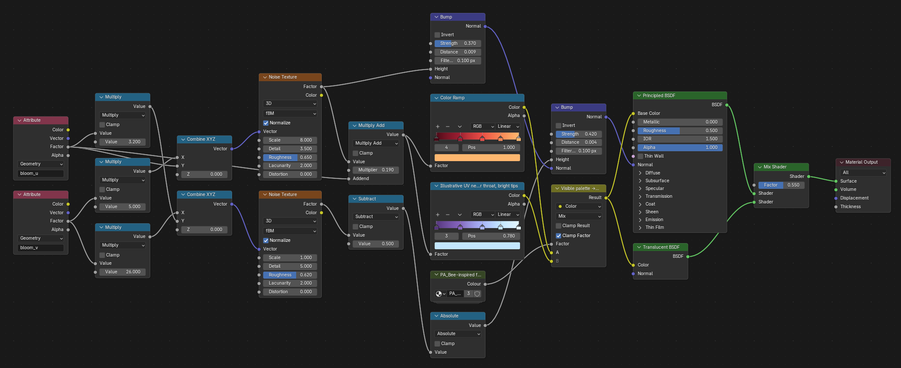

After the optics have finished, an illustrative "bee view" fades in between frames 82 and 124. It is an RGB proxy:
bees see ultraviolet, blue and green, and no measured UV reflectance goes into it.

- **Timing.** One group, `PA_Bee-inspired false colour | timing`, holds a keyed Value,
  `Blue / green / UV-inspired strength`, 0 at frame 82 and 1 at frame 124. Every material that changes reads it.
- **Petals.** Both petal materials get a second ColorRamp, `Illustrative UV nectar guide: darker throat, bright tips`,
  driven by the same noise factor as the visible ramp. `Visible palette → bee-inspired petal palette` mixes the two:
  deep violet at the base, light blue at the tips.
- **Pollen.** `Pollen stays bright in both views` blends the anthers from orange (0.97, 0.52, 0.067) to yellow-green
  (0.76, 0.94, 0.29), with a faint emission of 0.12.
- **Grade.** In the compositor tree `PA_Post`, right after Render Layers and before the bloom and streaks,
  `RGB proxy, no measured UV data` splits the channels:
  R′ = 0.77 R + 0.12 B, G′ = 1.025 G + 0.045 B, B′ = 1.08 B + 0.135 G. `False-colour amount`, keyed on the same frames,
  mixes it in through `Human → bee-inspired cool palette`.

---

## Appendix B · The poppy and its petals

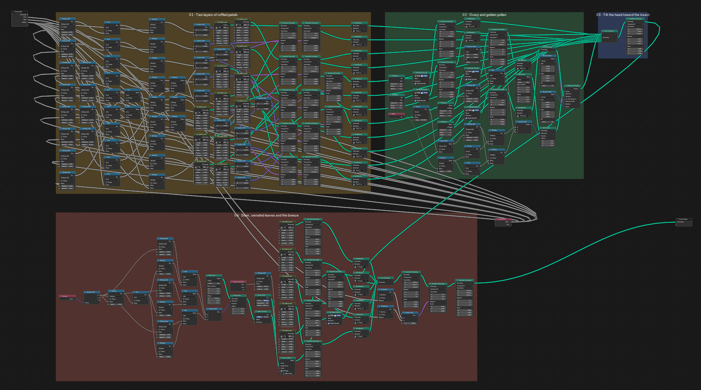

`PA_Poppy_GN` is built by a Python loop, so it is long (169 nodes) but simple. There are four sections:

1. **Two layers of ruffled petals.** Twelve calls of `PA_Ruffled petal`, seven outer and five inner, with lengths,
   widths, cups and ruffles from a seeded random generator and `Crumple` 1. Each petal swings by
   `Flutter` × sin(2π · rate · Seconds + phase) from the Scene Time node, with its own rate and phase.
2. **Ovary and golden pollen.** Two squashed spheres, and 154 stamens on a golden-angle disc with random tilt and size.
3. **Tilt the head toward the insect.** One Transform turns the flower to face the eye.
4. **Stem, serrated leaves and the breeze.** A tube for the stem and five leaves, which are `PA_Ruffled petal` with
   `Crumple` 0. `Lean` and `Nod` turn the whole plant about the stem base, in degrees.

The petal group has five lettered sections:

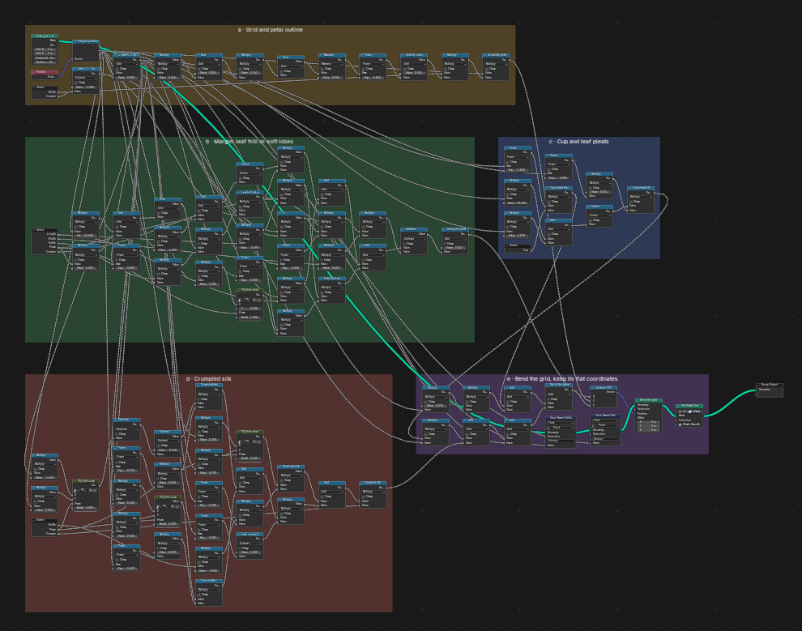

| Section | What it does |
|---|---|
| `a · Grid and petal outline` | `Petal grid: u along, v across` (64 × 61 points). `u: base 0 → tip 1`, `Outline: narrow claw, wide blade` |
| `b · Margin: leaf frill or soft lobes` | `Leaf frill (off when crumpled)` for leaves, `Soft lobes along the margin` for petals |
| `c · Cup and leaf pleats` | `Cup toward the tip` and `Leaf pleats (off when crumpled)` |
| `d · Crumpled silk` | `Broad waves at the rim`, `Creases radiating from the base`, `Fine crinkle`, all faded by `Fade creases before the rim` |
| `e · Bend the grid, keep its flat coordinates` | `Bend the grid` after storing `bloom_u` and `bloom_v` on the flat grid for the material |

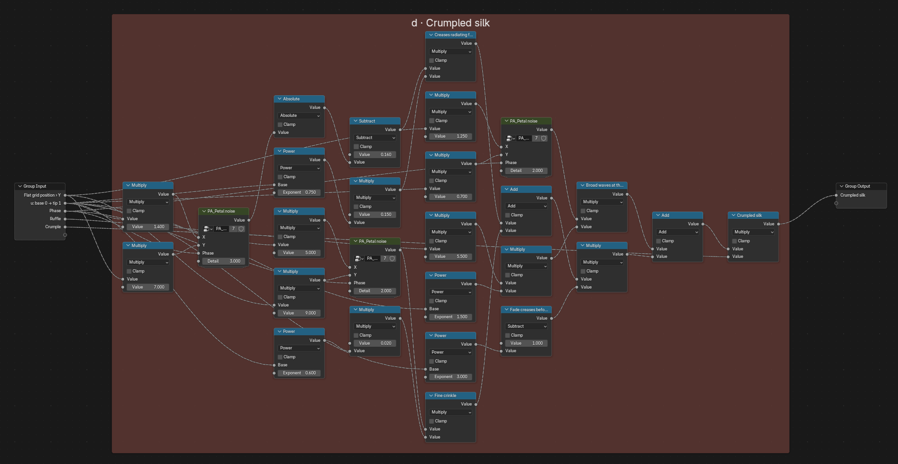

The creases are noise stretched along the petal (u × 1.4, v × 7), folded into ridges by 0.16 − |noise|. They fade out
before the margin, so the edge stays a soft wave instead of a sawtooth. All three noises go through `PA_Petal noise`
(a 3D Noise Texture of (X, Y, `Phase`), minus 0.5), so each petal call shows one node per noise instead of three.

The meadow, `PA_Meadow_GN`, is built the same way, by a loop of 2 256 nodes, so it gets no screenshot here. It has up
to 76 distant stems with leaves and seed heads (every fifth with a small butter-yellow flower), up to 21 foreground
blades (the loop skips spots in front of the poppy), 88 drifting pollen motes and a ground plane.
`Wind: tips sway, roots stay` moves every point by `Wind` times the square of its height (normalised to 3.4 m).

---

## Appendix C · Sky, sun, haze and camera

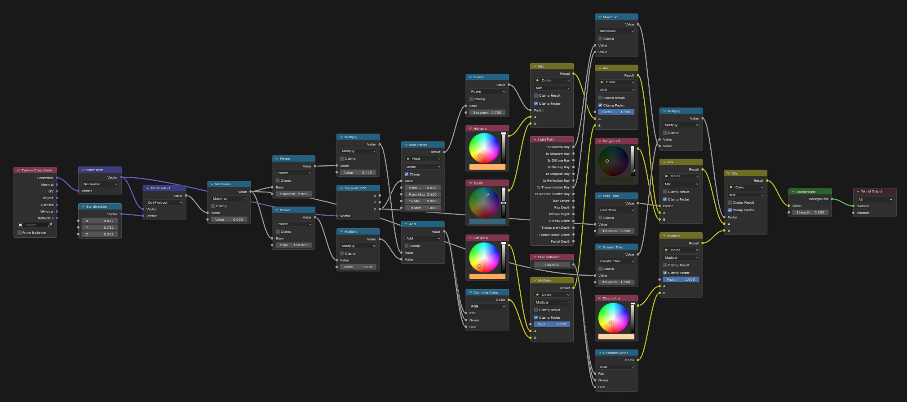

- **Sky.** `PA_Procedural evening sky` mixes `Horizon` and `Zenith` by elevation and adds `Sun glow` around
  `Sun direction` (azimuth 41°, elevation 14°). Below the horizon it shows `Far ground`.
- **Sun disc.** 2° wide, `Disc radiance` 900 times `Disc colour`. Only camera rays and transmission rays see it
  (Light Path: max(Is Camera Ray, Is Transmission Ray)), and those are the rays that pass through the facets. A Sun
  lamp, `PA_Low sun behind the poppy`, strength 9, lights the meadow from the same direction. Diffuse and glossy rays
  never see the disc, so the sun is not counted twice.
- **Haze.** `PA_Air behind flower` is a 21 × 12 × 6 m box behind the poppy with a Principled Volume (density 0.036,
  anisotropy 0.62, so it scatters the backlight forward). In the clip, `Fade out before the top of the box` fades the
  density by height, from 1 at 1.2 m to 0 at 5.2 m. The box's lid is at 5.5 m. Without the fade, its top edge shows as
  a hard bright arc in the sky of the plain human view.
- **Camera.** `PA_Compound Eye Camera` is an equisolid fisheye with a 36 mm sensor: a ray θ off the axis lands
  2f sin(θ/2) from the centre. At 30 mm the frame's edge is 35° off the axis and its corner 50°. At 21 mm the edge is
  51° and the corner 75°. So the widening from frame 24 to 60 brings the outer facets into the frame as the wave
reaches them.
  The eye is parented to the camera, so it stays centred on the lens.

---

## How it was rendered

Cycles at 1080 × 1080, 160 samples with adaptive sampling (threshold 0.022) and the OpenImageDenoise denoiser, AgX
with the Medium High Contrast look. Light paths may bounce up to 12 times, up to 8 of them through glass. Clamping is off: Cycles
counts the sky seen through glass as *indirect* light, and the default indirect clamp turns every sun image into a grey
dot. Refractive caustics are off. After the render, `PA_Post` adds a Bloom and a four-point Streaks glare at 22°
with a threshold of 3, so only the sun images flare.

The frames were split between two machines: a Mac (Apple Metal) and a second PC with an RTX 4060 (OptiX), both
on Blender 5.3. The same glass frame rendered on both matched at a PSNR of 52.5 dB, so the hand-off doesn't show. The
PNG frames were encoded to H.264 with ffmpeg.

---

## Try it yourself

In your own build:

1. **Watch the wave in clay.** Turn on `Hide Clear Facets` and scrub `Vision` from 0 to 1 in the viewport. Only the
   switched facets are drawn, so you see a ring close in from the rim.
2. **A uniform eye.** Set `Fovea` to 1. The 432 facets are all close to one size (radii 23–32 mm), and the poppy
   repeats at one size across the eye.
3. **Stronger lenses.** Set `Cornea Radius` to 1.6. The facets bulge more and each one shows a smaller, upside-down
   poppy with more meadow around it.
4. **A sharp wave front.** Set `Wave Width` to 0.05 and `Vision` to 0.6. The switch becomes a thin ring between clear
   and glass facets.
5. **See the focal crossing.** In the glass material, set `Settle into focus` To Min from 1.30 to 1.0 and plug the
   Principled BSDF straight into the Material Output, past `Clear view → lens view`. That is the plain IOR ramp.
   Render frames 65–72 at 512 × 512: facets next to the sun flash white as they pass IOR 1.07–1.14.

*Made with Blender 5.3 Geometry Nodes and Cycles for [Nodevember](https://nodevember.com) 2026, Day 22 · Lens.*
