# How a rain shower is pressed into one groove: the same drops cut the vinyl, move the needle and make the sound

*A node-by-node walkthrough of Nodevember 2026 · Day 23 · Analogue (v2 · Rain on Vinyl)*

The clip (7.8 s, 187 frames, 24 fps, with stereo sound) opens on a black record and a classic moving-magnet pickup in
warm side light. The camera moves down past the brushed aluminum body and the red stylus holder until it faces the
thin cantilever and the clear diamond sitting in the groove. From frame 144 the record slows to 1/90 speed, like a
high-speed camera, so the fine stereo cut slides slowly under the tip. The record is one continuous spiral groove of
192 turns. Its wobble *is* the rain: three streams of drops, swelling to a downpour and easing off, are cut into the
groove as a radial swing. The same three drop clocks move the needle and play as close drips in the soundtrack.

The record, the pickup, the headshell and the platter are Geometry Nodes modifiers on empty meshes. There are no image
textures, no imported or modelled meshes and no simulation (a procedural-purity audit passes, and the build script checks it).
Some things are not nodes, and this walkthrough covers them too:
- Bevel, Weighted Normal and Solidify modifiers round off the box parts.
- An adaptive Subdivision modifier dices the turns near the lens.
- Keyframes move the camera (position, aim, focus and f-stop) and one light.
- Drivers turn the record and slide the arm. Copy drivers keep the sliders of the needle and of the diced band equal to
  the record's.
- A Python script writes the sound with numpy.


| File | What it is |
|---|---|
| `rain-on-vinyl.mp4` | the clip: 864 × 864, 24 fps, 187 frames (7.8 s), Cycles, H.264 with 48 kHz stereo AAC |
| `render.png`, `stylus-detail.png` | frame 1 and frame 175 at 1080 × 1080, 64 samples (the close-up without motion blur) |
| `nodes/` | the node trees full size: `main.png` (`PA_Vinyl_lathe_GN`), `rain-pressure.png` (`PA_Rain pressure`), `vinyl-material.png` (`Black PVC`), `cantilever.png` (`PA_Cantilever and diamond_GN`), `stylus-holder.png`, `headshell.png`, `finger-lift.png` |
| `post.md` | idea, build notes, captions and alt text |

The `.blend`, the Python script that builds it and the sound script are not published. In the scene, the object
**PA_Vinyl_lathe** carries the tree `PA_Vinyl_lathe_GN` and the sliders, **PA_Vinyl_diced band** is its child and runs
the same tree, and the pickup parts are children of the empty **PA_Tracking arm**. Every node, label and number you need
is in the screenshots and the text. It was built in Blender 5.3.

---

## The one idea

> **Every point of the groove knows when it will be played, so the rain can be read at that moment.** The spiral is
> made from a grid of samples. Each sample stores its playback time, in seconds after the needle sets down. One node
> group, `PA_Rain pressure`, turns a time into a pressure. The record reads it at every point of the spiral and swings
> the groove sideways by that much. The needle reads the same group at the current playhead and moves by the same
> amount, so the tip follows the rain swing of the cut it sits in. (The finer stereo micro-cut added by the material
> is not read by the needle; see needle section 01.)

Everything else is bookkeeping around that idea:

- **What does the rain look like as a number?** A storm envelope times three streams of drops. Each drop is a fast
  attack, an exponential decay and a low sine carrier (`PA_Rain pressure`).
- **How does one long strip become a record?** A grid 82 945 samples long and 7 rows wide is wound into a spiral. The
  outer rows of neighbouring turns land on the same points and are welded (1–4).
- **Why does the groove waver in the close-up?** A finer stereo signal, two noise channels like the left and right
  walls of a 45/45 stereo groove, is cut by the vinyl shader as true displacement. Cycles dices only the turns near the
  needle down to about 1.5 pixels (6, "The micro-cut").
- **Why can we see it move?** The record, the arm and the needle share one playhead driver. It runs in real time, then
  slows to 1/90 when the camera arrives ("The playback clock").
- **And the sound?** The sound script rebuilds the same three drop clocks and plays a drip at each drop. Until frame 144, every
  drip you hear is a swing of the needle you see.


### How to read the screenshots

- Each coloured frame is one section of a tree. The record's sections are numbered like the headings below
  (`01 · Unwrap one continuous strip`). The helper group `PA_Rain pressure` uses letters (`a · Storm swells and
  passes`). The vinyl material and the needle number their own frames.
- A **cut-out** shows one section on its own. Wires from another section come in through a Group Input socket named
  after what they carry (`turns from the rim`, `edge: 0 centre, 1 land`). Wires that leave go out through a Group
  Output socket. Sliders keep their own names (`Groove depth`, `Signal swing`).
- Node labels are written `like this` and match the file. Node types are plain text (Set Position, Merge by Distance).
- The record is 3.06 units across, so one Blender unit is about 100 mm of a 12-inch LP. The text keeps the file's units.
  Pitch 0.003 is the distance from one turn to the next. Angles in the nodes are radians.
- The node editor rounds what it shows. `MODULATION` is 0.0009, but a field shows it as `0.001`. The text gives the
  values from the build script.
- Click any screenshot to open it full size.

---

## 0 · The map

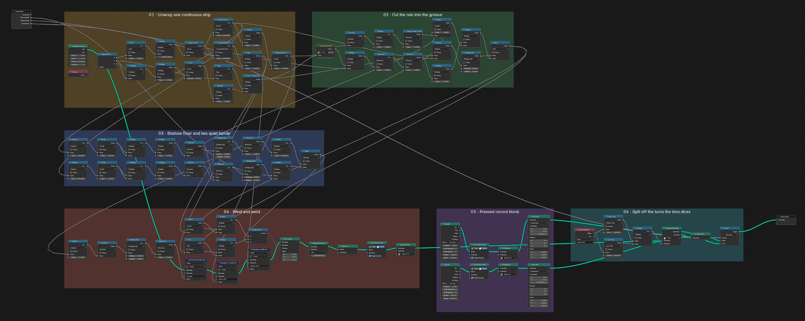

| # | Section | Nodes | Job |
|---|---|---|---|
| 1 | Unwrap one continuous strip | 17 | a Grid becomes samples: turns, angle, position across the groove, playback time |
| 2 | Cut the rain into the groove | 13 | read `PA_Rain pressure` at each sample's time and swing the radius |
| 3 | Shallow floor and two quiet bands | 17 | the groove's depth profile, shallower in two bands |
| 4 | Wind and weld | 17 | store the shader's attributes, wind the strip into a spiral, weld the turns |
| 5 | Pressed record blank | 8 | the disc under the groove and the paper label |
| 6 | Split off the turns the lens dices | 7 | turns 52–100 for the diced band, everything else for the record |

The counts are nodes inside each frame. The tree has three sliders:

| Slider | Default | Range | What it does |
|---|---|---|---|
| `Groove depth` | 1 | 0.4 – 1.5 | multiplies the cut depth of 0.00042. The diamond follows |
| `Signal swing` | 1 | 0 – 1.4 | gain on the rain before it moves the groove. The same gain drives the cantilever |
| `Diced band` | off | | on: output only turns 52–100. Only **PA_Vinyl_diced band** turns it on |

Copy drivers keep the band's and the needle's `Groove depth` and `Signal swing` equal to the record's. Move the
sliders on **PA_Vinyl_lathe** only.


The camera has six keys (frames 1, 28, 65, 95, 116, 144) with Blender's default eased interpolation. Between them it
moves down and turns to face the needle, and the f-stop goes from 6 to 25. The warm strip light slides with three keys
(1, 75, 144). The shaded band, frames 156–187, is the slow-motion hold: the camera and the lights are still, and the
grooves pass under the tip at 1/90 speed.

---

## 1 · Unwrap one continuous strip

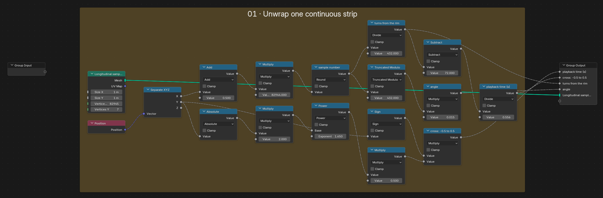

A record groove is one line that never ends until the label. The easiest way to build it is to build it straight
first, as a long strip, and wind it later.

| Node | What it does |
|---|---|
| `Longitudinal samples × cross-section` | Grid 1 × 1 m with `TURNS · STEPS + 1` = 192 · 432 + 1 = 82 945 vertices along X and `PROFILE` = 7 across Y |
| `sample number` | Round((X + 0.5) · 82 944): an integer from 0 to 82 944 |
| `turns from the rim` | sample / 432. 432 samples per turn is one every 0.83° |
| `angle` | (sample Truncated Modulo 432) · 2π / 432 |
| `cross: -0.5 to 0.5` | sign(Y) · (2·abs(Y))^1.65 · 0.5. The seven rows end up at 0, ±0.082, ±0.256 and ±0.5 |
| `playback time (s)` | (turns − 72) / `RPS`. `RPS` is 33⅓ / 60 = 0.556 turns per second. The needle sets down at turn 72 |

### Trick · count samples, not distance

Why round to an integer? A grid's X positions are floats. Across 82 944 steps, the angle computed from a float X
drifts a little from turn to turn. Then the outer row of one turn and the inner row of the next no longer meet at the
same angle, and the weld in section 4 leaves cracks. Rounding gives every sample an exact integer. Sample *i* and
sample *i* + 432 then land on exactly the same angle.

### Trick · bunch the rows towards the middle

The power of 1.65 pulls the inner rows towards the centre line. Three rows lie on the floor of the cut (`edge` below
0.5, section 3), the rows at ±0.256 sit just past the lip, and the two outer rows are the land shared with the
neighbouring turns.

> **Try it:** in the Power node before `cross: -0.5 to 0.5`, set the exponent to 1. The rows become evenly spaced (0,
> ±0.167, ±0.333, ±0.5). The floor's side rows move out and up, from ±0.082 at 67 % of the depth to ±0.167 at 33 %, so
> the groove turns into a wide, shallow V with a sharp bottom.

---

## 2 · Cut the rain into the groove

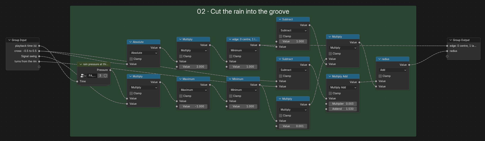

This is the lathe. Every sample asks `PA_Rain pressure` what the rain was doing at its playback time and moves the
groove sideways by that amount.

| Node | What it does |
|---|---|
| `rain pressure at this point` | the group `PA_Rain pressure` with Time = `playback time (s)` |
| `edge: 0 centre, 1 land` | min(2·abs(cross), 1): 0 on the groove's centre line, 1 from the lip outward |
| Subtract (1 − edge) | the weight of the swing: 1 in the middle of the cut, 0 on the land |
| Multiply, Maximum, Minimum, Multiply | clamp(pressure · `Signal swing`, −1, 1) · `MODULATION`. `MODULATION` is 0.3 pitch = 0.0009 |
| Multiply Add | `RADIUS` + (cross − turns) · `PITCH` = 1.530 + (cross − turns) · 0.003 |
| `radius` | add the weighted swing |

The radius formula is the whole spiral. Each turn moves the groove 0.003 inward. Across the groove, cross runs from
−0.5 to 0.5, so one groove is exactly one pitch wide.

### Trick · keep the land still

The swing is multiplied by 1 − edge, so it is zero on the land. Only the cut moves. That is how a real lathe works,
where the land is the undisturbed lacquer between grooves. It also keeps the outer rows of neighbouring turns on top
of each other, which the weld in section 4 needs.

Over the part of the record the needle plays, the pressure stays between −0.50 and +0.41 (computed from the same
formulas in numpy). So the clamp to ±1 never acts, not even at `Signal swing` 1.4. It is a guard rail. The
largest swing is 0.50 · 0.0009 = 0.00045, about 15 % of the pitch.

> **Try it:** set `Signal swing` to 0. The groove becomes a plain spiral, and the cantilever stops swinging, because it
> reads the same slider. The fine waver of the close-up stays: that comes from the material and has its own gain (see
> "The micro-cut").

---

## 3 · Shallow floor and two quiet bands

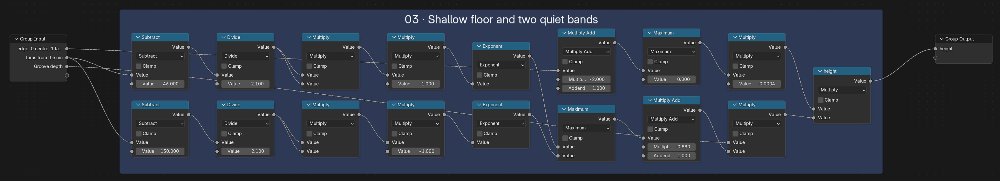

| Part | Formula |
|---|---|
| well (top row) | max(1 − 2·edge, 0): 1 on the centre line, 0 at edge 0.5 and beyond |
| two bands | exp(−((turns − 46) / 2.1)²) and the same around turn 130 |
| band factor | 1 − 0.88 · max(band 1, band 2): down to 12 % of the depth at turns 46 and 130 |
| `height` | well · (−0.00042) · `Groove depth` · band factor |

Only the three middle rows (well 1, 0.674, 0.674) go down. The two rows at ±0.256 have edge 0.512, so their well is 0:
they are the lip. The figure shows the result for three neighbouring turns:


Why the bands? An LP's playing surface shows rings of different shine between tracks and in quiet passages. Here two
shallow bands of about ±2 turns catch the warm side light differently from the rest, so the wide shot reads as a
record and not as a uniform grey disc.

> **Try it:** set `Groove depth` to 0.4. The cut is now 0.000168 deep. The diamond's tip height follows (section 1 of
> the needle), so it still sits on the floor of the shallower groove. The highlights on the walls get thinner.

---

## 4 · Wind and weld


| Node | What it does |
|---|---|
| `Limit tool marks to the wall` | stores `cut_wall` = max(1 − 3.65 · abs(edge − 0.24), 0), a mask that peaks on the groove walls |
| `Keep groove_time for the shader cut`, `Keep groove_cross for the shader cut` | store playback time and cross for the material |
| Combine XYZ | (radius · cos(angle), radius · sin(angle), height) |
| Set Position | winds the strip |
| Merge by Distance | 0.000018: welds the outer row of each turn to the inner row of the turn before |
| Flip Faces | the grid's +X becomes the counterclockwise direction and its +Y points outward, a mirror-handed mapping that turns every face upside down. With Flip Faces muted, all of the strip's normals point down |
| `grooved surface` | Set Shade Smooth and Set Material `Black PVC` |

### Trick · store before you move

The three Store Named Attribute nodes come before Set Position on purpose. Their fields (`playback time (s)`,
`cross: -0.5 to 0.5`) are computed from the grid's position. After Set Position, the same fields would be evaluated
on the wound positions and give nonsense. Storing them first freezes the values on the points, and the material
reads them later.

The weld removes one row per sample after the first turn: 82 945 · 7 = 580 615 vertices become 498 102 (580 615 −
82 513). The result is one connected surface. Smooth shading and the band's subdivision treat neighbouring turns as
one piece of vinyl, not as separate strips that happen to touch.

> **Try it:** mute Merge by Distance (M) and turn on the viewport Statistics overlay. **PA_Vinyl_lathe** goes from
> 375 660 to 437 006 vertices and **PA_Vinyl_diced band** from 124 854 to 145 159: every turn is now its own strip,
> lying edge to edge with the next.

---

## 5 · Pressed record blank

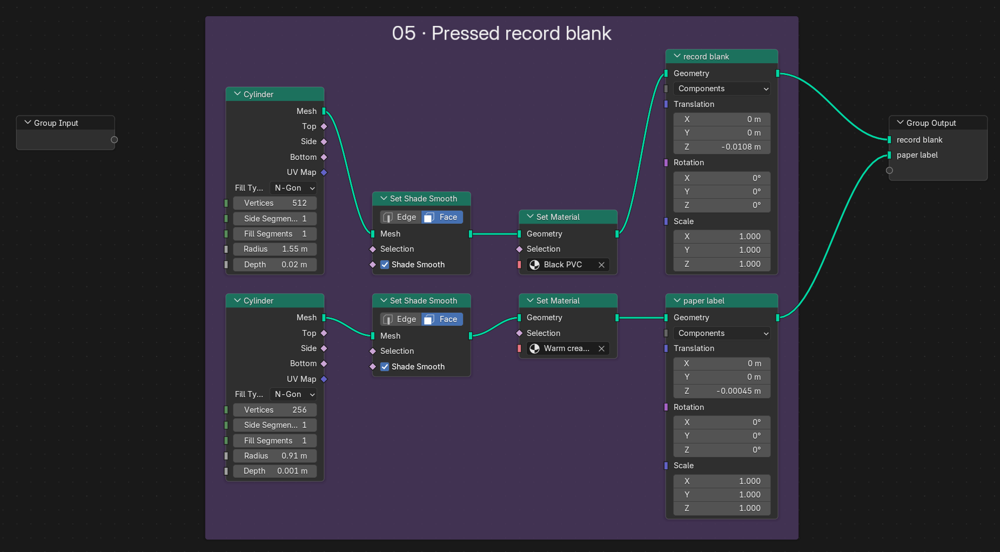

The groove is a skin with no thickness. Under it sits `record blank`, a Mesh Cylinder of radius 1.552 and depth 0.020
with 512 vertices, in `Black PVC`. Its top is at −0.0008, just under the deepest cut (−0.00042 · 1.5 at most), so it
never shows through. `paper label` is a disc of radius 0.910 and 0.001 thick in `Warm cream paper label`. The groove
ends at 1.530 − 192 · 0.003 = 0.954, just outside the label.

---

## 6 · Split off the turns the lens dices


The close-up needs the groove's fine stereo cut as real relief, a few thousandths of a unit high. That takes
subdivision down to a pixel. Adaptive subdivision on the whole record ran out of memory on the 8 GB render GPU, and
even a coarser dicing peaked at 8.1 GB. But the lens only sees a few turns around the needle. So the tree splits the record in two:

- `groove_time` between (52 − 72) / `RPS` = −36.0 s and (100 − 72) / `RPS` = 50.4 s selects turns 52–100
  (`DICED_TURNS`). The needle plays turns 72 to about 75.5.
- `Diced band` off (the record): everything else, joined with the blank and the label. 374 020 faces.
- `Diced band` on (the object **PA_Vinyl_diced band**): only the 48 selected turns, 48 · 432 · 6 = 124 416 faces.

**PA_Vinyl_diced band** is a second object with the same node group and one extra modifier, `Dice near the lens`. It
is a Subdivision Surface with adaptive subdivision, 1.5 px per micropolygon, 0 levels. Cycles splits each face until
its pieces are about 1.5 pixels on screen. Off screen it uses 25 times that (`offscreen_dicing_scale`), with at most 9
levels. The two objects meet along the edges of turns 52 and 100, far outside the close-up. The render peaks at
3.4 GB.

The modifier's subdivision type is Catmull-Clark, so the band's seven-row V is also smoothed into a rounder trough
in the render. The rest of the record is too far away for its V to show.

> **Try it:** select **PA_Vinyl_diced band** and hide it in renders. A smooth ring 48 turns wide appears, with no
> grooves: you are looking at the top of `record blank`, 0.0008 below the land. That shows exactly which turns the
> lens dices.

---

## Inside `PA_Rain pressure`

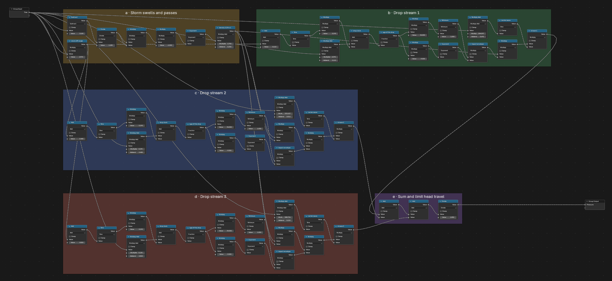

One input, `Time` (seconds after the needle sets down), one output, `Pressure`. The record and the needle both call
it, so they get the same number for the same moment. The sound script uses the same constants.


### a · Storm swells and passes

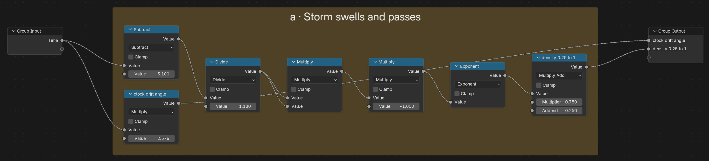

swell = exp(−((Time − 3.10) / 1.18)²), a Gaussian peaking 3.10 s into the clip (`SWELL_CENTER`, `SWELL_WIDTH`).
`density 0.25 to 1` = 0.25 + 0.75 · swell: light rain never stops completely. `clock drift angle` = Time · 2π · 0.41
(`CLOCK_RATE`) is shared by the three streams.

### b · Drop stream 1

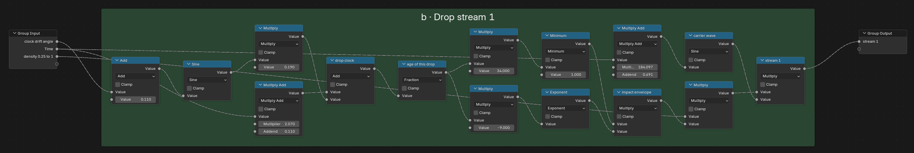

Each stream is a clock that ticks once per drop:

| Node | Formula (stream 1) |
|---|---|
| `drop clock` | Time · 2.07 + 0.11 + 0.19 · sin(drift angle + 0.11) |
| `age of this drop` | Fraction of the clock: 0 at a drop, rising to 1 just before the next one |
| `impact envelope` | min(age · 34, 1) · exp(−9 · age): full height after 1/34 of the interval, then ringing down |
| `carrier wave` | sin(2π · 29.3 · Time + 2π · 0.11) |
| `stream 1` | density · envelope · carrier |

Why a drifting clock? A plain Time · 2.07 would drop exactly every 0.48 s, a metronome. The sine term pushes each
drop up to 0.19 of an interval early or late, at 0.41 Hz, so the rhythm breathes. It is still a pure function of
time, which is what lets the sound script find the same drops.

### c · Drop stream 2 and d · Drop stream 3

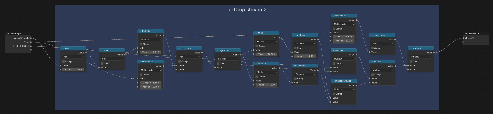

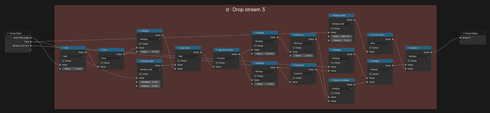

The same chain with `LANES` rows 2 and 3: 3.19 and 5.13 drops per second, phases 0.48 and 0.82, carriers 53.1 and
93.7 Hz. These two are scaled by density², so at the edges of the storm (density 0.25) they fall to 1/16 and only
the slow first stream is heard. In the downpour all three play.

### e · Sum and limit head travel

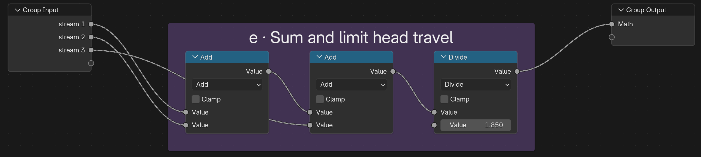

The three streams are added and divided by 1.85, so the sum stays inside ±1 (it reaches −0.50 at most). The record
and the needle clamp it to ±1 after the swing gain anyway.

> **Try it:** in your own build, move the storm centre (`SWELL_CENTER`) from 3.10 to 1.5 s. The downpour moves earlier in the
> groove, the needle shakes hardest while the camera is still wide, and the soundtrack peaks at the same moment. All
> three follow because they read one constant.

---

## The micro-cut: the `Black PVC` material

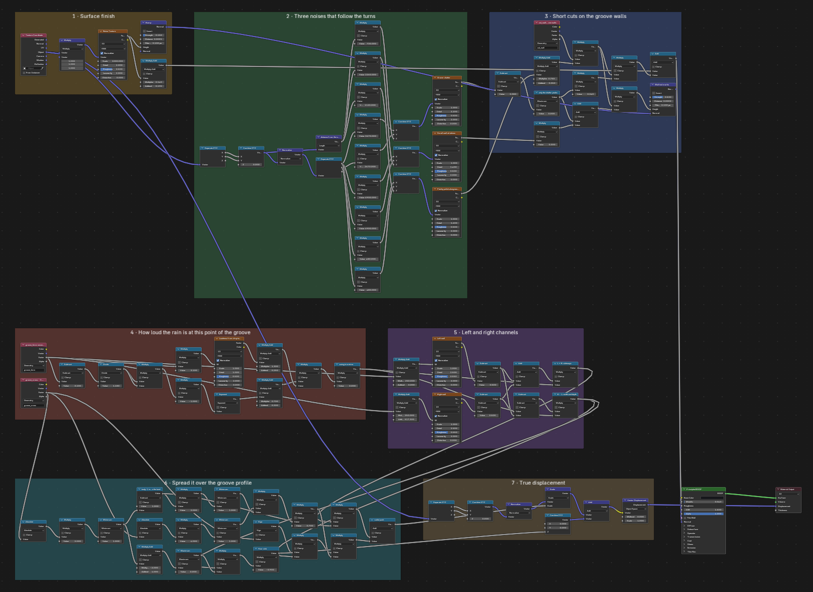

Up close, a real LP groove is not a row of identical channels. The music makes it waver in position and in width,
and the cutting stylus leaves fine marks on the walls. The geometry from section 2 carries the slow rain, a swing at
29–94 Hz. The material adds the rest in seven frames: 1–3 for the surface, 4–7 for the stereo micro-cut.

### 1 · Surface finish

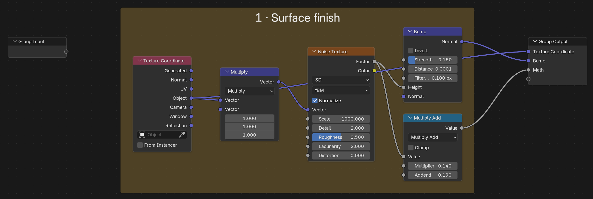

The same small helper as the metals: Object coordinates into a Noise Texture (scale 1000, detail 2), which drives a
faint Bump (strength 0.15, distance 0.00013) and roughness between 0.19 and 0.33. The base is a Principled BSDF with
colour (0.008, 0.009, 0.011), metallic 0.04 and a 0.18 coat.

### 2 · Three noises that follow the turns


A Noise Texture in plain XYZ would ignore the grooves. These three take (direction.x · a, direction.y · a,
`distance from the spindle` · b). Around a turn the input runs along a circle of radius *a* in noise space, and
across the grooves it moves by *b* per unit. So the pattern is laid out in polar coordinates:

| Noise | a (around) | b (across) | Detail | Look |
|---|---|---|---|---|
| `Graver chatter` | 2670 | 730 | 2.2 | short marks that lie across the groove |
| `Small wall striations` | 6900 | 2260 | 1.4 | finer scratches |
| `Patchy polish along each turn` | 480 | 1120 | 1.6 | long patches along the turn, changing from groove to groove |

### 3 · Short cuts on the groove walls

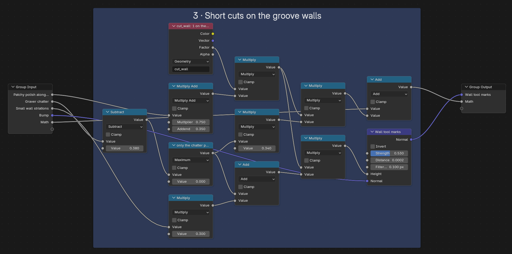

`cut_wall: 1 on the groove walls` reads the mask stored in section 4 of the record. weight = mask · (0.35 + 0.75 ·
polish). `only the chatter peaks` = max(chatter − 0.38, 0) keeps the top of the noise as separate short cuts. Their
height, plus 0.30 · striations, goes into `Wall tool marks` (Bump, strength 0.53), chained after the surface bump.
The roughness rises by weight · cuts · 0.34, so each mark catches the light a little differently.

### 4 · How loud the rain is at this point of the groove

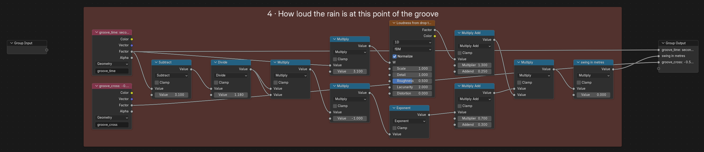

`groove_time: seconds of playback` is the same clock the record used in section 2. The material rebuilds the storm
Gaussian from it (3.10, 1.18) and adds `Loudness from drop to drop`, a 1D noise at 3.1 per second:

loud = (0.3 + 0.7 · swell) · (0.25 + 1.3 · gusts), and `swing in metres` = loud · `MICRO_SWING` (0.0003).

For scale, the groove is 0.0015 wide (cross ±0.25 at the lip), so `MICRO_SWING` is a fifth of the groove's width.
Loudness and the channel sum scale it up or down from there.

### 5 · Left and right channels

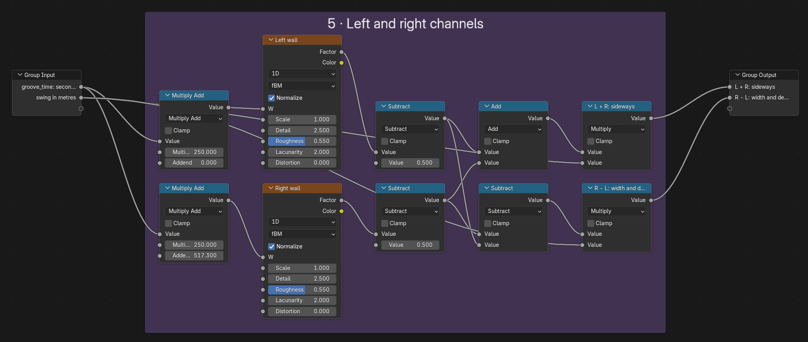

Two independent signals, read at `MICRO_RATE` = 250 cycles per second of playback. The offset 517.3 moves the right
channel to a far, unrelated part of the noise. On a stereo LP each wall carries one channel at 45°. The sum of the
channels moves the whole groove sideways, and the difference moves it up and down, which changes depth and width at
once. The two outputs do the same:

- `L + R: sideways` = (left + right) · swing
- `R - L: width and depth` = (right − left) · swing

Under the needle the groove passes at 2π · 1.314 · 0.556 = 4.59 units per second. One cycle of the base noise is
4.59 / 250 = 0.018 units long, about 6 pitches. Detail 2.5 adds finer octaves on top.

### 6 · Spread it over the groove profile

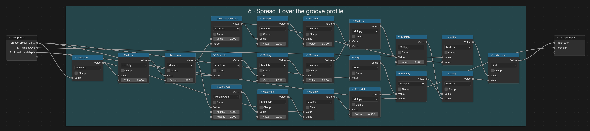

The weights in the right half of the groove-profile figure above:

| Weight | Formula | Where |
|---|---|---|
| `body: 1 in the cut, 0 on the land` | 1 − edge | the whole cut moves together |
| wall | min(4·abs(cross), 1) · min(2·body, 1) | peaks at the lip (cross ±0.25), zero on the centre line and the land |
| floor | max(1 − 2·edge, 0) | the same as the record's well |

`radial push` = sideways · body + sign(cross) · (width and depth) · wall · 0.7. Because of sign(cross), the two walls
move in opposite directions: the groove opens or narrows. `floor sink` = −0.9 · (width and depth) · floor lowers or
raises the floor at the same time.

### 7 · True displacement

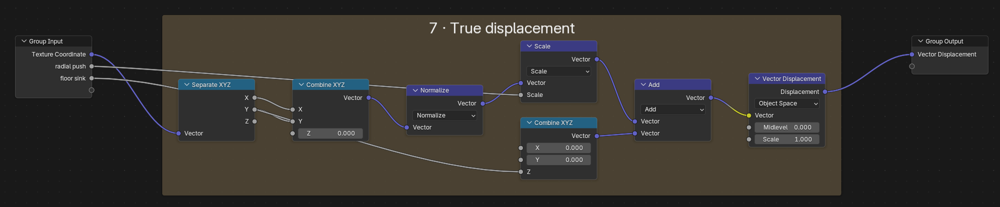

outward = normalize(x, y, 0). The offset outward · `radial push` + (0, 0, `floor sink`) goes into a Vector
Displacement node (Object space, Midlevel 0, Scale 1) and into the Material Output's Displacement. The material's
displacement method is **Displacement only**, so Cycles really moves the surface. A bump would only shade it, and
the silhouette of each groove against the next would stay straight.

### Trick · let the renderer make the geometry

Building this relief in Geometry Nodes would need a sample every few thousandths of a unit along 192 turns, hundreds
of millions of points. As true displacement on an adaptively subdivided band, Cycles makes it only where the camera
looks, at the size of a pixel, and only at render time. In the viewport's Solid mode the grooves are all the same, and
without the dicing the displacement can only move the existing vertices, one every 0.019 units along a turn, about
one cycle of the signal. Render (F12) to see the micro-cut.

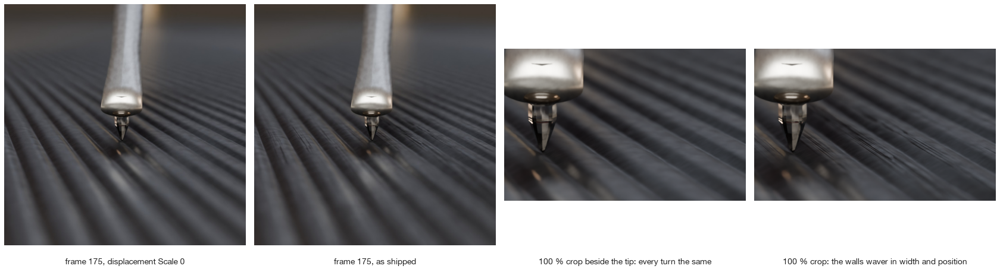

> **Try it:** in section 7 set the Vector Displacement's Scale to 0, as in the left half of the figure. The turns become
> identical, with only the tool marks left. Set it to 2 for a louder record: every wall moves twice as far.

---

## The needle: `PA_Cantilever and diamond_GN`

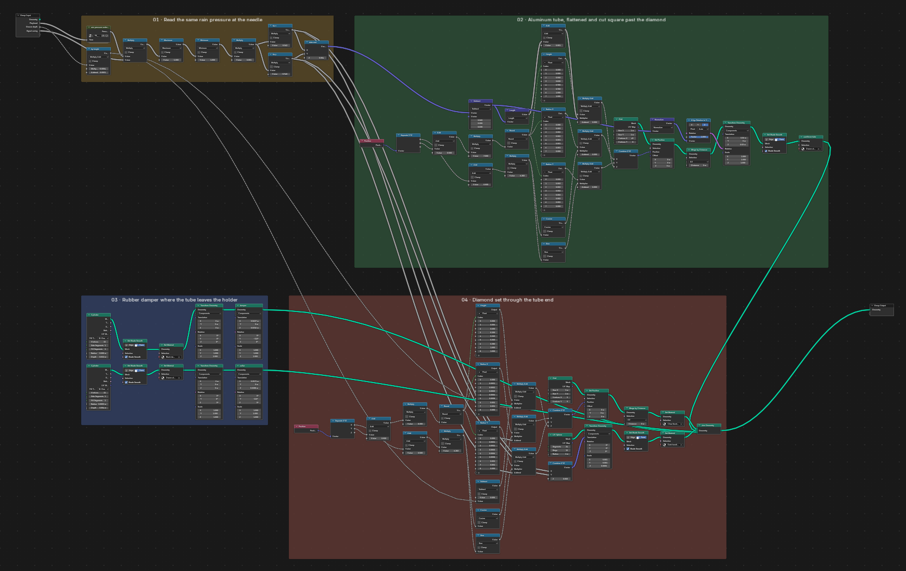

The object **PA_Cantilever and diamond** is a child of **PA_Tracking arm**, an empty turned 70° (`TRACKING_ANGLE`) so
that its +x runs back along the cartridge. The diamond's rest position is the empty's origin.

### 01 · Read the same rain pressure at the needle


`Playhead` is a slider driven by the playback clock (see "The playback clock" below). The group returns the pressure at that
moment, and the same clamp and `MODULATION` as section 2 give the travel. At the groove's centre line the record's
weight 1 − edge is 1, so the needle moves exactly as far as the centre of the cut under it. In tracking space the
radial direction is (cos 70°, −sin 70°), so `tip x` and `tip y` move it radially in world space.

`tip height` = −0.00042 · `Groove depth` + 0.00006 (`TIP_CLEARANCE`): the tip floats 0.00006 above the floor of the
base cut, at whatever depth the slider sets.

The needle reads only `PA_Rain pressure`. The material's micro-cut (`floor sink`, `L + R: sideways`) and the
band's subdivision move the walls and the floor under the tip by amounts of the same order as the rain swing, and
the needle ignores them. At 1/90 speed, with the tip seen from the front, the eye cannot tell.

### 02 · Aluminum tube, flattened and cut square past the diamond

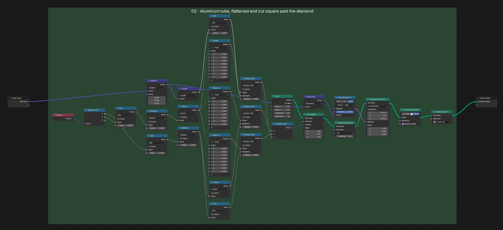

The cantilever is a loft. A Grid of 49 × 8 vertices is bent into rings: the row index picks a height and two radii
from three Index Switch tables (`Height`, `Radius X`, `Radius Y`), and the column index is the angle around the ring.

| Ring | Fraction of length | Half thickness | Half width |
|---|---|---|---|
| root cap | 0 | 0 | 0 |
| root | 0 | 0.0026 | 0.0026 |
|  | 0.55 | 0.0023 | 0.0023 |
|  | 0.82 | 0.0019 | 0.0019 |
| flattening | 0.90 | 0.0014 | 0.0021 |
|  | 0.95 | 0.00105 | 0.0023 |
| end | 1.00 | 0.00105 | 0.0023 |
| end cap | 1.00 | 0 | 0 |

The zero-radius rings close both ends. Merge by Distance welds the seam of the ring and the cap points. The tube
runs from the pivot (0.060, 0, 0.030) to the tube end, 0.0011 past it, so the flat end is cut square just beyond the
diamond. At 100 mm per unit the tube is about 6.5 mm long, and its last 10 % is flattened, as on real stylus
macro photos.

Align Rotation to Vector (axis Z) points the loft along pivot → tube end. The tube end moves with the rain, so the
tube re-aims every frame and pivots at the damper, like a real cantilever.

### 03 · Rubber damper where the tube leaves the holder

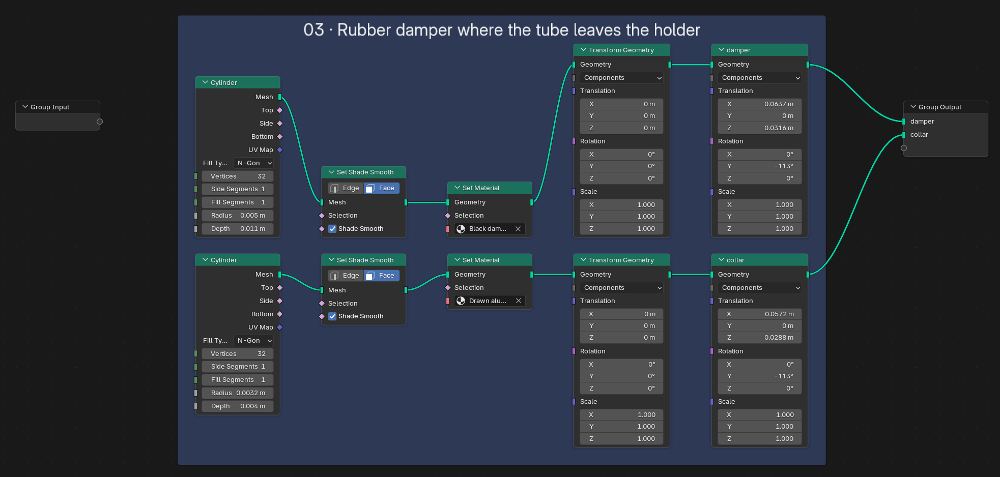

`damper` (radius 0.005, length 0.011, `Black damper rubber`) sits 0.004 behind the pivot along the rest axis, and
`collar` (radius 0.0032, length 0.004) 0.003 in front of it. Both are tilted by atan2(−0.060, −0.026) = −113.4° about Y.
They use the rest axis, not the moving one. The tube end travels at most 0.00045, which turns the tube by less than
0.4°.

### 04 · Diamond set through the tube end


The same loft helper, with 8 sides instead of 48, so the diamond has eight flat facets. It runs from `tip height` up
to `NOSE_Z` + 0.0009 = 0.0049, just under the top of the flattened tube end:

| Fraction of height | Radius |
|---|---|
| 0, 0.006, 0.03, 0.10, 0.26 | 0, 0.00006, 0.00016, 0.00032, 0.00062: a cone with a rounded point |
| 0.36, 0.38 | 0.00078, 0.0008: the shoulder |
| 1.0 | 0.0008: an eight-sided prism up through the tube |

Its material, `Clear faceted diamond`, is a Principled BSDF with Transmission 1, roughness 0.015 and IOR 2.417, the
index of diamond. A UV sphere scaled to (0.0013, 0.0013, 0.00055) sits 0.001 below the tube end in `Dark bonding
adhesive`: the bead of glue that holds the stone.

---

## The playback clock

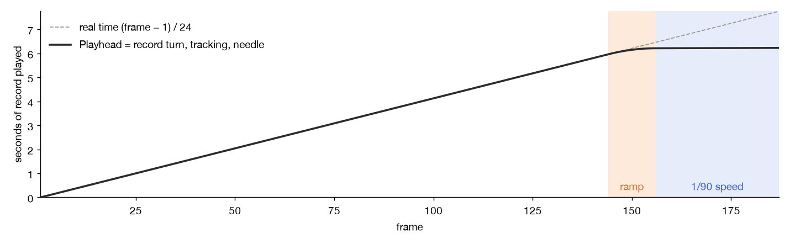

Three things must agree on how much of the record has been played: the record's rotation, the arm's slide inward and
the needle's `Playhead`. All three are drivers with one expression, `elapsed`, in seconds:

```
elapsed = ( min(frame, 144) − 1
          + r − 0.0412037 · r²            r = min(max(frame, 144), 156) − 144
          + (1/90) · max(frame − 156, 0) ) / 24
```

- Until frame 144 it is (frame − 1) / 24: real time.
- From 144 to 156 the speed falls linearly from 1 to 1/90. 0.0412037 is (1 − 1/90) / (2 · 12), the integral of that
  ramp, so there is no jump in speed.
- After frame 156 it runs at 1/90.

| Driver | Expression |
|---|---|
| **PA_Vinyl_lathe** rotation Z | −2π · `RPS` · elapsed |
| **PA_Tracking arm** location X | 1.314 − 0.003 · `RPS` · elapsed: one pitch inward per turn, starting at turn 72 |
| **PA_Cantilever and diamond** `Playhead` | elapsed |

Why the slow motion? At real speed the groove passes the tip at 4.59 units per second, 0.19 units per frame. That is
about ten cycles of the micro-cut per frame, so it either strobes or smears to grey. At 1/90 it moves 0.0021 units, 0.7
pitch, per frame. One base cycle (0.018 units) takes about nine frames, and the eye can follow it. The 180° shutter
(motion blur 0.5) softens the rest.

### Trick · simple expressions only

The expression uses only min, max and arithmetic. Blender evaluates such a driver as a *simple expression*, without
Python, so it works on a render farm where scripts may not run automatically. The build script checks every scripted driver
with `driver.is_simple_expression` before saving.

> **Try it:** in your own build, set `SLOW_MOTION` to 1. The clip runs in real time to the end, and in the
> close-up the grooves blur into flat streaks.

---

## Appendix A · The pickup and the headshell

The cartridge follows photographs of 1970s moving-magnet pickups. Most of it is boxes. The helper `part()` makes a
Geometry Nodes object from one Mesh Cube, sets its material, and adds a Bevel (`Machined corners`, harden normals) and a
Weighted Normal modifier.

| Object | Size | Notes |
|---|---|---|
| **PA_Brushed aluminum body** | 0.285 × 0.172 × 0.150 | material `Brushed aluminum cartridge body`: its noise is stretched 50× along X for brushed lines |
| **PA_Black side label** | 0.170 × 0.003 × 0.072 | plus two String to Curves → Fill Curve objects: `RAIN  023` and `STEREO  ·  MOVING MAGNET` |
| **PA_Deck** | 4.50 × 4.50 × 0.11 | the plinth |

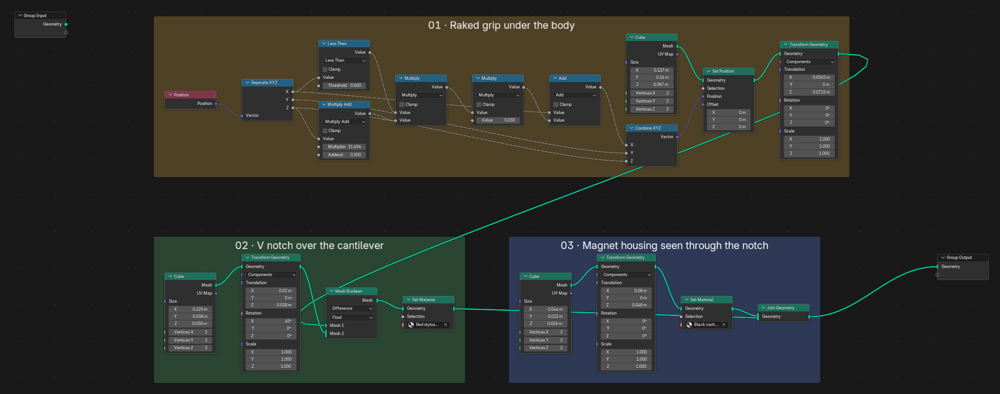

**PA_Replaceable stylus holder** (21 nodes): a 0.137 × 0.160 × 0.087 grip whose front face leans back by 0.030
(`raked()` moves the front vertices back in proportion to their height). A cube turned 45° about X is subtracted by
Mesh Boolean to cut the V notch over the cantilever. A dark `Magnet housing seen through the notch` sits behind it.

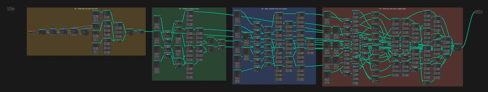

**PA_Universal headshell** (134 nodes, four sections):
1. A 0.330 × 0.200 plate, narrowed 22 % at the front, with two 0.150-long slots cut by Mesh Boolean.
2. Two washers and two slotted screw heads.
3. Five cylinders along X for the neck, the bayonet collar and the tonearm, plus the arm's pillar.
4. Four gold pins with clips, and four Bézier leads (red, green, white, blue: right +, right −, left +, left −) swept
   with a 0.0034 circle by Curve to Mesh.

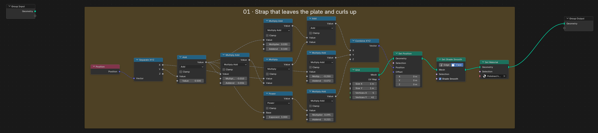

**PA_Finger lift**: a 5 × 41 Grid set to a strap that narrows from 0.036 to 0.026 and rises with u³ to curl up at the
end. A Solidify modifier (`Stamped sheet thickness`, 0.0075) and a Bevel (`Rolled edges`) make it sheet metal.

**PA_Turntable platter**: Mesh Cylinders for the aluminum platter, a dark rim, five fine chrome trim rings and the
spindle.

## Appendix B · Light and camera

- **World** `PA_Dim room`: a warm grey background at strength 0.19.
- **Five area lights**:
  - `Warm strip` (18 W), which slides between three keys.
  - `Rain-blue strip` (8.5 W, pale blue), behind the needle.
  - `Soft front fill` (8.1 W).
  - `Edge light` (3.5 W).
  - `Warm room fill` (35 W).
  `point_at()` aims each one at a point near the needle.
- **Shadow linking**: the tall cartridge body would shadow the groove under the needle from `Rain-blue strip`. Its
  blocker collection, `PA_Groove light blockers`, holds only the record, the platter, the deck and the cantilever. For
  that one light the pickup casts no shadow, and the blue edge stays on the walls around the tip. Every other light
  keeps all shadows.
- **Camera** `PA_Macro`:
  - Lens: 61 mm on a 28.8 mm horizontal sensor.
  - Clip start: 0.004.
  - Depth of field: eight blades.
  - At each key, the focus distance is set to the needle's contact point along the view direction, and the f-stop
    rises from 6 to 25 as the camera closes in.
- **Colour**: AgX, Medium High Contrast look.

## Appendix C · The sound

The sound script writes 187 / 24 = 7.79 s of 48 kHz stereo with numpy. It uses the stdlib `wave` module, so the
file has exactly 374 000 samples per channel with no padding. It is built from many small events:

1. **Hiss**: pinkish noise from 260 Hz to 9 kHz, partly shared between the ears, scaled by density^1.3. In heavy rain
   a low rumble from 70 to 420 Hz joins in.
2. **Patter**: a Poisson stream of 1.2–4.5 ms noise ticks. The rate rises from 260 to about 2560 per second with the
   swell. 11 % of the drops trap a bubble, a decaying sine whose pitch rises (the Minnaert / van den Doel model).
3. **The three streams as close drips**: the same drifting clocks as `PA_Rain pressure`. At every drop onset there is
   a bubble at the stream's resonance (740, 1060, 1510 Hz), a tick and a soft thud, and half the time a splash bubble.
   Each stream has a fixed pan: left, right or centre.
4. **Pressed to vinyl**: band-limited to 35 Hz–13.5 kHz, with about 5.5 faint crackles per second. A fade-in and a
   fade-out, and a peak at 0.89.

The sound runs in real time for the whole clip. Until frame 144 its drips land on the needle's swings. During the hold
the needle reads only 0.27 s of groove while the sound plays on for 1.8 s, so the soundtrack finishes the storm as the
picture slows down.

---

## How it was rendered

- **Engine**: Cycles, 1080 × 1080 base resolution.
  - The video is at 80 % (864 × 864), 40 samples with adaptive sampling (threshold 0.075) and denoising, and motion
    blur with a 180° shutter.
  - The two stills are at 100 %, 64 samples. `stylus-detail.png` has motion blur off.
  - Light paths: 5 bounces in total, 2 diffuse, 3 glossy.
- **Where**: all 187 frames came from a second PC with an RTX 4060 (OptiX) in Blender 5.3. About 7 s per frame,
  25 minutes for the clip. Adaptive dicing of the band keeps the peak at 3.4 GB.
- **Sound**: the soundtrack is muxed in as AAC, about 280 kbps.
- **The comparison figure**: rendered the same way from the still's scene with the Vector Displacement Scale at 0.

## Try it yourself

In your own build of the scene:

1. **No rain in the cut.** Set `Signal swing` to 0 on **PA_Vinyl_lathe**. The spiral is regular and the cantilever
   is still. The stereo micro-cut stays.
2. **A deeper record.** Set `Groove depth` to 1.5 (0.00063). The diamond goes down with it. The two quiet bands at
   turns 46 and 130 stay at 12 % of the depth, so they stand out more.
3. **Move the storm.** Set `SWELL_CENTER` to 1.5. The cut, the needle and the sound all
   peak earlier, together.
4. **A different rhythm.** Change the first `LANES` row's 2.07 drops per second to 1.0. Stream 1 drips half as often,
   in the groove and in the soundtrack.
5. **Flat grooves.** Set the Vector Displacement Scale to 0 in `Black PVC` (shader section 7). Compare the close-up
   with the figure above.

*Made with Blender 5.3 Geometry Nodes for [Nodevember](https://nodevember.com) 2026, Day 23 · Analogue.*
