# How a cross cut through a concrete wall burns a red ring into the film at dawn

*A node-by-node walkthrough of Nodevember 2026 · Day 24 · Halation (v4 · Cross of Light)*

> **Reference.** The chapel is modelled after Tadao Ando's **Church of the Light** (Ibaraki, Osaka, 1989): a bare
> concrete box whose end wall is cut through by a cross, with a floor that steps down toward it and benches of
> scaffold planks. The model follows photographs of the building; its dimensions here are approximate, not a survey.

The clip (10 s, 240 frames, 24 fps) is one slow shot from the benches of a bare concrete chapel. The end wall is cut
through by a cross-shaped slit, floor to ceiling and wall to wall. It opens in the blue hour: the cross is a pale line
and the room is black. In the first two seconds the sun comes up behind the wall. The cross burns white and gets a thin
red fringe. A sheet of sunlight comes down through the dusty air, passes the camera's eye height, and lies on the floor
and the benches as a skewed cross of light. For the rest of the clip the sun climbs from 11° to 32° and the camera
drifts 40 cm down the aisle.

The red fringe is the subject. It is **halation**: on colour negative film without its anti-halation backing, light
that goes through the emulsion reflects off the back of the film base and exposes the red layer a second time, a
fixed distance away from the bright edge. Here it is not a tinted glow filter. A compositor group draws the film's
own ring from the base thickness and refractive index, and convolves the frame with it.

One Geometry Nodes tree builds the chapel. There are no image textures, no imported or modelled meshes and no
simulation (an audit of the scene finds nothing else). Some things are not nodes, and this walkthrough covers them too:
- Keyframes, written by the build script, move the sun lamp, three sky values and the camera.
- A driver gives the air volume its clock (`frame / 24`).
- Two portal lamps sit in the slit, placed by Python.
- The compositor tree `PA_Film` holds the halation group.

| File | What it is |
|---|---|
| `cross-of-light.mp4` | the clip: 1080 × 1080, 24 fps, 240 frames (10 s), Cycles 256 samples, film grain added after |
| `render.png`, `render-036.png` | frame 130 and frame 36 at 1080 × 1080 |
| `nodes/` | the node trees full size: `main.png` (`PA_Chapel_GN`), `box.png` (`PA_Box`), `halation.png` (`PA_Halation`), `halation-pass.png` (`PA_Halation pass`), `concrete.png` (`PA_Concrete`), `cedar.png` (`PA_Cedar`), `air.png` (`PA_Air`), `sky.png` (the world `PA_Sky`) |
| `post.md` | idea, build notes, caption and alt text |

The `.blend` and the Python scripts that build the scene and the film group are not published. In the scene, the
object **PA_Chapel** carries the tree `PA_Chapel_GN` and its two sliders, **PA_Air** is the volume box, and the
compositor tree `PA_Film` holds the halation group. Every node, label and number you need is in the screenshots and the
text. It was built in Blender 5.3.

---

## The one idea

> **Halation is a ring, not a glow, and its size comes from the film, not the scene.** Light that enters the film
> base at a steep angle reflects totally at the base's back face (film base to air, with no backing to absorb it) and lands
> back on the emulsion at r = 2·t·tan θ. Below the critical angle θc almost nothing comes back. So the halo starts
> sharply at r_c = 2·t·tan θc, about 10 pixels here, and fades outward. A 125 µm base gives the same ring around a
> cross, a lamp or the sun. The scene only decides **where** it appears: on edges bright enough to overexpose the film.

Everything else is bookkeeping around that idea:

- **What makes the edges bright enough?** The sky seen through the slit is 20.3 times a white of 1 in scene-linear
  light, and nothing clamps it before the halation group. The halo is 6 % of that light, so it still shows next to a
  blown edge, and disappears next to a mid-grey one (Dawn, "Bright to the eye, gentle to the room").
- **Why a cross?** A slit is a long, thin overexposed edge, the best possible test for a ring with a sharp inner edge.
  The four blocks around the slit keep its width and height as live sliders (2).
- **Why dawn?** The halo needs overexposure, so the clip starts below it: in the blue hour the cross is not blown, and
  the ring grows as the sky brightens behind the wall.
- **What lights the room?** Mostly the sun lamp, through the slit only, scattered by a thin dusty-air volume. That is
  where the light sheets come from.

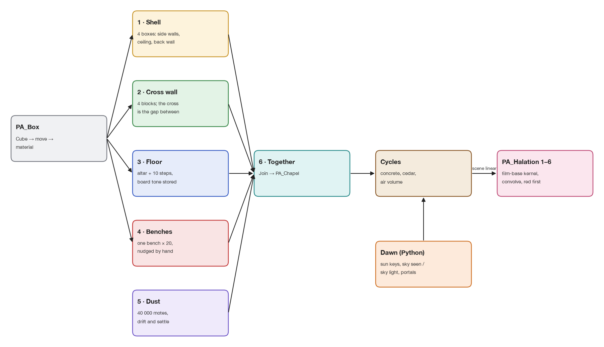

### How to read the screenshots

- Each coloured frame is one section of a tree. The chapel tree's sections are numbered like the headings below
  (`1 · Shell: side walls, ceiling, back wall`). The concrete material and the world use letters
  (`c · Tie holes`). The halation group numbers its own frames.
- A **cut-out** shows one section on its own. Wires from another section come in through a Group Input socket named
  after what they carry (`wall uv (m)`, `r on film (µm)`). Wires that leave go out through a Group Output socket.
  Sliders keep their own names (`Slit width`, `Bar height`).
- Node labels are written `like this` and match the file. Node types are plain text (Mesh Line, Instance on Points).
- One Blender unit is one metre. The nave runs along +x from the cross wall (inner face at x = 0) to the back wall
  (x = 17.4). y runs across, z up. Sunlight travels toward +x.
- The node editor rounds what it shows. The text gives the values from the build scripts.
- Click any screenshot to open it full size.

---

## 0 · The map

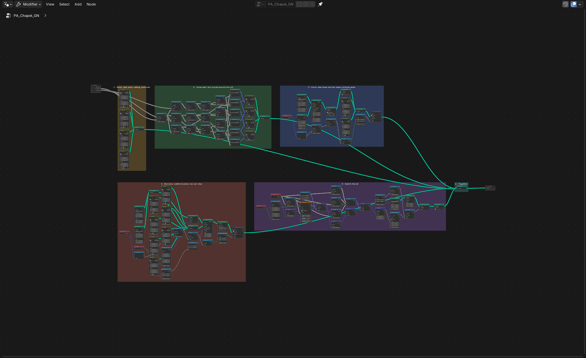

| # | Section | Nodes | Job |
|---|---|---|---|
| 1 | Shell: side walls, ceiling, back wall | 5 | four concrete boxes around a 17.4 × 5.9 × 5.9 m room |
| 2 | Cross wall: four blocks around the slit | 25 | the end wall as four blocks; the cross is the gap between them |
| 3 | Floor: altar level and ten steps of black cedar | 15 | a flat altar floor, ten steps of 6 cm, a rear landing, a tone per board |
| 4 | Benches: scaffold planks, two per step | 25 | one bench from six planks, placed 20 times, slightly off |
| 5 | Dust in the air | 24 | 40 000 motes that drift and settle |
| 6 | Together | 1 | join everything |

The tree has two sliders. Both change only section 2:

| Slider | Default | Range | What it does |
|---|---|---|---|
| `Slit width` | 0.20 m | 0.05 – 0.6 | width of both arms of the cross |
| `Bar height` | 3.55 m | 1.5 – 5.0 | height of the centre of the cross bar |

The cross is 5.9 m tall and 5.9 m wide, as tall as the room is high and as wide as it is wide.

All timing lives in the build script, not in the node trees. Appendix A explains it.

---

## 1 · Shell: side walls, ceiling, back wall

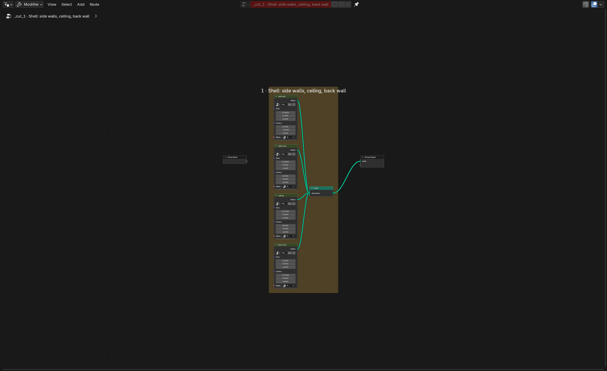

Four calls of the helper group `PA_Box` (a cube with a size, a centre and a material; see "Inside PA_Box"). The walls
are T = 0.20 m thick, and the interior is L × W × H = 17.4 × 5.9 × 5.9 m.

| Node | Spans (x, y, z) |
|---|---|
| `left wall` | −0.2 → 17.6, −3.15 → −2.95, −0.3 → 6.1 |
| `right wall` | the mirror image at y 2.95 → 3.15 |
| `ceiling` | −0.2 → 17.4, across the room, 5.9 → 6.1 |
| `back wall` | 17.4 → 17.6, across the room, −0.3 → 5.9 |

The side walls start at x = −0.2, so they also close the two ends of the cross wall (section 2). Every wall reaches
0.3 m below the floor, so no seam of light can leak in where a wall meets a step.

The build script writes boxes by their corners and computes each size and centre from them. This keeps its numbers
readable as room dimensions.

---

## 2 · Cross wall: four blocks around the slit

**Why four blocks instead of a boolean?** A wall with a cross cut out of it is just four rectangles that do not touch:
two below the bar and two above, one on each side of the upright. The gap between them *is* the cross. Building it this
way needs no Boolean node, keeps the edges perfectly sharp (they are cube edges), and lets the slit's width and height
be plain numbers that flow into the block sizes.

From the sliders:

| Node | Value at default | Formula |
|---|---|---|
| `half the slit` | 0.10 | `Slit width` × 0.5 |
| `underside of the bar` | 3.45 | `Bar height` − half |
| `top of the bar` | 3.65 | `Bar height` + half |
| `block width` | 2.85 | W/2 − half |
| `lower block height` | 3.75 | underside + 0.3 (down to 0.3 m below the floor) |
| `lower block centre z` | 1.575 | lower height / 2 − 0.3 |
| `upper block height` | 2.25 | H − top of the bar |
| `upper block centre z` | 4.775 | top + upper height / 2 |
| `block centre off the axis` | 1.525 | half + block width / 2 |
| `left block centre` / `right block centre` | ∓1.525 | the same, × −1 or × +1 |

The two lower blocks have the same size (`lower block size`, T × block width × lower height), and so do the two upper
ones. Only the centre's y differs between the sides.

Each block is T = 0.20 m thick and sits at x = −0.1, so its inner face is the plane x = 0. The upright gap runs from
0.3 m below the floor to the ceiling, and the bar gap runs from one side wall to the other: floor to ceiling, wall to
wall.

### Trick · the slit is cut through, not drawn

The cross is a real opening. Sunlight comes through it as light, not as an emissive shape on the wall. The cross of
light on the floor is the sun's shadow of the four blocks, and it moves because the sun moves. Nothing in the tree
knows where the light will land.

Because the cut goes through 0.20 m of concrete, the slit is a short tunnel. Sunlight at an angle has to get through
both ends, so the opening the sun sees is narrower than the slit: slit − T·tan(angle). For the bar the angle is the
sun's elevation: 0.2 − 0.2·tan 11° = 0.16 m at frame 74, but 0.2 − 0.2·tan 32° = 0.075 m at frame 240. That is why the
line of sun on the right wall gets thinner as the sun climbs. For the upright the angle is the 10–13° azimuth, which
leaves about 0.16 m.

> **Try it:** set `Slit width` to 0.6. The cross gets three times wider, much more light enters and the whole room
> brightens, but the red ring around the cross keeps the same width: the ring belongs to the film (The one idea). The two portal lamps (Appendix A) are
> placed by Python for the default 0.2 m slit, so the wider parts of the opening render noisier until you also widen
> `PA_PortalUpright` and `PA_PortalBar`.

---

## 3 · Floor: altar level and ten steps of black cedar

The floor steps up toward the back, one bench row per step, like a raked lecture hall.

- `altar floor`: flat, from the cross wall to x = 3.0.
- `steps: one point per tier`: a Mesh Line in Offset mode with 10 points. The first point is at (3.6, 0, −0.44) and each
  next one is 1.2 m further and 6 cm higher.
- `one step slab`: a 1.2 × 5.9 × 1.0 m cube. Instance on Points puts one on each point, so the top of step k sits at
  0.06·k m. The slabs are 1 m deep so their sides never show.
- `rear landing`: from x = 15.0 to the back wall, at 0.60 m, the height of the tenth step.

The black cedar shader (Appendix B) needs to know which board a point is on. The boards run along the nave, 15 cm
wide: `board index (15 cm)` is floor(y / 0.15). `tone per board` is a Random Value (seed 5) with that index as its
ID, so every point of one board gets the same random number. `floor (board tone stored)` saves it on the faces as
the attribute `board`, which the shader reads.

---

## 4 · Benches: scaffold planks, two per step

One bench is made of seven planks, 4 cm thick, each a `PA_Box`:

| Node | Size | Height |
|---|---|---|
| `seat` | 0.32 deep × 2.2 long | top at 0.44 m |
| `back board` | 0.04 × 2.2 × 0.22 | 0.62 → 0.84 m, at the back (+x) |
| `leg board` (2) | 0.28 × 0.04 | 0 → 0.40 m, 0.12 m in from each end |
| `back post` (2) | 0.04 × 0.04 | 0 → 0.84 m |
| `stretcher` | 0.33 × 1.96 × 0.04 | 0.08 → 0.12 m |

The bench length is (W − aisle) / 2 − 0.25 = (5.9 − 1.0) / 2 − 0.25 = 2.2 m. The bench faces −x, toward the cross.

`left rows` and `right rows` are two Mesh Lines with the same rhythm as the steps: 10 points each, starting at
x = 3.54, then every 1.2 m and 6 cm higher, at y = ∓1.7. So each bench stands on its own step, 0.54 m behind the
step's front edge.

**Why nudge them?** Twenty benches on a perfect grid read as CAD. Real benches are put down by hand. `nudge ±3–4 cm`
moves each point up to 3 cm along the nave and 4 cm across it (Random Value, seed 11, ID = Index). `yaw ±1°` turns
each bench by up to 0.018 rad (seed 12). The camera is close to the rear rows, so a few centimetres show.

`tone per plank height` gives the planks different board tones: floor(z × 37) is a band index about 2.7 cm tall, so the
seat, the back board and the stretcher, at different heights, get different random tones (seed 13).

---

## 5 · Dust in the air

The air volume (Appendix B) makes the light sheets. The motes add the glints you see inside them.

- `40 000 motes`: a Points node.
- `anywhere in the nave`: a random position per point (seed 31) in the box x 0.1 → 17.3, y −2.85 → 2.85,
  z 0.2 → 5.7.
- `slow drift`: a 4D Noise Texture read at 0.6 × that position, with W = seconds × 0.05. Its colour minus 0.5, times
  0.4, moves each mote up to 0.2 m, slowly and differently from its neighbours.
- `settle`: a constant drift of (0.01, −0.008, −0.006) m per second. In 10 s every mote moves 10 cm toward the back,
  8 cm across and 6 cm down: dust in still air, not a swarm.
- `mote radius`: 0.48–1.2 mm, a random 0.4–1.0 × 1.2 mm (seed 33).
- `fade near the lens`: motes closer than 1.5 m to the camera get radius 0, growing to full size at 2.5 m. A mote
  1 m in front of a 35 mm lens at f/5.6 focused 11 m away would be a large soft disc.

The dust material is pale and 60 % translucent, so a mote shows only where the sun reaches it and glows when it is
between the camera and the light.

### Why there is no ground outside

Through the lower part of the upright, the camera looks down through the slit at whatever is outside. A sunlit ground
there was physically correct, but it was about 20 times dimmer than the sky seen through the slit (see "Bright to the
eye"). The lower part of the cross was then not overexposed, so it got no ring: the foot of the cross had no halation.
Without a ground, the slit shows the bright dawn below the horizon line, and the whole upright is blown out down to the
floor.

---

## 6 · Together

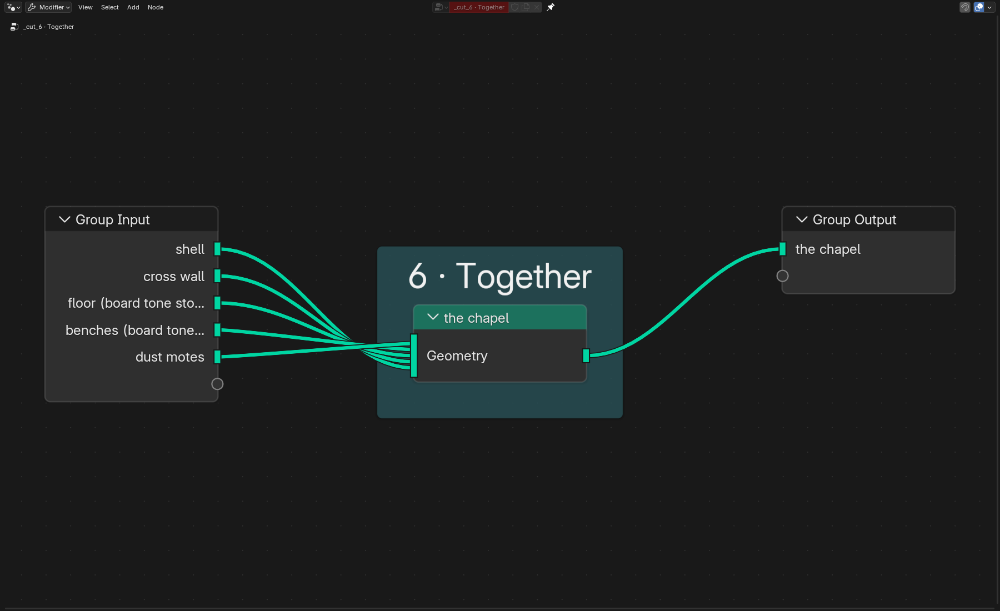

One Join Geometry. The result is 1 280 vertices, 960 faces and 40 000 points: the whole chapel is a handful of boxes.
All the detail is in the materials.

---

## Inside `PA_Box`

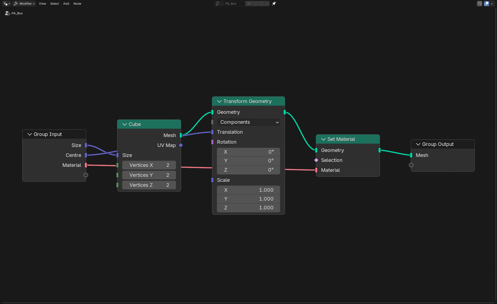

A Cube of `Size`, moved to `Centre`, with `Material`. It is used 17 times: 4 for the shell, 4 for the cross wall, 2
for the floor and 7 for the bench (instanced 20 times).

The group ends with Set Material on purpose. A Cube carries its own material slot, so the object's material would be
ignored. Setting it inside the tree is the only way the boxes get concrete and cedar.

---

## Appendix A · Dawn: the sun, the sky and the camera

All of this is written by the build script, with keyframes every 6 frames (and one on frame 240).

### The sun

Five keys give the sun's elevation and its azimuth away from the nave axis at five frames: (1, −2.6°, 13°),
(24, −0.8°, 12.5°), (74, 11°, 12°), (160, 23°, 11°), (240, 32°, 10°). Between keys the values are interpolated
linearly. So the sun is below the horizon for the first second, rises fast, then climbs slowly. The 1-second blue
hour and the fast rise give the clip its event; the slow climb gives the light time to move over the benches.

From the elevation e, the build script computes the lamp:

| Value | Formula | What it means |
|---|---|---|
| `up` | smoothstep(e, −0.8°, 3.5°) | the disc clears the haze on the horizon |
| air mass | exp(−0.9 / (sin e + 0.05) × 0.25) | a low sun goes through more air and is dimmer |
| strength | 14 × up × (0.35 + 0.65 × air) | 0 until frame 24, about 6 at frame 43, 11 at the end |
| colour | (1, 0.42 + 0.42w, 0.16 + 0.48w), w = smoothstep(e, 0°, 18°) | deep orange at sunrise, warm white by 18° |

The lamp `PA_Sun` is a Sun with a 0.53° disc. Its 10–13° azimuth sends the light slightly toward +y, the camera's
right: the cross on the floor is skewed, and the bar's sheet reaches the right wall as a line of sun.

At frame 59–66 the sun is near 8.7°. That is the angle at which the light through the bar (3.55 m high) comes down
to the camera's eye (1.87 m) about 11 m away: tan 8.7° ≈ (3.55 − 1.87) / 11. For a third of a second the camera is
inside the light sheet, and the whole frame fills with lit haze.

### The sky: bright to the eye, gentle to the room

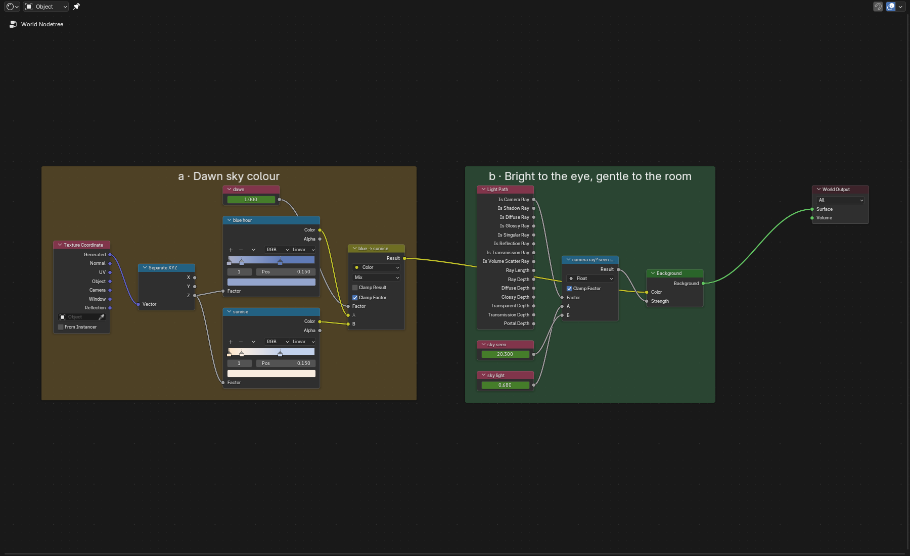

**a · Dawn sky colour.** Two Color Ramps over the height of the sky (Generated Z): `blue hour` and `sunrise`. The value
`dawn` mixes them. It is smoothstep(e, −2°, 8°), so the sky turns from frame 9 to frame 62.

**b · Bright to the eye, gentle to the room.** This is the one place where the lighting is not physical. The
Background strength depends on who is asking:

- **Camera rays** see `sky seen`: 0.8 in the blue hour, 20.3 once the sun is 6° up.
- **All other rays** (light bouncing in the room) get `sky light`: 0.08 → 0.68.

`camera ray? seen : light` is a Mix node driven by Is Camera Ray. The sky in the slit is 30 times brighter than the sky
that lights the room.

**Why?** The film needs the cross blown out for the halation ring. A physical sky that bright would also flood the
room with soft fill light, and the chapel would lose its darkness and its sun sheets. Splitting the two lets the
camera see an overexposed slit while the room is lit mostly by the sun. One side effect: reflections of the slit in
the varnished floor are non-camera rays, so they see the dim value. The floor reflects a soft cross, not a blown one.

### The portals

Sky light can enter the room only through a slit 20 cm wide. Cycles would find it by chance, so the room would be
noisy. Two Area lamps with Portal on, `PA_PortalUpright` (6.2 × 0.24 m) and `PA_PortalBar` (0.24 × 5.9 m), sit just
outside the slit, at x = −0.25. They emit nothing. They tell Cycles where the sky can come in, so it samples the sky
through the slit directly.

### The camera

`PA_Pew`: 35 mm lens on a 36 mm sensor, f/5.6, focused on the cross 11.24 m away. It starts in the aisle at x = 11.2,
on the seventh step, with the eye 1.45 m above the step (z = 1.87), aimed at (0, 0, 2.85). It drifts 0.40 m forward
over the 240 frames with a sine ease in and out.

---

## Appendix B · Materials and air

### Concrete: formwork panels and tie holes

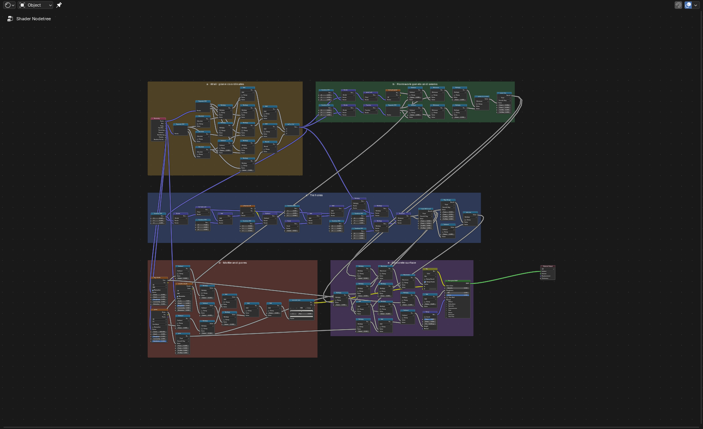

Fair-faced concrete is a record of its formwork: plywood panels with a seam between them, and round tie holes where
the steel ties held the two sides of the form together. The shader rebuilds that grid in metres on every wall.

**a · Wall-plane coordinates.** Every wall needs its own flat (u, v) in metres. The Geometry normal says which way a
face points: u = x·|ny| + y·|nx| + x·|nz| and v = z·(1 − |nz|) + y·|nz|. A side wall gets (x, z), the cross wall gets
(y, z) and the ceiling (x, y). `wall uv (m)` carries them, with round(3·nx) as a third coordinate so the two faces of
the cross wall get different panels.

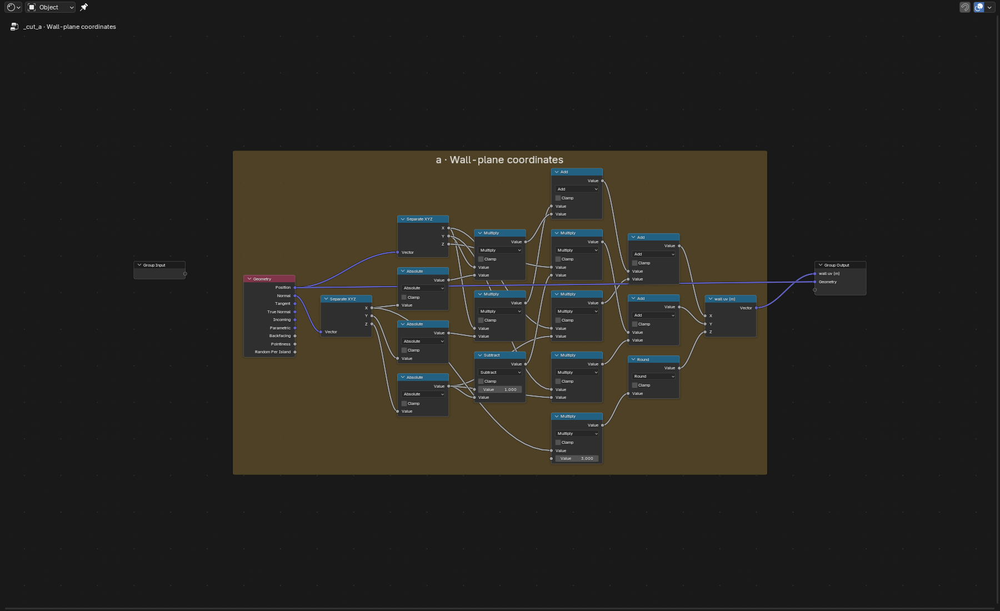

**b · Formwork panels and seams.** Panels are 1.82 × 0.91 m. `panel cell` is floor(uv / panel), and `tone per panel` is
White Noise of that cell: every panel gets its own slight tone, as real pours do. The fraction inside the panel gives
`metres to a seam`, and `seam line` is a smoothstep from 3.5 mm to 1 mm: a seam with a 2 mm core that fades out over a few millimetres.

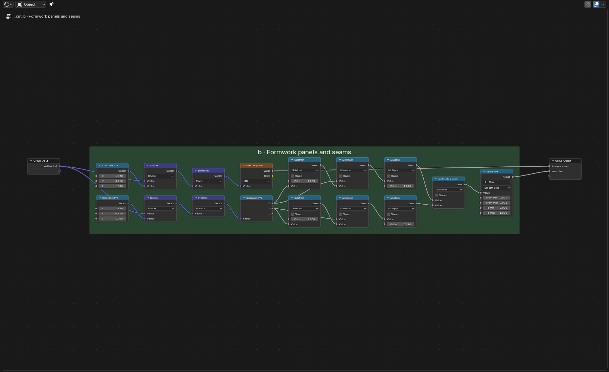

**c · Tie holes.** Six per panel, on a 607 × 455 mm grid (`tie-hole cell`). `a few mm off` is White Noise per cell that
moves each hole by up to about 3 mm, because ties are never placed perfectly. `hole (Ø 31 mm)` is a smoothstep at 14.5–16.5 mm
from the hole's centre, and `hole rim` a slightly raised ring out to 21.5 mm.

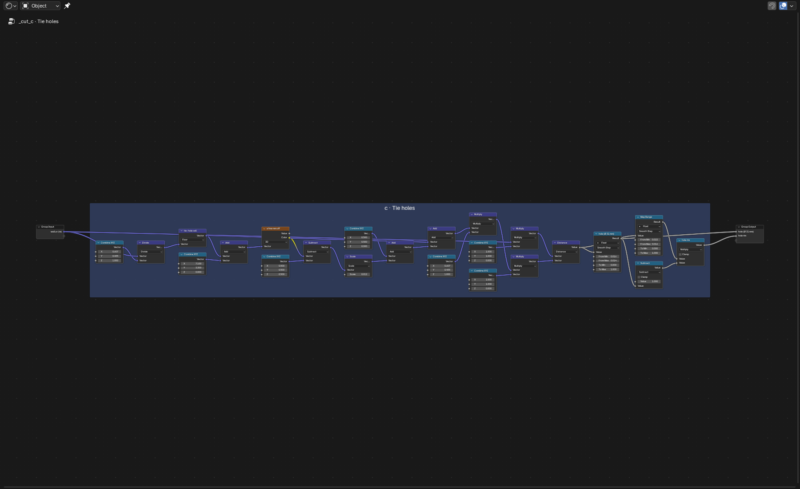

**d · Mottle and pores.** `big clouds` (Noise, scale 0.9) and `smaller clouds` (scale 7) vary the tone by about ±11 %
and ±5 %, and the panel tone adds ±5 %. `pores` is a Voronoi at scale 260, so a pore every 4 mm or so. `concrete tone`
maps the sum onto greys from 0.30 to 0.53.

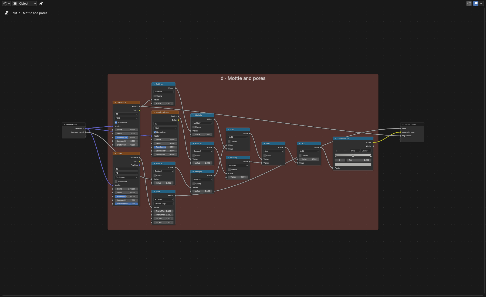

**e · Concrete surface.** Holes (×0.85), seams (×0.25) and pores (×0.35) darken the colour toward 0.05. The same masks
make the bump height: the rim up, the hole, seam and pores down, over 4 mm. Roughness is 0.42–0.60, following the big
clouds.

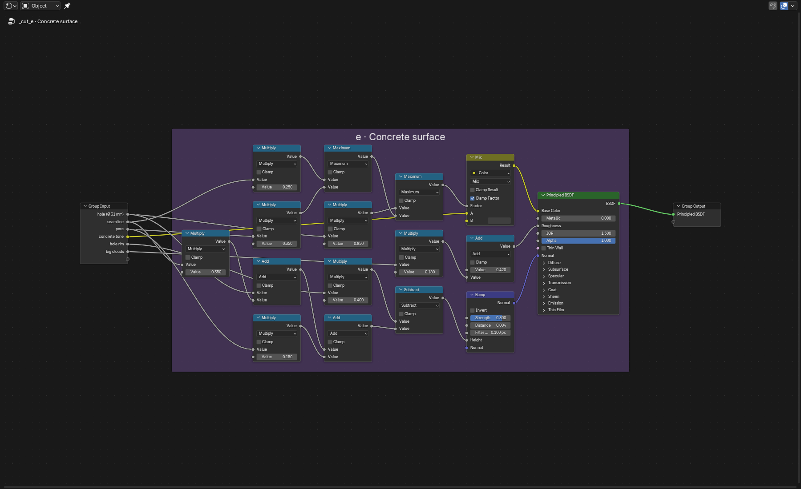

### Black cedar

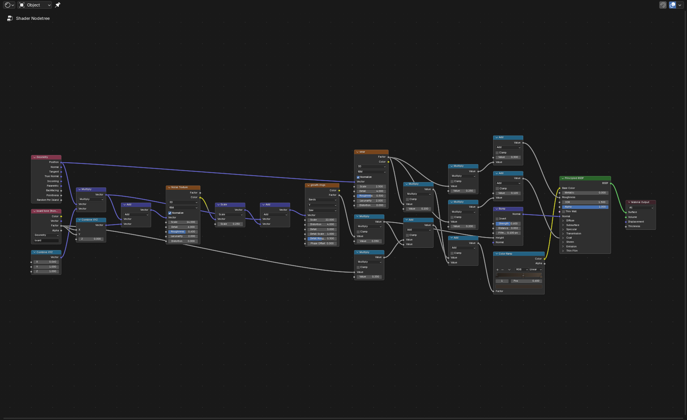

The position is stretched along x (× 0.06), so `growth rings` (a Wave texture in bands) runs along the boards.
`board tone (from GN)` reads the attribute stored in sections 3 and 4: it shifts the grain noise per board and adds up
to 0.35 to the tone. The colours are very dark (0.018 to 0.075). `wear` adds roughness (0.30–0.55) and a 0.35 coat,
so the floor has a worn sheen that catches the sun stripe.

### The air

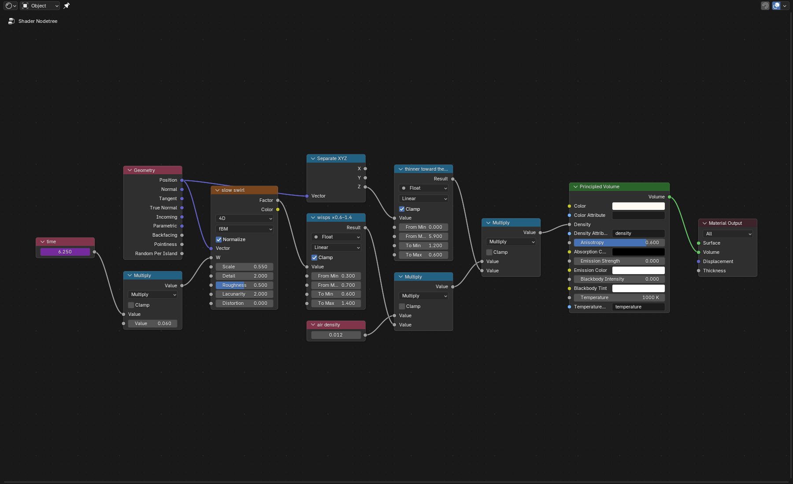

The object **PA_Air** is a box 1 cm inside the walls, floor and ceiling, with a Principled Volume:

- `air density` 0.012, times `wisps ×0.6–1.4` (a 4D Noise, `slow swirl`, whose W is `time` × 0.06), times
  `thinner toward the ceiling` (1.2 at the floor, 0.6 at the ceiling).
- Anisotropy 0.6: the air scatters light mostly forward. A light sheet is brightest when you look toward the sun, which
  is exactly where the camera looks.
- The value `time` has a driver, `frame / 24.0`.

The scene renders with volume bounces 0, so the air scatters the sun once and does not fill the room with fog light.
That keeps the sheets crisp-edged.

---

## Appendix C · `PA_Halation`: the film

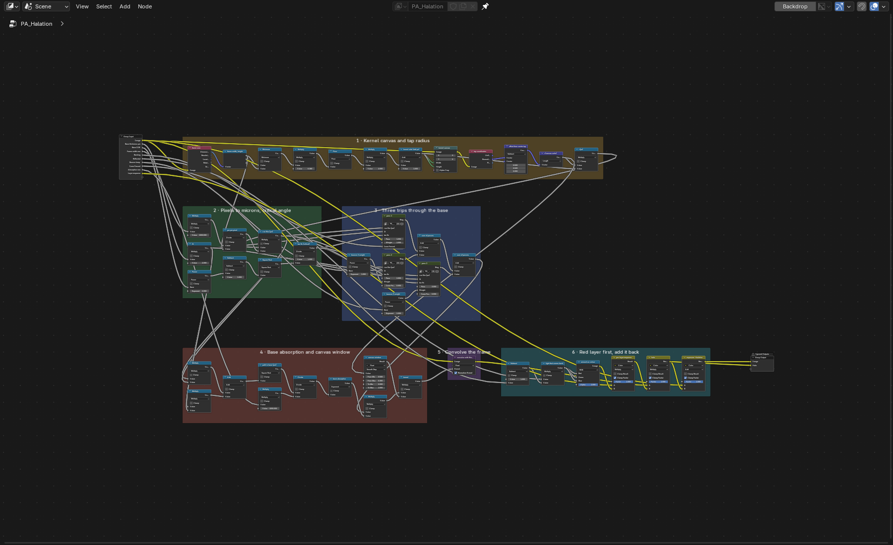

The compositor tree `PA_Film` is Render Layers → `film halation` (this group) → output. The group works in scene-linear
light, before the view transform, and nothing in it clamps.

Its inputs, with the defaults (only `Reflected` is changed, to 0.06):

| Input | Default | What it is |
|---|---|---|
| `Base thickness µm` | 125 | acetate film base |
| `Base IOR` | 1.50 | gives the critical angle, sin θc = 1/n |
| `Frame width mm` | 24 | the film gate imaged on the render width |
| `Backing` | 0 | anti-halation backing: 1 absorbs everything |
| `Reflected` | 0.06 | share of the exposure that comes back from the base |
| `Bounce keep` | 0.35 | energy kept per extra trip through the base |
| `Inner Fresnel` | 0.05 | weak reflection below the critical angle |
| `Absorption mm` | 1.2 | light fades as exp(−path / length) in the base |
| `Layer response` | (1, 0.16, 0.02) | how much each layer records: red sits next to the base |

### 1 · Kernel canvas and tap radius

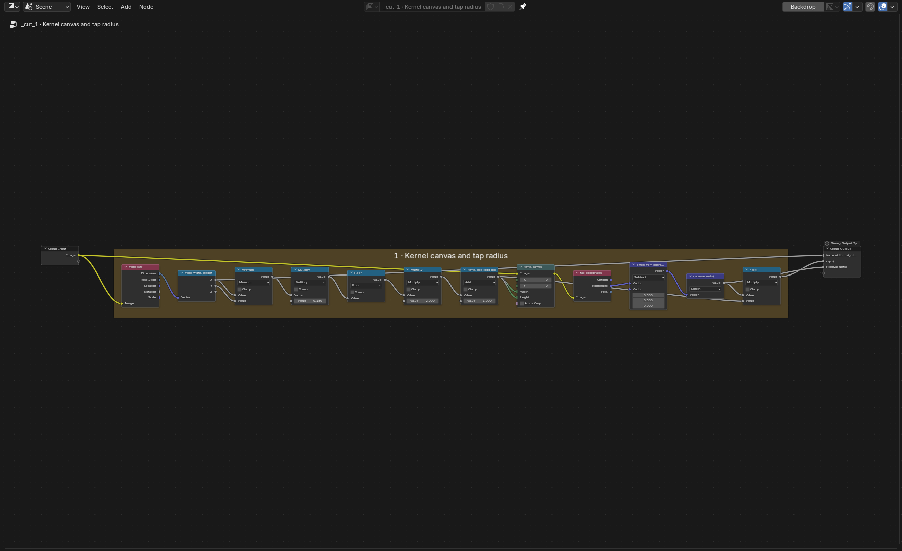

The Convolve node takes its kernel as an image. So the group needs a square image whose pixels are the kernel's taps.
`frame size` reads the render size; the shorter side × 0.18 (the kernel spans 36 % of the short side), floored,
gives 194, and `kernel side (odd px)` = 2 × 194 + 1 = 389 at 1080. An odd side puts one tap exactly in the centre.

`kernel canvas` is a Crop of the input image to 389 × 389. Only its size is used. Image Coordinates on it
(`tap coordinates`) gives each tap's position from 0 to 1, `offset from centre tap` subtracts 0.5, and the length is
`r (canvas units)`; × the side gives `r (px)`.

**Why Crop and not Scale?** Both make an image of the right size. A Scale-resampled canvas made Convolve print a thin
L-shaped line from every hot pixel; next to a long blown edge those lines stacked into a visible grid. The Crop canvas
has none.

### 2 · Pixels to microns, critical angle

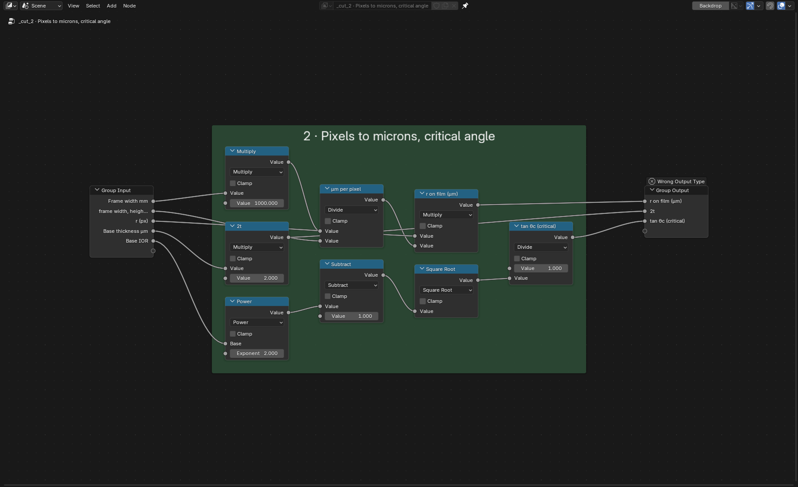

A 24 mm gate over 1080 pixels is `µm per pixel` = 22.22. `r on film (µm)` is the tap's distance on the film. `2t` is
250 µm. `tan θc (critical)` = 1 / √(n² − 1) = 0.894, so θc = 41.8° and the ring starts at r_c = 2t·tan θc = 224 µm,
10.1 px.

### 3 · Three trips through the base

Light reflected at the back face comes back to the emulsion; some of it reflects again at the emulsion and goes
round once more. Pass k lands k times as far away. Each pass is one call of the group `PA_Halation pass`, with its
`Pass` number k, a `Weight` and an `Inner Fresnel` share:

| Node | Pass | Weight | Inner Fresnel |
|---|---|---|---|
| `pass 1` | 1 | 1 | `Inner Fresnel` (0.05) |
| `pass 2` | 2 | `bounce 2 weight` = `Bounce keep` = 0.35 | 0 |
| `pass 3` | 3 | `bounce 3 weight` = `Bounce keep`² = 0.12 | 0 |

`sum of passes` adds the three rings.

#### Inside `PA_Halation pass`

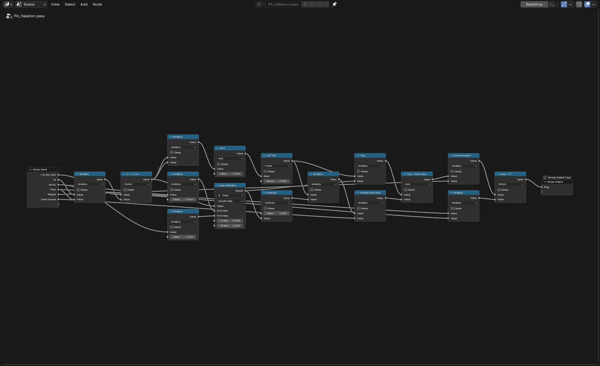

- `u = r / 2·k·t` is tan θ of the ray that lands at this tap on pass k.
- `cos⁴ tail` = (1 + u²)⁻². This is cos⁴ θ: light scattered at a slant is spread over more film and travels at a
  slant to it.
- `total reflection` is a smoothstep of u from 0.94·tan θc to 1.06·tan θc. Below θc the light leaves the film; above
  it, all of it comes back. The ±6 % softening stands in for the scatter inside the emulsion.
- `ring` = tail × total reflection. `Fresnel inner disc` = tail × (1 − total reflection) × `Inner Fresnel`: below θc a
  little light still reflects. Only pass 1 sets it.
- `bounce weight` multiplies by `Weight`, and `area: ÷ k²` divides by k²: a ring k times wider spreads its light over
  k² times the area.

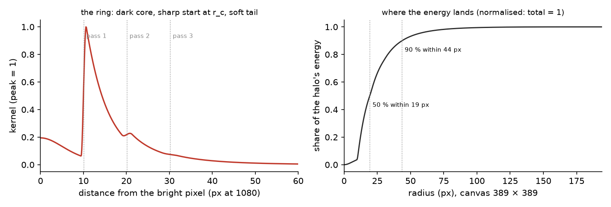

### 4 · Base absorption and canvas window

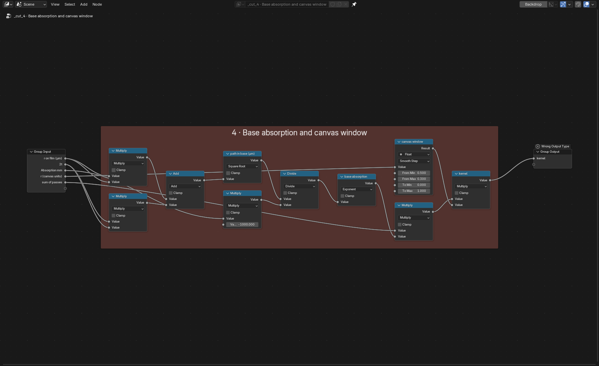

`path in base (µm)` ≈ √(r² + (2t)²) is the length of the slanted path; `base absorption` = exp(−path / 1200 µm).
`canvas window` is a smoothstep from r = 0.3 to 0.5 canvas units, so the kernel reaches zero before the canvas edge
and never shows a square outline. Their product is `kernel`.

### 5 · Convolve the frame

`convolve with film kernel` convolves the whole frame with the kernel image. Normalize Kernel is on: the taps sum to 1,
so the result carries exactly as much light as the frame. Every bright pixel is replaced by its own ring.

### 6 · Red layer first, add it back

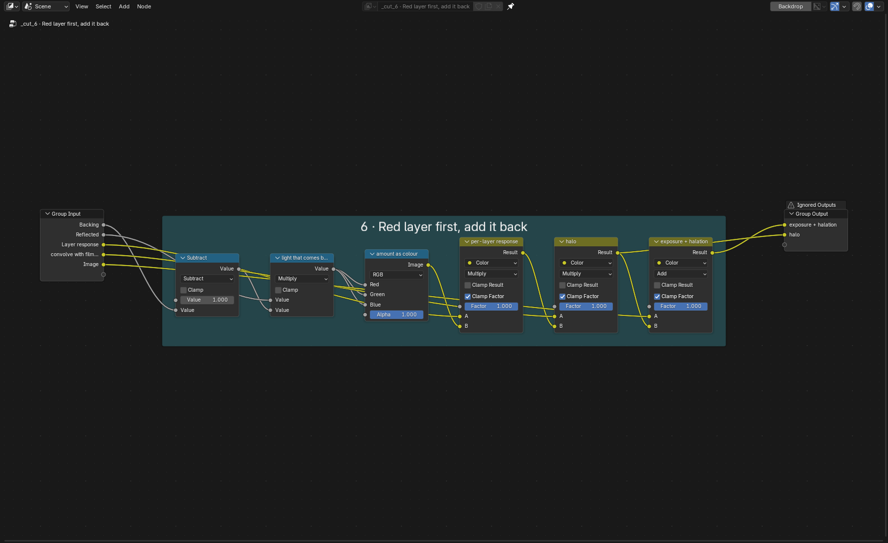

`light that comes back` = `Reflected` × (1 − `Backing`) = 0.06. `per-layer response` multiplies it by (1, 0.16, 0.02):
the returning light reaches the red-sensitive layer first, because it is the one next to the base. `halo` is the
convolved frame × that colour, and `exposure + halation` adds it to the frame. A test frame with one hot pixel shows the
ring's peak 11 px out and 6.0 % of the pixel's energy in the halo.

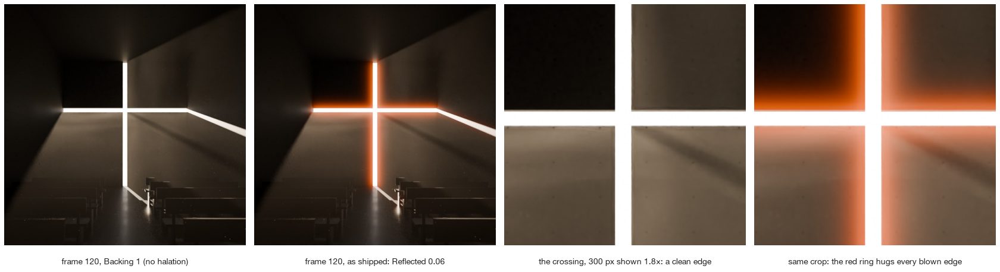

The ring shows only where the frame is very bright. The slit is about 20 in scene-linear light, so 6 % of it is still
more than the dark concrete next to it. The sun stripe on the floor reads 0.4–0.7, and its 6 % disappears into the
image. That is why the cross has a red fringe and the light sheets do not.

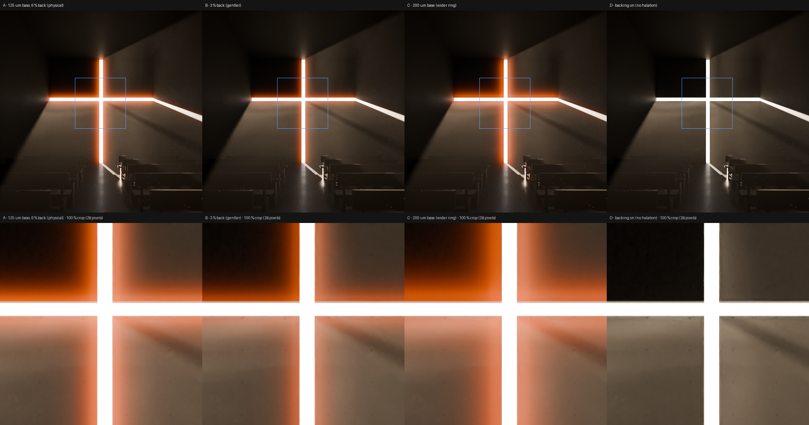

---

## How it was rendered

Cycles, 1080 × 1080, 256 samples with adaptive sampling (threshold 0.01) and the denoiser, light tree on. Bounces:
8 total, 4 diffuse, 3 glossy, 0 volume. Indirect light clamped at 10. AgX, Medium High Contrast look, exposure +1.5.

Half the frames rendered on a Mac (Apple Metal), half on a second PC with an RTX 4060 (OptiX). One frame rendered on
both matched to 49.9 dB PSNR, with no visible difference at the hand-off. The compositor
runs per frame inside the render. Film grain was added after, with ffmpeg (`noise=alls=5:allf=t`).

---

## Try it yourself

In your own build of the scene:

1. **Thicker film.** In `PA_Halation`, set `Base thickness µm` to 200. The ring starts at 2 × 200 × 0.894 = 358 µm,
   16 px, and is wider and softer. Look C in the look sheet.
2. **Put the backing back.** Set `Backing` to 1. The halo is gone and the slit has a clean white edge: this is what
   film with its anti-halation layer would record. Look D.
3. **A thinner cross.** Set `Slit width` to 0.05. The camera still looks straight through the slit, so the cross is
   still blown out and keeps its full red ring, now wider than the slit itself. But the room goes almost black: the
   slit is now a 5 cm tunnel through 20 cm of concrete (0.05 − 0.2·tan angle). At 10–13° azimuth only 0.4–1.5 cm of
   the upright lets the sun through, and the bar lets nothing through once the sun is above 14°. The light sheets and
   the cross on the floor are gone.
4. **Raise the bar.** Set `Bar height` to 4.5. The lower arm gets longer. The bar's light sheet now has to come down
   from 4.5 m to the eye (1.87 m), so it passes the camera when the sun is about 13.4° up: around frame 91 instead of
   frame 64; at frame 91 the frame fills with lit haze. Move `PA_PortalBar` to z = 4.5 too: if you leave it at 3.55, the
   sky light through the raised bar is found only by chance and the haze turns speckled.
5. **Thicker air.** In `PA_Air`, set `air density` to 0.024. The light sheets get about twice as bright and the room
   hazier; the cross on the floor gets slightly dimmer, because more sunlight is scattered on the way.

*Made with Blender 5.3 Geometry Nodes for [Nodevember](https://nodevember.com) 2026, Day 24 · Halation. After Tadao
Ando's Church of the Light (Ibaraki, 1989).*
