# How one material puts a pumped-down neon bulb inside a wet glass ball

*A node-by-node walkthrough of Nodevember 2026 · Day 25 · Neon (v4 · Neon Bulb in the Rain)*

The clip (12 s, 288 frames, 24 fps) is a glass shader ball on a grey studio floor, covered in rain. A pink neon
glow fills almost the whole ball. Over twelve seconds the gas inside is pumped down and let back in. The light starts
as sparks, spreads into thin wandering filaments, swells into a full glow, breaks into rings that drift toward the
centre, and goes dark. Then the glass itself fluoresces green, air rushes back in, and the gas runs the stages
backwards to the sparks it started with. Through every raindrop the glow is sharp and magnified. Between the drops it
is softer. Drops slide down the ball in short stick-slip steps and leave wet trails that dry.

There is nothing inside the ball. The bulb, the gas, the rings, the drops and the trails are all **one material**
on a plain sphere, `PA_RainGlass`. It uses object coordinates and one time value, and it has no image textures and
no volumes. The clip loops with no seam: frame 289 would be frame 1 again.

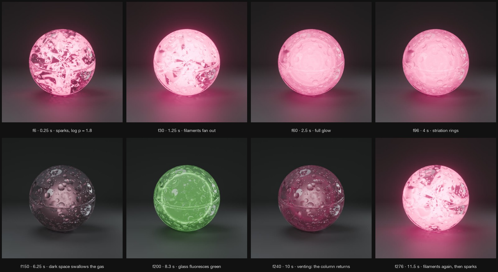

| File | What it is |
|---|---|
| `neon-bulb-ball.mp4` | the clip: 1080 × 1080, 24 fps, 288 frames (12 s), Cycles 128 samples, a seamless loop |
| `render.png`, `render-200.png` | frame 72 (full glow) and frame 200 (green glass) at 1080 × 1080 |
| `nodes/` | the node trees full size: `main.png` (the material `PA_RainGlass`), `rain.png` (`PA_Rain`), `dropcap.png` (`PA_DropCap`), `runner.png` (`PA_RunnerLayer`), `bulb.png` (`PA_NeonBulb`), `stage.png` (`PA_PumpStage`), `march.png` (`PA_BulbMarch`), `step.png` (`PA_NeonStep`), `ball.png` (`PA_Ball_GN`) |
| `post.md` | idea, build notes, caption and alt text |

The `.blend` and the Python script that builds it are not published. In the scene, the object **PA_Ball** carries
the Geometry Nodes tree `PA_Ball_GN` (ball and floor), and its material is `PA_RainGlass`. Every node, label and
number you need is in the screenshots and the text. It was built in Blender 5.3.

---

## The one idea

> **Walk the view ray through an imaginary sphere and add up the light of the gas along it.** At every pixel of
> the ball, the material knows where the camera ray enters the ball and which way it is going. It intersects that ray
> with a sphere of radius 0.75 (the bulb) and samples the gas at 10 points along the chord. Each sample asks one
> question: how bright is neon gas at this distance from the cathode, at this pressure? The sum is the emission. Because
> it is a real 3D walk, the glow has depth: rings look like shells, and filaments look like they leave the centre.

Everything else is bookkeeping around that idea:

- **What does the gas look like at a given pressure?** the physics of an earlier take on this prompt (a straight neon tube being pumped down), borrowed whole: every
  length in a glow
  discharge scales as 1 / pressure (the similarity law). The cathode dark space is 0.064 torr·cm / p. The ribbon of
  current narrows as p drops, and striations appear in a pressure window (`PA_PumpStage`).
- **Why are the drops sharp?** Each drop is a little lens. The material bends the view ray by how much the drop's
  surface tilts, and marches the bulb a second time along that bent ray with crisper filaments. Where there is water,
  that sharp view wins (sections 3 and 4).
- **Why does it loop?** The pressure runs a 12 s timeline that ends where it starts, and every drop moves a whole
  number of times per 12 s.

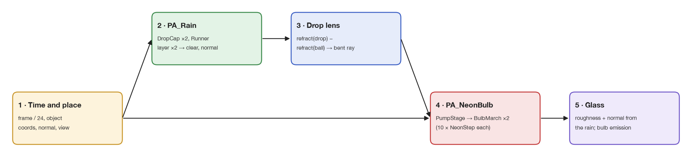

### How to read the screenshots

- Each coloured frame is one section. The material's sections are numbered like the headings below
  (`1 · Time and place`). Sections inside a node group use letters (`a · Pump-down stage`).
- Each section has its own picture. Wires that come in from another section enter through a **Group Input** socket
  named after what they carry (for example `rain › Clear`, the `Clear` output of the node labelled `rain`). Wires
  that leave go out through a **Group Output**.
- Node labels say what a node is for (`drop bend`, `ray hits the bulb`). The text quotes them in code style.
- Distances are in object space. The ball has radius 1, so 0.75 is three quarters of the way to the glass.
- Click any screenshot for full size.

---

## 0 · The map

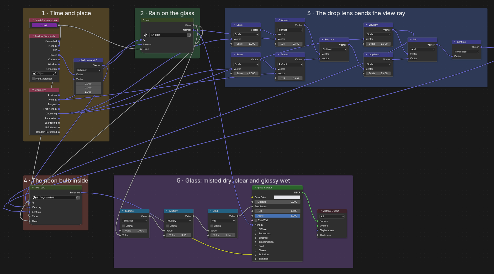

| # | Section | Nodes | Job |
|---|---|---|---|
| 1 | Time and place | 4 | time in seconds, the shading point relative to the ball's centre, the normal, the view direction |
| 2 | Rain on the glass | 1 | `PA_Rain`: static drops, runners and trails → how clear the glass is, and the water's normal |
| 3 | The drop lens bends the view ray | 9 | how much each drop bends the ray into the ball |
| 4 | The neon bulb inside | 1 | `PA_NeonBulb`: the pump-down, the bulb marched twice, halo, green glass → emission |
| 5 | Glass: misted dry, clear and glossy wet | 5 | Principled BSDF: roughness from the rain, emission from the bulb |

The material is five sections because everything repeated lives in node groups. Seven groups make up the material,
each built once and used where needed:

| Group | Used | Nodes | Job |
|---|---|---|---|
| `PA_Rain` | 1 × | 32 | two drop layers, two runner layers, then the wet mask |
| `PA_DropCap` | 2 × in `PA_Rain` | 28 | spherical-cap drops on a Voronoi |
| `PA_RunnerLayer` | 2 × in `PA_Rain` | 106 | one sliding drop per meridian column, and its trail |
| `PA_NeonBulb` | 1 × | 62 | everything about the bulb |
| `PA_PumpStage` | 1 × in `PA_NeonBulb` | 70 | pressure timeline → every length of the discharge |
| `PA_BulbMarch` | 2 × in `PA_NeonBulb` | 92 | cross the bulb along a ray, ten samples |
| `PA_NeonStep` | 10 × in each `PA_BulbMarch` | 61 | the gas at one sample point |

Unrolled, the same material is about 1 900 nodes. With the groups the material itself is 20.

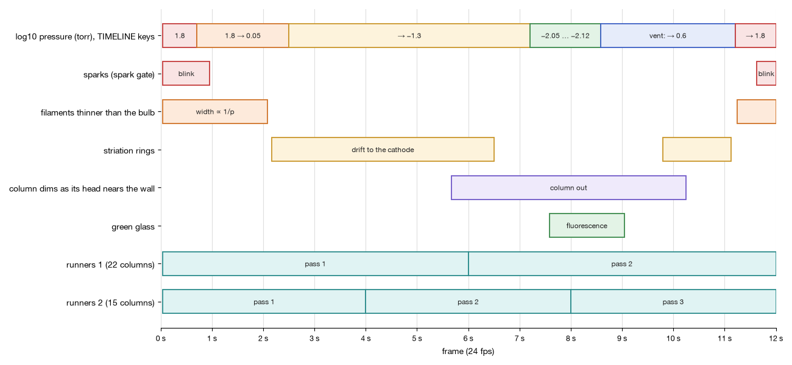

The timeline is the pressure. Everything in the bulb lane follows from the curve in the top row. The runners
are independent of it, but they also repeat exactly in 12 s.

---

## 1 · Time and place

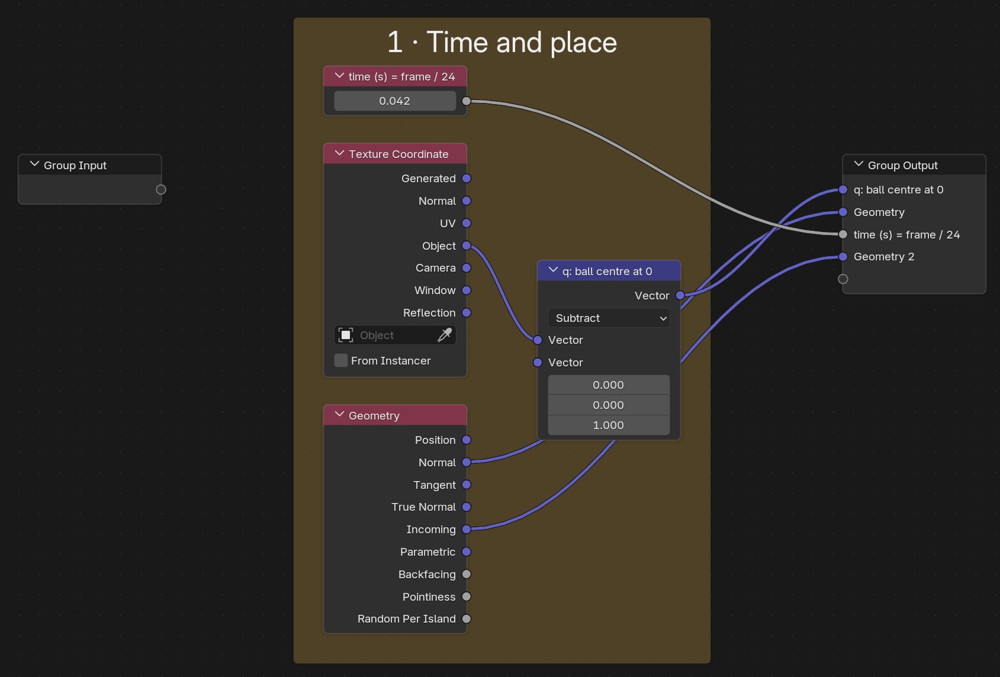

| Node | What it does |
|---|---|
| `time (s) = frame / 24` | a Value node with a driver `frame / 24`. It is the only clock in the material |
| `q: ball centre at 0` | Texture Coordinate › Object minus (0, 0, 1). The ball's mesh sits 1 m up, so this puts its centre at 0 |
| Geometry › Normal, Incoming | the smooth normal of the ball, and the direction toward the camera |

Object coordinates matter. The bulb and the drops are positions inside the ball's own space, so they stay put as the
ball moves or turns, like real objects.

> **Try it:** change the driver to `frame / 48`. Everything runs at half speed, and the 288 frames now show only the
> first half of the loop (sparks to the swallow), so the clip no longer loops.

---

## 2 · Rain on the glass

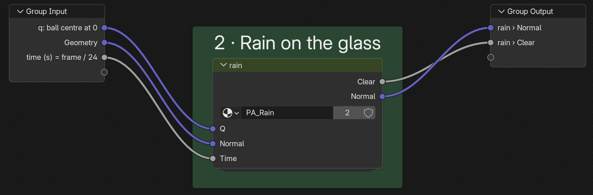

One group node does all the water. It returns two values:

- `Clear` is how much of the sharp view this point shows, from 0.75 on dry glass to 1 in a drop.
- `Normal` is the surface normal tilted by the drops.

How it does that is in [Inside `PA_Rain`](#inside-pa_rain).

---

## 3 · The drop lens bends the view ray

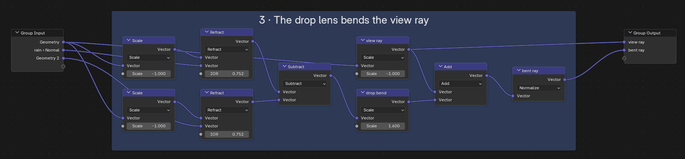

The ball is treated as a thin glass shell. On dry glass the view ray goes straight in, so `view ray` is just
−Incoming. A drop is a lump of water on top. It bends the ray by however much its tilted surface differs from the
glass under it:

```
drop bend = (refract(−I, drop normal) − refract(−I, ball normal)) × 1.6
bent ray  = normalize(view ray + drop bend)
```

Both Refract nodes use an index ratio of 1 / 1.33 (air into water).

### Trick · Refract the ball twice, keep only the difference

Refracting through the ball itself would make the whole ball a lens. A solid glass sphere is a strong lens and
would smear the bulb over the whole surface. Subtracting the plain-ball refraction cancels that, so only the drops
bend. On dry glass the two Refract nodes agree and `drop bend` is exactly zero. The factor 1.6 is taste. It makes a
drop magnify a bit more than a real one would at this scale, so the filaments inside it read.

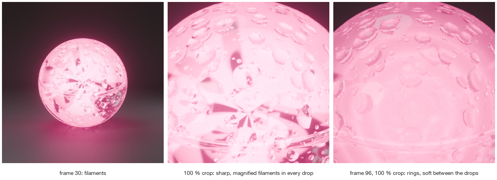

> **Try it:** set the 1.6 in `drop bend` to 0. The drops still clear the mist, but they no longer magnify: the
> filaments behind them line up with the ones around them.

---

## 4 · The neon bulb inside

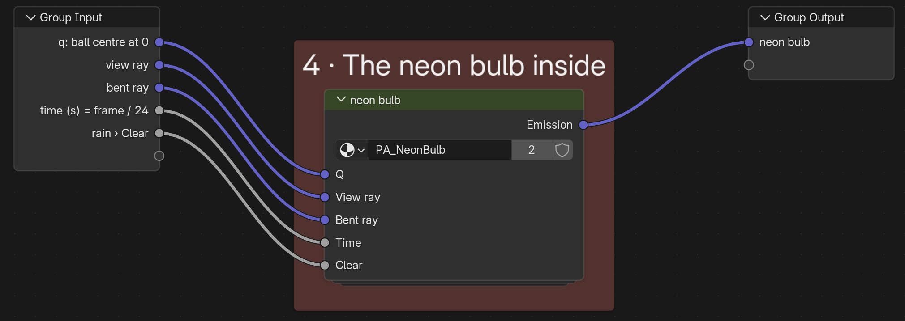

The bulb group gets both rays, the clock and the rain's `Clear`, and returns one emission colour. See
[Inside `PA_NeonBulb`](#inside-pa_neonbulb).

---

## 5 · Glass: misted dry, clear and glossy wet

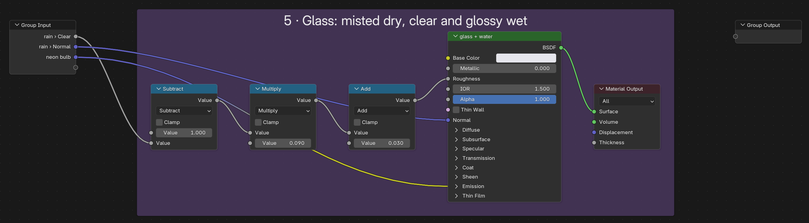

`glass + water` is one Principled BSDF:

| Input | Value | Why |
|---|---|---|
| Base Color | (0.8, 0.8, 0.85) | a faint blue-grey tint |
| Transmission | 0.95 | almost clear glass: the floor and the lights show through |
| IOR | 1.5 | glass |
| Roughness | (1 − Clear) × 0.09 + 0.03 | 0.0525 on dry glass, 0.03 in a drop: water is glossier than the light mist between drops |
| Normal | `rain › Normal` | drops catch the softbox as round highlights |
| Emission | the bulb, strength 1 | the whole bulb is surface emission |

Since the light is emission on the surface, the glass shader does not "see" the bulb. Transmission shows the room
behind the ball, and emission adds the bulb on top. The emission also lights the floor pink, because Cycles treats
an emissive surface as a light.

> **Try it:** set Transmission to 0 and Base Color to almost black (0.008). The bulb looks the same, because it is
> emission, but the ball becomes dark smoke glass: the floor no longer shows through, and the drops read as glossy
> beads with highlights.

---

## Inside `PA_Rain`

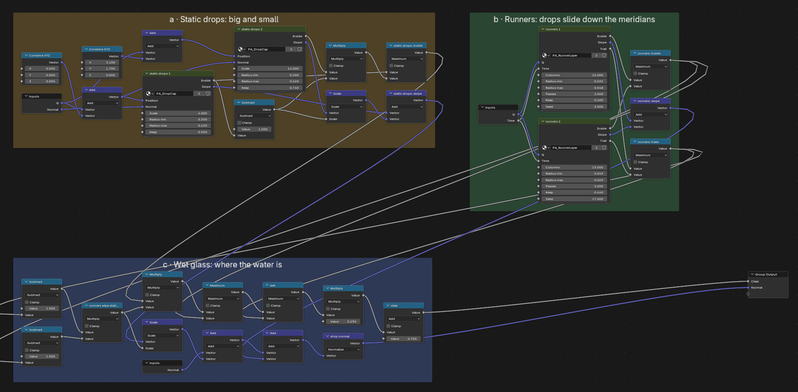

### a · Static drops: big and small

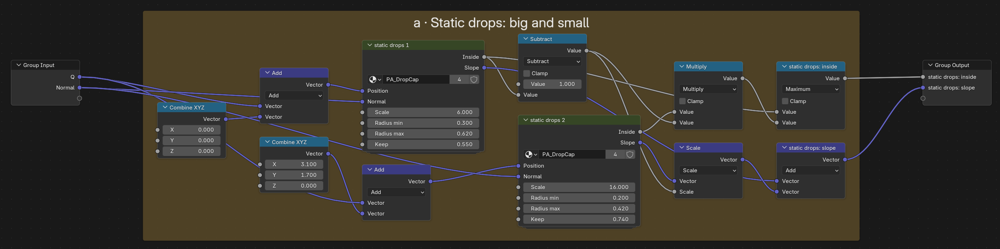

Two `PA_DropCap` nodes make two layers of drops that never move:

| Node | Scale (cells / m) | Radius (× cell) | Keep |
|---|---|---|---|
| `static drops 1` | 6 | 0.30 – 0.62 | 0.55 |
| `static drops 2` | 16 | 0.20 – 0.42 | 0.74 |

`Keep` dries out cells. A cell only holds a drop if its random value is above `Keep`, so the big layer fills about
45 % of its cells and the small one about 26 %. The second layer reads its position shifted by (3.1, 1.7, 0) so its
cells don't line up with the first. The small drops are multiplied by (1 − big drop), so they never sit inside a big
one (`static drops: inside`, `static drops: slope`).

### b · Runners: drops slide down the meridians

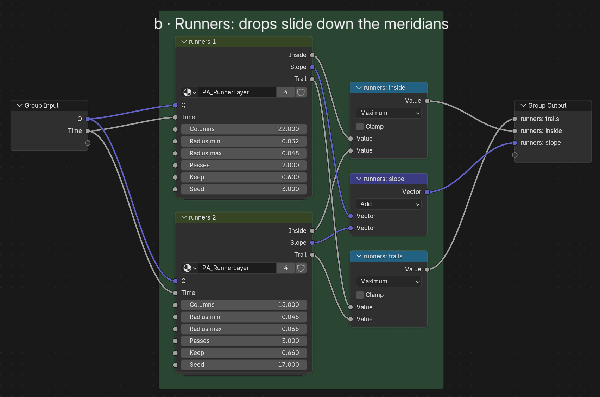

| Node | Columns | Radius (m) | Passes per 12 s | Keep | Seed |
|---|---|---|---|---|---|
| `runners 1` | 22 | 0.032 – 0.048 | 2 | 0.60 | 3 |
| `runners 2` | 15 | 0.045 – 0.065 | 3 | 0.66 | 17 |

The two layers are combined with Maximum (inside, trails) and Add (slopes).

### c · Wet glass: where the water is

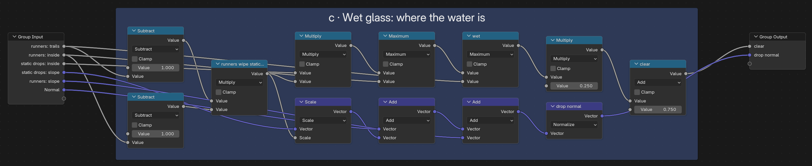

| Node | Formula | Why |
|---|---|---|
| `runners wipe static drops` | (1 − trail) × (1 − runner) | a runner sweeps the static drops off its path |
| `wet` | max(static, runner, trail) | any water |
| `clear` | wet × 0.25 + 0.75 | dry glass already shows 75 % of the sharp view |
| `drop normal` | normalize(N + static slope × wiped + runner slope) | the surface the light and the lens see |

> **Try it:** change the 0.75 in `clear` to 0 (and its multiplier from 0.25 to 1). The ball becomes properly frosted.
> The bulb is a soft blur everywhere and only shows sharp through the drops. That is how the ball looked before the
> glass was made clearer.

---

## Inside `PA_DropCap`

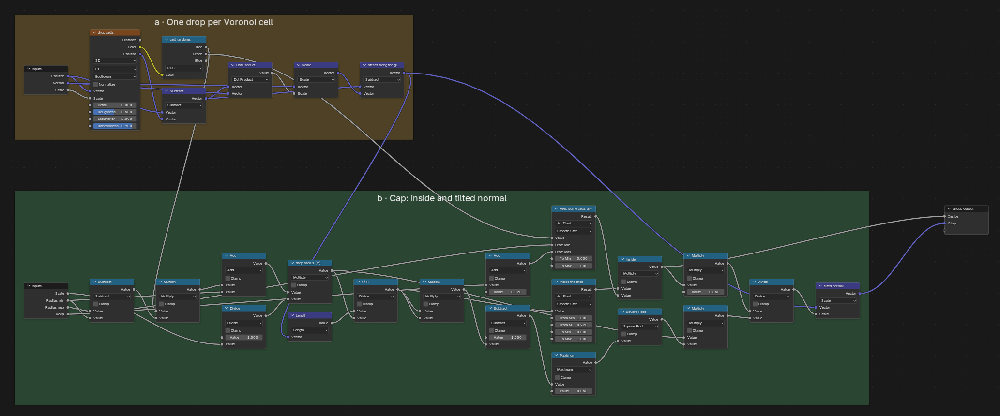

### a · One drop per Voronoi cell

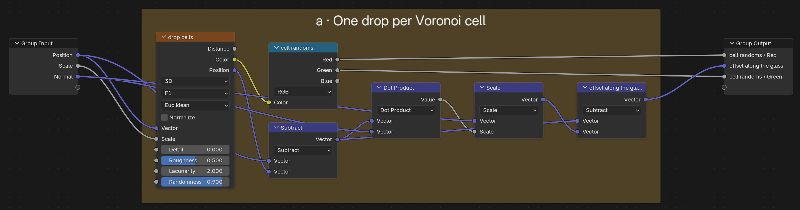

`drop cells` is a 3D Voronoi texture with Randomness 0.9. Its **Position** output is the centre of the nearest
cell, already in input units (metres), and its **Color** gives each cell random numbers (`cell randoms`). The
offset from the centre is projected onto the glass (`offset along the glass`: o − N (o·N)), so a drop is a disc on
the surface, not a ball in space.

### b · Cap: inside and tilted normal

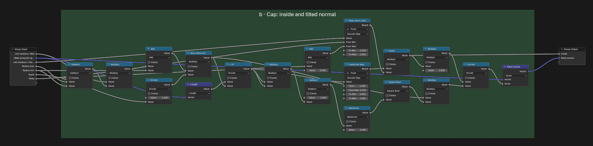

| Node | What it does |
|---|---|
| `drop radius (m)` | Red mapped to Radius min … max, divided by Scale (so radius is a fraction of the cell) |
| `r / R` | how far out in the drop this point is |
| `inside the drop` | smoothstep 1 → 0.92: a soft 8 % rim |
| `keep some cells dry` | Green above `Keep` |
| `tilted normal` | offset × 0.85 / (R √(1 − (r/R)²)) |

### Trick · A spherical cap's normal without any geometry

A drop is a slice of a sphere. On a cap of radius R the height's slope at distance r is r / √(R² − r²). The node
adds that slope, along the offset direction, to the normal. At the centre it adds nothing. At the rim it tilts hard,
which is why drops have bright rims and dark edges like real water. The √ is clamped at 0.05 so the rim doesn't blow
up.

---

## Inside `PA_RunnerLayer`

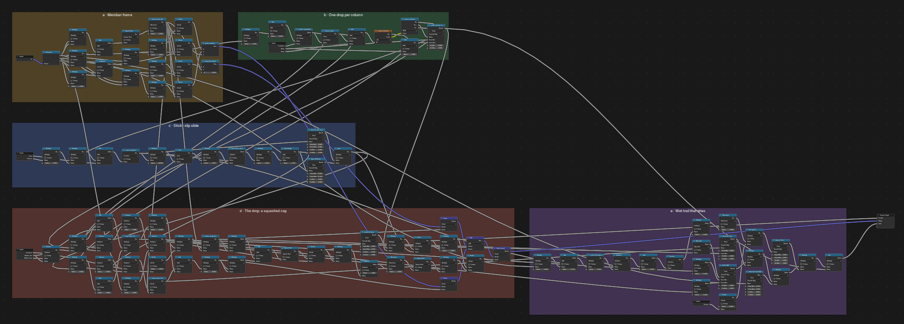

A runner is a drop that forms near the top of the ball, slides down a meridian in steps, drips off near the bottom
and leaves a wet trail that dries. There is one runner per column, so the shader never searches for neighbours.

### a · Meridian frame

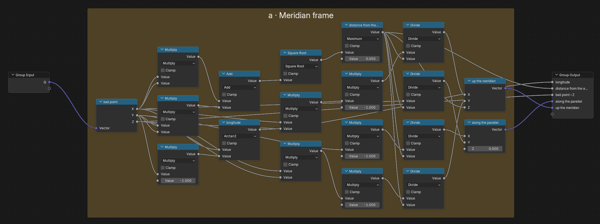

The ball is cut into columns by longitude (`longitude` = atan2(x, −y), so the seam is at the back). `along the
parallel` and `up the meridian` are the two directions on the surface the drop moves in. They give it a shape and
a slope.

### b · One drop per column

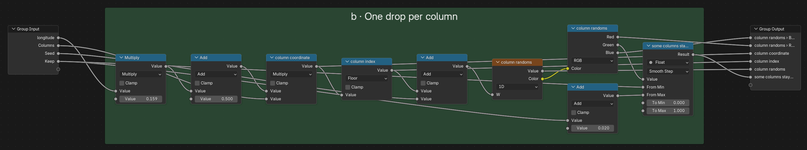

`column coordinate` = (longitude / 2π + 0.5) × Columns, and `column index` is its floor. A 1D White Noise of
index + Seed gives each column four random numbers (`column randoms`): the drop's size, whether this column has a
drop at all (`some columns stay dry`), its start time and a sideways nudge.

### c · Stick-slip slide

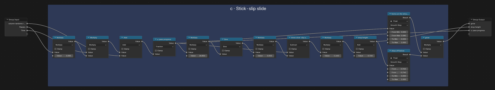

| Node | Formula |
|---|---|
| `u: pass progress` | fract(time × Passes / 12 + random) |
| `three stick-slip pauses` | u − sin(6π u) / (6π) |
| `drop height` | 0.72 − slide × 1.64 (from z = 0.72 down to −0.92) |
| `grow` | `forms on the shoulder` × `drips off below` |

### Trick · Stick-slip with one sine

s = u − sin(6πu) / (6π) never goes backwards. Its slope is 1 − cos(6πu), which touches zero three times per pass.
So the drop stops dead three times on the way down, then lurches on, like water held by friction. Because Passes is a
whole number, u repeats exactly every 12 s, which is the loop.

### d · The drop: a squashed cap

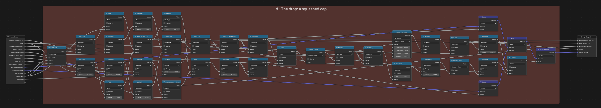

The same cap as `PA_DropCap`, measured in metres along the parallel and the meridian. Vertically the offset is
(dz + R / 4) × 0.8, so the cap is 1.25 R tall and centred a quarter radius below the track point: the water
hangs, like a real drop on a slope.

### e · Wet trail that dries

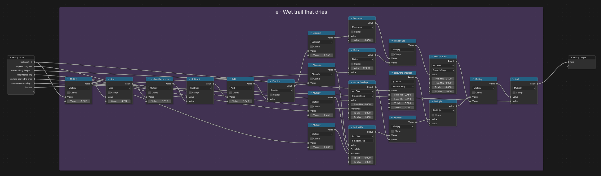

The trail does not store history. It works out the past instead: `u when the drop passed here` is the inverse of
the slide (a straight line, ignoring the pauses). The difference to now is the `trail age (s)`, and `dries in 1.6 s`
fades it out. The trail is narrower than the drop (`trail width`) and only exists above it and below the shoulder.

> **Try it:** set Passes on `runners 1` to 2.5. The drops slide 25 % faster, but the loop breaks: at frame 289
> they jump.

---

## Inside `PA_NeonBulb`

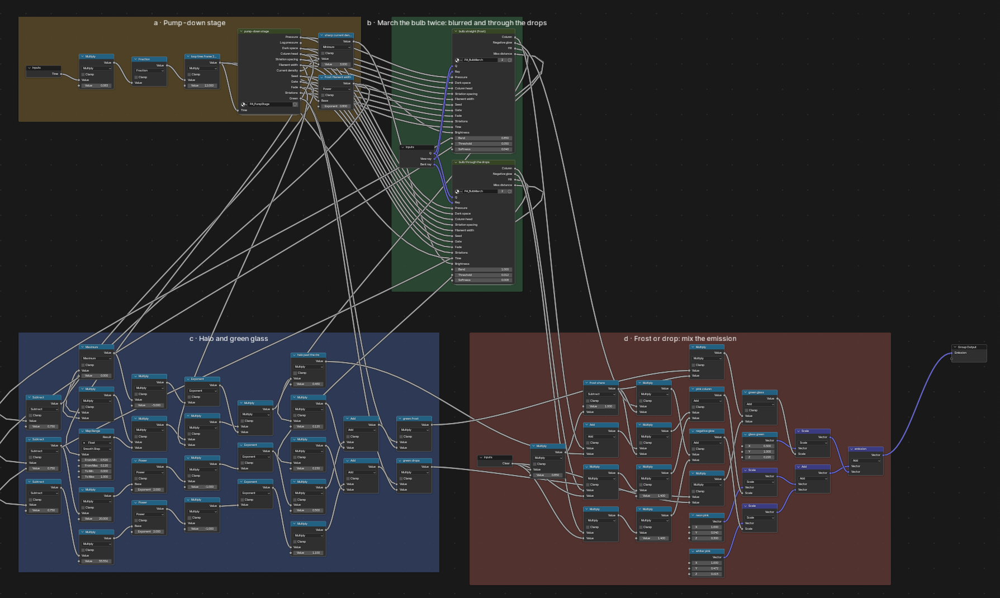

### a · Pump-down stage

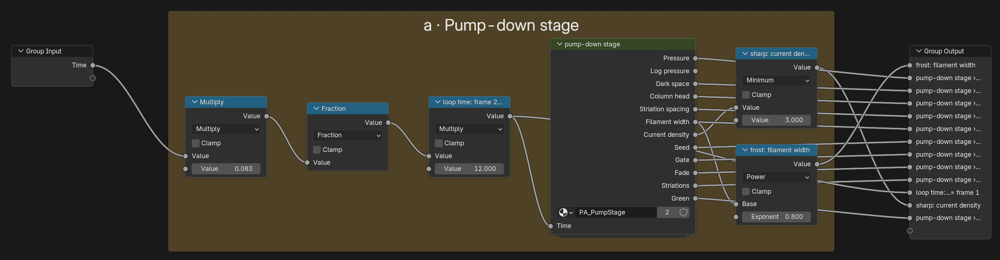

`loop time: frame 289 = frame 1` wraps the clock to 0–12 s. `pump-down stage` turns it into the whole state of the
gas (see [`PA_PumpStage`](#inside-pa_pumpstage)). Two gains differ between the two views:

- `sharp: current density`, min(density, 3). Through a drop a thin filament is bright, because the same current
  squeezes through less gas.
- `frost: filament width`, width^0.8. Seen softly, a thin filament is dim because its light is spread.

### b · March the bulb twice: blurred and through the drops

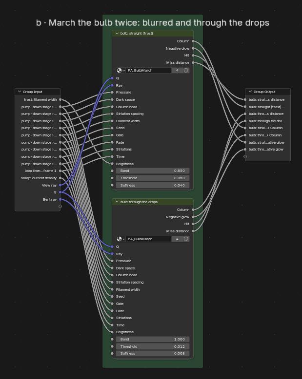

| Node | Ray | Brightness | Band | Threshold | Softness |
|---|---|---|---|---|---|
| `bulb: straight (frost)` | `View ray` | frost gain | 0.85 | 0.05 | 0.04 |
| `bulb: through the drops` | `Bent ray` | sharp gain | 1.0 | 0.012 | 0.008 |

The softer look is not a blur. The frost march draws wider, softer filaments (Threshold and Softness) and paler
rings (Band 0.85). Both are cheap, and they read as a view through mist.

### c · Halo and green glass

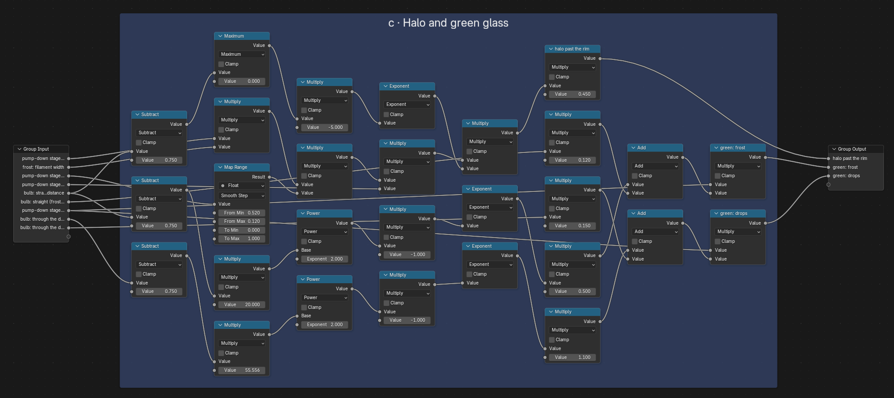

| Node | Formula | Why |
|---|---|---|
| `halo past the rim` | level × exp(−(miss − 0.75) / 0.2) × 0.45 | mist scatters the glow a little past the bulb |
| `green: frost` | green × (exp(−((miss − 0.75) / 0.05)²) × 0.5 + hit × 0.12) | a soft green ring where the ray grazes the bulb wall |
| `green: drops` | green × (exp(−((miss − 0.75) / 0.018)²) × 1.1 + hit × 0.15) | the same ring, sharp, through the drops |

`miss` is `Miss distance`: how close the ray passes to the cathode. When it equals 0.75 the ray grazes the bulb's
wall, where you look through the most glass. That is where fluorescing glass looks brightest, so the green is a ring.

### d · Frost or drop: mix the emission

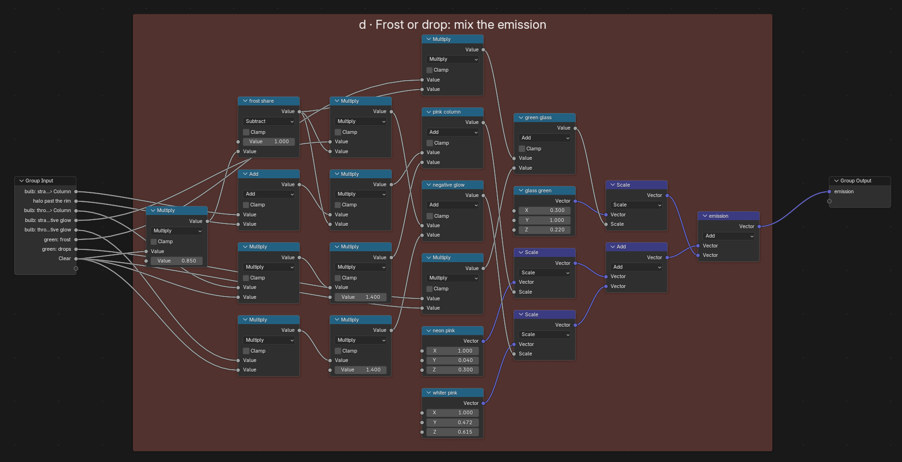

`frost share` = 1 − Clear × 0.85, and the sharp view is weighted Clear × 1.4. Three amounts come out:

| Amount | Colour |
|---|---|
| `pink column` | `neon pink` (1.0, 0.04, 0.30) |
| `negative glow` | `whiter pink`, 45 % of the way to white: the bright layer at the cathode is hotter |
| `green glass` | `glass green` (0.30, 1.0, 0.22) |

`emission` is the sum.

---

## Inside `PA_PumpStage`

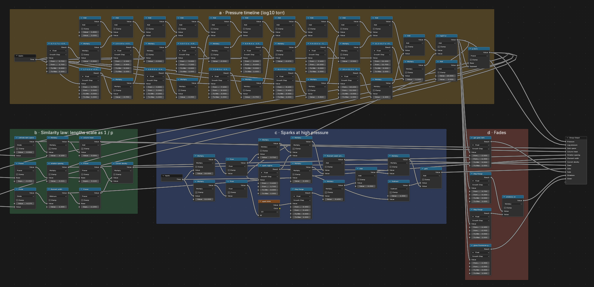

### a · Pressure timeline (log10 torr)

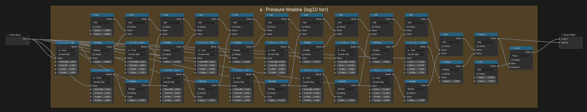

The pressure is a smooth curve through 14 keys, written as a start value plus one smoothstep per segment that
moves (eleven; the two flat holds need none). Each smoothstep is a Map Range labelled with its window, for example `2.5–3.8 s: +0.05 → -0.45`.

| Time (s) | 0 | 0.7 | 1.7 | 2.5 | 3.8 | 5.0 | 7.2 | 8.0 | 8.6 | 9.4 | 10.6 | 11.2 | 11.7 | 12.0 |
|---|---|---|---|---|---|---|---|---|---|---|---|---|---|---|
| log10 p | 1.80 | 1.80 | 1.00 | 0.05 | −0.45 | −0.80 | −1.30 | −2.05 | −2.12 | −1.30 | −0.80 | 0.60 | 1.80 | 1.80 |

That is 63 torr down to 7.6 mtorr and back. The −0.80 → −1.30 segment takes 2.2 s on purpose: it is when the dark
space swallows the bulb, and a slow swallow reads better than a switch-off.

### b · Similarity law: lengths scale as 1 / p

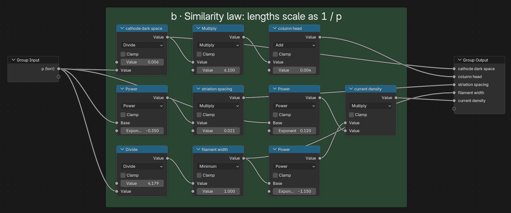

Lengths are in units of a 0.5 m neon tube (the straight tube of the earlier take), so x = 0.5 is the bulb wall:

| Node | Formula |
|---|---|
| `cathode dark space` | 0.0064 / p |
| `column head` | dark space × 6.1 + 0.004 (after the Faraday dark space) |
| `striation spacing` | p^−0.35 × 0.0212 |
| `filament width` | min(0.05 / (0.62 × 0.0193) / p, 1) |
| `current density` | width^−1.15 × p^0.12 |

### c · Sparks at high pressure

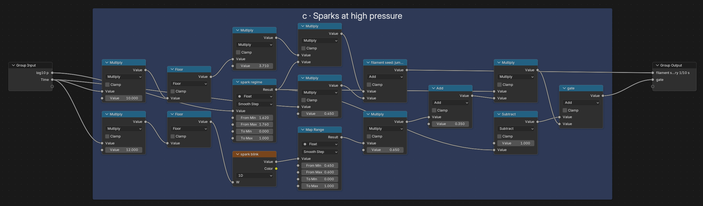

Above about 40–60 torr (`spark regime`, log p 1.62 → 1.76) the gas cannot hold a steady glow. The
`filament seed: jumps every 1/10 s` makes the filaments jump to new paths ten times a second. The `gate` dips with a 12 Hz `spark blink`,
but never below 35 %, so the bulb flickers without strobing black.

### d · Fades

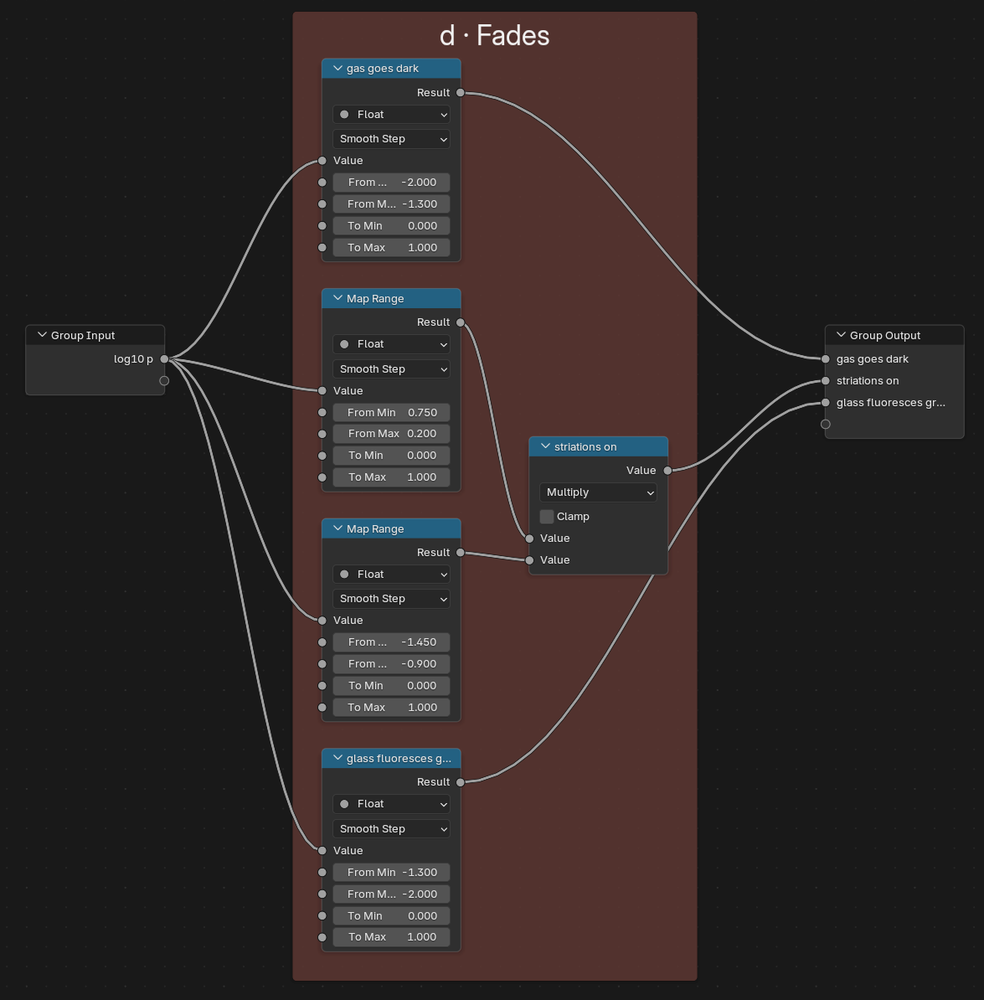

| Node | log p window | Meaning |
|---|---|---|
| `gas goes dark` | −2.0 → −1.3 | the negative glow dies at the lowest pressure |
| `striations on` | 0.75 → 0.2 and −1.45 → −0.9 | rings only appear in a pressure window |
| `glass fluoresces green` | −1.3 → −2.0 | electrons reach the glass and make soda glass glow green |

---

## Inside `PA_BulbMarch`

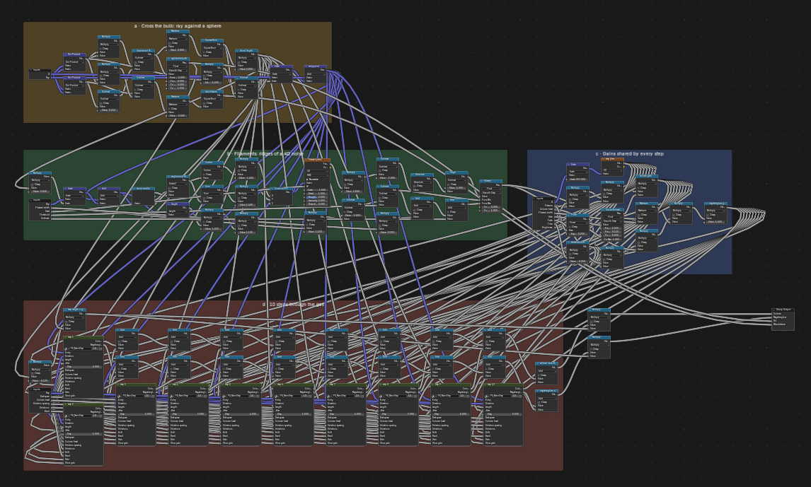

### a · Cross the bulb: ray against a sphere

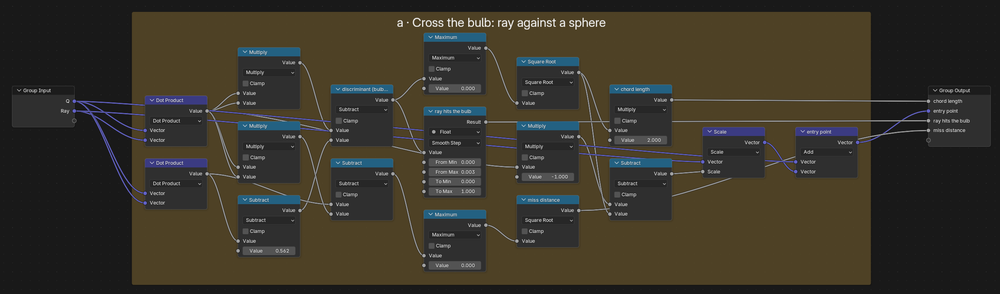

The ray starts at the shading point q and goes in direction d. With b = q·d, it hits a sphere of radius 0.75 if
b² − (q·q − 0.75²) > 0 (`discriminant (bulb radius 0.75)`). Then:

| Node | Formula |
|---|---|
| `entry point` | q + d (−b − √disc) |
| `chord length` | 2 √disc |
| `ray hits the bulb` | smoothstep(disc, 0, 0.003): a soft edge, no jaggies |
| `miss distance` | √(q·q − b²): the ray's closest approach to the centre |

### b · Filaments: ridges of a 4D noise

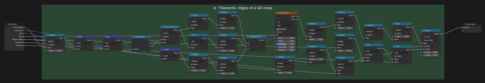

The filaments are worked out once per ray, at the middle of the chord (`chord middle`). Its `angle round the
cathode` goes onto a circle, its distance from the centre is the third coordinate, and the pump's seed is the fourth
(`filament paths`, a 4D Noise). `ridge` = 1 − |2n − 1| peaks where the noise crosses 0.5, which gives thin lines
fanning out from the centre that wander as the seed moves. `filament` keeps ridges above 1 − width × 1.1 −
Threshold. A wide filament width (low pressure) fills the whole bulb, so the filaments merge into a full glow.

### c · Gains shared by every step

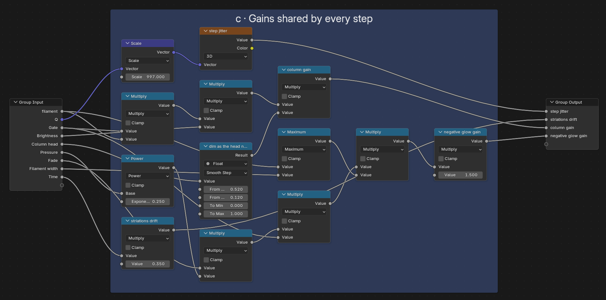

| Node | What it does |
|---|---|
| `step jitter` | a 3D White Noise of q × 997: a different offset for every pixel |
| `column gain` | gate × filament × Brightness × `dim as the head nears the wall` |
| `negative glow gain` | fade × p^0.25 × gate × max(filament, width) × 1.5 |
| `striations drift` | time × 0.35: the rings slide toward the cathode |

### Trick · Jitter turns banding into noise

Ten evenly spaced samples would show as ten shells. Shifting every pixel's samples by a random fraction of a step
(`step jitter`) turns the shells into fine noise, and Cycles' denoiser removes the noise. That is how ten steps can
look like a continuous glow.

### d · 10 steps through the gas

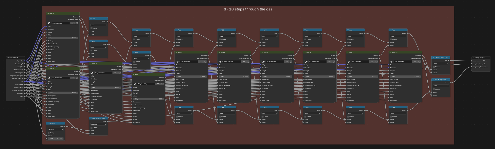

Ten copies of `PA_NeonStep` (`step 1` … `step 10`), with Step set to 0 … 9. Their outputs are summed
(`column: sum of the steps`, `negative glow: sum of the steps`) and multiplied by `step length × gain`: chord /
10 × 1.25 × hit. Longer chords through the middle of the bulb collect more light, so the bulb is brighter in the
middle, like a real glowing sphere.

---

## Inside `PA_NeonStep`

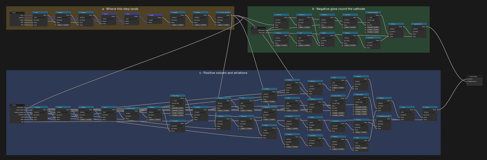

### a · Where this step lands

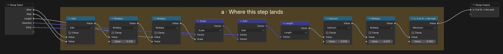

P = Entry + Direction × Length × (Jitter + Step) / 10. Its distance from the centre is turned into
`x: 0 at the cathode, 0.5 at the wall`: (r − 0.035) × 0.5 / (0.75 − 0.035). The cathode is a bead of radius 0.035
at the centre and the anode is the whole bulb wall. The bulb is a radial version of a straight tube.

### b · Negative glow round the cathode

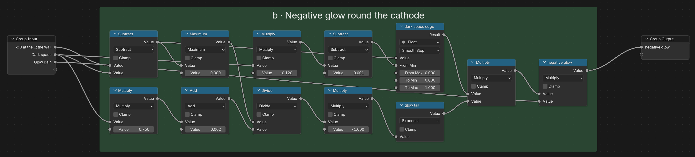

The negative glow is a bright layer that starts sharply at the edge of the cathode dark space (`dark space edge`)
and fades outward (`glow tail`, decay length 0.75 × dark space + 0.0015). As the pressure drops, the dark space
grows and the glow layer moves out, from a speck at the centre to the bulb wall.

### c · Positive column and striations

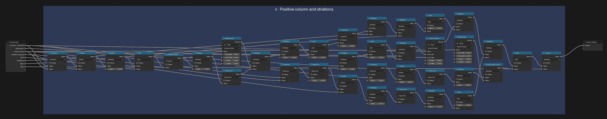

| Node | What it does |
|---|---|
| `column starts` | the pink column begins at `Column head` |
| `anode glow on the wall` | a thin bright skin on the wall, fading as the head reaches it |
| `striation phase` | fract((x − head) / spacing × 0.25 + drift) |
| band | 1 + (pulse − 1) × Striations × Band: bright, sharp-edged bands |
| head | 1 + 0.7 × exp(−(x − head) / spacing × 0.25): the first band is brightest |

The 0.25 (`STRI_K` in the build script) makes the rings four times wider than in a straight tube, so a few big shells survive the
mist.

---

## Appendix A · `PA_Ball_GN`: the shader ball and the floor

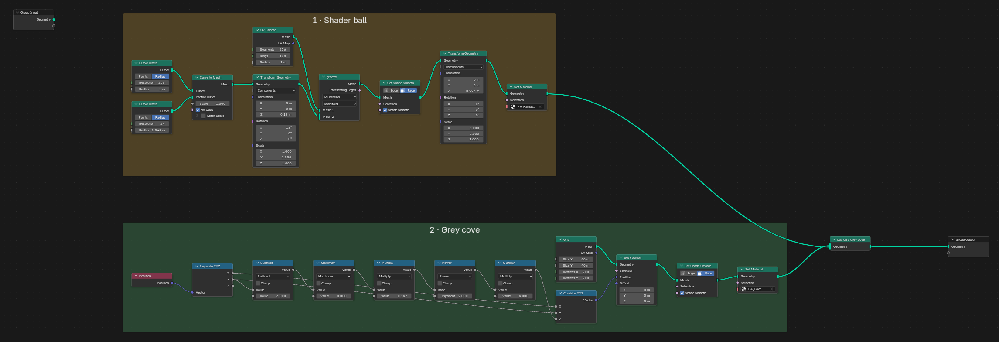

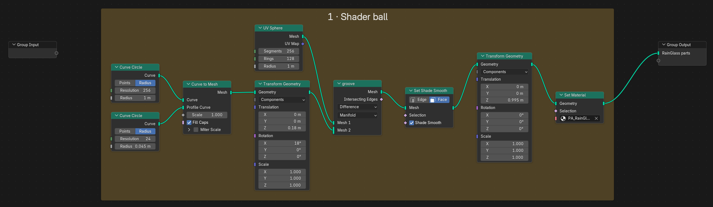

The ball is a UV sphere (256 segments, 128 rings, radius 1). A tube of radius 0.045 round a circle of radius 1,
raised 0.18 and tilted 18°, is cut out with a Manifold boolean (`groove`). That is the classic shader-ball seam,
and it catches a line of light. The ball sits at z = 0.995, so it touches the floor.

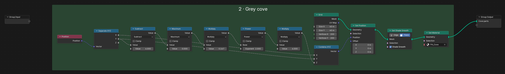

The floor is a 40 m grid (200 × 200) that curves up behind the ball, z = ((y − 6) / 6)² × 6 past y = 6, so there is no
horizon line.

## Appendix B · Camera and lights

| Thing | Setting |
|---|---|
| Camera `PA_Cam` | 92 mm, 9.2 m away at 2.35 m height, aimed at the ball's centre; f/2.8 focused at 8.6 m |
| `PA_Key` | round area light, 3.0 m, 60 W, above and behind |
| `PA_Window` | round area light, 2.2 m, 90 W, front left: the softbox the wet glass reflects |
| `PA_Rim` | round area light, 1.5 m, 40 W, right |
| World | grey 0.18, strength 0.6 |

The lights are discs, not squares. Square softboxes reflected as little tiles in every drop.

---

## How it was rendered

Cycles, 128 samples with adaptive sampling and denoising, AgX (Medium High Contrast), a light bloom in the
compositor. The 288 frames were rendered on a second PC with an RTX 4060 (OptiX), about 18 s a frame. A test frame
rendered on both the Mac and that PC matched to 67 dB PSNR. The loop was checked numerically: the step from frame 288
back to frame 1 is smaller than the median step between neighbouring frames.

## Try it yourself

1. **Freeze a stage.** In `PA_NeonBulb`, unplug `pump-down stage`'s Time and type 4.0: the pressure stops at the
   striation rings. The rings still slide, because the march's own Time (drift) is still the loop time; set
   `striations drift`'s 0.35 to 0 as well to stop them. Try 0.3 (sparks), 2.6 (full glow), 8.3 (green glass).
2. **Frost the ball.** Set `clear` in `PA_Rain` to wet × 1 + 0: dry glass is frosted, and only the drops show the
   bulb sharp.
3. **Still rings.** Set `striations drift`'s 0.35 to 0 in `PA_BulbMarch`. The rings still appear and move as the
   pressure changes, but they no longer slide toward the cathode on their own.
4. **Another gas.** Change `neon pink` to (0.1, 0.35, 1.0) and `whiter pink` to (0.5, 0.65, 1.0): a blue
   argon-mercury bulb with the same physics.
5. **No lens.** Set `drop bend`'s 1.6 to 0. The drops clear the glass but stop magnifying.
6. **Rebuild from scratch.** The material is a list of formulas, and every one of them is in the tables above.
   Rebuilding it group by group, starting with `PA_NeonStep`, is the best way to learn it.

*Made with Blender 5.3 for [Nodevember](https://nodevember.com) 2026, Day 25 · Neon.*
