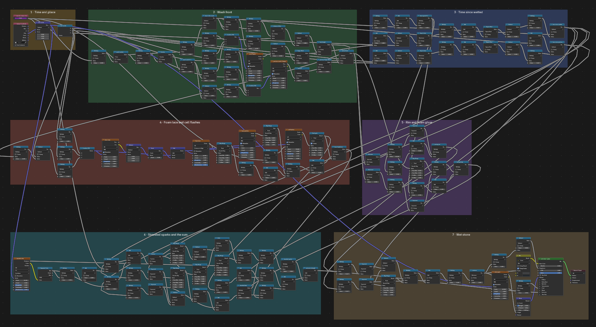
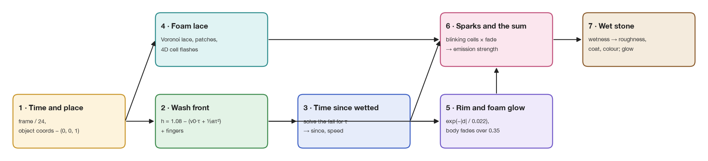
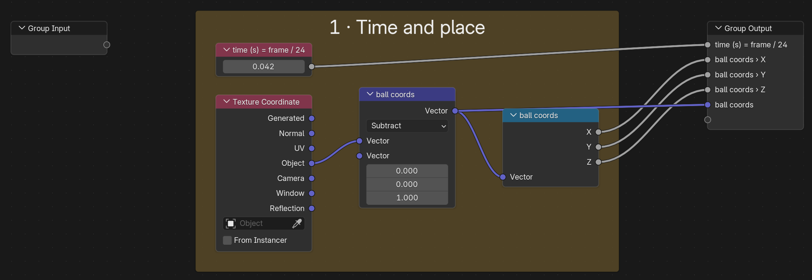
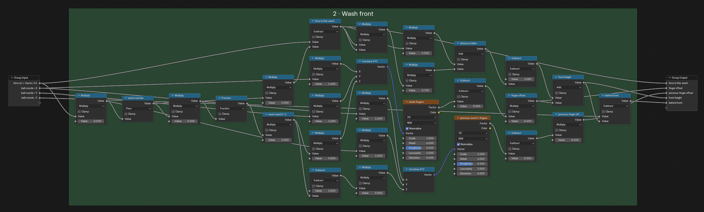
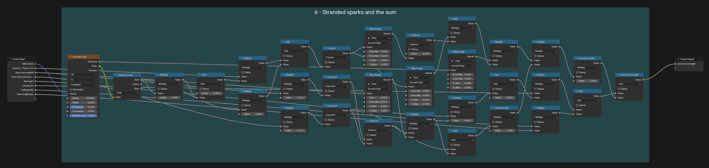
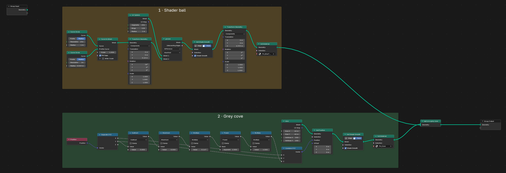

# How one material washes glowing sea water down a stone ball

*A node-by-node walkthrough of Nodevember 2026 · Day 26 · Bioluminescent (v2 · Blue Tears on Stone)*

The clip is a dark polished stone ball on a seamless grey backdrop. Every two seconds a thin sheet of sea water tips
over the top and runs down the ball, faster and faster. Its ragged front edge glows electric blue, a lace of blue foam
trails behind it, and fine cells in the foam flash on and off. Once the sheet has passed, tiny blue sparks are left
stranded on the wet stone. They blink and fade within a second, and the stone slowly loses its gloss as it drains,
until the next wash comes. This is the "blue tears" of the Matsu islands: the dinoflagellate *Noctiluca scintillans*
flashes when the water around it is disturbed, so the light follows the motion of the water.

There is no water. The ball is a plain mesh, and the sheet, the glow, the foam, the sparks and the wet gloss are
**one material**, `PA_BlueTears`. It uses object coordinates and one time value, and it has no keyframes, no image
textures and no simulation. Two washes fit in 4 s (96 frames), and the wash loops exactly.

| File | What it is |
|---|---|
| `blue-tears-ball.mp4` | the clip: 1080 × 1080, 24 fps, one pass of the 96-frame loop (4 s), starting at frame 22 so it opens on the glowing front; Cycles 128 samples, light film grain |
| `render.png` | frame 22 (the front just above the equator) at 1080 × 1080 |
| `nodes/` | the node trees full size: `main.png` (the material `PA_BlueTears`) and `ball.png` (`PA_Ball_GN`) |
| `post.md` | idea, build notes, caption and alt text |

The `.blend` and the Python script that builds it are not published. In the scene, the object **PA_Ball** carries
the Geometry Nodes tree `PA_Ball_GN` (ball and backdrop), and the ball's material is `PA_BlueTears`. Every node,
label and number you need is in the screenshots and the text. It was built in Blender 5.3.

---

## The one idea

> **Every point on the ball only needs to know how long ago the water passed it.** The height of the front is a
> simple formula of time: it starts above the pole and falls with constant acceleration. Turn that formula round and
> each point can work out *when* the front reached it. Subtract that from the clock, and you have one number per
> pixel: the time since this spot got wet.

Everything else is bookkeeping around that number:

- **Is the front here right now?** The time is about 0, so the point is on the running rim. The rim glows, and
  glows more the faster the water is falling (section 5).
- **Was it here a moment ago?** The time is small and positive, so the point is under the fresh sheet: foam,
  lace and cell flashes, fading over a third of a second (sections 4 and 5).
- **What is left behind?** Sparks that blink and fade over 0.9 s, and wet stone that dries over 2.4 s (sections 6
  and 7).

### How to read the screenshots

- Each coloured frame is one section, numbered like the headings below (`1 · Time and place`).
- Each section has its own picture. Wires that come in from another section enter through a **Group Input** socket
  named after what they carry (for example `ball coords › Z`, the Z output of the node labelled `ball coords`).
  Wires that leave go out through a **Group Output**.
- Most of the tree is plain Math nodes, so the important ones carry labels (`front height`, `time since wetted`).
  The text quotes them in code style. An unlabelled Multiply by a strange number is usually 1 / something:
  −45.455 is −1 / 0.022, −2.857 is −1 / 0.35, −1.111 is −1 / 0.9, −0.417 is −1 / 2.4.
- Distances are in object space. The ball has radius 1, so 0.022 is about 2 % of the radius.
- Times are in seconds. Click any screenshot for full size.

---

## 0 · The map

| # | Section | Nodes | Job |
|---|---|---|---|
| 1 | Time and place | 4 | the clock (frame / 24) and the position on the ball |
| 2 | Wash front | 29 | which wash, time in this wash, the ragged front height |
| 3 | Time since wetted | 22 | when the front reached this point; front speed |
| 4 | Foam lace and cell flashes | 22 | the foam texture that rides down with the sheet |
| 5 | Rim and foam glow | 14 | a thin bright line at the front, a fading glow behind it |
| 6 | Stranded sparks and the sum | 31 | blinking cells left on the stone; the emission strength |
| 7 | Wet stone | 18 | gloss, coat and colour from wetness; the shader |

One wash lasts 2 s. The front crosses the equator at 1.02 s (frame 24 or 25) and leaves the bottom at 1.48 s (frame
35 or 36). For the last half second nothing new arrives: the ball just drains.

---

## 1 · Time and place

| Node | What it does |
|---|---|
| `time (s) = frame / 24` | a Value node with the driver `frame / 24`: the scene time in seconds |
| Texture Coordinate → Object | the point's position in the ball object's own space, so the pattern sticks to the ball |
| Vector Math Subtract (0, 0, 1) → `ball coords` | moves the origin to the ball's centre (the ball sits 1 unit above the floor) |

The Z of `ball coords` is the height `h` on the ball: +1 at the pole, 0 at the equator, −1 at the bottom. Almost
everything below works with `h` alone. X and Y only shape the fingers and the foam.

The driver `frame / 24` is a simple expression, so Blender evaluates it without running Python scripts.

---

## 2 · Wash front

**Which wash?** `wash number` = floor(time × 0.5), so 0 for the first 2 s and 1 for the next. `time in this wash`
τ = time − 2 × wash number restarts at 0 every 2 s. `wash seed 0 / 1` = fract(wash number × 0.5) × 2 alternates 0,
1, 0, 1, so the two washes in the clip have different fingers, and the third (at 4 s) looks like the first.

**How far has it fallen?** `distance fallen` = 0.30 τ + 0.75 τ². That is v₀τ + ½aτ² with a starting speed of
0.30 and an acceleration of 1.50 (radii per second, per second). Water sheeting off a ball speeds up as it falls
toward the steep sides, and the constant acceleration gets that look with a formula you can invert (section 3).

**The ragged edge.** `sheet fingers` is a Noise Texture (Scale 1, Detail 4) read at (1.6 X, 1.6 Y, 5 × seed).
`finger offset` = (Factor − 0.5) × 0.45, so the front is up to about 0.11 higher or lower from place to place.

`front height` = 1.08 − `distance fallen` + `finger offset`. The front starts at 1.08, just above the pole (1.0), so
every wash begins by tipping over the top. `behind front` = h − `front height`: positive where the sheet has
already passed, negative ahead of it, zero on the rim.

### Trick · fingers without a seam

The noise is read at X and Y, not at an angle around the ball. An angle would have a cut at the back where it wraps
from 360° to 0°, and the noise would jump there. X and Y are continuous all the way round. Near the poles X and Y
change slowly, so the fingers are widest at the top, where the sheet is just starting to break up.

`previous wash's fingers` is the same noise with the other seed (1 − seed). Section 3 needs it.

> **Try it:** set Detail to 0 on both finger noises and both 0.45 Multiplies to 1.2. The front becomes a few big
> lazy tongues instead of a ragged edge. Change both copies: if the two washes' fingers differ in kind, the stone's
> memory of the last wash jumps when the next one starts (section 3).

---

## 3 · Time since wetted

When did the front reach height h? It had to fall `drop to here` = max(1.08 + finger offset − h, 0). Solve
0.30 τ + 0.75 τ² = drop for τ:

τ = (√(3 × drop + 0.09) − 0.30) / 1.5

That is the chain Multiply 3, Add 0.09, Square Root, Subtract 0.3, Multiply 0.667 in the picture. Then
`time since wetted` = time in this wash − τ. It is negative until the front arrives, zero on the rim, and counts up
after.

`front speed 0–1` = (1.5 τ + 0.30) × 0.303, the speed of the front now, divided by its speed at the end of the wash
(3.3). It starts at 0.09, passes the pole at 0.17, crosses the equator at 0.55 and leaves the bottom at 0.76.

### Trick · the previous wash keeps its own fingers

The stone does not forget the last wash when a new one starts: the lower half is still draining and its sparks are
still fading. So the second row works out when the **previous** wash reached this point:
`time since previous wash` = time in this wash + 2 − τ(previous fingers).

It has to use the previous wash's own fingers. If it borrowed this wash's, then at the moment a new wash starts
(time 2 s, 4 s) the previous wash would suddenly have a different shape, every point's "time since" would jump, and the
whole ball would flicker between two frames. With its own fingers, the number just before the new wash starts
(this wash's `time since wetted`) equals the number just after (the next wash's `time since previous wash`), for
every point.

> **Try it:** feed `time since wetted` straight into a Material Output's Surface (through an Emission shader). Scrub
> the timeline: below the front the ball is black (the water has not arrived), and above it a ramp grows brighter
> the longer ago the water passed. That is the whole effect, in one number.

---

## 4 · Foam lace and cell flashes

The foam is read at a coordinate that moves with the water:
(X, Y, (h − 0.6 × `front height`) × 0.35).

- As the front falls, `front height` drops, so the third coordinate grows: the pattern slides down the ball at
  0.6 times the speed of the front. It lags behind, like foam that the sheet drags along.
- The × 0.35 stretches it about three times along the flow, so the foam reads as streaks, not blobs.

| Node | Settings | Job |
|---|---|---|
| `foam warp` | Noise, Scale 2.5, Detail 3; (Color − 0.5) × 0.18 added to the coordinate | wobbles the lace so it is not a clean cell grid |
| `foam lace` | Voronoi, Distance to Edge, Scale 14; smooth step from 0.05 to 0 | 1 on the cell walls: the lace |
| `foam patches` | Noise, Scale 4, Detail 8, Roughness 0.6; smooth step 0.40 → 0.70 | thick and thin foam |
| `cell flashes` | 4D Noise, W = time × 3, Scale 70, Detail 1; linear map 0.56–0.74 → 0.5–2.4 (clamped) | `flash gain`: fine cells brighten and dim as W runs |

`foam brightness` = (patches × (1 + 0.4 × lace) + 0.2) × `flash gain`.

### Trick · flashes are a fourth dimension

The flashes are not a moving texture. They are a 4D noise whose W runs with the clock, so each tiny cell brightens
and dims in place, at its own moment, the way single organisms flash. At Scale 70 the cells are five times finer
than the foam lace (Scale 14).

> **Try it:** set `cell flashes` To Max to 0.5, the same as To Min. `flash gain` is a flat 0.5 everywhere, and the
> foam turns into a smooth glowing veil with no sparkle.

---

## 5 · Rim and foam glow

| Value | Formula | Look |
|---|---|---|
| `running rim` | exp(−\|behind front\| / 0.022) × (0.25 + 2.2 × speed) | a line about 2 % of the radius wide, on both sides of the front |
| `trailing body` | smooth step(−0.01 → 0.01 of behind front) × exp(−behind front / 0.35) × (0.15 + 0.9 × speed) | starts at the front and fades over about a third of the ball behind it |

The trailing body is multiplied by `foam brightness` in section 6, so it is the foam that glows, not a smooth band.

### Trick · brightness from speed

Noctiluca flashes when it is disturbed, and faster water disturbs it more. Both glows are scaled by `front speed 0–1`,
so the rim is dim as the water tips over the pole (0.25 + 2.2 × 0.17 ≈ 0.6) and three times brighter near the
bottom (0.25 + 2.2 × 0.76 ≈ 1.9). You see the water accelerate as it brightens, without any motion blur.

> **Try it:** change the −45.455 Multiply (−1 / 0.022) to −15. The rim becomes a soft glowing band three times as
> wide, more like a wave seen through the water than a breaking edge.

---

## 6 · Stranded sparks and the sum

After the sheet passes, a few organisms are left on the stone and keep flashing for a moment.

- **Where:** `stranded cells` is a Voronoi texture on `ball coords` (Scale 55, Randomness 1). A smooth step from
  0.16 down to 0.06 of its Distance makes a tiny round dot at each cell's centre.
- **When:** each cell's random Color gives it a phase `ph` (the red channel). p = fract(time × (0.8 + 0.9 ph) + 7 ph),
  so every cell blinks on its own clock, between 0.8 and 1.7 times a second. `blink` = smooth step(p, 0 → 0.08) ×
  (1 − smooth step(p, 0.08 → 0.45)): a quick flash and a slower fade, then dark for the rest of the cycle.
- **How long:** `stranded fade` dies away with the time since the water last passed, over 0.9 s (next trick).

`stranded sparks` = dot × blink × fade × 3, and finally

`emission strength` = rim × (0.6 + 0.4 × flash gain) + body × foam brightness + stranded sparks.

### Trick · fading from the *last* wash

`stranded fade` (and the wetness in section 7) uses one helper for "how long since the water last passed":

fade = (before + (now − before) × smooth step(time since wetted, −0.02 → 0.06)) × (1 + e^(−2 / 0.9))

- `now` = exp(−time since wetted / 0.9) and `before` = exp(−time since previous wash / 0.9).
- Until this wash's front arrives, the smooth step is 0 and the previous wash's fade carries on. As the front
  passes, it hands over to this wash.
- When a new wash starts, nothing jumps: section 3 made the two "time since" values match at that moment.
- The gain 1 + e^(−2 / 0.9) ≈ 1.11 makes up for the second wash's echo. Behind the front the sparks are as
  bright as "this wash plus what was left of the last one".

> **Try it:** set the `stranded sparks` Multiply from 3 to 8. After every wash, the stone the water has passed
> is a field of blinking blue stars.

---

## 7 · Wet stone

`wetness` = min(1, the same blend with a 2.4 s life). The gain is 1 + e^(−2 / 2.4) ≈ 1.43, so wetness stays at 1 for
the first 2.4 × ln 1.43 ≈ 0.87 s after the front, then dries to about 0.62 by the time the next front arrives. The
stone never dries completely, as a rock in the surf never does.

| Input of `wet stone + glow` | From wetness | Dry → wet |
|---|---|---|
| Base Color | Mix | (0.055, 0.058, 0.062) → (0.018, 0.022, 0.028): wet stone is darker |
| Roughness | 0.55 − 0.48 × wetness | 0.55 → 0.07 |
| Coat Weight | 0.9 × wetness | 0 → 0.9, a water film (Coat IOR 1.33, Coat Roughness 0.03) |
| Normal | `stone grain` Noise (Scale 60, Detail 6) → Bump (Strength 0.18, Distance 0.004) | the same grain, dry or wet |
| Emission | Color (0.03, 0.30, 1.0), Strength = `emission strength` | the blue light |

The material's emission sampling is set to None. The glow is thin lines and dots over a big sphere, and Cycles would
spend samples treating the whole ball as a light. The glow still reaches the floor through ordinary bounces (the floor under the ball turns blue as the front reaches the bottom, around frame 34).

> **Try it:** set both −0.417 Multiplies to 0. The stone is soaked all the time. The glow is the same, but you lose
> the gloss that follows the water down the ball, and the wash reads much less like water.

---

## Appendix · The shader ball and the backdrop (`PA_Ball_GN`)

- **1 · Shader ball:** a UV Sphere (256 segments, 128 rings, radius 1). A ring of radius 1 swept with a 0.045 circle
  (Curve to Mesh, 256 × 24) is lifted 0.18 and tilted 18°, and `groove` (Mesh Boolean, Difference, Manifold) cuts it
  into the ball: the classic shader-ball seam that catches a highlight. Shade smooth, raise by 0.995 so it rests on
  the floor, Set Material `PA_BlueTears`.
- **2 · Grey cove:** a 40 × 40 m grid (200 × 200 vertices) whose Z becomes 6 × (max(Y − 3, 0) / 6)²: flat floor up
  to 3 m behind the ball, then curving up into a wall. Its material is a plain mid-grey Principled (0.18, roughness
  0.6), and the world is the same grey at strength 0.9, so floor and sky melt together.

Light: a dim cool softbox (area 3 m, 60 W, colour (0.75, 0.82, 1.0)) above and behind-left, and a smaller cool rim
light (1.2 m, 55 W) behind-right to pick out the wet edge. Camera: 92 mm, about 9 m away, slightly above, f/5.6.

## How it was rendered

Cycles, 128 samples with adaptive sampling and denoising, indirect clamp 30, AgX (Medium High Contrast), and a light
bloom and fog glow in the compositor. The 96 frames were rendered on a Mac, about 9 s a frame. The clip is one pass
of the loop, encoded from frame 22 round to frame 21, with light film grain (`noise=alls=5:allf=t`) added in the
encode.

The loop was checked numerically. The wash repeats exactly: frame 96 is time 4 s, the same state as time 0, and frame
1 follows it. The fine flicker does not repeat: the cell flashes' W runs from 0 to 12, and every spark blinks at its
own rate. It changes every frame anyway, so the seam does not show. The step from frame 96 back to frame 1 (mean
difference 0.26 on a 0–255 scale) is smaller than the median step between neighbouring frames (1.05). The steps
where a new wash starts (47 → 48 and 95 → 96) are 0.19, the same as their neighbours. The biggest steps (3.6) are
at frames 25–27 and 75–77, where the front sweeps across the widest part of the ball.

## Try it yourself

1. **Bigger fingers.** Set Detail to 0 on `sheet fingers` and `previous wash's fingers`, and both 0.45 Multiplies
   to 1.2 (section 2): big lazy tongues of water.
2. **A wide glow.** Change −45.455 in `running rim` to −15: a soft band instead of a breaking edge.
3. **Smooth foam.** Set `cell flashes` To Max to 0.5: no flashing cells, a glowing veil.
4. **Starfield.** Set the `stranded sparks` Multiply to 8: the wet stone fills with blinking blue stars.
5. **Another creature.** Change the Emission Color to (0.15, 1.0, 0.3) for a green glow.
6. **Rebuild from scratch.** The material is a list of formulas, and every one of them is in the tables above.
   Start with sections 1 to 3 and plug `time since wetted` into an Emission shader. Once that ramp runs down the
   ball, the rest is decoration on one number.

*Made with Blender 5.3 for [Nodevember](https://nodevember.com) 2026, Day 26 · Bioluminescent.*
